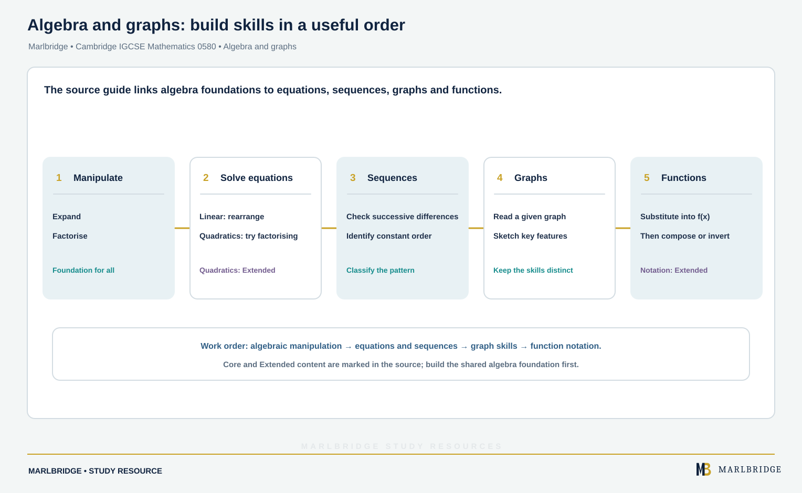

This guide covers **Topic 2 Algebra and graphs**, for Cambridge IGCSE
Mathematics 0580, 2025–2027 series. The Core subtopics (C2.1, C2.2,
C2.4, C2.5, C2.6, C2.7, C2.9, C2.10, C2.11) are examined at all entry
levels; the Extended-only subtopics (E2.2 additions, E2.3, E2.4 additions, E2.5
additions, E2.6 additions, E2.7 additions, E2.8, E2.9 additions, E2.10
additions, E2.11 additions, E2.12, E2.13) are required only for the
Extended tier. Extended candidates are eligible for grades A* to E and Core candidates for grades C to G, so grades A* to B need the Extended tier (the syllabus advises Extended for anyone aiming at grades A* to C).

## Where this fits in 0580

Algebra and graphs is a long topic in 0580, and it is
cumulative — later subtopics lean on earlier ones rather than standing
alone. Solving equations depends on confident algebraic manipulation;
sketching and interpreting graphs of functions depends on being able to
substitute into and rearrange those same functions; sequences depend on
spotting and describing algebraic patterns. A gap in the manipulation
subtopics (C2.2) tends to resurface as lost marks throughout the rest of
the topic, and again later in coordinate geometry and calculus.

## Syllabus coverage

**CAMBRIDGE IGCSE MATHEMATICS 0580 — TOPIC 2 ALGEBRA AND GRAPHS**

**Core**

- C2.1 Introduction to algebra — knowing that letters can represent
generalised numbers; substituting numbers into expressions and
formulae
- C2.2 Algebraic manipulation — simplifying expressions by collecting
like terms; expanding products of algebraic expressions (including
two brackets in one variable); factorising by extracting common
factors
- C2.4 Indices II — understanding and using indices (positive, zero
and negative); understanding and using the rules of indices
- C2.5 Equations — constructing simple expressions, equations and
formulae; solving linear equations in one unknown; solving simultaneous
linear equations in two unknowns; changing the subject of simple
formulae (where the subject appears only once, with no power or root
of the subject)
- C2.6 Inequalities — representing and interpreting inequalities,
including on a number line
- C2.7 Sequences — continuing a given number sequence or pattern;
recognising patterns in sequences, including the term-to-term rule and
relationships between different sequences; finding and using the nth
term of linear, simple quadratic and simple cubic sequences
- C2.9 Graphs in practical situations — using and interpreting graphs
in practical situations, including travel graphs and conversion
graphs; drawing graphs from given data
- C2.10 Graphs of functions — constructing tables of values and
drawing, recognising and interpreting graphs for functions of the form
ax + b, ±x² + ax + b and a/x (a, b integer constants); solving
associated equations graphically, including finding and interpreting
roots
- C2.11 Sketching curves — recognising, sketching and interpreting
graphs of linear and quadratic functions (symmetry and roots are
required; turning points are not)

Note that C2.3, C2.8, C2.12 and C2.13 exist only as Extended-tier
subtopics (E2.3, E2.8, E2.12, E2.13 below) — there is no Core content
at those numbers.

**Extended only (in addition to the Core content above)**

- E2.2 Algebraic manipulation (Extended) — as C2.2, plus factorising
expressions of the form ax + bx + kay + kby, a²x² − b²y², a² + 2ab +
b², ax² + bx + c and ax³ + bx² + cx; completing the square for
ax² + bx + c
- E2.3 Algebraic fractions — manipulating algebraic fractions;
factorising and simplifying rational expressions
- E2.4 Indices II (Extended) — as C2.4, plus fractional indices
- E2.5 Equations (Extended) — as C2.5, plus solving fractional
equations with numerical and linear algebraic denominators; solving
simultaneous equations where one equation is linear and one is
non-linear; solving quadratic equations by factorisation,
completing the square and the quadratic formula; changing the
subject of a formula where the subject appears twice or has a power or
root
- E2.6 Inequalities (Extended) — constructing, solving and
interpreting linear inequalities; representing linear inequalities in
two variables graphically and listing the inequalities that define a
given region
- E2.7 Sequences (Extended) — finding and using the nth term of
sequences including linear, quadratic, cubic and exponential sequences
and simple combinations of these
- E2.8 Proportion — expressing direct and inverse proportion in
algebraic terms and using this form of expression to find unknown
quantities
- E2.9 Graphs in practical situations (Extended) — as C2.9, plus
applying rate of change to simple kinematics (distance–time and
speed–time graphs, acceleration and deceleration) and calculating
distance travelled as the area under a speed–time graph
- E2.10 Graphs of functions (Extended) — constructing tables of values
and drawing, recognising and interpreting graphs for functions of the
form axⁿ (sums of up to three such terms) and abˣ + c; solving
associated equations graphically; drawing and interpreting exponential
growth and decay graphs
- E2.11 Sketching curves (Extended) — recognising, sketching and
interpreting graphs of linear, quadratic, cubic, reciprocal and
exponential functions, with turning points, roots, symmetry and
asymptotes required
- E2.12 Differentiation — estimating gradients of curves by drawing
tangents; using the derivative of functions of the form axⁿ, and
simple sums of up to three of these, to calculate gradients;
determining turning points (maxima and minima) by calculus
- E2.13 Functions — using function notation and understanding domain
and range; finding the inverse function f⁻¹(x); forming the composite
function gf(x) = g(f(x))

## Worked examples

**Solving a quadratic by factorisation (Extended).** Solve x² + 5x + 6 = 0.

```
x^2 + 5x + 6 = 0
(x + 2)(x + 3) = 0
x = -2  or  x = -3
```

**Solving simultaneous linear equations.** Solve 2x + y = 7 and x − y = 2.

```
Adding the two equations eliminates y:
(2x + y) + (x - y) = 7 + 2
3x = 9,  so x = 3

Substituting back: 2(3) + y = 7, so y = 1
```

**Finding the nth term of a linear sequence.** Find the nth term of 5, 8, 11, 14, ...

```
Differences: 3, 3, 3 -- constant, so the sequence is linear: an + b
a = 3 (the common difference)
When n = 1, the term is 5, so 3(1) + b = 5, giving b = 2
nth term = 3n + 2
```

**Solving a double inequality (Extended, E2.6).** Solve −5 < 2x + 3 ⩽ 11,
list the integer solutions and show the solution on a number line.

```
-5 < 2x + 3 <= 11
Subtract 3 from every part:   -8 < 2x <= 8
Divide every part by 2:       -4 < x  <= 4

Integer solutions: -3, -2, -1, 0, 1, 2, 3, 4
Number line: open circle at -4 (strict <), closed circle at 4 (<=),
line joining them.
```

Whatever you do to one part, do to all three. Dividing by a negative
number would reverse the inequality signs; here we divide by +2, so they
stay the same.

**Finding turning points by differentiation (Extended, E2.12).** Find the
turning points of y = x³ − 12x and decide which is a maximum.

```
dy/dx = 3x^2 - 12
At a turning point dy/dx = 0:  3x^2 = 12,  x^2 = 4,  x = 2 or x = -2

x = 2:   y = 8 - 24   = -16   ->  (2, -16)
x = -2:  y = -8 + 24  =  16   ->  (-2, 16)

d2y/dx2 = 6x
At x = 2:   6(2)  = 12 > 0,  so (2, -16) is a minimum
At x = -2:  6(-2) = -12 < 0, so (-2, 16) is a maximum
```

The syllabus accepts any method to tell a maximum from a minimum: the
second derivative (as here), an accurate sketch, or the sign of the
gradient either side of the point.

For more practice, use the
[Algebra and graphs practice questions](/resources/igcse-mathematics-algebra-and-graphs-practice/),
the [Extended algebra practice](/resources/igcse-mathematics-algebra-extended-practice/)
and the [Algebra and graphs revision notes](/resources/igcse-mathematics-algebra-and-graphs-revision-notes/).

<figure class="topic-figure">
  
  <figcaption>The solution of simultaneous equations is where their graphs cross.</figcaption>
</figure>

<figure class="topic-figure">
  
  <figcaption>Open circles exclude an end value, closed circles include it.</figcaption>
</figure>

<figure class="topic-figure">
  
  <figcaption>A constant difference d gives dn plus the value the line has at n = 0.</figcaption>
</figure>

<figure class="topic-figure">
  
  <figcaption>Turning points are where the gradient dy/dx is zero.</figcaption>
</figure>


## How to approach it

<!-- marlbridge-diagram:math-b53-algebra-graphs-learning-pathway -->
<figure class="lesson-diagram" style="margin: 2rem 0;">
  <a href="/public/images/learning/mathematics/math-b53-algebra-graphs-learning-pathway.svg" aria-label="Open full-size diagram: math-b53-algebra-graphs-learning-pathway"></a>
  <figcaption>A source-based pathway: secure manipulation, select equation methods by tier, inspect successive differences for sequences, separate graph reading from sketching, then practise function notation. Core and Extended scope is distinguished as in the source guide. Select the image to enlarge it.</figcaption>
</figure>
<!-- /marlbridge-diagram:math-b53-algebra-graphs-learning-pathway -->


Treat C2.2 (algebraic manipulation) as the foundation to fix before
anything else in this topic — every equation, inequality and sequence
question depends on being able to expand, factorise and simplify
without hesitation. When solving equations, always check which method
is expected: linear equations by rearrangement (Core); solving a
quadratic equation by any method is Extended-only content (E2.5), and
within that, factorisation is usually tried first (fast, and often
what the question wants), reaching for the formula or completing the
square only when factorising clearly won't work cleanly. With
sequences, get into the habit of writing out the differences between
terms before hunting for the nth term — a constant difference means
linear (an + b), a constant *second* difference means quadratic, and a
constant *third* difference means cubic; Core (C2.7) only asks you to
find the nth term for these three types, while Extended (E2.7) adds
exponential sequences and combinations of these. For graphs, keep
"reading a graph" and "sketching a graph" as separate skills: reading
(finding a gradient, an intercept, or a solution from a drawn graph)
uses the axes as given, while sketching (Core C2.11, linear and
quadratic only) needs the general shape and key features — origin,
roots, symmetry — not a precise plot; Extended sketching (E2.11) adds
cubic, reciprocal and exponential shapes and requires turning points
and asymptotes as well. Function notation (Extended, E2.13) trips
students up mostly through notation, not difficulty — practise
translating f(x) = ... into "substitute x" before attempting fg(x) or
f⁻¹(x) composite questions.

<figure class="topic-figure">
  
  <figcaption>A constant second difference means a quadratic nth term.</figcaption>
</figure>

## Frequently asked questions

**What is the difference between Core and Extended in Cambridge IGCSE Maths 0580?**
Core subtopics are examined at all entry levels, while Extended-only subtopics are required only for the Extended tier. Extended candidates are eligible for grades A* to E and Core candidates for grades C to G.

**Is differentiation in the Cambridge IGCSE 0580 syllabus?**
Yes, for Extended candidates only. Subtopic E2.12 covers estimating gradients by drawing tangents, differentiating axⁿ and simple sums of such terms, and finding maxima and minima.

**Which sequences do you need for Cambridge IGCSE 0580?**
Core (C2.7) requires the nth term of linear, simple quadratic and simple cubic sequences. Extended (E2.7) adds exponential sequences and simple combinations of these types.

**Do you need turning points when sketching curves in Core 0580?**
No. Core sketching (C2.11) covers linear and quadratic graphs with symmetry and roots but not turning points. Extended sketching (E2.11) adds cubic, reciprocal and exponential graphs and requires turning points and asymptotes.

## Official syllabus

Cambridge IGCSE Mathematics 0580 syllabus for 2025, 2026 and 2027,
Topic 2 verified against the PDF on 29 August 2026 —
[cambridgeinternational.org](https://www.cambridgeinternational.org/Images/662466-2025-2027-syllabus.pdf).

<figure class="topic-figure">
  
  <figcaption>Do the same to both sides and the equation stays balanced.</figcaption>
</figure>

<figure class="topic-figure">
  
  <figcaption>The region is where all the inequalities are true at once.</figcaption>
</figure>

