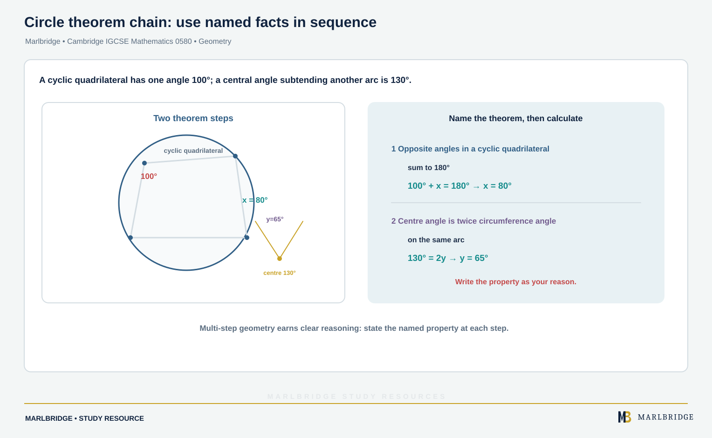

This guide covers **Topic 4 Geometry**, for Cambridge IGCSE
Mathematics 0580, 2025–2027 series. The Core subtopics (C4.1–C4.7)
are examined at all entry levels; the Extended-only subtopics (E4.4,
E4.5, E4.6 and E4.7 additions, plus E4.8, which has no Core
equivalent) are required only for the Extended tier. Extended candidates are eligible for grades A* to E and Core candidates for grades C to G, so grades A* to B need the Extended tier (the syllabus advises Extended for anyone aiming at grades A* to C).

## Where this fits in 0580

Geometry is the fourth of nine topics in 0580 and the largest topic
in terms of named vocabulary and properties to know precisely. It
follows [Coordinate
geometry](/resources/igcse-mathematics-coordinate-geometry/), but the
two topics are otherwise independent — geometry here is about shape
properties, constructions and angle reasoning rather than points on a
grid. This topic also underpins Mensuration (calculating with shapes
whose properties this topic defines) and Trigonometry (which builds
directly on the angle and triangle vocabulary introduced here).

## Syllabus coverage

**CAMBRIDGE IGCSE MATHEMATICS 0580 — TOPIC 4 GEOMETRY**

**Core**

- C4.1 Geometrical terms — using and interpreting terms including
point, vertex, line, parallel, perpendicular, bearing, right angle,
acute/obtuse/reflex angles, interior and exterior angles, similar,
congruent and scale factor; the vocabulary of triangles (equilateral,
isosceles, scalene, right-angled), special quadrilaterals (square,
rectangle, kite, rhombus, parallelogram, trapezium), polygons
(regular/irregular, pentagon, hexagon, octagon, decagon), nets and
simple solids (cube, cuboid, prism, cylinder, pyramid, cone, sphere,
face, surface, edge); and the vocabulary of a circle (centre, radius,
diameter, circumference, semicircle, chord, tangent, arc, sector,
segment). Candidates are not expected to show that two shapes are
congruent.
- C4.2 Geometrical constructions — measuring and drawing lines and
angles; constructing a triangle given the lengths of all sides using
a ruler and pair of compasses only (construction arcs must be shown;
perpendicular and angle bisector constructions are not required);
drawing, using and interpreting nets, including using measurements
from nets to calculate volumes and surface areas
- C4.3 Scale drawings — drawing and interpreting scale drawings;
using and interpreting three-figure bearings, measured clockwise from
north (000° to 360°)
- C4.4 Similarity — calculating lengths of similar shapes
- C4.5 Symmetry — recognising line symmetry and order of rotational
symmetry in two dimensions, including properties of triangles,
quadrilaterals and polygons directly related to their symmetries
- C4.6 Angles — calculating unknown angles and giving simple
explanations using: angles at a point sum to 360°; angles at a point
on a straight line sum to 180°; vertically opposite angles are equal;
angle sum of a triangle is 180° and of a quadrilateral is 360°; and
angles formed within parallel lines (corresponding angles equal,
alternate angles equal, co-interior angles sum to 180°); knowing and
using angle properties of regular polygons. Three-letter angle
notation (for example, angle ABC) is required, and candidates must
use correct geometrical terminology when giving reasons.
- C4.7 Circle theorems — calculating unknown angles and giving
explanations using: the angle in a semicircle is 90°, and the angle
between a tangent and a radius is 90°

Note that C4.8 exists only as an Extended-tier subtopic (E4.8 below)
— there is no Core content at that number.

**Extended only (in addition to the Core content above)**

- E4.4 Similarity (Extended) — as C4.4, plus using the relationships
between lengths and areas of similar shapes, and between lengths,
surface areas and volumes of similar solids; solving problems and
giving simple explanations involving similarity, including showing
that two triangles are similar using geometric reasons
- E4.5 Symmetry (Extended) — as C4.5, plus recognising symmetry
properties of prisms, cylinders, pyramids and cones, including
identifying planes and axes of symmetry
- E4.6 Angles (Extended) — as C4.6, plus knowing and using angle
properties of both regular and irregular polygons
- E4.7 Circle theorems I (Extended) — as C4.7, plus: the angle at the
centre is twice the angle at the circumference; angles in the same
segment are equal; opposite angles of a cyclic quadrilateral sum to
180°; and the alternate segment theorem
- E4.8 Circle theorems II — using the symmetry properties of circles:
equal chords are equidistant from the centre; the perpendicular
bisector of a chord passes through the centre; and tangents from an
external point are equal in length

## How to approach it

<!-- marlbridge-diagram:math-b55-circle-theorem-chain -->
<figure class="lesson-diagram" style="margin: 2rem 0;">
  <a href="/public/images/learning/mathematics/math-b55-circle-theorem-chain.svg" aria-label="Open full-size diagram: math-b55-circle-theorem-chain"></a>
  <figcaption>The diagram follows the source’s circle-theorem example: opposite angles of a cyclic quadrilateral give x=80° from 100°+x=180°; the same-arc centre/circumference theorem gives y=65° from 130°=2y. Select the image to enlarge it.</figcaption>
</figure>
<!-- /marlbridge-diagram:math-b55-circle-theorem-chain -->


Because C4.1's vocabulary underpins every later subtopic, treat it as
a fixed reference list to know precisely rather than something to
absorb passively — a question that asks you to name a shape or angle
type using the wrong term (calling a reflex angle "obtuse", for
example) loses marks even when the underlying geometric reasoning is
correct. For angle problems, always state the geometric property by
name when giving a reason ("angle sum of a triangle is 180°," not
just "because it equals that"), since the syllabus explicitly expects
correct geometrical terminology in explanations, not just a correct
numerical answer. Learn the angle properties in C4.6 and the circle
theorems in C4.7/E4.7/E4.8 as a growing, connected list rather than
isolated facts — many multi-step angle questions chain two or three
properties together (for example, using parallel-line angles to find
one angle, then a triangle's angle sum to find another). For
similarity at Extended tier, keep the length/area/volume scale-factor
relationship precise: if the length scale factor is k, area scales by
k² and volume scales by k³ — a very common source of error is
applying the same scale factor to all three without adjusting the
power.

<figure class="topic-figure">
  
  <figcaption>Length scale factor k multiplies area by k² and volume by k³ (shown for k = 2).</figcaption>
</figure>


## Worked example: circle theorem chain (Extended)

A cyclic quadrilateral has one angle of 100°. A chord divides the
circle so that an inscribed angle in one segment needs to be found,
given the angle at the centre subtending the same arc is 130°.

```
Opposite angles of a cyclic quadrilateral sum to 180°:
  100 + x = 180  ->  x = 80

Angle at the centre is twice the angle at the circumference
(same arc):
  130 = 2y  ->  y = 65
```

Questions like this test whether more than one named circle theorem
can be applied correctly within the same problem, which is why
learning the full list as a connected set — rather than one theorem
at a time in isolation — pays off directly in multi-part questions.

<figure class="topic-figure">
  
  <figcaption>The angle at the centre is twice the angle at the circumference, and angles in the same segment are equal.</figcaption>
</figure>

<figure class="topic-figure">
  
  <figcaption>Opposite angles of a cyclic quadrilateral add to 180°.</figcaption>
</figure>


## Common mistakes

Using an imprecise or incorrect geometrical term when naming a shape,
angle type or circle feature. Giving a numerically correct angle
without stating the geometric property used to find it, when the
question asks for a reason. Confusing which angle pairs are equal and
which are supplementary within parallel lines (corresponding and
alternate angles are equal; co-interior angles sum to 180°).
Applying a similarity scale factor directly to area or volume without
squaring or cubing it first. Omitting construction arcs when
constructing a triangle from given side lengths, which the syllabus
requires to be shown.

## Quick revision checklist

- Know the full geometrical vocabulary list (C4.1) precisely, not
  approximately.
- Practise constructing a triangle from three given side lengths
  using compasses only, showing all arcs.
- Be confident naming and applying every listed circle theorem for
  your tier, not just recognising the diagram.
- Practise the length/area/volume scale-factor relationships for
  similar shapes at Extended tier (k, k², k³).
- Always state the specific geometric property by name when giving a
  reason for an angle calculation.

## Frequently asked questions

**Which constructions are required for Cambridge IGCSE 0580?**
Core subtopic C4.2 requires constructing a triangle from the lengths of its three sides using a ruler and compasses only, with arcs shown. Perpendicular bisector and angle bisector constructions are not required.

**How are bearings measured in IGCSE Maths?**
Bearings are three-figure angles measured clockwise from north, from 000° to 360°.

**Do you need to give reasons for angle answers in 0580?**
Yes. The syllabus expects correct geometrical terminology when giving reasons, so state the property used, such as "angles in a triangle sum to 180°".

**What are corresponding, alternate and co-interior angles?**
When a line crosses parallel lines, corresponding angles are equal, alternate angles are equal and co-interior angles sum to 180°.

**Which circle theorems are in Extended subtopic E4.8?**
E4.8 covers the symmetry properties of circles: equal chords are equidistant from the centre, the perpendicular bisector of a chord passes through the centre, and tangents from an external point are equal in length.

## Official syllabus

Cambridge International, *Cambridge IGCSE Mathematics (0580) syllabus
for examination in 2025, 2026 and 2027*: [official syllabus
PDF](https://www.cambridgeinternational.org/Images/662466-2025-2027-syllabus.pdf),
Subject content, section 4 "Geometry". Verified 2026-09-06.

<figure class="topic-figure">
  
  <figcaption>Corresponding and alternate angles are equal; co-interior angles add to 180°.</figcaption>
</figure>

<figure class="topic-figure">
  
  <figcaption>Exterior angles add to 360°, so a regular hexagon has interior angles of 120°.</figcaption>
</figure>

<figure class="topic-figure">
  
  <figcaption>The angle in a semicircle and the angle between tangent and radius are both 90°.</figcaption>
</figure>

