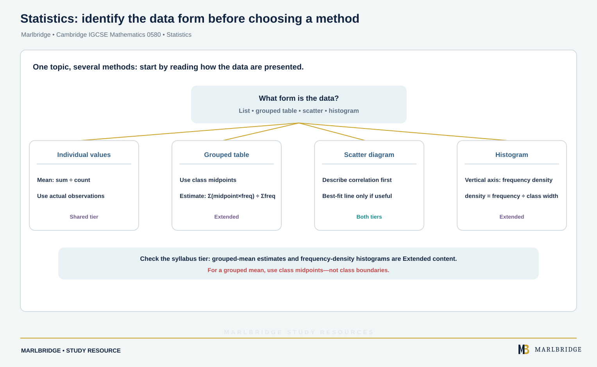

This guide covers **Topic 9 Statistics**, the final topic for
Cambridge IGCSE Mathematics 0580, 2025–2027 series. The Core
subtopics (C9.1–C9.5) are examined at all entry levels; the
Extended-only subtopics (E9.3 additions, plus E9.6 and E9.7, which
have no Core equivalent) are required only for the Extended tier. Extended candidates are eligible for grades A* to E and Core candidates for grades C to G, so grades A* to B need the Extended tier (the syllabus advises Extended for anyone aiming at grades A* to C).

## Where this fits in 0580

Statistics is the ninth and final topic in 0580, and it draws on
arithmetic and graph-reading skills built up across the rest of the
syllabus — calculating an average uses the same careful arithmetic as
Topic 1 Number, and reading a statistical chart uses the same
coordinate and scale-reading skills as Topic 3 Coordinate geometry.
Because Statistics sits last, it is sometimes under-revised relative
to earlier topics simply due to running out of time. The syllabus gives
weightings for its assessment objectives and papers, not for individual
topics, so plan revision time for Statistics on the same footing as the
topics that come before it.

## Syllabus coverage

**CAMBRIDGE IGCSE MATHEMATICS 0580 — TOPIC 9 STATISTICS**

- C9.1 Classifying statistical data — classifying and tabulating
statistical data, for example tally tables and two-way tables
- C9.2 Interpreting statistical data — reading, interpreting and
drawing inferences from tables and statistical diagrams; comparing
sets of data using tables, graphs and statistical measures;
appreciating restrictions on drawing conclusions from given data
- C9.3 Averages and range — calculating the mean, median, mode and
range for individual data (in a list or frequency table, but not
grouped) and distinguishing between the purposes for which these are
used
- C9.4 Statistical charts and diagrams — drawing and interpreting bar
charts (including composite/stacked and dual/side-by-side), pie
charts, pictograms, stem-and-leaf diagrams (ordered, with a key), and
simple frequency distributions
- C9.5 Scatter diagrams — drawing and interpreting scatter diagrams;
understanding positive, negative and zero correlation; drawing by eye,
interpreting and using a straight line of best fit

Note that C9.6 and C9.7 exist only as Extended-tier subtopics (E9.6
and E9.7 below) — there is no Core content at those numbers.

**Extended only (in addition to the Core content above)**

- E9.3 Averages and measures of spread (Extended) — as C9.3, plus
quartiles and interquartile range; calculating an estimate of the mean
for grouped discrete or grouped continuous data; identifying the modal
class from a grouped frequency distribution
- E9.6 Cumulative frequency diagrams — drawing and interpreting
cumulative frequency tables and diagrams; estimating and interpreting
the median, percentiles, quartiles and interquartile range from
cumulative frequency diagrams
- E9.7 Histograms — drawing and interpreting histograms; calculating
with frequency density, defined as frequency density = frequency ÷
class width, with the vertical axis labelled "Frequency density"

<figure class="topic-figure">
  
  <figcaption>For a frequency table, multiply each value by its frequency, add, then divide by the total frequency.</figcaption>
</figure>


## How to approach it

<!-- marlbridge-diagram:math-b57-statistics-method-selection -->
<figure class="lesson-diagram" style="margin: 2rem 0;">
  <a href="/public/images/learning/mathematics/math-b57-statistics-method-selection.svg" aria-label="Open full-size diagram: math-b57-statistics-method-selection"></a>
  <figcaption>A source-based decision map distinguishes individual values, grouped frequency tables, scatter diagrams and histograms. It highlights midpoint-weighted estimated means and frequency density for unequal-width classes as Extended material, and recommends judging correlation before fitting a line. Select the image to enlarge it.</figcaption>
</figure>
<!-- /marlbridge-diagram:math-b57-statistics-method-selection -->


The single most consequential Core/Extended distinction in this topic
is that Extended students must handle grouped data (estimating the
mean from a grouped frequency table, identifying a modal class) in
addition to the individual-data calculations both tiers share — always
check whether a dataset is given as a list of individual values or as
a grouped frequency table before choosing a method, since the grouped
method for estimating the mean uses the midpoint of each class
multiplied by its frequency, not the class boundaries directly. For
scatter diagrams, practise judging correlation type by eye (positive,
negative, zero) before attempting to draw a line of best fit, since
a zero-correlation scatter should not have a line of best fit forced
onto it. For Extended histograms, remember that the vertical axis
plots frequency density, not frequency directly — this is essential
whenever class widths are unequal, since frequency alone would
visually exaggerate wider classes.

<figure class="topic-figure">
  
  <figcaption>Judge the correlation by eye before drawing any line.</figcaption>
</figure>


## Worked example: estimating the mean of grouped data (Extended)

A survey of 40 students' heights (cm) is grouped as: 150–<160 (8
students), 160–<170 (15 students), 170–<180 (12 students), 180–<190 (5
students). Estimate the mean height.

```
Midpoints:        155, 165, 175, 185

Midpoint x freq:  155 x 8  = 1240
                  165 x 15 = 2475
                  175 x 12 = 2100
                  185 x 5  = 925

Sum of (midpoint x freq) = 1240 + 2475 + 2100 + 925 = 6740

Estimate of mean = 6740 / 40 = 168.5 cm
```

This is only an estimate because the exact individual values within
each class are unknown — the midpoint stands in for every value in
that class, which is why the syllabus specifically calls this an
"estimate of the mean" rather than the mean itself.

<figure class="topic-figure">
  
  <figcaption>The mean, median, mode and range of one small list of data.</figcaption>
</figure>

<figure class="topic-figure">
  
  <figcaption>Use the midpoint of each class, not a boundary, so the mean is only an estimate.</figcaption>
</figure>

<figure class="topic-figure">
  
  <figcaption>A line of best fit passes through the mean point and is used to predict inside the range of the data.</figcaption>
</figure>


## Common mistakes

Using a class boundary instead of the midpoint when estimating the
mean of grouped data. Forcing a line of best fit onto a scatter
diagram that shows no meaningful correlation. Confusing frequency with
frequency density when reading or drawing a histogram with unequal
class widths, leading to an incorrectly shaped or misread diagram.
Calculating the median from an un-ordered stem-and-leaf diagram
without first ordering the data within each stem. Reporting the mode
of grouped data as a single value rather than correctly identifying
only the modal class (Extended).

## Quick revision checklist

- Practise distinguishing individual data (list or ungrouped
  frequency table) from grouped data, and use the correct method for
  each.
- Know the three averages (mean, median and mode) and the measures of
  spread (range, plus quartiles and interquartile range at Extended),
  and when each is most appropriate to use.
- Practise reading correlation type from a scatter diagram before
  drawing a line of best fit.
- For Extended, practise the frequency density calculation for
  histograms with unequal class widths.
- For Extended, practise reading percentiles, quartiles and the
  interquartile range directly from a cumulative frequency diagram.

<figure class="topic-figure">
  
  <figcaption>With unequal class widths the bar height is frequency density, and the bar area equals the frequency.</figcaption>
</figure>

<figure class="topic-figure">
  
  <figcaption>Order the leaves in each row before counting to the median.</figcaption>
</figure>

## Frequently asked questions

**Are histograms in the Core syllabus for Cambridge IGCSE 0580?**
No. Histograms with frequency density (E9.7) and cumulative frequency diagrams (E9.6) are Extended-only subtopics.

**Do Core candidates calculate averages from grouped data?**
No. Core (C9.3) covers the mean, median, mode and range for individual data in a list or frequency table. Estimating the mean of grouped data and finding the modal class are Extended content (E9.3).

**Which charts do you need for Core 0580 statistics?**
Core subtopic C9.4 covers bar charts, including composite and dual bar charts, pie charts, pictograms, ordered stem-and-leaf diagrams with a key, and simple frequency distributions.

**What types of correlation are there on a scatter diagram?**
Positive correlation means one variable tends to increase as the other increases, negative correlation means one tends to decrease as the other increases, and zero correlation means there is no clear pattern.

## Official syllabus

Cambridge International, *Cambridge IGCSE Mathematics (0580) syllabus
for examination in 2025, 2026 and 2027*: [official syllabus
PDF](https://www.cambridgeinternational.org/Images/662466-2025-2027-syllabus.pdf),
Subject content, section 9 "Statistics". Verified 2026-09-06.
