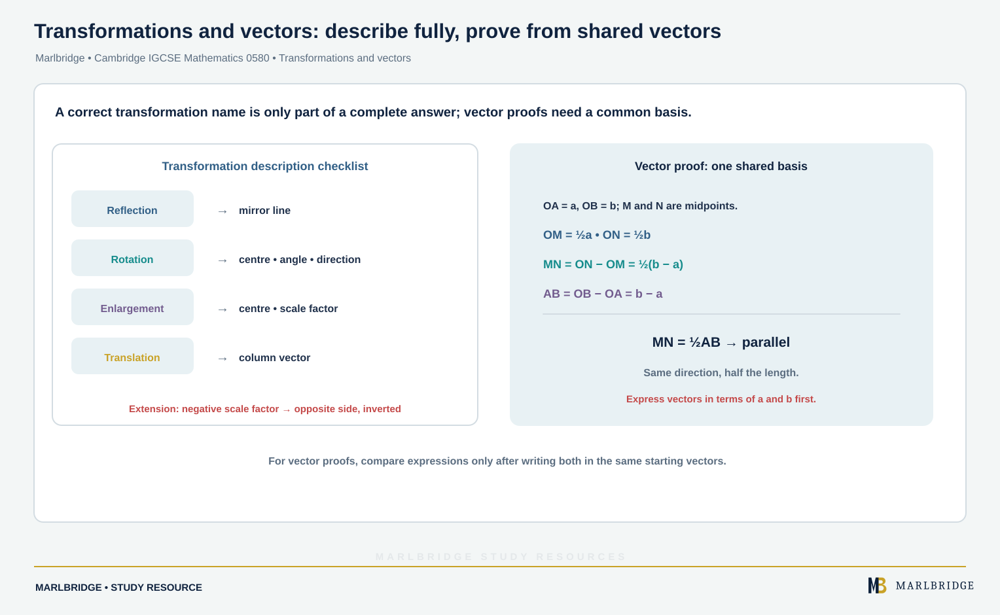

This guide covers **Topic 7 Transformations and Vectors**, for
Cambridge IGCSE Mathematics 0580, 2025–2027 series. The Core
subtopic (C7.1) is examined at all entry levels; the Extended-only
subtopics (E7.1 additions, plus E7.2, E7.3 and E7.4, none of which
have a Core equivalent) are required only for the Extended tier. Extended candidates are eligible for grades A* to E and Core candidates for grades C to G, so grades A* to B need the Extended tier (the syllabus advises Extended for anyone aiming at grades A* to C).

## Where this fits in 0580

Transformations and vectors is the seventh of nine topics in 0580,
and it draws directly on Coordinate geometry (Topic 3) for plotting
and reading coordinates, and on Geometry (Topic 4) for the language
of angles, symmetry and similarity used to describe enlargements.
Vector work at Extended tier (E7.2–E7.4) also feeds forward into
vector geometry proof-style questions, which are among the more
demanding Extended exam questions because they combine algebraic
manipulation of vectors with geometric reasoning about parallel and
collinear points.

## Syllabus coverage

**CAMBRIDGE IGCSE MATHEMATICS 0580 — TOPIC 7 TRANSFORMATIONS AND
VECTORS**

- C7.1 Transformations — recognise, describe and draw reflection of a
shape in a vertical or horizontal line; rotation of a shape about the
origin, vertices or midpoints of edges, through multiples of 90°;
enlargement of a shape from a centre by a scale factor (positive and
fractional scale factors only); translation of a shape by a vector
written as a column vector; questions will not involve combinations
of transformations, and a ruler must be used for all straight edges

Note that C7.2, C7.3 and C7.4 exist only as Extended-tier subtopics
(E7.2–E7.4 below) — there is no Core content at those numbers.

**Extended only (in addition to the Core content above)**

- E7.1 Transformations (Extended) — as C7.1, but reflection may be in
any straight line (not just vertical or horizontal), rotation may be
about any centre through multiples of 90°, and scale factors for
enlargement may be positive, fractional or negative; questions may
involve combinations of transformations
- E7.2 Vectors in two dimensions — describing a translation using a
vector written as a column vector, as AB, or as a (vectors are
printed as AB or a); adding and subtracting vectors; multiplying a
vector by a scalar
- E7.3 Magnitude of a vector — calculating the magnitude of a column
vector using Pythagoras' theorem on its components; magnitudes are
denoted by modulus signs, e.g. |a| is the magnitude of a, and |AB| is
the magnitude of AB
- E7.4 Vector geometry — representing vectors by directed line
segments; using position vectors; using the sum and difference of two
or more vectors to express given vectors in terms of two coplanar
vectors; using vectors to reason and solve geometric problems,
including showing that vectors are parallel, showing that three
points are collinear, and solving vector problems involving ratio and
similarity

## How to approach it

<!-- marlbridge-diagram:math-b57-transform-vector-proof-route -->
<figure class="lesson-diagram" style="margin: 2rem 0;">
  <a href="/public/images/learning/mathematics/math-b57-transform-vector-proof-route.svg" aria-label="Open full-size diagram: math-b57-transform-vector-proof-route"></a>
  <figcaption>The checklist lists the information required for reflection, rotation, enlargement and translation. Its vector proof example uses OA=a and OB=b to show MN=½(b−a)=½AB, so MN is parallel to AB and half its length; it also flags negative enlargement scale factors. Select the image to enlarge it.</figcaption>
</figure>
<!-- /marlbridge-diagram:math-b57-transform-vector-proof-route -->


For any transformation question, describe fully means naming the
transformation type and giving every required piece of information:
a reflection needs the equation of the mirror line, a rotation needs
the centre, angle and direction, an enlargement needs the centre and
scale factor, and a translation needs the column vector. Mark schemes
give the name of the transformation a mark of its own and each required
detail a further mark, so a correctly named transformation with a
detail missing earns only part of the marks. At Extended tier, always check the sign and
size of an enlargement's scale factor before drawing: a negative
scale factor produces an image on the opposite side of the centre
that is also upside down, which students who only practise positive
scale factors frequently miss. For vector geometry proofs, the
recurring technique is to express every vector in the diagram in
terms of the same two starting vectors (often labelled a and b), since
showing two expressions are scalar multiples of each other is exactly
how you prove two lines are parallel, and showing a point lies on a
line already shown to pass through two other points is how you prove
collinearity.

<figure class="topic-figure">
  
  <figcaption>A negative scale factor puts the image on the opposite side of the centre, inverted.</figcaption>
</figure>


## Worked example: vector geometry — proving two lines are parallel (Extended)

Triangle OAB has OA = a and OB = b. M is the midpoint of OA and N is
the midpoint of OB. Show that MN is parallel to AB.

```
OM = (1/2)a                 (M is the midpoint of OA)
ON = (1/2)b                 (N is the midpoint of OB)

MN = ON - OM = (1/2)b - (1/2)a = (1/2)(b - a)

AB = OB - OA = b - a

So MN = (1/2) x AB
```

Since MN is a scalar multiple of AB, the two vectors are parallel;
because they also share the common point structure of the triangle
(M and N are distinct from A and B), this confirms MN is parallel to
AB and exactly half its length. The instructive point of this example
is procedural, not just the result: express every vector in the
diagram in terms of the same two base vectors (a and b here) before
attempting any comparison, since parallelism and collinearity can
only be checked once two vectors are written in a common form — here,
spotting that MN reduces to a scalar multiple of AB is what completes
the proof.

<figure class="topic-figure">
  
  <figcaption>Writing every vector in terms of a and b shows MN = half of AB, so the lines are parallel.</figcaption>
</figure>


## Common mistakes

Describing a transformation without every required detail, such as
naming "rotation" without stating the centre, angle and direction.
Forgetting that a negative scale factor in an Extended enlargement
places the image on the opposite side of the centre and inverts it.
Attempting combinations of transformations at Core tier, where the
syllabus explicitly restricts questions to a single transformation.
Adding or subtracting column vectors component-by-component
incorrectly, particularly when a negative sign is involved. In vector
geometry proofs, comparing two vectors for being parallel or
collinear without first expressing both in terms of the same pair of
base vectors.

## Quick revision checklist

- Practise describing each of the four transformations with every
  required detail (mirror line, centre/angle/direction, centre/scale
  factor, or column vector).
- Know that Extended enlargements can use negative and fractional
  scale factors, and combinations of transformations may be tested.
- Practise adding, subtracting and scalar-multiplying column vectors
  (Extended).
- Know how to find the magnitude of a vector using Pythagoras'
  theorem on its components (Extended).
- Practise expressing vectors in a diagram in terms of two given base
  vectors, then using that form to show parallelism or collinearity
  (Extended).

## Frequently asked questions

**Do Core candidates get combined transformations in 0580?**
No. Core questions (C7.1) do not involve combinations of transformations, while Extended questions (E7.1) may.

**Can an enlargement have a negative scale factor?**
Yes, at Extended tier. A negative scale factor places the image on the opposite side of the centre and turns it upside down. Core enlargements use positive and fractional scale factors only.

**Are vectors in the Core syllabus for Cambridge IGCSE 0580?**
Column vectors are used to describe translations at Core, but vectors in two dimensions, magnitude and vector geometry (E7.2 to E7.4) are Extended only.

**How are marks given for describing a transformation?**
The name of the transformation earns a mark of its own and each required detail earns a further mark, so a correctly named transformation with a missing detail earns only part of the marks.

## Official syllabus

Cambridge International, *Cambridge IGCSE Mathematics (0580) syllabus
for examination in 2025, 2026 and 2027*: [official syllabus
PDF](https://www.cambridgeinternational.org/Images/662466-2025-2027-syllabus.pdf),
Subject content, section 7 "Transformations and vectors". Verified
2026-09-06.

<figure class="topic-figure">
  
  <figcaption>A reflection puts each image point the same distance behind the mirror line, and is described by its mirror line.</figcaption>
</figure>

<figure class="topic-figure">
  
  <figcaption>A rotation is described by its centre, angle and direction.</figcaption>
</figure>

<figure class="topic-figure">
  
  <figcaption>A translation slides every point by the same column vector without turning or resizing the shape.</figcaption>
</figure>

<figure class="topic-figure">
  
  <figcaption>An enlargement multiplies every distance from the centre, and every side, by the scale factor.</figcaption>
</figure>

<figure class="topic-figure">
  
  <figcaption>A scale factor between 0 and 1 makes the image smaller.</figcaption>
</figure>

