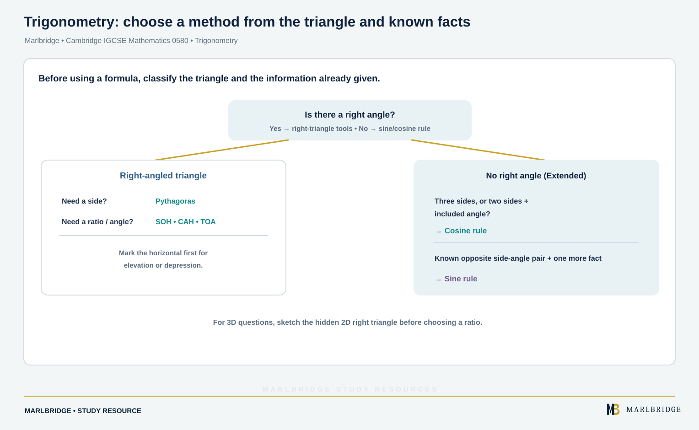

This guide covers **Topic 6 Trigonometry**, for Cambridge IGCSE
Mathematics 0580, 2025–2027 series. The Core subtopics (C6.1–C6.2)
are examined at all entry levels; the Extended-only subtopics
(E6.2 additions, plus E6.3, E6.4, E6.5 and E6.6, none of which have
a Core equivalent) are required only for the Extended tier. Extended candidates are eligible for grades A* to E and Core candidates for grades C to G, so grades A* to B need the Extended tier (the syllabus advises Extended for anyone aiming at grades A* to C).

## Where this fits in 0580

Trigonometry is the sixth of nine topics in 0580, and it builds
directly on two earlier topics: Number's work with ratio and
decimals, and Geometry's angle facts and constructions. Coordinate
geometry's gradient work (Topic 3) also resurfaces here, since a
right-angled triangle drawn between two coordinates is the usual
route to finding a line's length. Bearings link it to Geometry:
three-figure bearings are taught in C4.3/E4.3 Scale drawings, and the
notes to C6.2/E6.2 say that knowledge of bearings may be required when
solving two-dimensional problems with Pythagoras' theorem and
trigonometry. At Extended tier, E6.6 extends these methods to three
dimensions, including the angle between a line and a plane, so
familiarity with 3D solids from Mensuration helps.

## Syllabus coverage

**CAMBRIDGE IGCSE MATHEMATICS 0580 — TOPIC 6 TRIGONOMETRY**

- C6.1 Pythagoras' theorem — know and use Pythagoras' theorem
- C6.2 Right-angled triangles — know and use the sine, cosine and
tangent ratios for acute angles in calculations involving sides and
angles of a right-angled triangle; solve problems in two dimensions
using Pythagoras' theorem and trigonometry; angles are given in
degrees, with answers written in degrees to one decimal place;
knowledge of bearings may be required

Note that C6.3, C6.4, C6.5 and C6.6 exist only as Extended-tier
subtopics (E6.3–E6.6 below) — there is no Core content at those
numbers.

**Extended only (in addition to the Core content above)**

- E6.2 Right-angled triangles (Extended) — as C6.2, plus knowing that
the perpendicular distance from a point to a line is the shortest
distance to the line, and carrying out calculations involving angles
of elevation and depression
- E6.3 Exact trigonometric values — knowing the exact values of sin x
and cos x for x = 0°, 30°, 45°, 60° and 90°, and of tan x for x = 0°,
30°, 45° and 60°
- E6.4 Trigonometric functions — recognising, sketching and
interpreting the graphs of y = sin x, y = cos x and y = tan x for
0° ⩽ x ⩽ 360°; solving trigonometric equations involving sin x, cos x
or tan x for 0° ⩽ x ⩽ 360°
- E6.5 Non-right-angled triangles — using the sine and cosine rules in
calculations involving lengths and angles for any triangle, and using
the formula area of triangle = ½ ab sin C; includes problems involving
obtuse angles and the ambiguous case; the sine rule, cosine rule and
area formula are given in the List of formulas provided in the exam
- E6.6 Pythagoras' theorem and trigonometry in 3D — carrying out
calculations and solving problems in three dimensions using
Pythagoras' theorem and trigonometry, including calculating the angle
between a line and a plane

## How to approach it

<!-- marlbridge-diagram:math-b57-trigonometry-method-selector -->
<figure class="lesson-diagram" style="margin: 2rem 0;">
  <a href="/public/images/learning/mathematics/math-b57-trigonometry-method-selector.svg" aria-label="Open full-size diagram: math-b57-trigonometry-method-selector"></a>
  <figcaption>The method selector follows the source: right triangles use Pythagoras or SOH CAH TOA; non-right triangles use the cosine rule with three sides or two sides and included angle, and the sine rule with an opposite side-angle pair. Elevation/depression references the horizontal; 3D questions start with a hidden 2D triangle. Select the image to enlarge it.</figcaption>
</figure>
<!-- /marlbridge-diagram:math-b57-trigonometry-method-selector -->


Before reaching for a formula, identify what kind of triangle the
question gives you: a right angle means Pythagoras or SOH CAH TOA is
enough (Core and Extended alike), while a triangle with no right
angle signals that only the Extended sine or cosine rule will work.
Choosing between the sine and cosine rules comes down to what you
already know: use the cosine rule when you have three sides, or two
sides and the included angle; use the sine rule when you have a side
and its opposite angle, plus one more piece of information. Elevation
and depression problems (Extended, E6.2) are just right-angled triangle trigonometry
with the angle measured from a horizontal line, so redraw them with
the horizontal marked before choosing a ratio. For 3D problems,
always start by sketching the single 2D right-angled triangle hidden
inside the solid — usually formed by a diagonal, a height, and a
base length — since the calculation itself is then identical to a 2D
question.

<figure class="topic-figure">
  
  <figcaption>Elevation and depression are both measured from the horizontal and are equal for the same line of sight.</figcaption>
</figure>

<figure class="topic-figure">
  
  <figcaption>Pair each side with the angle opposite it.</figcaption>
</figure>


## Worked example: cosine rule with an obtuse angle (Extended)

Triangle ABC has AB = 7 cm, AC = 10 cm and angle BAC = 110°. Find BC.

```
BC^2 = AB^2 + AC^2 - 2 x AB x AC x cos(BAC)
BC^2 = 7^2 + 10^2 - 2 x 7 x 10 x cos(110 degrees)
BC^2 = 49 + 100 - 140 x (-0.342)
BC^2 = 149 + 47.9
BC^2 = 196.9
BC = 14.0 cm (3 s.f.)
```

Because the given angle (110°) is obtuse, cos(110°) is negative, so
subtracting a negative term actually increases the result — a detail
worth checking mentally before accepting an answer, since it is easy
to lose the sign when substituting into a calculator.

<figure class="topic-figure">
  
  <figcaption>With an obtuse angle the cosine term adds, so BC is longer than the right-angle case.</figcaption>
</figure>


## Common mistakes

Using SOH CAH TOA or Pythagoras on a triangle that has no right
angle, when the sine or cosine rule is required instead. Forgetting
that a calculator must be in degree mode, producing wildly incorrect
values for sine, cosine or tangent. Mixing up which pair of sides and
angle the sine rule needs (a side and its opposite angle) with what
the cosine rule needs (three sides, or two sides and the included
angle). In 3D problems, attempting to calculate an angle using a
2D face of the solid rather than isolating the actual right-angled
triangle formed by the diagonal in question. Losing track of the
negative sign that appears when using the cosine rule with an obtuse
angle.

## Quick revision checklist

- Know SOH CAH TOA and Pythagoras' theorem for right-angled triangles
  (Core and Extended).
- Know the exact trigonometric values for 0°, 30°, 45°, 60° and 90°
  (Extended).
- Practise sketching and reading y = sin x, y = cos x and y = tan x
  over 0°–360°, and solving trig equations from them (Extended).
- Know when to use the sine rule versus the cosine rule, and be
  comfortable with the ambiguous case and obtuse angles (Extended).
- Practise isolating the single right-angled triangle inside a 3D
  solid before calculating (Extended).

## Official syllabus

Cambridge International, *Cambridge IGCSE Mathematics (0580) syllabus
for examination in 2025, 2026 and 2027*: [official syllabus
PDF](https://www.cambridgeinternational.org/Images/662466-2025-2027-syllabus.pdf),
Subject content, section 6 "Trigonometry". Verified 2026-09-06.

<figure class="topic-figure">
  
  <figcaption>Name the sides from the angle, then pick sin, cos or tan.</figcaption>
</figure>

<figure class="topic-figure">
  
  <figcaption>Two different triangles can fit the same sine rule data.</figcaption>
</figure>

<figure class="topic-figure">
  
  <figcaption>The area formula comes from base times height with h = a sin C.</figcaption>
</figure>

<figure class="topic-figure">
  
  <figcaption>Pull the right-angled triangle out of the solid, then use ordinary trigonometry.</figcaption>
</figure>

