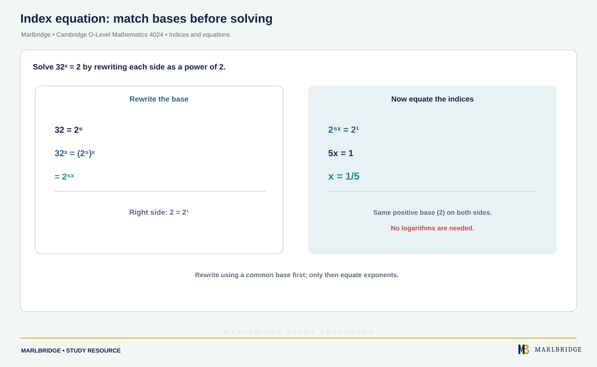

This guide covers subtopics **2.4 Indices II** and **2.5 Equations**, from
Topic 2, Algebra and graphs, for Cambridge O Level Mathematics (Syllabus D)
4024, 2025–2027 series.

## Where this fits in 4024

Indices and equation-solving are the working tools the rest of Topic 2
depends on: exponential equations use index rules directly, and every later
subtopic — inequalities, sequences, graphs — assumes fluent equation
manipulation. This page follows on from
[Algebraic Manipulation](/resources/algebraic-manipulation/), which covers
2.1–2.3.

## Syllabus coverage

**CAMBRIDGE O LEVEL MATHEMATICS (SYLLABUS D) 4024**

- Understand and use indices — positive, zero, negative and fractional
(2.4)
- Understand and use the rules of indices, including solving equations
such as 32^x = 2 or 5^(x+1) = 25^x, and simplifying expressions with
fractional and negative indices (2.4)
- Construct expressions, equations and formulas (2.5)
- Solve linear equations in one unknown (2.5)
- Solve fractional equations with numerical and linear algebraic
denominators (2.5)
- Solve simultaneous linear equations in two unknowns, including
constructing the simultaneous equations from a worded problem (2.5)
- Solve quadratic equations by factorisation, completing the square, and
using the quadratic formula — solutions may be required in surd form (2.5)
- Change the subject of formulas, including where the subject appears
twice or as a power or root (2.5)

4024 is **not tiered** — every candidate covers all of the above.
Knowledge of logarithms is **not required** for 2.4. The quadratic formula
is provided in the exam's List of Formulas.

## Indices

The rules of indices apply to positive, zero, negative and fractional
powers alike:

```
a^m × a^n = a^(m+n)        a^m ÷ a^n = a^(m−n)        (a^m)^n = a^(mn)
a^0 = 1        a^(−n) = 1/a^n        a^(1/n) = ⁿ√a
```

**Worked example.** Simplify (x³ × x⁻¹) ÷ x^(1/2).

```
x³ × x⁻¹ = x²
x² ÷ x^(1/2) = x^(2 − 1/2) = x^(3/2)
```

**Worked example.** Solve 32^x = 2.

Rewrite both sides so they share the same base. Since 32 = 2⁵:

```
32^x = 2
(2⁵)^x = 2¹
2^(5x) = 2¹
so 5x = 1
x = 1/5
```

**Worked example.** Solve 5^(x+1) = 25^x.

Rewrite 25 as 5² first, so both sides share base 5:

```
5^(x+1) = (5²)^x = 5^(2x)
so x + 1 = 2x
x = 1
```

Matching the *bases* first, then equating the *indices*, is the standard
technique for this style of question — logarithms are not required or
expected.

<figure class="topic-figure">
  
  <figcaption>Dividing by 2 each step explains zero and negative indices, and equal factors explain a fractional index.</figcaption>
</figure>

<figure class="topic-figure">
  
  <figcaption>Rewrite both sides with the same base, then equate the indices.</figcaption>
</figure>


## Solving equations

**Linear equations** in one unknown are solved by collecting terms:

```
5 − 2x = 3(x + 7)
5 − 2x = 3x + 21
5 − 21 = 3x + 2x
−16 = 5x
x = −3.2
```

**Fractional equations** with numerical or linear algebraic denominators
are solved by multiplying through to clear the fractions, then solving the
resulting linear or quadratic equation.

**Worked example.** Solve x / (x + 2) = 3 / (x − 6).

```
x(x − 6) = 3(x + 2)
x² − 6x = 3x + 6
x² − 9x − 6 = 0
```

(This reduces to a quadratic — solve it with the quadratic formula, as
below, remembering to reject any solution that makes an original
denominator zero.)

**Simultaneous linear equations** in two unknowns are solved by
elimination or substitution — construct the two equations from the problem
first if they are not already given.

**Quadratic equations** can be solved three ways: factorisation (where the
expression factorises over rational numbers), completing the square, or
the quadratic formula:

```
for ax² + bx + c = 0:        x = (−b ± √(b² − 4ac)) / 2a
```

**Worked example.** Solve x² − 4x − 3 = 0, giving answers in surd form.

```
x = (4 ± √(16 + 12)) / 2 = (4 ± √28) / 2 = 2 ± √7
```

Since 28 doesn't have an integer square root, the answer is left as a surd
rather than approximated — exactly what "surd form" instructs.

<figure class="topic-figure">
  
  <figcaption>The solution of an equation is the x where both sides have the same value.</figcaption>
</figure>

<figure class="topic-figure">
  
  <figcaption>Excluded values are where a denominator is zero; genuine solutions are where the curves meet.</figcaption>
</figure>

<figure class="topic-figure">
  
  <figcaption>The surd roots sit sqrt(7) either side of the line of symmetry x = 2.</figcaption>
</figure>


## Changing the subject of a formula

Rearranging a formula to make a different variable the subject follows the
same rules as solving an equation, but two situations need extra care:
when the **subject appears twice**, collect every term containing it on
one side and factorise it out before dividing; when the subject appears as
a **power or root**, undo the power/root as the last step, once the
subject is isolated apart from that power or root.

**Worked example.** Make x the subject of y = √(x + 3) − 2.

```
y + 2 = √(x + 3)
(y + 2)² = x + 3
x = (y + 2)² − 3
```

This rearrangement is only valid when y + 2 ≥ 0, since a square root
cannot itself be negative -- squaring both sides is a step that must be
checked for reversibility whenever it is used.

<figure class="topic-figure">
  
  <figcaption>Squaring adds a second branch, so the rearrangement is valid only when y + 2 &gt;= 0.</figcaption>
</figure>


## Common mistakes

- **Forgetting a^0 = 1** for any nonzero a, or mishandling negative
indices (a⁻ⁿ = 1/aⁿ, not −aⁿ).
- **Cross-multiplying a fractional equation incorrectly**, especially when
one side has a sum of two fractions — multiply every term on both sides by
the full common denominator, not just isolated terms.
- **Forgetting to check for excluded values** in fractional equations —
any solution that makes an original denominator zero must be rejected.
- **Approximating a surd answer** when the question explicitly asks for
surd form, or vice versa.
- **Dividing before factorising** when the subject of a formula appears
twice — the subject must be isolated as a common factor first.

## Quick revision checklist

<!-- marlbridge-diagram:math-b59-indices-common-base-equation -->
<figure class="lesson-diagram" style="margin: 2rem 0;">
  <a href="/public/images/learning/mathematics/math-b59-indices-common-base-equation.svg" aria-label="Open full-size diagram: math-b59-indices-common-base-equation"></a>
  <figcaption>The source example rewrites 32 as 2⁵, giving (2⁵)ˣ=2¹, so 2⁵ˣ=2¹ and 5x=1; therefore x=1/5. Matching bases and then equating indices is the required method; logarithms are not needed. Select the image to enlarge it.</figcaption>
</figure>
<!-- /marlbridge-diagram:math-b59-indices-common-base-equation -->


- The index rules, including zero, negative and fractional indices
- Solving index equations by matching bases, then equating indices
- Solving linear, fractional and simultaneous equations
- The three quadratic-solving methods, and when to give an answer in surd
form
- Changing the subject of a formula, including when it appears twice or as
a power/root

## Frequently asked questions

**Is the quadratic formula given in the Cambridge O Level 4024 exam?**
Yes. The quadratic formula is provided in the List of Formulas for Cambridge O Level Mathematics 4024.

**Is Cambridge O Level Maths 4024 tiered?**
No. 4024 is not tiered, so every candidate covers all of the indices and equations content.

**How do you change the subject when it appears twice?**
Collect every term containing the subject on one side, factorise it out, and then divide by the bracket.

**What does solutions in surd form mean?**
Leave the answer with an exact square root, such as 2 ± √7, rather than rounding it to a decimal.

## Related resources

- [Algebraic Manipulation](/resources/algebraic-manipulation/) — subtopics
2.1–2.3, the foundation this page builds on
- [Inequalities](/resources/inequalities/) — the next subtopic, using the
same equation-solving skills
- [Cambridge O Level Mathematics subject hub](/subjects/mathematics/)

*Written against Cambridge O Level Mathematics (Syllabus D) 4024,
2025–2027 series. Always check the current syllabus for your examination
year.*
