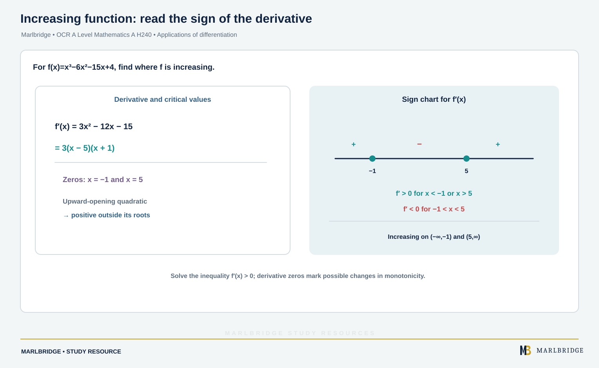

This guide covers the applications of differentiation in OCR A Level Mathematics A (H240), as set out in the OCR specification (Version 3.1, August 2026): content references 1.07m, 1.07n and 1.07o (Stage 1, the stage shared with AS Level H230) and 1.07p (Stage 2, A Level only), within 1.07 Differentiation. Optimisation in context and curve sketching with calculus apply the same results. Gradients, second derivatives, first principles and standard derivatives are taught in a separate fundamentals page, and the product, quotient and chain rules in a techniques page.

Use it with the [revision notes](/resources/ocr-a-level-mathematics-applications-of-differentiation-tangents-normals-revision-notes/) and the [practice set](/resources/ocr-a-level-mathematics-applications-of-differentiation-tangents-normals-practice/). The wider course is covered in the [Pure Mathematics guide](/resources/ocr-a-level-mathematics-pure-mathematics/), with the [course hub](/boards/ocr/a-level/mathematics/) and [checklist](/checklists/ocr/a-level/mathematics/) alongside. The [free diagnostics](/diagnostics/) show where to start.

## Scope at a glance

| Ref | What you must be able to do | Stage |
|---|---|---|
| 1.07m | Find the gradient at a point, and the equations of tangents and normals | Stage 1 |
| 1.07n | Find and classify stationary points as maxima or minima, using the second derivative, the first derivative or other methods | Stage 1 |
| 1.07o | Use the sign of dy/dx to decide where a function is increasing or decreasing | Stage 1 |
| 1.07p | Find points of inflection, stationary or not | A Level only |
| (applied) | Optimise in context; sketch curves using calculus | Uses the above |

## Tangents and normals (1.07m)

At a point on a curve, the tangent has gradient dy/dx evaluated there. The normal meets the curve at right angles to the tangent. Its gradient is −1 divided by the tangent gradient, as long as that gradient is not zero.

Method:

1. Differentiate and substitute the x-value to get the tangent gradient m.
2. Find the y-value from the curve itself, not from the derivative.
3. Tangent: y − y₁ = m(x − x₁). Normal: y − y₁ = −(1/m)(x − x₁).

### Example 1

Find the tangent and normal to y = 3x^(3/2) − 2x at the point where x = 4.

```
y(4)    = 3 × 8 − 8 = 16
dy/dx   = (9/2)x^(1/2) − 2
at x=4  : 9 − 2 = 7
Tangent : y − 16 = 7(x − 4)      →  y = 7x − 12
Normal  : y − 16 = −(1/7)(x − 4) →  x + 7y = 116
```

<figure class="topic-figure">
  
  <figcaption>How chord gradients 12 + 2h approach the tangent gradient 12 at x = 3 on y = 2x².</figcaption>
</figure>


### Example 2

On y = x³ − 3x² − 5x, find the points where the tangent is perpendicular to the line x + 4y = 8, and the equation of one such tangent.

The line has gradient −1/4, so the tangent gradient is 4.

```
dy/dx = 3x² − 6x − 5 = 4
3x² − 6x − 9 = 0  →  x² − 2x − 3 = 0  →  (x − 3)(x + 1) = 0
x = 3 : y = 27 − 27 − 15 = −15     x = −1 : y = −1 − 3 + 5 = 1
```

The points are (3, −15) and (−1, 1). At (3, −15): y + 15 = 4(x − 3), so y = 4x − 27.

<figure class="topic-figure">
  
  <figcaption>The tangent and normal at P(2, 3) are perpendicular because their gradients multiply to −1.</figcaption>
</figure>

<figure class="topic-figure">
  
  <figcaption>The gradient of the composite is the product of the two gradients: 16 × 0.1 = 1.6.</figcaption>
</figure>

<figure class="topic-figure">
  
  <figcaption>The slope of eˣ equals its height and the slope of ln x at x is 1/x.</figcaption>
</figure>

<figure class="topic-figure">
  
  <figcaption>At t = 2 the gradient is dy/dt ÷ dx/dt = 9/6, with the normal gradient −2/3.</figcaption>
</figure>


## Stationary points (1.07n)

A stationary point is where dy/dx = 0. To classify it you may use the second derivative, the first derivative or another method; the specification allows any of these.

Second derivative test, at a stationary point x = a:

| d²y/dx² at a | Conclusion |
|---|---|
| positive | minimum |
| negative | maximum |
| zero | no conclusion: use another method |

First derivative test: look at the sign of dy/dx a little to the left of a and a little to the right. Positive then negative is a maximum; negative then positive is a minimum; no change is neither.

### Example 3

Find and classify the stationary points of y = 2x³ − 15x² + 24x + 3.

```
dy/dx   = 6x² − 30x + 24 = 6(x − 1)(x − 4)   →  x = 1 or x = 4
d²y/dx² = 12x − 30
x = 1 : y = 14,  d²y/dx² = −18 < 0  →  maximum at (1, 14)
x = 4 : y = −13, d²y/dx² = +18 > 0  →  minimum at (4, −13)
```

### Example 4

Show that y = x² − 8 ln x (for x > 0) has one stationary point and find its nature.

```
dy/dx = 2x − 8/x = 0  →  x² = 4  →  x = 2   (x = −2 is outside the domain)
d²y/dx² = 2 + 8/x²  →  at x = 2 this is 4 > 0  →  minimum
y(2) = 4 − 8 ln 2   (about −1.55)
```

Always check the domain before you accept a root.

## Increasing and decreasing functions (1.07o)

Use the sign of dy/dx. Where dy/dx > 0 the function is increasing; where dy/dx < 0 it is decreasing. Solve the inequality, not the equation. Sketching the gradient function (a quadratic here) makes the intervals clear.

### Example 5

<!-- marlbridge-diagram:math-b59-derivative-increasing-intervals -->
<figure class="lesson-diagram" style="margin: 2rem 0;">
  <a href="/public/images/learning/mathematics/math-b59-derivative-increasing-intervals.svg" aria-label="Open full-size diagram: math-b59-derivative-increasing-intervals"></a>
  <figcaption>The source example has f′(x)=3x²−12x−15=3(x−5)(x+1). Its zeros are −1 and 5; because the quadratic opens upward, f′ is positive outside these roots and negative between them. Thus f increases for x&lt;−1 and x&gt;5. Select the image to enlarge it.</figcaption>
</figure>
<!-- /marlbridge-diagram:math-b59-derivative-increasing-intervals -->


Find where f(x) = x³ − 6x² − 15x + 4 is increasing.

```
f′(x) = 3x² − 12x − 15 = 3(x − 5)(x + 1)
f′(x) > 0 when x < −1 or x > 5     (upward parabola, outside the roots)
f′(x) < 0 when −1 < x < 5
```

So f is increasing for x < −1 and for x > 5, and decreasing between.

### Example 6

Show that g(x) = x³ + 6x² + 15x + 2 is increasing for all real x.

```
g′(x) = 3x² + 12x + 15 = 3(x + 2)² + 3
```

The bracket squared is at least 0, so g′(x) ≥ 3 > 0 for every x. Completing the square is the quickest route to a proof of this kind.

### Example 7

Show that h(x) = x + 9/x is increasing for x > 3.

h′(x) = 1 − 9/x², which is positive exactly when x² > 9. With x > 0 that means x > 3.

<figure class="topic-figure">
  
  <figcaption>The sign of f′ tells you where f rises or falls, and f′ = 0 at turning points.</figcaption>
</figure>


## Points of inflection (1.07p, A Level only)

The specification states that at a point of inflection d²y/dx² = 0 and there is a sign change in the second derivative on either side. Both parts are needed. If dy/dx = 0 as well, the inflection is a stationary point. If dy/dx ≠ 0, it is not.

Warning: d²y/dx² = 0 alone proves nothing. For y = x⁴, d²y/dx² = 12x² is zero at x = 0 but never changes sign, and the point is a minimum.

### Example 8

Find and classify all stationary points of y = 3x⁴ − 20x³ + 1, and find its points of inflection.

```
dy/dx   = 12x³ − 60x² = 12x²(x − 5)          →  x = 0 or x = 5
d²y/dx² = 36x² − 120x = 12x(3x − 10)
```

At x = 5: d²y/dx² = 300 > 0, a minimum at (5, −624).

At x = 0: d²y/dx² = 0, so the test fails. Check dy/dx: it is 12x²(x − 5), negative on both sides of 0 (for example −72 at x = −1 and −48 at x = 1). There is no sign change, so it is not a maximum or minimum.

For inflection, d²y/dx² = 12x(3x − 10) is zero at x = 0 and x = 10/3:

| x | −1 | 1 | 4 |
|---|---|---|---|
| d²y/dx² | +156 | −84 | +96 |

The sign changes at both x = 0 and x = 10/3. So (0, 1) is a stationary point of inflection (dy/dx = 0), and (10/3, −9973/27) is a point of inflection that is not stationary, since dy/dx = −2000/9 there.

<figure class="topic-figure">
  
  <figcaption>Convex and concave sections of a curve and the inflection points where f″ changes sign.</figcaption>
</figure>


## Sketching with calculus

To sketch a curve, collect: intercepts, stationary points and their nature, points of inflection if asked, and behaviour for large |x|.

### Example 9

Sketch y = x⁴ − 8x².

```
Intercepts : y = x²(x² − 8) = 0  →  x = 0 (touches), x = ±2√2;  y-intercept 0
dy/dx      : 4x³ − 16x = 4x(x − 2)(x + 2)  →  x = 0, ±2
Nature     : d²y/dx² = 12x² − 16
             x = 0 : −16 → maximum (0, 0)
             x = ±2 : +32 → minima (±2, −16)
Inflection : 12x² = 16 → x = ±2/√3, y = −80/9, sign changes either side
Large |x|  : y → +∞ both ends
```

The curve is a symmetrical W: it comes down from the left, bottoms out at (−2, −16), rises to a maximum at the origin, falls to (2, −16) and then climbs. It crosses the x-axis at ±2√2 and has an inflection on each side of the origin. Label every point you have found.

## Optimisation

Optimisation is classification of a stationary point in context. The steps:

1. Name the variables and write down the quantity you want to make largest or smallest.
2. Use the given condition to remove one variable.
3. Differentiate, set equal to zero and solve.
4. Show whether the point is a maximum or a minimum.
5. Give the value asked for, with units, and ask whether it makes sense in the situation.

### Example 10

A box with a square base of side x metres and no lid is made from 12 m² of sheet metal with no waste. Find the greatest possible volume.

```
Surface: x² + 4xh = 12   →  h = (12 − x²)/(4x)
V = x²h = x(12 − x²)/4 = 3x − x³/4
dV/dx = 3 − 3x²/4 = 0  →  x² = 4  →  x = 2   (x > 0)
d²V/dx² = −3x/2 = −3 < 0  →  maximum
```

When x = 2, h = 8/8 = 1 and V = 3(2) − 8/4 = 4. The greatest volume is 4 m³. As a check, x = 1 gives 2.75 and x = 3 gives 2.25, both smaller.

## Common errors

- Substituting the x-value into dy/dx to find the y-coordinate. Use the original equation.
- Taking the normal gradient as −m or 1/m. It is −1/m.
- Treating d²y/dx² = 0 as proof of an inflection, or as proof the point is not a maximum or minimum.
- Stopping at stationary x-values and never finding y.
- Solving f′(x) = 0 when the question asks where f is increasing, and then stating the roots rather than the intervals.
- Keeping a root outside the domain, or forgetting that an optimisation answer must fit the context.
- Writing "it is a minimum" with no evidence. Quote the sign of the second derivative, or the signs of dy/dx either side.

## Frequently asked questions

**Which specification references cover applications of differentiation in OCR A Level Mathematics A (H240)?**
References 1.07m to 1.07p cover tangents and normals, stationary points, increasing and decreasing functions, and points of inflection. Points of inflection, 1.07p, are A Level only.

**How do you find the y-coordinate of a stationary point?**
Substitute the x-value into the original equation of the curve, not into dy/dx. Stopping at the x-values and never finding y is a common way to lose marks.

**Does d²y/dx² = 0 prove a point of inflection?**
No. You also need d²y/dx² to change sign on either side of the point. On its own, d²y/dx² = 0 does not prove an inflection, nor that the point is not a maximum or minimum.

**How do you use calculus to sketch a curve?**
Find the stationary points and their nature, the intercepts with the axes and any points of inflection, then draw a curve with the correct shape through them, labelling the points found.

## Where next

Work through the [practice questions](/resources/ocr-a-level-mathematics-applications-of-differentiation-tangents-normals-practice/), then keep the [revision notes](/resources/ocr-a-level-mathematics-applications-of-differentiation-tangents-normals-revision-notes/) for the final weeks. The [checklist](/checklists/ocr/a-level/mathematics/) lets you tick off each reference.

<figure class="topic-figure">
  
  <figcaption>Horizontal tangents occur where the numerator of dy/dx is zero and vertical tangents where the denominator is zero.</figcaption>
</figure>


## Official syllabus

*Cambridge OCR Level 3 Advanced GCE in Mathematics A (H240)* specification, Version 3.1 (August 2026), for first assessment in 2018, published by Cambridge OCR: section 1.07, Differentiation, references 1.07m to 1.07p.
