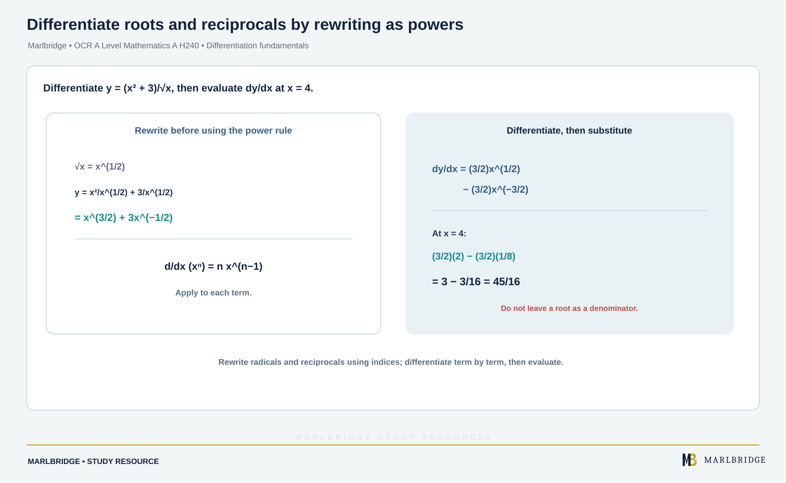

This guide covers the first half of differentiation in OCR A Level Mathematics A (H240), content references 1.07a to 1.07l of the specification, Version 3.1 (August 2026). Most of it is Stage 1, common to AS and A Level. Content marked **A Level only** is Stage 2. Tangents, normals, stationary points, optimisation, the product, quotient and chain rules, implicit and parametric differentiation and differential equations are separate topics, so they are not taught here.

Use it with the [revision notes](/resources/ocr-a-level-mathematics-differentiation-fundamentals-gradients-second-revision-notes/) and the [practice questions](/resources/ocr-a-level-mathematics-differentiation-fundamentals-gradients-second-practice/). The wider course is on the [OCR A Level Mathematics hub](/boards/ocr/a-level/mathematics/), the [printable checklist](/checklists/ocr/a-level/mathematics/) shows what to tick off, and the [pure mathematics overview](/resources/ocr-a-level-mathematics-pure-mathematics/) gives the bigger picture. If you are unsure where to start, take a [free 10-minute diagnostic](/diagnostics/).

## What this unit covers

| Reference | What you must be able to do | Stage |
|---|---|---|
| 1.07a, 1.07b | Use the derivative as the gradient of the tangent, as the limit of chord gradients and as a rate of change; use f'(x) and dy/dx | 1 |
| 1.07c | Sketch the gradient function for a given curve | 1 |
| 1.07d, 1.07e | Find second derivatives f''(x) and d²y/dx²; use them as the rate of change of gradient | 1 |
| 1.07f | Use the second derivative for convex and concave sections and points of inflection | **A Level only** |
| 1.07g | Differentiate from first principles for small positive integer powers of x (the specification excludes powers above 4) | 1 |
| 1.07h | First principles for sin x and cos x | **A Level only** |
| 1.07i | Differentiate xⁿ for rational n, with constant multiples, sums and differences | 1 |
| 1.07j, 1.07k, 1.07l | Differentiate e^kx, a^kx, sin kx, cos kx, tan kx and ln x | **A Level only** |

## 1. The derivative as a gradient (1.07a, 1.07b)

A curve y = f(x) bends, so its gradient changes from point to point. The **derivative** f'(x) is the gradient of the tangent at the general point (x, y). The same thing is written dy/dx, and you should treat f'(x) and dy/dx as equivalent.

Take two points on the curve: A at x = a and B at x = a + h. The chord AB has gradient

```
[f(a + h) − f(a)] / h
```

As h gets smaller, B slides towards A and the chord turns into the tangent. So the gradient of the tangent at x = a is the **limit of the gradient of a chord** as h → 0. The same number is the **rate of change of y with respect to x** at that point, which is how you read dy/dx in context: "y changes by 12 units for each unit of x, at that instant".

**Worked example.** For y = x³, find the gradient of the chord from x = 2 to x = 2 + h, then the gradient at x = 2.

```
y(2 + h) = 8 + 12h + 6h² + h³
chord gradient = (12h + 6h² + h³) / h = 12 + 6h + h²
```

With h = 0.1 the chord gradient is 12.61. As h → 0 the terms 6h and h² vanish, so the gradient at x = 2 is **12**.

<figure class="topic-figure">
  
  <figcaption>How chord gradients 12 + 2h approach the tangent gradient 12 at x = 3 on y = 2x².</figcaption>
</figure>

<figure class="topic-figure">
  
  <figcaption>At t = 2 the gradient is dy/dt ÷ dx/dt = 9/6, with the normal gradient −2/3.</figcaption>
</figure>


## 2. Sketching the gradient function (1.07c)

You can sketch f'(x) from the picture of f(x) without any algebra. Read the curve from left to right and ask what the tangent is doing.

| On the curve y = f(x) | On the graph of y = f'(x) |
|---|---|
| Rising | Above the x-axis |
| Falling | Below the x-axis |
| Turning point | Crosses or touches the x-axis |
| Getting steeper | Rising |
| Straight section | Horizontal line at the gradient value |

The degree drops by one: the gradient function of a cubic is a quadratic, and of a quadratic is a straight line.

**Worked example.** A cubic with a positive x³ coefficient has a maximum at x = −1 and a minimum at x = 3. Describe y = f'(x).

```
f is rising for x < −1       so f' > 0 there
f is falling for −1 < x < 3  so f' < 0 there
f is rising for x > 3        so f' > 0 there
```

So f' is a U-shaped parabola crossing the x-axis at −1 and 3. It is symmetrical about x = 1, which is where its lowest point lies. For f(x) = x³ − 3x² − 9x, f'(x) = 3(x + 1)(x − 3), with f'(0) = −9 and a minimum value of −12 at x = 1. Label the intercepts and the minimum on your sketch.

<figure class="topic-figure">
  
  <figcaption>The sign of f′ tells you where f rises or falls, and f′ = 0 at turning points.</figcaption>
</figure>

<figure class="topic-figure">
  
  <figcaption>The tangent and normal at P(2, 3) are perpendicular because their gradients multiply to −1.</figcaption>
</figure>


## 3. Second derivatives (1.07d, 1.07e)

Differentiate f'(x) again to get the **second derivative**, written f''(x) or d²y/dx². It is the **rate of change of the gradient**.

- f''(x) > 0: the gradient is increasing.
- f''(x) < 0: the gradient is decreasing.

This is why the second derivative can help to tell a maximum point (gradient going from positive to negative) from a minimum point (gradient going from negative to positive).

Do not read d²y/dx² as (dy/dx)². It means "apply d/dx twice".

## 4. Convex, concave and points of inflection (1.07f, A Level only)

On an interval where f''(x) > 0 the function is **convex** (the curve bends upwards, like a bowl). Where f''(x) < 0 it is **concave** (it bends downwards). A **point of inflection** is where the curve changes from concave to convex or the other way round. At such a point f''(x) = 0 **and** f'' changes sign.

**Worked example.** Let f(x) = x⁴ − 8x³ + 18x² + 5. Find where f is convex and concave and locate the points of inflection.

```
f'(x)  = 4x³ − 24x² + 36x = 4x(x − 3)²
f''(x) = 12x² − 48x + 36 = 12(x − 1)(x − 3)
```

f'' is a U-shaped parabola with roots 1 and 3, so f'' > 0 for x < 1 and x > 3 (convex) and f'' < 0 for 1 < x < 3 (concave). The sign changes at both roots, so there are points of inflection at x = 1 and x = 3. Their y-values are f(1) = 16 and f(3) = 32. At x = 3 the gradient f'(3) is also 0, so the curve flattens as it passes through; at x = 1, f'(1) = 16.

**Warning.** f''(x) = 0 alone is not enough. For y = x⁴, f''(0) = 0 but f'' = 12x² is positive on both sides, so the curve stays convex and there is no inflection.

<figure class="topic-figure">
  
  <figcaption>Convex and concave sections of a curve and the inflection points where f″ changes sign.</figcaption>
</figure>


## 5. First principles for powers of x (1.07g)

The definition you must be able to use, with its notation, is

```
f'(x) = lim (h → 0) [f(x + h) − f(x)] / h
```

For small positive integer powers (the specification excludes integer powers above 4), expand (x + h)ⁿ, cancel the xⁿ, divide by h, then let h → 0.

**Worked example.** Differentiate f(x) = x⁴ from first principles.

```
f(x + h) = x⁴ + 4x³h + 6x²h² + 4xh³ + h⁴
f(x + h) − f(x) = 4x³h + 6x²h² + 4xh³ + h⁴
divided by h: 4x³ + 6x²h + 4xh² + h³
```

As h → 0 the last three terms go to 0, so f'(x) = **4x³**. Write the limit notation on every line until you take the limit; dropping it early loses the point of the method.

## 6. First principles for sin x and cos x (1.07h, A Level only)

Angles are in **radians**. You need two limits, which you can quote:

```
as h → 0:   sin h / h → 1     and     (cos h − 1) / h → 0
```

**Worked example.** Differentiate sin x from first principles.

```
sin(x + h) − sin x = sin x cos h + cos x sin h − sin x
divided by h: sin x · (cos h − 1)/h + cos x · (sin h / h)
```

As h → 0 the first term tends to sin x × 0 = 0 and the second to cos x × 1. So d/dx(sin x) = **cos x**.

The cos x case follows the same steps from cos(x + h) = cos x cos h − sin x sin h and gives −sin x. The [practice questions](/resources/ocr-a-level-mathematics-differentiation-fundamentals-gradients-second-practice/) include it.

## 7. Differentiating xⁿ (1.07i)

<!-- marlbridge-diagram:math-b61-power-rule-roots-reciprocals -->
<figure class="lesson-diagram" style="margin: 2rem 0;">
  <a href="/public/images/learning/mathematics/math-b61-power-rule-roots-reciprocals.svg" aria-label="Open full-size diagram: math-b61-power-rule-roots-reciprocals"></a>
  <figcaption>The source rewrites (x²+3)/√x as x^(3/2)+3x^(−1/2), then differentiates to (3/2)x^(1/2)−(3/2)x^(−3/2). At x=4, this is 3−3/16=45/16. Select the image to enlarge it.</figcaption>
</figure>
<!-- /marlbridge-diagram:math-b61-power-rule-roots-reciprocals -->


For any rational n: **d/dx (xⁿ) = nxⁿ⁻¹**. Constant multiples stay in place, sums and differences are handled one term at a time, and a lone constant gives 0.

The skill is rewriting first. Roots and reciprocals must become powers: √x = x^(1/2), 1/x³ = x⁻³, 1/√x = x^(−1/2). Split fractions that have a single term in the denominator.

**Worked example.** Differentiate y = (x² + 3)/√x and find dy/dx at x = 4.

```
y = x^(3/2) + 3x^(−1/2)
dy/dx = (3/2)x^(1/2) − (3/2)x^(−3/2)
at x = 4: (3/2)(2) − (3/2)(1/8) = 3 − 3/16 = 45/16
```

<figure class="topic-figure">
  
  <figcaption>The gradient of the composite is the product of the two gradients: 16 × 0.1 = 1.6.</figcaption>
</figure>


## 8. Exponentials and logarithms (1.07j, 1.07l, A Level only)

| Function | Derivative |
|---|---|
| e^kx | k e^kx |
| a^kx (a > 0) | k ln a · a^kx |
| ln x | 1/x |

The result for a^kx comes from writing a^kx = e^(kx ln a). In every case k is a constant. The function e^x itself is the case k = 1, and it is its own derivative.

<figure class="topic-figure">
  
  <figcaption>The slope of eˣ equals its height and the slope of ln x at x is 1/x.</figcaption>
</figure>


## 9. Trigonometric functions (1.07k, A Level only)

| Function | Derivative |
|---|---|
| sin kx | k cos kx |
| cos kx | −k sin kx |
| tan kx | k sec² kx |

These hold for x in **radians** only. If a question gives degrees, the factor k picks up an extra π/180, and you should convert to radians.

**Worked example.** Differentiate each function.

```
(a) f(x) = 6e^(x/3) − 4(5^(2x)) + 7 ln x
    f'(x) = 2e^(x/3) − 8 ln 5 · 5^(2x) + 7/x

(b) y = 3 sin 2x − 5 cos(x/2) + tan 4x
    dy/dx = 6 cos 2x + (5/2) sin(x/2) + 4 sec² 4x
```

Check the signs in (b): the derivative of cos kx is −k sin kx, and the −5 in front turns it positive.

## Common errors

- Writing the derivative of 5^(2x) as 2x · 5^(2x−1). The power rule only works when the variable is in the base.
- Forgetting ln a in the derivative of a^kx.
- Differentiating cos kx as +k sin kx.
- Leaving a root or a denominator unconverted before applying the power rule.
- Claiming an inflection because f''(x) = 0, without checking for a sign change.
- Dropping "lim" or the h → 0 step in a first-principles answer.
- Using degrees when differentiating trigonometric functions.
- Confusing the sketch of f' with the sketch of f: the roots of f' are the turning points of f.

## Frequently asked questions

**What does differentiation fundamentals cover in OCR A Level Mathematics A (H240)?**
Specification references 1.07a to 1.07l cover the derivative as a gradient and limit, sketching gradient functions, second derivatives, convexity, first principles and standard derivatives of powers, exponentials, logarithms and trigonometric functions.

**Which powers of x can be asked from first principles in OCR H240?**
Reference 1.07g covers differentiation from first principles for small positive integer powers of x; the specification excludes powers above 4. First principles for sin x and cos x is A Level only.

**Is a point where f''(x) = 0 always a point of inflection?**
No. You also need f'' to change sign either side. For y = x⁴, f''(0) = 0 but f'' is positive on both sides, so there is no inflection.

**Why can't you use the power rule on 5^(2x)?**
The power rule only works when the variable is in the base. When the variable is in the power, use the exponential rule: the derivative of a^kx is k ln a · a^kx.

## Official syllabus

*OCR Level 3 Advanced GCE in Mathematics A (H240)* specification, Version 3.1 (August 2026), for first assessment in 2018, published by OCR: section 1.07, Differentiation, references 1.07a to 1.07l.
