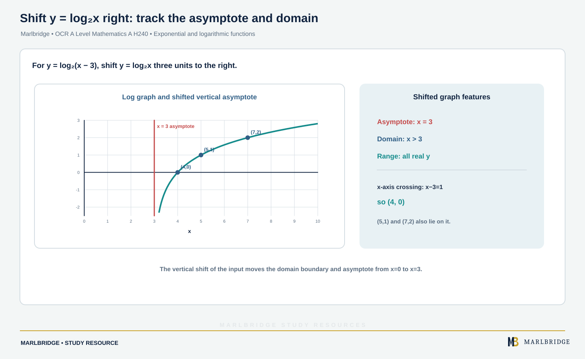

This guide covers the exponential and logarithmic functions in OCR A Level Mathematics A (H240), as set out in the OCR specification (Version 3.1, August 2026): content references 1.06a to 1.06e, within 1.06 Exponentials and Logarithms. The specification lists all of this as Stage 1 content, common to AS Level (H230) and A Level, so none of it is A Level only. Laws of logarithms, solving a^x = b, reduction to linear form and growth and decay modelling (1.06f to 1.06i) are separate topics and are not taught here. The specification shows Pure Mathematics content in all three components.

Use this guide with the [revision notes](/resources/ocr-a-level-mathematics-exponential-and-logarithmic-functions-e-x-a-x-ln-x-and-revision-notes/) and the [practice set](/resources/ocr-a-level-mathematics-exponential-and-logarithmic-functions-e-x-a-x-ln-x-and-practice/). For the wider course see the [Pure Mathematics guide](/resources/ocr-a-level-mathematics-pure-mathematics/), the [course hub](/boards/ocr/a-level/mathematics/) and the [checklist](/checklists/ocr/a-level/mathematics/). The [free diagnostics](/diagnostics/) show where to start.

## Scope at a glance

| Ref | Skills | Stage |
|---|---|---|
| 1.06a | Know and use a^x (a positive) and its graph; know and use e^x and its graph | 1 |
| 1.06b | Know that the gradient of e^(kx) is k e^(kx), and why exponential models suit many applications | 1 |
| 1.06c | Know and use log_a x (x > 0) as the inverse of a^x; convert between index and logarithmic form; know log_a a = 1 and log_a 1 = 0 | 1 |
| 1.06d | Know and use ln x and its graph | 1 |
| 1.06e | Know and use ln x as the inverse of e^x; know ln e = 1 and ln 1 = 0 | 1 |

Section 5d of the specification lists x = aⁿ ⇔ n = log_a x among the results you must be able to use without being given them. Many answers here are best left exact, such as ln 5 or e².

## 1.06a The function a^x and its graph

An exponential function has the variable in the power: y = a^x, where a is a positive constant. Three cases matter.

| Base | Behaviour |
|---|---|
| a > 1 | increasing; grows very fast as x increases; approaches 0 as x → −∞ |
| a = 1 | y = 1, a horizontal line (not a growth curve) |
| 0 < a < 1 | decreasing; approaches 0 as x → ∞ |

Every curve y = a^x (a ≠ 1) has the same key features:

- It passes through (0, 1), because a⁰ = 1.
- It lies wholly above the x-axis, so a^x > 0 for every x.
- The x-axis (y = 0) is a horizontal asymptote.
- It has no x-intercept and no turning points.

The curves y = a^x and y = (1/a)^x are reflections of each other in the y-axis, since (1/a)^x = a^(−x).

**Worked example 1.** Complete the table for y = 3^x and y = (1/3)^x and describe the relationship.

```
x         -2     -1     0     1     2
3^x       1/9    1/3    1     3     9
(1/3)^x   9      3      1     1/3   1/9
```

Each row is the other read backwards, so the graphs are mirror images in the y-axis. Both pass through (0, 1) with asymptote y = 0.

### The number e and the graph of e^x

The number e ≈ 2.71828 is an irrational constant. The function y = e^x has every feature above, with a > 1, and one extra property: at (0, 1) its gradient is exactly 1. This is why e is the natural base, and 1.06b generalises it.

The graph of y = e^(−x) is the reflection of y = e^x in the y-axis: decreasing, through (0, 1), asymptote y = 0.

Adding a constant moves the asymptote. For y = 2^x − 3 the whole curve moves down 3: the y-intercept is 1 − 3 = −2, the asymptote is y = −3, and y > −3 throughout.

The specification mentions comparing two models and the link with geometric sequences: 250 × 1.4^t at t = 0, 1, 2 … is a geometric sequence with ratio 1.4.

**Worked example 2.** Two populations are modelled by A = 250 × 1.4^t and B = 1200 × 1.1^t, where t is the time in years. Which is larger for large t, and when does A first overtake B?

A starts smaller but has the larger base, so A eventually exceeds B whatever the starting values. A table shows when.

```
t    6       7
A    1882    2635
B    2126    2339
```

At t = 6, B is larger; at t = 7, A is larger. A first overtakes B between years 6 and 7. The exact time needs a separate method.

<figure class="topic-figure">
  
  <figcaption>Every aˣ passes through (0, 1); a &gt; 1 grows and a &lt; 1 decays.</figcaption>
</figure>

<figure class="topic-figure">
  
  <figcaption>Substituting u = eˣ turns e²ˣ − 5eˣ + 6 = 0 into a quadratic with roots ln 2 and ln 3.</figcaption>
</figure>

<figure class="topic-figure">
  
  <figcaption>Exponential decay has a constant half-life of ln 2 ÷ k.</figcaption>
</figure>


## 1.06b The gradient of e^(kx)

The key result is that for any constant k, the gradient of y = e^(kx) is

```
dy/dx = k e^(kx)
```

The gradient is k times the function itself. For k = 1 the gradient equals the height of the curve; for k = −1 it is −e^(−x). The specification points to 1.07j for explicit differentiation of e^x, so here the focus is on using and understanding the result. A constant multiple scales the gradient the same way: the gradient of 5e^(2x) is 10e^(2x).

**Worked example 3.** Find the equation of the tangent to y = e^(2x) at the point where x = 1/2, and show that it passes through the origin.

```
At x = 1/2:  y = e^1 = e
Gradient = 2e^(2 × 1/2) = 2e
Tangent:  y - e = 2e(x - 1/2)
          y = 2ex - e + e = 2ex
```

When x = 0, y = 0, so the tangent passes through the origin.

**Worked example 4.** The curve y = e^(−x/2) has gradient −1 at a point P. Find the exact coordinates of P.

```
dy/dx = -(1/2) e^(-x/2) = -1   →   e^(-x/2) = 2
-x/2 = ln 2   →   x = -2 ln 2
y = e^(ln 2) = 2
```

P is (−2 ln 2, 2), approximately (−1.39, 2).

### Why exponential models are suitable

Since the gradient of e^(kx) is k times its value, the rate of change is proportional to the current size. When y = Ae^(kt), the rate of change of y with respect to t is ky. Examples include a population whose growth depends on its size, or money earning interest on its balance. With k > 0 the quantity grows, and with k < 0 it decays, and the curve never reaches zero.

**Worked example 5.** A population is modelled by P = 500e^(0.03t), where t is in years. Find the rate of growth at t = 0 and at t = 10, and the rate when P = 2000.

```
dP/dt = 500 × 0.03 e^(0.03t) = 15e^(0.03t) = 0.03P
t = 0:   P = 500, rate = 15
t = 10:  P = 500e^0.3 = 674.9..., rate = 0.03 × 674.9 = 20.2
P = 2000: rate = 0.03 × 2000 = 60
```

Rates are about 15, 20.2 and 60 individuals per year. The rate is always 0.03 times P, which is why larger populations grow faster.

<figure class="topic-figure">
  
  <figcaption>The gradient of e^kx is k times its height, so growth is proportional to size.</figcaption>
</figure>

<figure class="topic-figure">
  
  <figcaption>A straight line on log axes gives gradient and intercept for power and exponential laws.</figcaption>
</figure>

<figure class="topic-figure">
  
  <figcaption>ln x differentiates to 1/x and the area under 1/x from 1 to e is 1.</figcaption>
</figure>


## 1.06c Logarithms as inverses of a^x

The logarithm to base a is defined as the inverse of a^x:

```
y = a^x   ⇔   x = log_a y        (a > 0)
```

In words, log_a b is the power to which a must be raised to give b. This lets you convert between forms.

| Index form | Logarithmic form |
|---|---|
| 2⁵ = 32 | log₂ 32 = 5 |
| 10⁻² = 0.01 | log₁₀ 0.01 = −2 |
| 7^x = y | x = log₇ y |

Two values must be known: log_a a = 1 (since a¹ = a) and log_a 1 = 0 (since a⁰ = 1). Because a^x is always positive, log_a x only exists for x > 0.

**Worked example 6.** Evaluate (a) log₃ 81, (b) log₂ (1/8), (c) log₈ 2. Then solve (d) log_x 49 = 2 and (e) log₄ x = 3/2.

```
(a) 3⁴ = 81, so log₃ 81 = 4
(b) 2⁻³ = 1/8, so log₂ (1/8) = -3
(c) 8^(1/3) = 2, so log₈ 2 = 1/3
(d) x² = 49, x = 7 (a base must be positive)
(e) x = 4^(3/2) = (√4)³ = 8
```

### Graph of y = log_a x

<!-- marlbridge-diagram:math-b61-shifted-log-graph -->
<figure class="lesson-diagram" style="margin: 2rem 0;">
  <a href="/public/images/learning/mathematics/math-b61-shifted-log-graph.svg" aria-label="Open full-size diagram: math-b61-shifted-log-graph"></a>
  <figcaption>For y=log₂(x−3), the graph shifts right by 3. Its vertical asymptote is x=3, domain x&gt;3, range all real values, and x-intercept (4,0); (5,1) and (7,2) are further points. The plot shows the asymptote and sample points. Select the image to enlarge it.</figcaption>
</figure>
<!-- /marlbridge-diagram:math-b61-shifted-log-graph -->


Because log_a x is the inverse of a^x, its graph is the reflection of y = a^x in the line y = x. Swapping coordinates gives these features for a > 1:

- It passes through (1, 0) and (a, 1).
- The y-axis (x = 0) is a vertical asymptote.
- The domain is x > 0 and the range is all real numbers.
- It is increasing, and it grows slowly for large x.

```
y = 2^x:     (-2, 1/4)  (-1, 1/2)  (0, 1)  (1, 2)  (2, 4)  (3, 8)
y = log₂ x:  (1/4, -2)  (1/2, -1)  (1, 0)  (2, 1)  (4, 2)  (8, 3)
```

**Worked example 7.** Describe the graph of y = log₂ (x − 3).

The graph of log₂ x moves 3 to the right. The asymptote is x = 3, the domain is x > 3, and the curve crosses the x-axis where x − 3 = 1, at (4, 0). Points (5, 1) and (7, 2) lie on it. There is no y-intercept, because x = 0 is outside the domain.

<figure class="topic-figure">
  
  <figcaption>Logarithms turn products into sums: lengths on a log ruler add.</figcaption>
</figure>

<figure class="topic-figure">
  
  <figcaption>Taking logs solves aˣ = b, and a negative log reverses an inequality.</figcaption>
</figure>


## 1.06d and 1.06e The natural logarithm

ln x means log_e x. It is the logarithm that undoes e^x, so its graph is the reflection of y = e^x in y = x. The two values the specification asks you to know are ln e = 1 and ln 1 = 0.

Features of y = ln x: it passes through (1, 0) and (e, 1); the asymptote is x = 0; the domain is x > 0; the range is all real numbers.

Because ln and e^x are inverses:

```
y = e^x  ⇔  x = ln y
ln(e^x) = x        for all real x
e^(ln x) = x       for x > 0
```

The restriction x > 0 matters: ln 0 and ln of a negative number do not exist.

**Worked example 8.** Solve exactly, then give the answer to 3 significant figures: (a) e^x = 7, (b) ln x = −1, (c) e^(2x−1) = 5, (d) ln(3x + 2) = 1.

```
(a) x = ln 7 = 1.95
(b) x = e^(-1) = 0.368
(c) 2x - 1 = ln 5, x = (1 + ln 5)/2 = 1.30
(d) 3x + 2 = e, x = (e - 2)/3 = 0.239
```

Apply the inverse to both sides: ln removes the e, and raising e to both sides removes the ln.

### Inverse functions involving e^x and ln x

**Worked example 9.** The function f is defined by f(x) = 3e^(2x) − 1 for all real x. Find f⁻¹(x) and state its domain.

```
y = 3e^(2x) - 1   →   e^(2x) = (y + 1)/3
2x = ln((y + 1)/3)   →   x = (1/2) ln((y + 1)/3)
f⁻¹(x) = (1/2) ln((x + 1)/3)
```

Since 3e^(2x) > 0, the range of f is f(x) > −1. The domain of f⁻¹ is the range of f, so the domain is x > −1, which also keeps the bracket inside ln positive. For example f⁻¹(5) = (1/2) ln 2 = 0.347.

<figure class="topic-figure">
  
  <figcaption>The graph of ln x is the reflection of eˣ in y = x.</figcaption>
</figure>


## Common errors

- Sketching a^x with a turning point, or crossing the x-axis. It never does either.
- Giving the asymptote of y = 2^x − 3 as x = −3 instead of y = −3.
- Giving the gradient of e^(kx) as e^(kx) or as kx e^(kx). The factor is exactly k.
- Splitting ln(x + 2) into ln x + ln 2, which is not valid.
- Reading log_a b as a divided by b. It is the power of a that gives b.
- Allowing x ≤ 0 inside ln or log_a.
- Giving f⁻¹ the inputs that belong to f; they must be f's outputs.

## Where next

Try the [practice questions](/resources/ocr-a-level-mathematics-exponential-and-logarithmic-functions-e-x-a-x-ln-x-and-practice/) and keep the [revision notes](/resources/ocr-a-level-mathematics-exponential-and-logarithmic-functions-e-x-a-x-ln-x-and-revision-notes/) for the final weeks.

## Official syllabus

*OCR Level 3 Advanced GCE in Mathematics A (H240)* specification, Version 3.1 (August 2026), for first assessment in 2018, published by OCR: section 1.06, Exponentials and Logarithms, references 1.06a to 1.06e.
