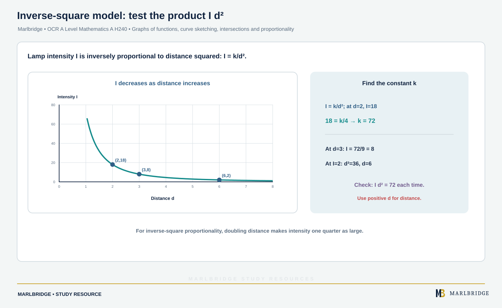

This guide follows the OCR A Level Mathematics A (H240) specification, Version 3.1 (August 2026), for first assessment in 2018. It covers the graph work in section 1.02: items 1.02m to 1.02r, which sit in Stage 1 (common with the AS qualification), and, as an application of intersections, the solution of inequalities from a graph. Pure Mathematics content is assessed on Paper 1 (Pure Mathematics), Paper 2 (Pure Mathematics and Statistics) and Paper 3 (Pure Mathematics and Mechanics).

The modulus parts of 1.02s and 1.02t are labelled A Level only in the specification (Stage 2). They are taught in the separate modulus unit and are not repeated here.

Use the [course hub](/boards/ocr/a-level/mathematics/) for the full list of topics and the [printable checklist](/checklists/ocr/a-level/mathematics/) to tick off what you have covered. Pair this guide with the [revision notes](/resources/ocr-a-level-mathematics-graphs-of-functions-curve-sketching-intersections-and-revision-notes/) and the [practice questions](/resources/ocr-a-level-mathematics-graphs-of-functions-curve-sketching-intersections-and-practice/). To find your weak spots first, take one of the free 10-minute [diagnostics](/diagnostics/). For the wider Pure picture see the [Pure Mathematics study guide](/resources/ocr-a-level-mathematics-pure-mathematics/).

## What this unit covers

| Ref | What you must be able to do | Stage |
|---|---|---|
| 1.02m | Understand and use graphs of functions; know the difference between plotting and sketching | Stage 1 |
| 1.02n | Sketch curves from simple equations, including polynomials of degree 4 or less in factorised form with repeated roots; find and classify stationary points where needed | Stage 1 |
| 1.02o | Sketch y = a/x and y = a/x², with their vertical and horizontal asymptotes | Stage 1 |
| 1.02p | Interpret the algebraic solution of equations graphically | Stage 1 |
| 1.02q | Use intersection points of graphs to solve equations (polynomial, trigonometric, exponential or reciprocal curves) | Stage 1 |
| 1.02r | Use proportional relationships and their graphs | Stage 1 |
| 1.02q (application) | Solve inequalities by reading the graphs of two functions | Stage 1 |

## 1. Plotting and sketching (1.02m)

**Plotting** means drawing accurately from a table of values. **Sketching** means drawing a diagram, not necessarily to scale, that shows the main features: turning points, asymptotes, where the curve meets the axes, and behaviour for large positive and negative x.

Label the coordinates you can find exactly. A sketch with no labels is not much use.

## 2. Sketching polynomials (1.02n)

Work through the same checklist each time.

1. **Roots.** Factorise and set y = 0. Mark each root on the x-axis.
2. **Repeated roots.** A factor (x − a) squared makes the curve touch the axis at a and turn back. A factor cubed makes it flatten as it crosses (a stationary point of inflexion on the axis). Odd powers cross; even powers touch.
3. **y-intercept.** Put x = 0.
4. **End behaviour.** Look at the sign of the highest-power term. A positive x³ goes from bottom left to top right. A negative x⁴ goes down on both sides.
5. **Stationary points.** Needed only when the question asks, or when the shape between roots is unclear. Differentiate, set dy/dx = 0, and classify.

**Example 1.** Sketch y = (2 − x)(x + 1)³.

Roots: x = 2 (crosses) and x = −1 (cubed, so it flattens as it crosses). y-intercept: (2)(1) = 2. The highest-power term is −x⁴, so both ends point down.

Between −1 and 2 both factors are positive, so the curve is above the axis. To the left of −1 the cubed factor is negative, so the curve is below. To the right of 2 it is below. So the curve rises from far below, flattens at (−1, 0), climbs to a maximum, then falls through (2, 0).

For the maximum, differentiate:

```
dy/dx = −(x + 1)³ + 3(2 − x)(x + 1)²
      = (x + 1)²[−(x + 1) + 6 − 3x]
      = (x + 1)²(5 − 4x)
```

dy/dx = 0 at x = −1 (the flat point) and x = 5/4. At x = 5/4, y = (3/4)(9/4)³ = 2187/256, about 8.54. So the maximum is (5/4, 2187/256).

**Example 2.** Sketch y = x(x − 6)² and find its stationary points.

Roots: x = 0 (crosses) and x = 6 (touches). The y-intercept is the origin. A positive cubic runs from bottom left to top right.

Expand: y = x³ − 12x² + 36x. Then dy/dx = 3x² − 24x + 36 = 3(x − 2)(x − 6).

```
x = 2:  y = 2 × 16 = 32   d²y/dx² = 6x − 24 = −12 < 0, maximum
x = 6:  y = 0             d²y/dx² = 12 > 0, minimum
```

The curve rises through the origin to a maximum at (2, 32), falls to touch the x-axis at (6, 0), then rises for ever.

**Example 3.** A cubic crosses the x-axis at x = −2, touches it at x = 3 and meets the y-axis at (0, 36). Find its equation.

Write y = k(x + 2)(x − 3)². Put x = 0: k × 2 × 9 = 36, so k = 2.

**y = 2(x + 2)(x − 3)²**

<figure class="topic-figure">
  
  <figcaption>Reflections are stretches with scale factor -1.</figcaption>
</figure>

<figure class="topic-figure">
  
  <figcaption>Track each key point through the map (x, y) to (x-1, -2y+5).</figcaption>
</figure>

<figure class="topic-figure">
  
  <figcaption>The same transformation can be built two ways, so state the order with the number.</figcaption>
</figure>

<figure class="topic-figure">
  
  <figcaption>Odd powers cross the axis, even powers touch it.</figcaption>
</figure>


## 3. Reciprocal graphs (1.02o)

Both curves have the axes as asymptotes. An asymptote is a line the curve approaches ever more closely but does not meet.

| | y = a/x | y = a/x² |
|---|---|---|
| Vertical asymptote | x = 0 | x = 0 |
| Horizontal asymptote | y = 0 | y = 0 |
| a > 0 | Branches in quadrants 1 and 3 | Both branches above the x-axis |
| a < 0 | Branches in quadrants 2 and 4 | Both branches below the x-axis |
| Symmetry | Unchanged by a half-turn about the origin | Mirror image in the y-axis |

Neither curve crosses an axis. Mark a point such as (1, a) to fix the scale.

A translated reciprocal such as y = 1/(x − 1) has its vertical asymptote at x = 1, because the function is undefined there. In the same way, for y = 6/(x − 2) the vertical asymptote is x = 2, the horizontal asymptote stays at y = 0, and putting x = 0 gives the y-intercept (0, −3). The graph never meets the x-axis because 6/(x − 2) is never zero.

<figure class="topic-figure">
  
  <figcaption>Outside the brackets acts on y as expected; inside acts on x and does the opposite.</figcaption>
</figure>

<figure class="topic-figure">
  
  <figcaption>Both axes are asymptotes of a/x and a/x^2.</figcaption>
</figure>


## 4. Algebra and graphs together (1.02p)

Every algebraic solution of f(x) = g(x) is an intersection of y = f(x) and y = g(x). The x-coordinate of each intersection is a solution.

- Two different real solutions: the graphs meet twice.
- A repeated solution: the graphs touch.
- No real solution: the graphs do not meet.

**Example 4.** Solve (x + 2)(x − 1)² = 4(x − 1) and explain what the answer shows.

Do not divide by (x − 1): that loses a solution. Move everything to one side and factorise.

```
(x + 2)(x − 1)² − 4(x − 1) = 0
(x − 1)[(x + 2)(x − 1) − 4] = 0
(x − 1)(x² + x − 6) = (x − 1)(x + 3)(x − 2) = 0
```

So x = 1, x = −3 or x = 2.

Graphically: the cubic y = (x + 2)(x − 1)² touches the x-axis at (1, 0). The line y = 4(x − 1) passes through that same point, so one intersection is at x = 1. The other two are where the line cuts the cubic on either side.

## 5. Using intersections to solve equations (1.02q)

If an equation is hard to solve, rearrange it into two curves you can sketch. Count the intersections to count the solutions. The curves can be polynomial, trigonometric, exponential or reciprocal.

**Example 5.** Show that x³ − 3x² + 1 = 0 has three real roots.

Rearrange: x²(x − 3) = −1, so x − 3 = −1/x² (valid because x = 0 is not a root).

Sketch the line y = x − 3 and the curve y = −1/x². The curve lies below the x-axis everywhere and drops to minus infinity on both sides of x = 0.

- For x < 0: the line is far below the curve for large negative x, but the curve falls to minus infinity near 0 while the line is at about −3. They cross once.
- For x > 0: near 0 the curve is far below the line. At x = 1 the line is at −2 and the curve at −1, so the line is now below. They have crossed once. For large x the line is positive and the curve is negative, so the line is above again. They have crossed a second time.

That is three intersections, so three real roots (about −0.53, 0.65 and 2.88).

**Example 6.** How many solutions does eˣ = 6/x have?

Sketch y = eˣ (always positive, through (0, 1), horizontal asymptote y = 0) and y = 6/x. For x < 0, 6/x is negative but eˣ is positive, so there is no intersection. For x > 0, eˣ rises from 1 while 6/x falls from very large values, so they meet exactly once, at about x = 1.43. **One solution.**

## 6. Inequalities from graphs

To solve f(x) > g(x), find where the graph of f lies above the graph of g. Read off x-values from the sketch, using the intersections as the boundaries. This avoids the trap of multiplying by an expression that might be negative.

**Example 7.** Solve (x + 2)(x − 1)² > 4(x − 1).

From Example 4 the intersections are at x = −3, 1 and 2. Sketch the cubic and the line: the cubic is above the line to the right of the largest intersection, and the sign then alternates at each intersection going left. Check one value, such as x = 0: the cubic gives 2 and the line gives −4, so the cubic is above the line there. That puts it above between the first two intersections as well.

**−3 < x < 1 or x > 2**

**Example 8.** Solve 6/x > 5 − x.

Sketch y = 6/x and y = 5 − x. They meet where 6 = 5x − x², so x² − 5x + 6 = 0, giving x = 2 and x = 3. For x < 0 the curve is below the axis and the line is above it, so the curve is lower. For 0 < x < 2 the curve is above the line. Between 2 and 3 it is below. Beyond 3 it is above again.

**0 < x < 2 or x > 3**

<figure class="topic-figure">
  
  <figcaption>Read inequalities from where one graph lies above the other.</figcaption>
</figure>


## 7. Proportionality (1.02r)

<!-- marlbridge-diagram:math-b63-inverse-square-proportionality -->
<figure class="lesson-diagram" style="margin: 2rem 0;">
  <a href="/public/images/learning/mathematics/math-b63-inverse-square-proportionality.svg" aria-label="Open full-size diagram: math-b63-inverse-square-proportionality"></a>
  <figcaption>The source lamp example gives I∝1/d² and I=18 when d=2, so k=72. Thus d=3 gives I=8 and I=2 occurs at d=6. The graph shows the inverse-square curve and verifies I d²=72. Select the image to enlarge it.</figcaption>
</figure>
<!-- /marlbridge-diagram:math-b63-inverse-square-proportionality -->


"y is proportional to f(x)" means y = k f(x) for a constant k. Find k from one pair of values, then use it.

| Statement | Equation | Graph |
|---|---|---|
| y ∝ x | y = kx | Straight line through the origin |
| y ∝ x² | y = kx² | Parabola, vertex at the origin |
| y ∝ x³ | y = kx³ | Cubic through the origin |
| y ∝ √x | y = k√x | Half-parabola lying on its side, from the origin |
| y ∝ 1/x | y = k/x | Reciprocal curve, as in section 3 |
| y ∝ 1/x² | y = k/x² | The y = a/x² shape, x > 0 or both sides |

A straight line that misses the origin is linear, not proportional. To test y ∝ xⁿ from data, plot y against xⁿ. A straight line through the origin confirms it, and its gradient is k.

**Example 9.** The intensity I of a lamp is inversely proportional to d², the square of the distance. I = 18 when d = 2. Find I when d = 3 and d when I = 2 (d > 0).

I = k/d², so 18 = k/4 and k = 72.

- d = 3: I = 72/9 = 8.
- I = 2: 2 = 72/d², so d² = 36 and d = 6.

**Example 10.** A table gives (x, y) values (1, 4), (2, 32), (3, 108), (4, 256). Which relationship fits?

Test y/x²: 4, 8, 12, 16 (not constant). Test y/x³: 4, 4, 4, 4. So y = 4x³, and a graph of y against x³ is a straight line through the origin with gradient 4.

<figure class="topic-figure">
  
  <figcaption>A straight line through the origin confirms y is proportional to x^n; its gradient is k.</figcaption>
</figure>


## Common errors

- Drawing a repeated root as a crossing. Even powers touch; odd powers cross.
- Forgetting the y-intercept.
- Letting reciprocal curves cross an axis, or ending them at a point instead of continuing towards the asymptote.
- Dividing both sides by a factor when solving, and losing a solution that the graph clearly shows.
- Giving the x-coordinates when a question asks for points of intersection, or the reverse.
- Reading an inequality from the wrong side of an intersection. Test one value in each interval.
- Treating a straight line with a non-zero intercept as direct proportion.

## Official syllabus

Source: OCR A Level Mathematics A (H240) specification, Version 3.1 (August 2026), for first assessment in 2018, published by OCR. Section 1.02, items 1.02m to 1.02r. The graphical inequalities in 1.02t involve the modulus function and are in the separate modulus unit.
