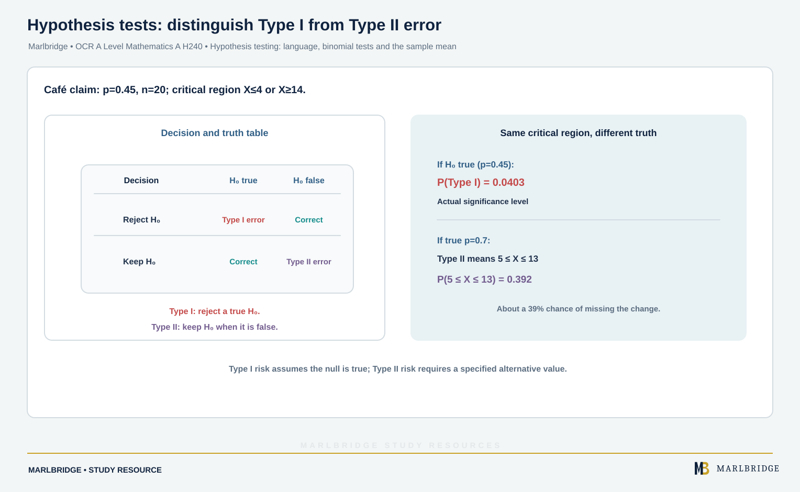

This guide follows the OCR A Level Mathematics A (H240) specification, Version 3.1 (August 2026), for first assessment in 2018. It covers sections 2.05a to 2.05e of Statistical Hypothesis Testing. Sections 2.05a to 2.05c are Stage 1 content, common with AS. Sections 2.05d and 2.05e, the sample mean and the test for a normal mean, are **A Level only**. Hypothesis testing for correlation (2.05f and 2.05g) has its own pages, so it is not repeated here.

Links: [OCR Mathematics A hub](/boards/ocr/a-level/mathematics/), [printable checklist](/checklists/ocr/a-level/mathematics/), [revision notes](/resources/ocr-a-level-mathematics-hypothesis-testing-language-binomial-tests-and-the-revision-notes/), [practice questions](/resources/ocr-a-level-mathematics-hypothesis-testing-language-binomial-tests-and-the-practice/), [OCR statistics overview](/resources/ocr-a-level-mathematics-statistics/) and [free diagnostics](/diagnostics/).

## What this unit covers

| Section | Skill | Stage |
|---|---|---|
| 2.05a | Use the language: null and alternative hypothesis, significance level, test statistic, one-tail and two-tail test, critical value, critical region, acceptance region, p-value | Stage 1 |
| 2.05b | Carry out a test for the proportion in a binomial distribution and interpret it in context | Stage 1 |
| 2.05c | See a sample as evidence about a population, and know that the significance level is the chance of wrongly rejecting a true null hypothesis | Stage 1 |
| 2.05d | Know that a sample mean is a random variable, and that X̄ ~ N(μ, σ²/n) when X ~ N(μ, σ²) | A Level only |
| 2.05e | Test the mean of a normal distribution when the variance is known, given or assumed | A Level only |

The specification excludes the normal approximation to the binomial in these tests, tests for the mean of a non-normal distribution, and estimation of population parameters from a sample.

## 2.05a: the language

- **Null hypothesis H₀**: the assumption you test. It names one value of the parameter, such as p = 0.15.
- **Alternative hypothesis H₁**: what you accept as likely if the data cast doubt on H₀. It is p > 0.15, p < 0.15 or p ≠ 0.15.
- **One-tail test**: H₁ has a single direction (< or >). **Two-tail test**: H₁ uses ≠.
- **Test statistic**: the quantity from the sample that you judge, such as the number of successes X, or the sample mean X̄.
- **Significance level**: the probability, set before you look at the data, that is small enough to count as surprising. Typical levels are 10%, 5% and 1%.
- **Critical region**: every outcome that would make you reject H₀. Its boundary is the **critical value**, and the outcomes left over form the **acceptance region**.
- **p-value**: how likely it is, if H₀ holds, to get a sample as extreme as yours or more so.

Define every symbol in the hypotheses, and give the parameter in the population, never the sample value. A good statement is: H₀: p = 0.15, H₁: p > 0.15, where p is the probability that a randomly chosen plug is faulty.

Two ways to decide, always the same decision:

1. Compare the p-value with the significance level. If p-value ≤ level, reject H₀.
2. Build the critical region, then check whether your observed value falls inside it.

For a two-tail test, each tail gets half the significance level (or double the one-tail probability to get the p-value).

**Writing the conclusion.** The test cannot prove anything, so the wording must be tentative and in context. If H₀ is rejected, write something like: "At the 5% level the data support rejecting H₀, so the proportion of faulty plugs has probably increased." If it is not rejected: "At the 5% level the data do not support rejecting H₀, so there is no reason to think the proportion has changed." Avoid "H₀ is true", "accept H₀" and "the claim is proved".

## 2.05b: binomial tests

The test statistic is X, the number of successes in a sample of n independent trials. Under H₀, X ~ B(n, p₀).

**Method**
1. Define p and state H₀ and H₁.
2. State the distribution of X under H₀.
3. Find the p-value, or the critical region, using binomial cumulative probabilities.
4. Compare with the significance level.
5. Conclude in context.

### Example 1: upper tail, p-value method

A supplier says 15% of its plugs are faulty. A buyer thinks the rate is higher and tests 22 plugs at the 5% level. Seven are faulty.

```
H₀: p = 0.15    H₁: p > 0.15    p = probability a plug is faulty
Under H₀, X ~ B(22, 0.15)
P(X ≥ 7) = 1 − P(X ≤ 6) = 0.0368
0.0368 < 0.05
```

Reject H₀. At the 5% level the evidence points to a proportion of faulty plugs above 0.15.

At the 1% level the decision changes: 0.0368 > 0.01, so there is no evidence to reject H₀. The same data can give different conclusions at different levels, which is why you set the level first.

### Example 2: lower tail, critical region method

A club says 60% of members renew. A new treasurer suspects fewer do. Sample size 30, 5% level. Find the critical region.

```
H₀: p = 0.6    H₁: p < 0.6    X ~ B(30, 0.6)
P(X ≤ 13) = 0.0481 ≤ 0.05
P(X ≤ 14) = 0.0971 > 0.05
```

The critical region is X ≤ 13. The critical value is 13. The probability of falling in the critical region when H₀ is true is 0.0481. This is the **actual significance level**. It is below 5%, never above it, because you take the largest region whose probability does not exceed the level (the specification states this).

If 12 members renew, 12 is in the region (P(X ≤ 12) = 0.0212), so reject H₀. If 14 renew, it is not, so there is no evidence of a fall.

<figure class="topic-figure">
  
  <figcaption>r above the critical value means evidence of positive correlation in the population.</figcaption>
</figure>


### Example 3: two-tail test

A café claims 45% of customers order a hot drink. A sample of 20 is taken to see whether the proportion differs, at the 10% level. Each tail gets 5%.

```
H₀: p = 0.45    H₁: p ≠ 0.45    X ~ B(20, 0.45)
Lower: P(X ≤ 4) = 0.0189 ≤ 0.05,  P(X ≤ 5) = 0.0553 > 0.05
Upper: P(X ≥ 14) = 0.0214 ≤ 0.05, P(X ≥ 13) = 0.0580 > 0.05
```

Critical region: X ≤ 4 or X ≥ 14. Actual significance level: 0.0189 + 0.0214 = 0.0403, about 4.03%.

Now suppose 4 customers order a hot drink. Using the p-value, 2 × P(X ≤ 4) = 2 × 0.0189 = 0.0377 (3 s.f.), less than 0.10. Reject H₀. The critical region gives the same decision, because 4 is in it.

<figure class="topic-figure">
  
  <figcaption>Type I is rejecting a true H0; Type II is keeping a false H0.</figcaption>
</figure>


## 2.05c: inference and errors

> **Specification note.** H240 statement 2.05c asks you to appreciate that the significance level is the probability of incorrectly rejecting the null hypothesis. The terms "Type I error" and "Type II error", and Type II error calculations, are not listed in the H240 specification, so the Type II material on this page is extension work that helps understanding but is not required for the exam.

A sample is used to infer something about a whole population, so the conclusion carries risk. Two things can go wrong.

| Decision | If H₀ is really true | If H₀ is really false |
|---|---|---|
| Reject H₀ | **Type I error** | Right decision |
| Keep H₀ | Right decision | **Type II error** |

- P(Type I error) is the probability of being in the critical region when H₀ is true. For a discrete test this is the actual significance level, which is at most the stated level.
- P(Type II error) is the probability of not being in the critical region when H₀ is false. It needs a specific true value of the parameter.

### Example 4: finding both

<!-- marlbridge-diagram:math-b63-type-one-type-two-errors -->
<figure class="lesson-diagram" style="margin: 2rem 0;">
  <a href="/public/images/learning/mathematics/math-b63-type-one-type-two-errors.svg" aria-label="Open full-size diagram: math-b63-type-one-type-two-errors"></a>
  <figcaption>Using the source critical region X≤4 or X≥14: if H₀:p=0.45 is true, Type I probability is 0.0403. If the true proportion is 0.7, Type II means 5≤X≤13 and has probability 0.392. The table distinguishes false rejection from a missed change. Select the image to enlarge it.</figcaption>
</figure>
<!-- /marlbridge-diagram:math-b63-type-one-type-two-errors -->


Use the critical region in Example 3 (X ≤ 4 or X ≥ 14, n = 20).

- P(Type I) = 0.0403.
- Suppose the true proportion is 0.7. Then X ~ B(20, 0.7) and a Type II error means 5 ≤ X ≤ 13:

```
P(5 ≤ X ≤ 13) = P(X ≤ 13) − P(X ≤ 4) = 0.392
```

So there is about a 39% chance that the test misses the fact that the proportion is not 0.45. If the true proportion is 0.3 the chance is 0.762: the nearer the truth is to p₀, the harder it is to detect.

In context, a Type I error here means concluding the café's claim is wrong when it is correct. A Type II error means keeping the claim when it is wrong.

## 2.05d: the sample mean (A Level only)

Take a sample of n values from a population. The sample mean X̄ changes from sample to sample, so it is a random variable.

If X ~ N(μ, σ²), then X̄ ~ N(μ, σ²/n).

The mean stays μ, but the variance shrinks, so the standard deviation of X̄ is σ/√n. Bigger samples give means that cluster more tightly around μ.

### Example 5

Journey times X (minutes) are N(48, 6²). Take n = 9.

```
X̄ ~ N(48, 6²/9) = N(48, 2²)
P(X̄ > 50) = P(Z > 1) = 0.1587
P(X > 50) = P(Z > 1/3) = 0.3694
P(46 < X̄ < 50) = 0.6827
```

## 2.05e: the test for a normal mean (A Level only)

You assume the population is normal and that σ is known, given or assumed. Under H₀: μ = μ₀, X̄ ~ N(μ₀, σ²/n). Standardise with

z = (x̄ − μ₀) / (σ/√n)

and compare with the standard normal critical values (the specification says tables of percentage points are provided in the assessment). The values to know are:

| Level | One-tail | Two-tail |
|---|---|---|
| 10% | 1.282 | 1.645 |
| 5% | 1.645 | 1.960 |
| 1% | 2.326 | 2.576 |

### Example 6: one-tail

Delivery times have standard deviation 2.8 minutes. A firm claims a mean of 34 minutes. A rival believes it is longer. A sample of 40 deliveries has mean 34.9 minutes. Test at the 5% level.

```
H₀: μ = 34    H₁: μ > 34    μ = population mean delivery time (minutes)
Under H₀, X̄ ~ N(34, 2.8²/40), standard deviation 0.4427
z = (34.9 − 34)/0.4427 = 2.033
p-value = P(Z > 2.033) = 0.021
```

2.033 > 1.645, and 0.021 < 0.05, so reject H₀. There is evidence at the 5% level that the mean delivery time is more than 34 minutes.

The critical region in terms of the mean is X̄ ≥ 34 + 1.645 × 0.4427 = 34.73 (2 d.p.). At the 1% level the boundary is 35.03, so 34.9 would not be in the region, and there would be no evidence to reject H₀.

<figure class="topic-figure">
  
  <figcaption>The p-value is the probability of a result at least as extreme as the one observed, compared with the significance level.</figcaption>
</figure>


### Example 7: two-tail

A machine is set to fill bottles with mean 330 ml. The fill has standard deviation 3.5 ml. A sample of 25 bottles gives mean 328.9 ml. Test at the 5% level whether the mean has changed.

```
H₀: μ = 330    H₁: μ ≠ 330
Under H₀, X̄ ~ N(330, 3.5²/25), standard deviation 0.7
z = (328.9 − 330)/0.7 = −1.571
p-value = 2 × P(Z < −1.571) = 0.116
```

|z| = 1.571 < 1.960, and 0.116 > 0.05, so the data do not support rejecting H₀ at the 5% level. Nothing suggests the mean fill has changed.

The critical region is X̄ < 328.63 or X̄ > 331.37, to 2 d.p.

<figure class="topic-figure">
  
  <figcaption>A 2-tail critical region puts at most 5% in each tail, and the actual level is the sum of the two tail probabilities.</figcaption>
</figure>


### Example 8: Type II error for a mean

Use Example 6. The 5% critical value for the mean is 34.728. Suppose the true mean is 35.2, with the same standard deviation. Then X̄ ~ N(35.2, 0.4427²), and

```
P(Type II) = P(X̄ < 34.728) = P(Z < −1.066) = 0.143
```

<figure class="topic-figure">
  
  <figcaption>The sample mean has the same centre as X but a smaller spread, sigma over root n.</figcaption>
</figure>

<figure class="topic-figure">
  
  <figcaption>A sample mean outside the critical region, equivalently a p-value above the level, means H0 is not rejected.</figcaption>
</figure>

<figure class="topic-figure">
  
  <figcaption>When sigma is unknown and n is small, t gives larger critical values than z.</figcaption>
</figure>


## Common errors

- Writing H₀: p = 7/22 or H₀: μ = 34.9. Hypotheses are about the population parameter, never the sample result.
- Using P(X = 7) instead of P(X ≥ 7) for an upper-tail test. Write it as 1 minus the cumulative probability up to k − 1.
- Forgetting to halve the level (or double the probability) in a two-tail test.
- Dividing by σ rather than σ/√n when standardising a sample mean.
- Concluding "the machine has changed" with certainty, or writing "accept H₀".

## Next steps

Condense this with the [revision notes](/resources/ocr-a-level-mathematics-hypothesis-testing-language-binomial-tests-and-the-revision-notes/), then try the [practice questions](/resources/ocr-a-level-mathematics-hypothesis-testing-language-binomial-tests-and-the-practice/). The [free diagnostics](/diagnostics/) show which topics need more work.

## Official syllabus

OCR A Level Mathematics A (H240) specification, Version 3.1 (August 2026), for first assessment in 2018, published by OCR. This page covers section 2.05, parts a to e.
