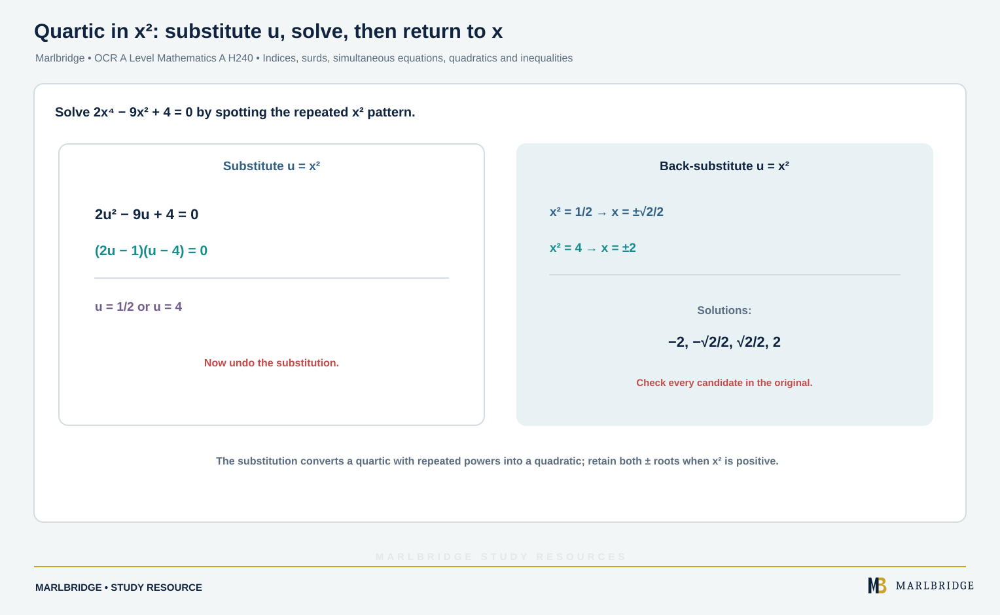

This guide is aligned to the OCR A Level Mathematics A (H240) specification, Version 3.1 (August 2026), and covers Stage 1 content in sections 1.02a to 1.02i of Algebra and Functions. Nothing here is marked as A Level only. The specification says Pure Mathematics is assessed in components 01, 02 and 03.

Related pages: [revision notes](/resources/ocr-a-level-mathematics-indices-surds-simultaneous-equations-quadratics-and-revision-notes/), [practice questions](/resources/ocr-a-level-mathematics-indices-surds-simultaneous-equations-quadratics-and-practice/), [Pure Mathematics overview](/resources/ocr-a-level-mathematics-pure-mathematics/), the [course hub](/boards/ocr/a-level/mathematics/) and the [printable checklist](/checklists/ocr/a-level/mathematics/). Not sure where to start? Take one of the [free diagnostics](/diagnostics/).

## What this unit covers

| Ref | You must be able to | Stage |
|---|---|---|
| 1.02a | Use the laws of indices for all rational exponents, including negative and zero | 1 |
| 1.02b | Use and manipulate surds, including rationalising the denominator | 1 |
| 1.02c | Solve simultaneous equations (one linear, one quadratic) by elimination and substitution | 1 |
| 1.02d | Work with quadratic functions, graphs and the discriminant | 1 |
| 1.02e | Complete the square for ax² + bx + c | 1 |
| 1.02f | Solve quadratics, including quadratics in a function of the unknown | 1 |
| 1.02g | Solve linear and quadratic inequalities and interpret them graphically | 1 |
| 1.02h | Express solutions with "and", "or", set notation and interval notation | 1 |
| 1.02i | Represent linear and quadratic inequalities as regions | 1 |

<figure class="topic-figure">
  
  <figcaption>The sign of b squared minus 4ac says whether the parabola crosses, touches or misses the x-axis.</figcaption>
</figure>

<figure class="topic-figure">
  
  <figcaption>With an unknown k, write the discriminant in k and read the ranges from its graph.</figcaption>
</figure>

<figure class="topic-figure">
  
  <figcaption>Completed-square form a(x + p)^2 + q gives the vertex (-p, q) and the line of symmetry x = -p.</figcaption>
</figure>


## 1.02a Indices

The specification lists these laws, for all rational exponents:

```
xᵃ × xᵇ = xᵃ⁺ᵇ     xᵃ ÷ xᵇ = xᵃ⁻ᵇ     (xᵃ)ᵇ = xᵃᵇ
x⁻ᵃ = 1/xᵃ          x^(m/n) = ⁿ√(xᵐ)     x⁰ = 1
```

Take the root first when you can: it keeps the numbers small. A negative power means "reciprocal", not "negative". Problems can combine several laws, so work one law at a time.

**Worked example 1.** Evaluate (a) 1296^(3/4) and (b) (8/27)^(−2/3).

```
(a) 1296^(1/4) = 6, so 1296^(3/4) = 6³ = 216
(b) (8/27)^(−2/3) = (27/8)^(2/3)        flip for the negative
                  = (³√27 / ³√8)²
                  = (3/2)² = 9/4
```

**Worked example 2.** Simplify (27x⁶/y⁹)^(2/3).

```
(27)^(2/3) = 3² = 9,  (x⁶)^(2/3) = x⁴,  (y⁹)^(2/3) = y⁶
Answer: 9x⁴/y⁶
```

**Worked example 3.** Solve x^(3/2) = 125, where x > 0.

```
x = 125^(2/3)         raise both sides to the power 2/3
  = (³√125)² = 5² = 25
```

<figure class="topic-figure">
  
  <figcaption>For a fractional index take the root first, then the power; a negative index flips the fraction.</figcaption>
</figure>


## 1.02b Surds

Surds are irrational roots, for example √2 or 3√5. The specification asks you to use surd and index notation as equivalent, so √x = x^(1/2).

Rules: √a × √b = √(ab), √a ÷ √b = √(a/b), and √(k²a) = k√a. Simplify by pulling out the largest square factor.

**Worked example 4.** Simplify √45 − √20 + √80.

```
√45 = 3√5,  √20 = 2√5,  √80 = 4√5
3√5 − 2√5 + 4√5 = 5√5
```

**Worked example 5.** Expand and simplify (3 + 2√5)².

```
= 9 + 2(3)(2√5) + (2√5)²
= 9 + 12√5 + 20 = 29 + 12√5
```

### Rationalising the denominator

If the denominator is one surd, multiply numerator and denominator by it. For a + b√c, multiply by the conjugate a − b√c. The product (a + b√c)(a − b√c) = a² − b²c is rational.

**Worked example 6.** Write 10/√8 in the form k√2.

```
10/√8 = 10/(2√2) = 5/√2 = 5√2/2
```

**Worked example 7.** Rationalise (7 + √2)/(3 − √2).

```
(7 + √2)(3 + √2) = 21 + 7√2 + 3√2 + 2 = 23 + 10√2
(3 − √2)(3 + √2) = 9 − 2 = 7
Answer: (23 + 10√2)/7
```

**Worked example 8.** Show that 3/(√5 + √2) = √5 − √2.

```
3(√5 − √2) / [(√5 + √2)(√5 − √2)] = 3(√5 − √2)/(5 − 2) = √5 − √2
```

<figure class="topic-figure">
  
  <figcaption>Surds with the same root combine like algebraic terms.</figcaption>
</figure>

<figure class="topic-figure">
  
  <figcaption>The conjugate pair multiplies to a rational number because (p - q)(p + q) = p squared minus q squared.</figcaption>
</figure>


## 1.02c Simultaneous equations

You may be given one linear and one quadratic equation. The method is always: rearrange the linear equation, substitute, solve the resulting quadratic, then substitute back to find the second variable. Brackets and fractions may appear, so clear them first.

**Worked example 9.** Solve y = x + 1 and x² + y² = 41.

```
x² + (x + 1)² = 41
2x² + 2x − 40 = 0  →  x² + x − 20 = 0
(x + 5)(x − 4) = 0
x = 4 → y = 5        x = −5 → y = −4
```

**Worked example 9b.** Solve x² − y = 4 and x + y = 8 by elimination.

```
Add the equations (the y terms cancel):  x² + x = 12  →  x² + x − 12 = 0
(x + 4)(x − 3) = 0  →  x = 3 or x = −4
Substitute into x + y = 8:  (3, 5) and (−4, 12)
```

Always pair each x with its own y. Substituting back into the quadratic instead can create false pairs. The pairs are not always whole numbers.

Graphically, the solutions are the intersection points of the line and the curve. A line and a curve can meet at two points, touch at one, or miss, and the discriminant of the quadratic you obtain tells you which.

**Worked example 10.** Decide how many times y = 2x + k meets y = x² − 4x + 10, depending on k.

```
x² − 4x + 10 = 2x + k  →  x² − 6x + (10 − k) = 0
Discriminant: 36 − 4(10 − k) = 4k − 4
```

Two points when k > 1, a tangent when k = 1, and no intersection when k < 1.

<figure class="topic-figure">
  
  <figcaption>The discriminant of the equation formed by equating a line and a curve tells you whether they cross, touch or miss.</figcaption>
</figure>


## 1.02d The quadratic function and discriminant

The equation y = ax² + bx + c draws a parabola. It is ∪-shaped when a > 0 and ∩-shaped when a < 0. It crosses the y-axis at (0, c). For ax² + bx + c = 0 the discriminant is b² − 4ac:

| Discriminant | Roots | Graph |
|---|---|---|
| b² − 4ac > 0 | two real distinct | crosses the x-axis twice |
| b² − 4ac = 0 | repeated | touches the x-axis |
| b² − 4ac < 0 | not real | does not meet the x-axis |

**Worked example 11.** Find k so that x² + (k + 1)x + 4 = 0 has a repeated root.

```
(k + 1)² − 16 = 0  →  k + 1 = ±4  →  k = 3 or k = −5
```

**Worked example 12.** Find the values of k for which kx² − 6x + 3 = 0 has two distinct real roots.

```
36 − 12k > 0  →  k < 3
It must also be a quadratic, so k ≠ 0.
Answer: k < 3, k ≠ 0
```

## 1.02e Completing the square

Write ax² + bx + c as a(x + p)² + q. This gives the line of symmetry x = −p and the turning point (−p, q). The sign of q, together with a, shows whether the graph meets the x-axis.

**Worked example 13.** Complete the square for f(x) = 3x² + 12x + 7.

```
3(x² + 4x) + 7 = 3[(x + 2)² − 4] + 7 = 3(x + 2)² − 5
```

The minimum point is (−2, −5) and the line of symmetry is x = −2. Setting f(x) = 0 gives (x + 2)² = 5/3, so x = −2 ± √15/3. The y-intercept is (0, 7).

**Worked example 14.** Show that −x² + 4x − 7 is negative for all x.

```
−(x − 2)² − 3
```

Since (x − 2)² ≥ 0, the expression is at most −3. It never reaches zero, which matches a discriminant of 16 − 28 = −12.

## 1.02f Solving quadratic equations

Three methods are expected: factorising, the formula x = [−b ± √(b² − 4ac)]/(2a), and completing the square. Use factorising first if the discriminant is a perfect square.

**Worked example 15.** Solve 6x² + x − 15 = 0 by factorising.

```
(2x − 3)(3x + 5) = 0  →  x = 3/2 or x = −5/3
```

**Worked example 16.** Solve x² − 4x − 1 = 0 by the formula.

```
x = [4 ± √(16 + 4)]/2 = [4 ± 2√5]/2 = 2 ± √5
```

### Quadratics in a function of the unknown

<!-- marlbridge-diagram:math-b63-quartic-substitution-x-squared -->
<figure class="lesson-diagram" style="margin: 2rem 0;">
  <a href="/public/images/learning/mathematics/math-b63-quartic-substitution-x-squared.svg" aria-label="Open full-size diagram: math-b63-quartic-substitution-x-squared"></a>
  <figcaption>The source substitution u=x² turns 2x⁴−9x²+4=0 into 2u²−9u+4=(2u−1)(u−4)=0. Back-substitution gives x=±√2/2 and x=±2; all four real solutions are retained. Select the image to enlarge it.</figcaption>
</figure>
<!-- /marlbridge-diagram:math-b63-quartic-substitution-x-squared -->


Look for a repeated pattern, replace it with a new letter, solve, then go back.

**Worked example 17.** Solve 2x⁴ − 9x² + 4 = 0.

```
Let u = x²:  2u² − 9u + 4 = 0  →  (2u − 1)(u − 4) = 0
u = 1/2 → x = ±√2/2        u = 4 → x = ±2
```

**Worked example 18.** Solve x − 7√x + 10 = 0.

```
Let u = √x:  u² − 7u + 10 = 0  →  u = 2 or 5  →  x = 4 or x = 25
```

**Worked example 19.** Solve 6/(x − 1)² − 5/(x − 1) = 1.

```
Let u = 1/(x − 1):  6u² − 5u − 1 = 0  →  (6u + 1)(u − 1) = 0
u = 1 → x = 2        u = −1/6 → x − 1 = −6 → x = −5
```

<figure class="topic-figure">
  
  <figcaption>When both sides are powers of the same base, equate the indices.</figcaption>
</figure>

<figure class="topic-figure">
  
  <figcaption>Substitute y = 3^x, solve the quadratic, then convert back to x.</figcaption>
</figure>


## 1.02g Linear and quadratic inequalities

Treat a linear inequality like an equation, except that multiplying or dividing by a negative number reverses the sign.

**Worked example 20.** Solve 5 − 3x < 14.

```
−3x < 9  →  x > −3        sign reversed
```

**Worked example 21.** Solve −4 < 2x + 3 ≤ 11.

```
−7 < 2x ≤ 8  →  −7/2 < x ≤ 4
```

**Worked example 22.** Solve (x + 1)/3 − (2x − 1)/4 ≥ 1/2.

```
Multiply by 12: 4(x + 1) − 3(2x − 1) ≥ 6
−2x + 7 ≥ 6  →  x ≤ 1/2
```

For a quadratic inequality, find the roots, sketch the parabola and read off where it is above or below the x-axis.

**Worked example 23.** Solve 3x² − x − 10 < 0.

```
(3x + 5)(x − 2) < 0, roots −5/3 and 2.
∪-shaped, so it is below the axis between the roots.
Answer: −5/3 < x < 2
```

**Worked example 24.** Solve (x + 4)(2x − 3) ≥ 0. The roots are −4 and 3/2, and the graph is above or on the axis outside them: x ≤ −4 or x ≥ 3/2.

## 1.02h Notation for solutions

Combine conditions with "and" (both true) or "or" (either true). The specification expects set notation for intervals and also interval notation.

| Statement | Set notation | Interval notation |
|---|---|---|
| x > 3 | {x : x > 3} | (3, ∞) |
| −2 ≤ x ≤ 4 | {x : −2 ≤ x ≤ 4} | [−2, 4] |
| x ≤ −4 or x ≥ 3/2 | {x : x ≤ −4} ∪ {x : x ≥ 3/2} | (−∞, −4] ∪ [3/2, ∞) |
| both x > 3 and x ≤ 4 | {x : x > 3} ∩ {x : x ≤ 4} | (3, 4] |

Square brackets include an end value; round brackets exclude it. Infinity always takes a round bracket. A union (∪) means "or", and an intersection (∩) means "and".

**Worked example 25.** Solve x² − 2x − 8 > 0 and 3x − 1 < 14 together.

```
x² − 2x − 8 > 0  →  (x + 2)(x − 4) > 0  →  x < −2 or x > 4
3x − 1 < 14      →  x < 5
Both:  x < −2  or  4 < x < 5
```

In set notation: {x : x < −2} ∪ {x : 4 < x < 5}. In interval notation: (−∞, −2) ∪ (4, 5). If the conditions share no values, the solution set is empty.

## 1.02i Regions

To show y > x + 1, draw the boundary y = x + 1 and shade the correct side. Use a dashed line for < or >, and a solid line for ≤ or ≥. For a quadratic boundary, sketch the parabola the same way. Test one point not on the boundary, such as (0, 0), to choose the side.

**Worked example 26.** Describe the region where y > x² − 4 and y ≤ x + 2.

```
Intersections: x² − 4 = x + 2 → x² − x − 6 = 0 → x = −2 or x = 3
Points: (−2, 0) and (3, 5)
Test (0, 0): 0 > −4 true; 0 ≤ 2 true, so (0, 0) is in the region.
```

The region lies between the parabola (dashed) and the line (solid), above the curve and below the line, bounded by the two intersection points.

## Common errors

- Writing 8^(−2/3) = −4. A negative index gives a reciprocal, so it equals 1/4.
- Squaring (3 + 2√5) as 9 + 20, leaving out 12√5.
- Multiplying by 3 − √2 instead of the conjugate 3 + √2 when rationalising.
- Forgetting to substitute back, or pairing an x with the wrong y.
- Reading the discriminant as the roots. It only counts them.
- Forgetting to multiply the squared term by a when you expand back to check a completed square.
- Dividing by a negative number but leaving the inequality sign unchanged.
- Giving "−4 ≥ x ≥ 3/2" for an "or" answer. Write two separate conditions.

## Frequently asked questions

**Which specification references does this OCR A Level Mathematics topic cover?**
It covers OCR A Level Mathematics A (H240) sections 1.02a to 1.02i: indices, surds, simultaneous equations, quadratic functions and the discriminant, completing the square, solving quadratics, inequalities, set notation and regions.

**How do you decide how many times a line meets a curve?**
Substitute the line into the curve to form a quadratic, then use its discriminant: positive means two intersections, zero means the line is a tangent, and negative means they do not meet.

**How do you solve an equation like 2x⁴ − 9x² + 4 = 0?**
Treat it as a quadratic in disguise: let u = x², solve for u, then take square roots, keeping both the positive and negative roots.

**How do you show a quadratic is negative for all x?**
Complete the square. For example, −x² + 4x − 7 = −(x − 2)² − 3, and since −(x − 2)² ≤ 0, the expression is at most −3, so it is always negative.

## Next steps

Work through the [revision notes](/resources/ocr-a-level-mathematics-indices-surds-simultaneous-equations-quadratics-and-revision-notes/), then try the [practice questions](/resources/ocr-a-level-mathematics-indices-surds-simultaneous-equations-quadratics-and-practice/). Tick off outcomes on the [checklist](/checklists/ocr/a-level/mathematics/), and use the [diagnostics](/diagnostics/) to check progress. Do these skills by hand, because they underpin later work in the [Pure Mathematics overview](/resources/ocr-a-level-mathematics-pure-mathematics/).

## Official syllabus

OCR, *A Level Mathematics A (H240)* specification, Version 3.1 (August 2026), for first assessment in 2018. Content references 1.02a to 1.02i.
