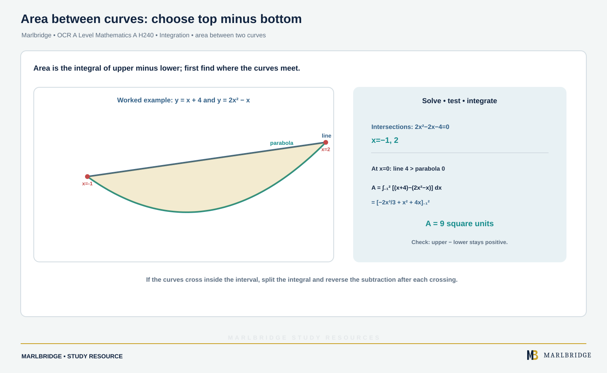

This guide covers the first part of integration in OCR A Level Mathematics A (H240), as set out in the OCR specification (Version 3.1, August 2026): content references 1.08a to 1.08f. The specification has two stages. Stage 1 is common to AS Level (H230) and A Level, and Stage 2 is A Level only. References 1.08a, 1.08b, 1.08d and 1.08e are Stage 1. Integrating e^kx, 1/x, sin kx and cos kx (1.08c) and finding areas between curves (1.08f) are A Level only. Pure Mathematics content is assessed on each of the three papers. Reverse chain rule, parts, substitution, partial fractions, the trapezium rule and differential equations are separate topics and are not taught here.

Use this guide with the [revision notes](/resources/ocr-a-level-mathematics-integration-basics-fundamental-theorem-indefinite-and-revision-notes/) and the [practice set](/resources/ocr-a-level-mathematics-integration-basics-fundamental-theorem-indefinite-and-practice/). Also see the [Pure Mathematics guide](/resources/ocr-a-level-mathematics-pure-mathematics/), the [course hub](/boards/ocr/a-level/mathematics/), the [checklist](/checklists/ocr/a-level/mathematics/) and the [free diagnostics](/diagnostics/).

## Scope at a glance

| Ref | What you must be able to do | Stage |
|---|---|---|
| 1.08a | Integration as the reverse of differentiation; the terms indefinite and definite | 1 |
| 1.08b | Integrate xⁿ (n ≠ -1), sums, differences and multiples; find c | 1 |
| 1.08c | Integrate e^kx, 1/x, sin kx, cos kx; double-angle formulae for cos²x | A Level only |
| 1.08d | Evaluate definite integrals | 1 |
| 1.08e | Area between a curve and the x-axis, including regions below the axis | 1 |
| 1.08f | Area between two curves, a line and a curve, or a curve and lines parallel to the axes; parametric curves | A Level only |

## 1.08a Integration as the reverse of differentiation

The specification states the fundamental theorem of calculus like this:

```
∫ f(x) dx = F(x) + c    when    f(x) = d/dx F(x)
```

An **indefinite** integral has no limits. Its answer is a function plus an arbitrary constant c, because every function F(x) + c has the same derivative. A **definite** integral has limits a and b, and its value is a number (1.08d). You can check any indefinite integral by differentiating your answer.

**Worked example 1.** Differentiate x sin x + cos x. Hence find ∫ x cos x dx and evaluate ∫₀^π x cos x dx.

```
d/dx (x sin x + cos x) = sin x + x cos x - sin x = x cos x
so  ∫ x cos x dx = x sin x + cos x + c
∫₀^π x cos x dx = [x sin x + cos x]₀^π = (0 - 1) - (0 + 1) = -2
```

<figure class="topic-figure">
  
  <figcaption>Integrating gives a family of curves; a known point picks out one of them.</figcaption>
</figure>


## 1.08b Integrating powers of x (Stage 1)

```
xⁿ  →  xⁿ⁺¹/(n + 1) + c        (n ≠ -1)
∫ (a f(x) ± b g(x)) dx = a ∫ f(x) dx ± b ∫ g(x) dx
```

Each power goes up by one and you divide by the new index. Integrate term by term. There is no product or quotient rule for integrals, so first rewrite each term as a power of x: roots become fractional powers and reciprocals become negative powers. Expand brackets and split fractions before integrating.

**Worked example 2.** Find ∫ (7x⁶ - 10/(x√x) + 4∛x) dx.

```
= ∫ (7x⁶ - 10x^(-3/2) + 4x^(1/3)) dx
= x⁷ - 10x^(-1/2)/(-1/2) + 4x^(4/3)/(4/3) + c
= x⁷ + 20/√x + 3x^(4/3) + c
```

**Worked example 3.** Find ∫ (3x - 2)²/√x dx.

```
(3x - 2)² = 9x² - 12x + 4, so the integrand is 9x^(3/2) - 12x^(1/2) + 4x^(-1/2)
∫ = 9x^(5/2)/(5/2) - 12x^(3/2)/(3/2) + 4x^(1/2)/(1/2) + c
  = (18/5)x^(5/2) - 8x^(3/2) + 8√x + c
```

**Finding the constant.** One point on the curve fixes c.

**Worked example 4.** A curve has dy/dx = 6√x - 2/x² and passes through (1, 5). Find y.

```
y = ∫ (6x^(1/2) - 2x^(-2)) dx = 4x^(3/2) + 2/x + c
At x = 1: 4 + 2 + c = 5, so c = -1
y = 4x^(3/2) + 2/x - 1
```

## 1.08c Standard integrals (A Level only)

For a constant k ≠ 0:

| Integrand | Antiderivative (add c) |
|---|---|
| cos kx | (1/k) sin kx |
| e^kx | (1/k) e^kx |
| sin kx | -(1/k) cos kx |
| 1/x | ln\|x\| |

Differentiate the right-hand side to see each one: d/dx e^kx = k e^kx, which is why you divide by k. The modulus in ln\|x\| matters, because 1/x is defined for negative x as well. These rules apply to functions of kx only. Anything with a bracket such as (2x + 1) inside the function needs methods from a different topic. The specification adds that integrals of arcsin, arccos and arctan will be given if required.

**Worked example 5.** Find ∫ (20e^(5x) - 9/x + 6 sin 3x - 8 cos(2x/3)) dx.

```
20e^(5x)        →  (20/5)e^(5x) = 4e^(5x)
-9/x            →  -9 ln|x|
6 sin 3x        →  6 × (-1/3) cos 3x = -2 cos 3x
-8 cos(2x/3)    →  -8 × (3/2) sin(2x/3) = -12 sin(2x/3)
Answer: 4e^(5x) - 9 ln|x| - 2 cos 3x - 12 sin(2x/3) + c
```

**Worked example 6.** Expand or split first. Find ∫ (eˣ + 3)² dx and ∫ (3x² + 4x - 5)/x dx.

```
(eˣ + 3)² = e^(2x) + 6eˣ + 9   →   (1/2)e^(2x) + 6eˣ + 9x + c
(3x² + 4x - 5)/x = 3x + 4 - 5/x   →   (3/2)x² + 4x - 5 ln|x| + c
```

**Double-angle formulae.** The specification includes functions such as cos²x. Use cos 2A = 2cos²A - 1 and cos 2A = 1 - 2sin²A to write

```
cos²A = (1 + cos 2A)/2        sin²A = (1 - cos 2A)/2
```

**Worked example 7.** Find ∫ sin² 3x dx.

```
sin² 3x = (1 - cos 6x)/2
∫ = x/2 - (1/2)(1/6) sin 6x + c = x/2 - (sin 6x)/12 + c
```

## 1.08d Definite integrals (Stage 1)

```
∫ₐᵇ f(x) dx = [F(x)]ₐᵇ = F(b) - F(a)
```

The constant c cancels, so leave it out. Swapping the limits changes the sign, and ∫ₐᶜ = ∫ₐᵇ + ∫ᵇᶜ. Give exact answers (π, e, ln) unless the question asks for decimals. One of the specification's examples of "you must show detailed reasoning" is a definite integral, and it says that writing down only a calculator's answer would not be awarded any marks there. Always show the antiderivative and the substitution of the limits.

**Worked example 8.** Evaluate ∫₀^(ln 3) (6e^(2x) - 4e^(-x)) dx.

```
= [3e^(2x) + 4e^(-x)]₀^(ln 3)
At ln 3: 3 × 9 + 4 × (1/3) = 27 + 4/3
At 0: 3 + 4 = 7
Answer: 27 + 4/3 - 7 = 64/3
```

**Worked example 9.** Evaluate ∫₀^(π/3) cos²x dx, and ∫_(-6)^(-2) (3/x) dx.

```
cos²x = (1 + cos 2x)/2, so ∫ = [x/2 + (sin 2x)/4]₀^(π/3)
= π/6 + (√3/2)/4 = π/6 + √3/8

∫_(-6)^(-2) 3/x dx = [3 ln|x|]_(-6)^(-2) = 3 ln 2 - 3 ln 6 = -3 ln 3
```

The second answer is negative because 1/x is negative between -6 and -2. Writing ln(-2) would be undefined, which is why the modulus is needed.

**Worked example 10.** Given that p > 1 and ∫₁^p (6 - 12/x²) dx = 0, find p.

```
[6x + 12/x]₁^p = (6p + 12/p) - 18 = 0
6p² - 18p + 12 = 0  →  p² - 3p + 2 = 0  →  p = 1 or 2
p > 1, so p = 2
```

<figure class="topic-figure">
  
  <figcaption>As strips get thinner, the rectangle sums close in on the integral.</figcaption>
</figure>

<figure class="topic-figure">
  
  <figcaption>An infinitely long region can still have a finite area.</figcaption>
</figure>

<figure class="topic-figure">
  
  <figcaption>With a substitution, convert the limits and the definite integral keeps its value.</figcaption>
</figure>


## 1.08e Area between a curve and the x-axis (Stage 1)

The specification defines this area as the region enclosed by the curve, the x-axis and two ordinates (vertical lines x = a and x = b). If the curve is above the axis on [a, b], the area is ∫ₐᵇ y dx. If it is wholly below, the integral is negative and the area is its modulus. If the curve crosses the axis, a single integral gives a **net** (signed) value, not the area.

**Regions partly above and partly below:** find the x-intercepts inside the interval, integrate on each piece separately, take the positive size of each piece and add.

**Worked example 11.** Find the area enclosed by y = x(x - 2)(x - 5), the x-axis, x = 0 and x = 5.

```
y = x³ - 7x² + 10x, an antiderivative is x⁴/4 - 7x³/3 + 5x²
Sign of y: positive for 0 < x < 2, negative for 2 < x < 5
∫₀² y dx = 4 - 56/3 + 20 = 16/3
∫₂⁵ y dx = -125/12 - 16/3 = -63/4  (so the piece has area 63/4)
Area = 16/3 + 63/4 = 253/12
```

One integral from 0 to 5 would give -125/12, which is not an area.

**Worked example 12.** Find the area between y = 4 cos 2x and the x-axis, 0 ≤ x ≤ π/2.

```
∫₀^(π/2) 4 cos 2x dx = [2 sin 2x]₀^(π/2) = 0   (the two halves cancel)
∫₀^(π/4) 4 cos 2x dx = 2, and the part from π/4 to π/2 has the same size
Area = 2 + 2 = 4
```

### Lines parallel to the axes (A Level only)

The Stage 2 wording extends this to regions enclosed by a curve and lines running parallel to the axes. For a region lying against the y-axis, express x using y and use area = ∫ x dy between the two y-values.

**Worked example 13.** Find the area between the curve y = x^(3/2) and the y-axis for 1 ≤ y ≤ 8.

```
x = y^(2/3)
Area = ∫₁⁸ y^(2/3) dy = [(3/5)y^(5/3)]₁⁸ = (3/5)(32 - 1) = 93/5
```

### Parametric curves (A Level only)

For x = x(t), y = y(t), use ∫ y dx = ∫ y (dx/dt) dt and change the limits to values of t.

**Worked example 14.** x = t², y = 6t for t > 0. Find the area under the curve between x = 1 and x = 9.

```
x = 1 → t = 1;  x = 9 → t = 3;  dx/dt = 2t
Area = ∫₁³ 6t × 2t dt = ∫₁³ 12t² dt = [4t³]₁³ = 108 - 4 = 104
Check: the curve is y = 6√x, and ∫₁⁹ 6√x dx = [4x^(3/2)]₁⁹ = 104
```

<figure class="topic-figure">
  
  <figcaption>Regions below the axis give negative integrals, so find the area in separate pieces.</figcaption>
</figure>

<figure class="topic-figure">
  
  <figcaption>The area between two curves is the integral of the top curve minus the bottom curve.</figcaption>
</figure>

<figure class="topic-figure">
  
  <figcaption>Rotating a region makes thin discs of radius y whose volumes add to π∫y² dx.</figcaption>
</figure>

<figure class="topic-figure">
  
  <figcaption>Integration by parts is the statement that two complementary areas fill a rectangle.</figcaption>
</figure>


## 1.08f Area between two curves (A Level only)

<!-- marlbridge-diagram:math-b65-area-between-curves -->
<figure class="lesson-diagram" style="margin: 2rem 0;">
  <a href="/public/images/learning/mathematics/math-b65-area-between-curves.svg" aria-label="Open full-size diagram: math-b65-area-between-curves"></a>
  <figcaption>For y=x+4 and y=2x²−x, intersections are −1 and 2. At x=0 the line is above. Integrating the vertical difference over [−1,2] gives 9 square units, matching source worked example 15. Select the image to enlarge it.</figcaption>
</figure>
<!-- /marlbridge-diagram:math-b65-area-between-curves -->


Let y = f(x) be the upper curve and y = g(x) the lower curve for a ≤ x ≤ b. Then

```
A = ∫ₐᵇ (f(x) - g(x)) dx
```

This holds even below the x-axis, because subtracting measures the vertical gap. Find the limits by solving f(x) = g(x). Test one x-value in between to see which curve is on top. If the curves cross inside the interval, split at each crossing and swap the order of subtraction.

**Worked example 15.** Find the area between the curve y = 2x² - x and the line y = x + 4.

```
2x² - x = x + 4  →  2x² - 2x - 4 = 0  →  x = -1 or 2
At x = 0: line = 4, curve = 0, so the line is above
A = ∫ from -1 to 2 of (x + 4 - 2x² + x) dx = ∫ (-2x² + 2x + 4) dx
  = [-2x³/3 + x² + 4x] from -1 to 2 = (-16/3 + 4 + 8) - (2/3 + 1 - 4) = 20/3 + 7/3 = 9
```

**Worked example 16.** Find the total area enclosed between y = x³ and y = 3x² - 2x.

```
x³ - 3x² + 2x = x(x - 1)(x - 2) = 0  →  x = 0, 1, 2
On (0, 1) the cubic is above (x = 1/2: 1/8 against -1/4); on (1, 2) the quadratic is above
∫₀¹ (x³ - 3x² + 2x) dx = 1/4 - 1 + 1 = 1/4
∫₁² (3x² - 2x - x³) dx = 1/4
Area = 1/2
```

One integral from 0 to 2 would give 0, the trap from example 12.

<figure class="topic-figure">
  
  <figcaption>Splitting into partial fractions splits the area into two simple logarithmic bands.</figcaption>
</figure>


## Common errors

- Missing +c on an indefinite integral, or adding +c to a definite one.
- Forgetting to divide by k: ∫ e^(3x) dx is (1/3)e^(3x), not 3e^(3x).
- Losing the minus sign in ∫ sin kx dx = -(1/k) cos kx.
- Applying the xⁿ rule to n = -1 instead of using ln\|x\|.
- Integrating a squared bracket or a product term by term. Expand first.
- Writing ∫ sin² 3x dx as a power of sin 3x. Use the double-angle form.
- Reporting a net integral as an area when the curve crosses the axis.
- Subtracting the wrong way round for two curves, or ignoring a crossing between the limits.
- Using x-limits in a parametric integral after changing to t.

## Official syllabus

This guide follows content references 1.08a to 1.08f of the OCR A Level in Mathematics A (H240) specification, Version 3.1 (August 2026), for first assessment in 2018, published by OCR.
