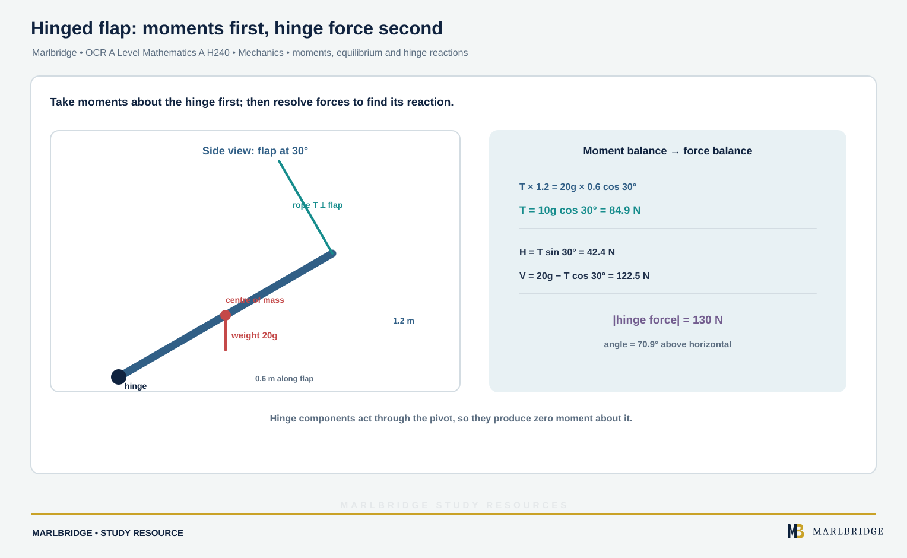

This guide covers moments and statics of rigid bodies in OCR A Level Mathematics A (H240), content references 3.04a to 3.04c of the Cambridge OCR specification, Version 3.1 (August 2026). All of 3.04 is Stage 2, so it is A Level only and is not part of AS. The specification lists Mechanics within Paper 3, Pure Mathematics and Mechanics. For the unit of moment, see the [units and kinematics guide](/resources/ocr-a-level-mathematics-quantities-units-and-kinematics-with-constant/). When you finish, use the [revision notes](/resources/ocr-a-level-mathematics-moments-and-statics-of-rigid-bodies-revision-notes/) and the [practice questions](/resources/ocr-a-level-mathematics-moments-and-statics-of-rigid-bodies-practice/). Wider links: the [course hub](/boards/ocr/a-level/mathematics/), the [checklist](/checklists/ocr/a-level/mathematics/) and the [free diagnostics](/diagnostics/).

## What this unit covers

| Reference | You must be able to | Stage |
|---|---|---|
| 3.04a | Calculate the moment of a force about an axis through a point in the plane of the body (for coplanar forces, "about a point") | A Level only |
| 3.04b | Know that a rigid body in equilibrium has zero resultant force and zero resultant moment | A Level only |
| 3.04c | Use moments in simple static contexts, such as a horizontal beam or a ladder on horizontal ground against a vertical wall | A Level only |

The specification excludes the vector nature of moments. You treat a moment as a turning effect that is clockwise or anticlockwise. Problems are modelled with rectangular laminas and uniform or non-uniform rods only. Take g as 9.8 m s⁻² unless a question says otherwise, which the specification allows.

## The moment of a force (3.04a)

A force turns a body about a point. The size of the turning effect is the **moment**:

```
moment = force × shortest distance from the point to the line of action
```

The unit is N m. The perpendicular distance is the shortest distance from the point to the line along which the force acts, so it is measured at right angles to that line.

Three consequences:

- A force whose line of action passes through the point has zero moment about it.
- Moving a force along its own line of action does not change its moment.
- For a force F at angle θ to a rod, at distance d from the point along the rod, the perpendicular distance is d sin θ. The moment is F d sin θ. Equivalently, resolve F: only the component perpendicular to the rod, F sin θ, turns the rod.

Choose a positive sense, usually anticlockwise, and give every moment a sign.

**Worked example 1.** (a) A force of 40 N acts at the end P of a horizontal rod OP, where OP = 0.65 m. The force makes 35° with the rod. Find its moment about O. (b) A rectangular lamina ABCD has AB = 0.9 m horizontal and BC = 0.4 m, with A at the bottom left. Forces act in the plane of the lamina: 10 N vertically upwards at B, 6 N horizontally to the right at C, and 4 N vertically downwards at D. Find the total moment about A.

```
(a) moment = 40 × 0.65 × sin 35° = 14.9 N m (3 s.f.)

(b) 10 N at B: perpendicular distance 0.9 m, anticlockwise: +10 × 0.9 = +9.0
    6 N at C:  line of action is 0.4 m above A, clockwise: −6 × 0.4 = −2.4
    4 N at D:  D is directly above A, so the line of action passes
               through A: 0
    total = 9.0 − 2.4 + 0 = 6.6 N m anticlockwise
```

<figure class="topic-figure">
  
  <figcaption>Resolve the weight along and across the slope: R = mg cos θ and the net force down the slope is mg sin θ − μR.</figcaption>
</figure>


## Equilibrium of a rigid body (3.04b)

A rigid body does not change shape. It is in equilibrium when it neither accelerates nor starts to turn, so two conditions hold together:

1. The resultant force is zero. Split every force into horizontal and vertical parts (or any two perpendicular directions) and set each sum to zero.
2. The resultant moment about any point is zero. Clockwise moments equal anticlockwise moments.

You may take moments about any point. Choose the point where the most unknown forces act, because those forces then have zero moment and drop out. Taking moments first often gives one unknown straight away.

You can only use "weight acts at the midpoint" and similar facts because the specification lets you assume them:

| Body | Where the weight acts |
|---|---|
| Uniform rod | at its midpoint |
| Non-uniform rod | at a point given in the question, or found by moments |
| Rectangular lamina | at its point of symmetry, the centre of the rectangle |

A **light** rod has negligible weight. A **particle** is a point mass, so its weight acts at its position.

<figure class="topic-figure">
  
  <figcaption>In equilibrium the forces sum to zero in every direction, so they close into a triangle.</figcaption>
</figure>

<figure class="topic-figure">
  
  <figcaption>Treat the whole system first, then one part to find the tow-bar force; a rigid bar can push (thrust).</figcaption>
</figure>


## Beams on supports (3.04c)

For a horizontal beam on two vertical supports, every force is vertical. Moments about one support give the other reaction. Resolving vertically gives the first. Check with moments about the second support.

**Worked example 2.** A uniform plank AB has length 5 m and mass 22 kg. It is supported horizontally at C and D, with AC = 0.5 m and DB = 1.5 m. A person of mass 55 kg stands 1 m from end A. Find the two support reactions.

```
Distances from C: centre of plank 2.0 m, person 0.5 m, D is 3.0 m.
Moments about C:
  R_D × 3.0 = 55g × 0.5 + 22g × 2.0 = 71.5g
  R_D = 71.5 × 9.8 ÷ 3 = 233.6 N (3 s.f.)
Resolve vertically:
  R_C + R_D = 77g = 754.6
  R_C = 754.6 − 233.57 = 521.0 N (3 s.f.)
Check, moments about D: R_C × 3.0 = 1563.1 and 22g × 1.0 + 55g × 2.5 = 1563.1.
```

### Tilting

A beam on two supports is **about to tilt** about one support when the reaction at the other support becomes zero. At that moment the beam is in limiting equilibrium. Set that reaction to zero, then take moments about the support that is still working.

**Worked example 3.** A uniform beam AB has length 4.4 m and mass 16 kg. It is supported at C and D, with AC = 0.8 m and DB = 1.0 m. A block of mass m kg is placed at B. Find the greatest value of m for which the beam stays in equilibrium on both supports.

```
Tilting about D: R_C = 0. D is 3.4 m from A. The centre is 2.2 m
from A, so it is 1.2 m from D on the A side. B is 1.0 m from D.
Moments about D: m g × 1.0 = 16 g × 1.2
m = 19.2
```

The greatest mass is **19.2 kg**. If the block went at A instead, the beam would tilt about C and the same method gives m × 0.8 = 16 × 1.4, so m = 28.

### Non-uniform rods

If the centre of mass G is not at the midpoint, its position is either given or found by moments.

**Worked example 4.** A non-uniform rod AB has length 2.4 m and mass 8 kg. A particle of mass 3 kg is attached at A. The rod then balances horizontally on a pivot 1.0 m from A. Find AG.

```
Let AG = x. The 3 kg particle is 1.0 m from the pivot (A side).
G is on the other side of the pivot (assume x > 1) at distance x − 1.
Moments about the pivot: 3g × 1.0 = 8g × (x − 1)
x − 1 = 0.375, so x = 1.375
```

AG = **1.375 m**. This is on the B side of the midpoint, 1.2 m from A, so the assumption x > 1 holds.

<figure class="topic-figure">
  
  <figcaption>Take moments about a support to remove its reaction; clockwise moments equal anticlockwise moments.</figcaption>
</figure>


## Hinges and laminas (3.04c)

<!-- marlbridge-diagram:math-b65-hinge-lamina-moments-and-reaction -->
<figure class="lesson-diagram" style="margin: 2rem 0;">
  <a href="/public/images/learning/mathematics/math-b65-hinge-lamina-moments-and-reaction.svg" aria-label="Open full-size diagram: math-b65-hinge-lamina-moments-and-reaction"></a>
  <figcaption>For the source uniform 1.2 m, 20 kg flap at 30°, T=10g cos30°=84.9 N. Resolving gives H=42.4 N and V=122.5 N; resultant is about 130 N at 70.9°. Select the image to enlarge it.</figcaption>
</figure>
<!-- /marlbridge-diagram:math-b65-hinge-lamina-moments-and-reaction -->


A hinge supplies a force of unknown size and direction. Do not guess its direction. Call its components H (horizontal) and V (vertical), then find them by resolving. Take moments about the hinge, because both H and V then have zero moment.

**Worked example 5.** A uniform rectangular flap has width 1.2 m and mass 20 kg. It is hinged along its lower edge on a horizontal base and held open at 30° above the horizontal by a light rope attached to the free edge. The rope is perpendicular to the flap, in the vertical plane through the flap's mid-line. Find the tension T and the force at the hinge.

```
Side view: the weight acts at the centre of the flap, 0.6 m along
the flap from the hinge. Its perpendicular distance is 0.6 cos 30°.
Moments about the hinge:
  T × 1.2 = 20g × 0.6 cos 30°
  T = 10g cos 30° = 84.9 N (3 s.f.)

The rope direction is perpendicular to the flap. Its components are
T cos 30° upwards and T sin 30° horizontally towards the hinge side.
Horizontal: H = T sin 30° = 42.4 N, in the direction the flap leans
Vertical:   V = 20g − T cos 30° = 196 − 73.5 = 122.5 N upwards
Magnitude = √(42.4² + 122.5²) = 130 N (3 s.f.)
Angle above horizontal = tan⁻¹(122.5 ÷ 42.4) = 70.9°
```

<figure class="topic-figure">
  
  <figcaption>A pull at an angle lowers R and so the friction limit; a push at an angle raises it.</figcaption>
</figure>

<figure class="topic-figure">
  
  <figcaption>The resultant of tension and weight points to the centre of the circle and equals mrω².</figcaption>
</figure>


## Ladders (3.04c)

The specification names a ladder resting on horizontal ground against a vertical wall. The usual model is a uniform rod. A smooth wall gives a reaction S that is horizontal, and the rough ground gives a normal reaction R (vertical) and a friction force F (horizontal). Friction is covered in specification item 3.03t: in limiting equilibrium F = μR, and in general F ≤ μR.

Equilibrium gives three equations:

```
Vertical:    R = total weight
Horizontal:  F = S
Moments about the foot of the ladder eliminate R and F,
giving S directly.
```

**Worked example 6.** A uniform ladder of length 6.5 m and mass 24 kg has its foot on rough horizontal ground and its top against a smooth vertical wall, at a height of 6.0 m. A person of mass 70 kg stands 3.9 m up the ladder. Find the smallest coefficient of friction that stops the ladder slipping.

```
The foot is √(6.5² − 6.0²) = 2.5 m from the wall.
Horizontal distances from the foot: ladder's centre 1.25 m,
person 3.9 × (2.5 ÷ 6.5) = 1.5 m.
Moments about the foot:
  S × 6.0 = 24g × 1.25 + 70g × 1.5 = 135g
  S = 22.5g = 220.5 N
Vertical: R = 94g = 921.2 N. Horizontal: F = S = 220.5 N.
F ≤ μR requires μ ≥ 220.5 ÷ 921.2 = 0.239 (3 s.f.)
```

The smallest coefficient is **0.239**.

## Common errors

- Using the distance along the rod when the force is not perpendicular to it. Use d sin θ, or resolve first.
- Mixing up which weight is at which distance. Draw the beam, label every distance from your chosen point, and then write the equation.
- Treating a hinge force as purely vertical or purely horizontal without checking by resolving.
- Forgetting that at the point of tilting the reaction at the other support is zero, not that the total reaction is zero.
- Writing a moment in N rather than N m, or leaving out its sense in a resultant.
- Resolving forces correctly but taking moments about a point where you then include forces that act through it. Such forces contribute nothing.
- On a ladder, assuming friction equals μR when the ladder is not in limiting equilibrium.

For a quick recap of the method and formulas, go to the [revision notes](/resources/ocr-a-level-mathematics-moments-and-statics-of-rigid-bodies-revision-notes/), then test yourself with the [practice questions](/resources/ocr-a-level-mathematics-moments-and-statics-of-rigid-bodies-practice/). The [exam preparation page](/resources/ocr-a-level-mathematics-exam-preparation/) gives wider advice.

<figure class="topic-figure">
  
  <figcaption>Friction matches the push up to a maximum μR; only when on the point of moving or sliding is F = μR.</figcaption>
</figure>


## Frequently asked questions

**What does moments cover in OCR A Level Mathematics A (H240)?**
References 3.04a to 3.04c cover the moment of a force, equilibrium of a rigid body, and problems with beams on supports, tilting, non-uniform rods, hinges, laminas and ladders.

**When is a beam about to tilt?**
A beam on two supports is about to tilt about one support when the reaction at the other support becomes zero. Set that reaction to zero and take moments about the support that remains.

**Where does the weight of a rectangular lamina act?**
The weight of a uniform rectangular lamina acts at its point of symmetry, the centre of the rectangle.

**Which point should you take moments about?**
Choosing a point where an unknown force acts removes that force from the equation, because a force through the point has zero moment about it. Do not include such forces in the moments equation.

## Official syllabus

Cambridge OCR Level 3 Advanced GCE in Mathematics A (H240), Version 3.1 (August 2026), first assessment 2018, published by OCR. Content references 3.04a to 3.04c.
