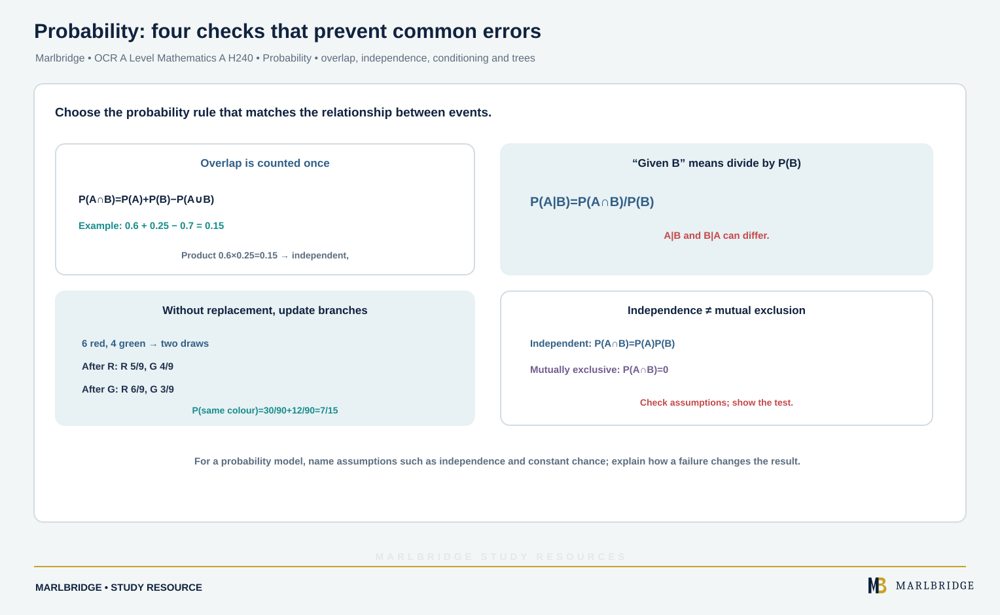

This guide covers section 2.03 Probability in the OCR A Level Mathematics A (H240) specification, Version 3.1 (August 2026), for first assessment in 2018. It teaches 2.03a to 2.03e. The specification has two stages. Stage 1 content (2.03a and 2.03b) is shared with AS. Conditional probability, the two formulae and modelling (2.03c to 2.03e) are **A Level only** (Stage 2).

Course hub: [/boards/ocr/a-level/mathematics/](/boards/ocr/a-level/mathematics/). Printable checklist: [/checklists/ocr/a-level/mathematics/](/checklists/ocr/a-level/mathematics/). Check where you stand with the [free diagnostics](/diagnostics/). Next, use the [revision notes](/resources/ocr-a-level-mathematics-probability-venn-and-tree-diagrams-conditional-revision-notes/) and the [practice questions](/resources/ocr-a-level-mathematics-probability-venn-and-tree-diagrams-conditional-practice/). For the wider course see [OCR A Level Mathematics: Statistics](/resources/ocr-a-level-mathematics-statistics/).

## What this unit covers

| Ref | What you must be able to do | Stage |
|---|---|---|
| 2.03a | Use mutually exclusive and independent events; use P(A), P(A'), P(X = 2), P(X = x); link probability to probability distributions | 1 |
| 2.03b | Use tree, sample space and Venn diagrams to calculate probabilities | 1 |
| 2.03c | Use conditional probability with tree diagrams, Venn diagrams and two-way tables; use A ∩ B, A ∪ B, A \| B and the two formulae | A Level only |
| 2.03d | Calculate conditional probability from first principles; use P(A \| B) = P(A ∩ B) / P(B) | A Level only |
| 2.03e | Model with probability; critique assumptions and the effect of more realistic ones | A Level only |

The specification excludes using the formula in 2.03d to find P(A | B) from P(B | A). This guide does not teach that reversal.

<figure class="topic-figure">
  
  <figcaption>Counting cells in the sample space shows P(A and B) equals P(A) x P(B).</figcaption>
</figure>


## 2.03a Notation, mutually exclusive and independent events

P(A) is the probability that event A happens. A' is the complement ("not A"), so P(A') = 1 − P(A). For a random variable X, P(X = 2) is the probability that X takes the value 2, and P(X = x) is the general form.

| Idea | Meaning | Rule |
|---|---|---|
| Mutually exclusive | A and B never occur together | P(A ∩ B) = 0, so P(A ∪ B) = P(A) + P(B) |
| Independent | one event does not change the chance of the other | P(A ∩ B) = P(A) × P(B) |

The two ideas are different. Two events that are mutually exclusive, each with a non-zero probability, can never be independent: once A has happened, B is certain not to.

**Worked example 1 (distribution).** A random variable X is defined by P(X = x) = k(5 − x), where x can be 1, 2, 3 or 4. Work out k and P(X ≥ 3). Then two independent values of X are observed: find the probability that they are the same.

```
Probabilities add to 1:  k(4 + 3 + 2 + 1) = 1, so 10k = 1 and k = 0.1
P(X = x):  x = 1: 0.4   x = 2: 0.3   x = 3: 0.2   x = 4: 0.1
P(X ≥ 3) = 0.2 + 0.1 = 0.3
P(equal) = 0.4² + 0.3² + 0.2² + 0.1² = 0.16 + 0.09 + 0.04 + 0.01 = 0.3
```

**Worked example 2 (testing for independence).** P(A) = 0.6, P(B) = 0.25 and P(A ∪ B) = 0.7. Decide whether A and B are independent.

```
P(A ∩ B) = P(A) + P(B) − P(A ∪ B) = 0.6 + 0.25 − 0.7 = 0.15
P(A) × P(B) = 0.6 × 0.25 = 0.15
```

The two values match, so A and B are independent. They can occur together, so they are not mutually exclusive. (The union formula used in the first line is listed under Stage 2; at Stage 1 you would read P(A ∩ B) from a Venn diagram.)

<figure class="topic-figure">
  
  <figcaption>Independence is an overlap equal to the product; exclusivity is no overlap at all.</figcaption>
</figure>


## 2.03b Diagrams (Stage 1)

Choose the diagram that fits the situation. A sample space diagram suits two stages with listable outcomes. A tree diagram suits ordered stages. A Venn diagram suits overlapping groups. Always check that the probabilities on the branches leaving a node add to 1.

**Worked example 3 (sample space).** A fair four-sided die (faces 1 to 4) is rolled and a spinner is spun. The spinner shows 1 with probability 0.5, 2 with probability 0.3 and 3 with probability 0.2. The score is the sum. Find P(score = 4) and P(score ≥ 6).

```
Sum      spinner 1   spinner 2   spinner 3
die 1        2           3           4
die 2        3           4           5
die 3        4           5           6
die 4        5           6           7
```

Each die face has probability 1/4. Score 4 arises from (die 1, spinner 3), (die 2, spinner 2) and (die 3, spinner 1):

```
P(score = 4) = 1/4 × (0.2 + 0.3 + 0.5) = 0.25
Score ≥ 6: (die 3, spinner 3), (die 4, spinner 2), (die 4, spinner 3)
P(score ≥ 6) = 1/4 × (0.2 + 0.3 + 0.2) = 0.175
```

**Worked example 4 (Venn diagram).** Of 90 members of a leisure centre, 52 use the gym (G), 38 use the pool (P) and 20 use both. Find the number who use neither, then P(G ∪ P) and the probability of using exactly one facility.

```
Both = 20.  Gym only = 52 − 20 = 32.  Pool only = 38 − 20 = 18.
Neither = 90 − (32 + 20 + 18) = 20
P(G ∪ P) = 70/90 = 7/9
P(exactly one) = (32 + 18)/90 = 5/9
```

**Worked example 5 (tree, independent stages).** On a morning commute the train is late with probability 0.2 and, independently, the bus is late with probability 0.1. Find P(exactly one is late) and P(at least one is late).

```
P(exactly one) = P(train late, bus on time) + P(train on time, bus late)
               = 0.2 × 0.9 + 0.8 × 0.1 = 0.18 + 0.08 = 0.26
P(at least one) = 1 − P(neither) = 1 − 0.8 × 0.9 = 0.28
```

<figure class="topic-figure">
  
  <figcaption>Adding P(A) and P(B) counts the overlap twice, so it is subtracted once.</figcaption>
</figure>


## 2.03c Conditional probability (A Level only)

In P(B | A), the bar is read "given": the chance of B once A is known to have happened. Two formulae are required:

| Formula | Use |
|---|---|
| P(A ∩ B) = P(A) × P(B \| A) | multiply along the branches of a tree |
| P(A ∪ B) = P(A) + P(B) − P(A ∩ B) | stops the overlap being counted twice |

When stages are dependent (for example, selection without replacement), the second-stage branches change according to the first outcome. Independence is the special case P(B | A) = P(B).

**Worked example 6 (tree, no replacement).** A box has 6 red and 4 green counters. Two are taken at random without replacement. Find P(same colour) and P(at least one green).

```
First:  R 6/10   G 4/10
After R: R 5/9   G 4/9
After G: R 6/9   G 3/9

P(RR) = 6/10 × 5/9 = 30/90       P(GG) = 4/10 × 3/9 = 12/90
P(same colour) = 42/90 = 7/15
P(at least one green) = 1 − P(RR) = 1 − 30/90 = 2/3
```

Reading a conditional probability straight off the tree: P(second is green | first is red) = 4/9.

**Worked example 7 (two-way table).** A company has 150 staff, classed by travel mode and site.

| | North | South | Total |
|---|---|---|---|
| Car | 30 | 20 | 50 |
| Bus | 18 | 27 | 45 |
| Cycle | 22 | 33 | 55 |
| Total | 70 | 80 | 150 |

Find P(Cycle | South). Then decide whether "Car" and "North" are independent.

```
P(Cycle | South) = 33/80      (restrict to the South column)
P(Car) = 50/150 = 1/3
P(Car | North) = 30/70 = 3/7
```

Since 3/7 ≠ 1/3, the events are not independent.

**Worked example 8 (Venn and formulae).** P(A) = 0.58, P(B) = 0.35 and P(A ∪ B) = 0.8. Find P(A ∩ B), then P(A' | B').

```
P(A ∩ B) = 0.58 + 0.35 − 0.8 = 0.13
P(A' ∩ B') = 1 − P(A ∪ B) = 0.2
P(B') = 1 − 0.35 = 0.65
P(A' | B') = 0.2 / 0.65 = 4/13
```

<figure class="topic-figure">
  
  <figcaption>Without replacement the second-stage branches change, and the complement 1 - P(RR) gives at least one blue quickly.</figcaption>
</figure>

<figure class="topic-figure">
  
  <figcaption>The word given restricts you to one row or column, so its total is the denominator.</figcaption>
</figure>

<figure class="topic-figure">
  
  <figcaption>The condition becomes the new sample space and sits in the denominator.</figcaption>
</figure>

<figure class="topic-figure">
  
  <figcaption>Reversing the condition means dividing one tree path by all paths that end in the observed outcome.</figcaption>
</figure>


## 2.03d Conditional probability from first principles (A Level only)

Given that B has happened, B becomes the whole sample space. Count or add only the outcomes inside B, then ask what share of them are also in A:

P(A | B) = P(A ∩ B) / P(B)

Read the "given that" part carefully. It goes in the denominator. P(A | B) and P(B | A) usually differ.

**Worked example 9.** A whole number is picked at random from 1 to 30 inclusive. A is "multiple of 6" and B is "multiple of 4". Find P(A | B) and P(B | A).

```
A = {6, 12, 18, 24, 30}              (5 outcomes)
B = {4, 8, 12, 16, 20, 24, 28}       (7 outcomes)
A ∩ B = {12, 24}
P(A | B) = (2/30) / (7/30) = 2/7
P(B | A) = (2/30) / (5/30) = 2/5
```

**Worked example 10 (dependent chain).** The probability of rain today is 0.3. If it rains today, the probability of rain tomorrow is 0.6. If it does not rain today, that probability is 0.2. Find P(rain on both days) and P(rain tomorrow).

```
P(rain both days) = 0.3 × 0.6 = 0.18
P(rain tomorrow) = 0.18 + 0.7 × 0.2 = 0.18 + 0.14 = 0.32
```

## 2.03e Modelling with probability (A Level only)

A probability model needs assumptions. State them, say what they do to the answer, and say how a more realistic assumption would change it.

| Assumption | Typical wording | If it fails |
|---|---|---|
| Fair, equally likely | "the die is fair" | biased outcomes change every probability |
| Independence | "trials are independent" | outcomes may be linked, as in example 10 |
| Constant probability | "the same chance each time" | chance may vary with time or conditions |
| Selection with replacement | "the population is large" | probabilities shift slightly each draw |

**Worked example 11.** A bus is late on any day with probability 0.15. Model five school days as independent. Find P(late at least once). Comment on the model.

```
P(late at least once) = 1 − 0.85⁵ = 1 − 0.4437 = 0.556 (3 s.f.)
```

The model assumes each day is independent with the same probability. In practice, lateness is linked: roadworks or bad weather can last several days. If late days tend to cluster while 0.15 stays the average, a run of late days becomes more likely and the chance of being late at least once would be expected to be lower than 0.556. The chance of being late on all five days would be higher than 0.15⁵.

**Worked example 12.** A school has 1200 students, of whom 540 are girls. Two students are chosen at random. Compare the exact probability that both are girls with the value from treating the choices as independent.

```
Exact (without replacement): 540/1200 × 539/1199 = 0.2023 (4 d.p.)
Independent model: 0.45 × 0.45 = 0.2025
```

The values differ by about 0.0002, so with a large population the independence model is a reasonable approximation. With a small group the gap would be much larger.

<figure class="topic-figure">
  
  <figcaption>Independence is a good approximation for a large population but poor for a small group.</figcaption>
</figure>


## Common errors

<!-- marlbridge-diagram:math-b69-probability-common-error-checks -->
<figure class="lesson-diagram" style="margin: 2rem 0;">
  <a href="/public/images/learning/mathematics/math-b69-probability-common-error-checks.svg" aria-label="Open full-size diagram: math-b69-probability-common-error-checks"></a>
  <figcaption>Source checks: overlapping events require subtraction; P(A|B) divides by P(B); without-replacement second-stage branches change; independence is tested with P(A∩B)=P(A)P(B). Example tree gives same-colour probability 7/15. Select the image to enlarge it.</figcaption>
</figure>
<!-- /marlbridge-diagram:math-b69-probability-common-error-checks -->


- Treating "mutually exclusive" and "independent" as the same thing. Mutually exclusive events that are both possible are never independent.
- Using P(A ∪ B) = P(A) + P(B) without checking that the events cannot overlap.
- Leaving the denominator as 1 or the total when finding P(A | B). The denominator is P(B).
- Keeping the same branch probabilities on the second stage of a without-replacement tree.
- Writing "the events are independent" without showing that P(A ∩ B) = P(A) × P(B) was tested.
- Commenting on a model with "it is not realistic" alone. Name the assumption and give the direction of the effect.

## Frequently asked questions

**What does probability cover in OCR A Level Mathematics A (H240)?**
Section 2.03 covers notation, mutually exclusive and independent events, and diagrams (Stage 1, shared with AS), then conditional probability, first-principles conditional probability and modelling with probability (A Level only).

**How do you use a two-way table for conditional probability?**
Use the row or column total for the condition as the denominator. For example, P(car | North) is the number of North staff who drive divided by the North total.

**When does sampling without replacement matter?**
Without replacement, the second-stage probabilities depend on the first outcome. From a very large population the change is small, so treating the picks as independent can be a reasonable approximation.

**What is the addition rule for two events that overlap?**
P(A ∪ B) = P(A) + P(B) − P(A ∩ B). Subtracting the overlap stops it being counted twice.

## Official syllabus

OCR A Level Mathematics A (H240) specification, Version 3.1 (August 2026), for first assessment in 2018, published by OCR. Section 2.03 Probability.
