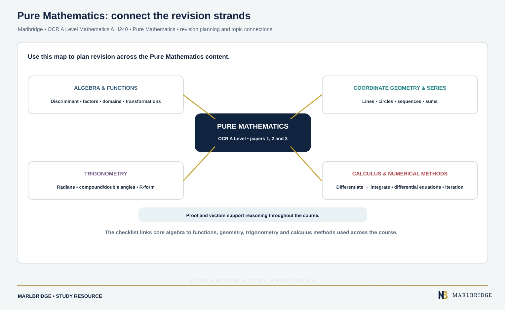

This guide covers **Pure mathematics**, the first of three
subject-content areas in OCR A Level Mathematics A (H240), qualification
number 603/1038/8. Pure mathematics is assessed within every one of
the three two-hour components (Pure mathematics; Pure mathematics and
statistics; Pure mathematics and mechanics), each worth 33 1/3% of the
award, making it the single largest content area of the qualification.

## Where this fits in H240

Because pure mathematics content appears across all three assessed
components, it forms the mathematical backbone of the entire A-level
-- the techniques developed here (algebraic manipulation,
differentiation, integration) are applied directly within both the
statistics and mechanics components. The sibling AS Level (H230)
shares most, but not all, of these sub-topics -- Numerical methods and
Vectors' more advanced content are A Level only.

## Syllabus coverage

**OCR A-LEVEL MATHEMATICS A (H240) — PURE MATHEMATICS**

- 1.1 Proof — methods of mathematical proof and their correct use
- 1.2 Algebra and functions — algebraic manipulation, functions and
their properties
- 1.3 Coordinate geometry in the x-y plane — equations of lines and
curves and their graphical interpretation
- 1.4 Sequences and series — arithmetic and geometric sequences and
series, and related notation
- 1.5 Trigonometry — trigonometric functions, identities and equations
- 1.6 Exponentials and logarithms — exponential and logarithmic
functions and their properties
- 1.7 Differentiation — rates of change and the techniques of
differentiation
- 1.8 Integration — techniques of integration and their applications
- 1.9 Numerical methods — approximate methods for solving problems
that cannot be solved analytically
- 1.10 Vectors — vector notation and its use in geometric problems


## How to approach it

Algebra and functions (1.2) underpins almost every other sub-topic,
so fluency here pays off across the whole qualification, not just
within pure mathematics itself. Differentiation and integration
(1.7-1.8) are best learned together as inverse processes, since
questions frequently move between the two, and both recur directly
within the mechanics component when working with rates of change.
Proof (1.1) is tested throughout the paper rather than as a
standalone question type, so practise constructing rigorous,
step-by-step arguments as a habit across every other sub-topic, not
just when a question explicitly says "prove."

<figure class="topic-figure">
  
  <figcaption>One cubic shows roots, turning points and signed versus total area.</figcaption>
</figure>


## Official syllabus

OCR A Level Mathematics A (H240) specification, for first assessment
2018 —
[ocr.org.uk](https://www.ocr.org.uk/qualifications/as-and-a-level/mathematics-a-h230-h240-from-2017/specification-at-a-glance/).

## Algebra, functions and proof

Pure Mathematics rests on algebraic fluency: indices and surds, quadratics through completing the square and the discriminant, simultaneous and inequality solutions, and the factor and remainder theorems for polynomials.

The **discriminant** classifies roots: b^2 - 4ac positive gives two distinct real roots, zero gives a repeated root, negative gives none.

Functions extend this with domain and range, composite and inverse functions — remembering that the graph of an inverse is the reflection of the original in y = x, and that a function must be one-to-one over the chosen domain to have an inverse.

**Transformations** of y = f(x): f(x) + a translates vertically, f(x + a) translates horizontally by -a, af(x) stretches vertically by factor a, and f(ax) stretches horizontally by 1/a. The counter-intuitive horizontal cases are the examined ones.

## Coordinate geometry and sequences

Straight lines, perpendicular gradients multiplying to -1, and the circle in the form (x - a)^2 + (y - b)^2 = r^2, recovered from expanded form by completing the square twice.

Sequences cover arithmetic and geometric progressions, their sums, the condition |r| < 1 for a convergent geometric series, and the binomial expansion — including the extension to negative and fractional indices, which is valid only for |x| < 1.

## Trigonometry

Radians replace degrees, with arc length r-theta and sector area half r-squared theta.

Beyond the basic identities, the double angle and compound angle formulae allow expressions such as a sin x + b cos x to be written as R sin(x + alpha), which is the standard route to maximum and minimum values and to solving equations of that form.

Always give every solution in the stated interval, using graph symmetry rather than the single value the calculator returns.

## Calculus

Differentiation extends from powers of x to the **chain**, **product** and **quotient** rules, and to exponentials, logarithms and trigonometric functions. Applications include tangents and normals, stationary points classified by the second derivative, connected rates of change, and differentiation from first principles.

Integration reverses this, with standard integrals, integration by substitution and by parts, partial fractions, and definite integrals for area — remembering that area below the x-axis integrates as negative.

Differential equations are solved by separating variables, and the constant is found from a given condition.

**Numerical methods** cover change of sign to locate roots, iteration with staircase and cobweb diagrams, the Newton-Raphson method, and the trapezium rule — including whether it over- or under-estimates depending on the curvature.

## Worked example

Find dy/dx for y = x^2 sin x.

```
Product rule: if y = uv then dy/dx = u(dv/dx) + v(du/dx)

u = x^2        du/dx = 2x
v = sin x      dv/dx = cos x

dy/dx = x^2 cos x + 2x sin x
```

Recognising this needs the product rule, not the chain rule, is the decision being tested.

## Common mistakes

Translating the wrong way for f(x + a) — it moves *left* for positive a. Omitting + c in indefinite integration. Losing trigonometric solutions by taking only the calculator value. Applying the binomial expansion for negative indices outside |x| < 1. Using the chain rule where a product is required. Treating a negative definite integral as an error rather than area below the axis.

## Quick revision checklist

<!-- marlbridge-diagram:math-b69-pure-mathematics-revision-map -->
<figure class="lesson-diagram" style="margin: 2rem 0;">
  <a href="/public/images/learning/mathematics/math-b69-pure-mathematics-revision-map.svg" aria-label="Open full-size diagram: math-b69-pure-mathematics-revision-map"></a>
  <figcaption>A visual revision map groups the source checklist’s algebra/functions, coordinate geometry/sequences, trigonometry and calculus/numerical-methods strands; proof and vectors support problem solving across them. Select the image to enlarge it.</figcaption>
</figure>
<!-- /marlbridge-diagram:math-b69-pure-mathematics-revision-map -->


- Use the discriminant, factor and remainder theorems confidently.
- Find domains, ranges, composite and inverse functions, and apply all four transformations.
- Work in radians, including arc length and sector area.
- Use compound and double angle formulae and the R sin(x + alpha) form.
- Apply chain, product and quotient rules, and integrate by substitution, parts and partial fractions.
- Solve differential equations by separating variables and apply the numerical methods.

## Frequently asked questions

**Which papers is pure mathematics assessed on in OCR A Level Mathematics A (H240)?**
Pure mathematics is assessed within all three two-hour components: Pure mathematics; Pure mathematics and statistics; and Pure mathematics and mechanics. Each component is worth 33⅓% of the award.

**Which pure topics are in the OCR H240 specification?**
The pure content is 1.1 Proof, 1.2 Algebra and functions, 1.3 Coordinate geometry, 1.4 Sequences and series, 1.5 Trigonometry, 1.6 Exponentials and logarithms, 1.7 Differentiation, 1.8 Integration, 1.9 Numerical methods and 1.10 Vectors.

**Does the AS Level cover all of the A Level pure content?**
No. The AS Level, H230, shares most but not all of the pure sub-topics; numerical methods and the more advanced vectors content are A Level only.

**Which way does y = f(x + a) move the graph?**
For positive a, y = f(x + a) translates the graph a units to the left, not the right. Getting this direction wrong is one of the common mistakes listed for this topic.
