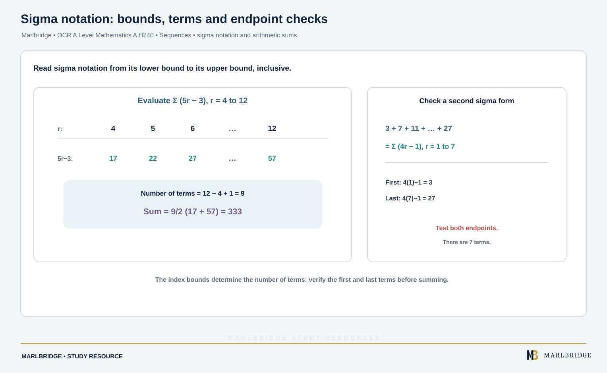

This study guide follows the OCR A Level Mathematics A specification (Version 3.1, August 2026, for first assessment in 2018). It covers sections 1.04e to 1.04k of the Pure Mathematics content: sequences, sigma notation, arithmetic and geometric series, the sum to infinity and modelling. The specification marks all of these as Stage 2, so they are A Level only and are not part of the AS qualification. Pure Mathematics content is assessed in all three written papers.

Use it with the [revision notes](/resources/ocr-a-level-mathematics-sequences-sigma-notation-arithmetic-and-geometric-revision-notes/) and the [practice questions](/resources/ocr-a-level-mathematics-sequences-sigma-notation-arithmetic-and-geometric-practice/). The course page is [OCR A Level Mathematics](/boards/ocr/a-level/mathematics/) and the printable list is the [checklist](/checklists/ocr/a-level/mathematics/). To find your weak spots first, try the [free diagnostics](/diagnostics/). The binomial expansion is a separate topic and is not covered here.

## What you must be able to do

| Section | Outcome | Stage |
|---|---|---|
| 1.04e | Work with sequences given by a formula for the nth term or by xₙ₊₁ = f(xₙ): generate terms, find nth terms, comment on behaviour | A Level only |
| 1.04f | Increasing, decreasing and periodic sequences; sequence versus series; finite versus infinite | A Level only |
| 1.04g | Use sigma notation for sums of series | A Level only |
| 1.04h | Arithmetic sequences and series: nth term and Sₙ | A Level only |
| 1.04i | Geometric sequences and series: nth term, finite sum, convergent versus divergent | A Level only |
| 1.04j | Sum to infinity of a convergent geometric series, with |r| < 1 | A Level only |
| 1.04k | Modelling with sequences and series, including inequalities with exponentials and logarithms | A Level only |

## Sequences (1.04e, 1.04f)

A **sequence** is an ordered list of numbers u₁, u₂, u₃, ... A **series** is the sum of terms of a sequence. A sequence is **finite** if it stops and **infinite** if it goes on for ever.

Two ways to define one:

- **Formula for the nth term:** uₙ = f(n). You can jump straight to any term.
- **Recurrence relation:** xₙ₊₁ = f(xₙ) with a starting value. You must work term by term.

A sequence is **increasing** if every term is larger than the one before (uₙ₊₁ > uₙ for all n), **decreasing** if every term is smaller, and **periodic** if the terms repeat in a cycle. The **order** of a periodic sequence is the length of the cycle.

### Worked example 1: a formula

uₙ = (3n − 1)/(n + 2). Describe the behaviour.

```
u₁ = 2/3, u₂ = 5/4, u₃ = 8/5, u₄ = 11/6
uₙ = 3 − 7/(n + 2)
```

As n grows, 7/(n + 2) falls towards 0 and is positive, so uₙ rises and stays below 3. To prove it is increasing, uₙ₊₁ − uₙ = 7/(n + 2) − 7/(n + 3) = 7/[(n + 2)(n + 3)] > 0. The sequence is increasing and its terms approach 3.

<figure class="topic-figure">
  
  <figcaption>Partial sums of a convergent geometric series level off at S_infinity = a/(1 - r).</figcaption>
</figure>

<figure class="topic-figure">
  
  <figcaption>Row n of Pascal’s triangle gives the binomial coefficients; the terms of (4 + 3x)^5 sum to 7^5 at x = 1.</figcaption>
</figure>


### Worked example 2: a periodic recurrence

xₙ₊₁ = 1/(1 − xₙ), x₁ = 3.

```
x₂ = 1/(1 − 3) = −1/2
x₃ = 1/(1 + 1/2) = 2/3
x₄ = 1/(1 − 2/3) = 3
```

x₄ = x₁, and each term depends only on the one before, so the cycle repeats: the sequence is periodic with order 3. Then x₉₉ = x₃ = 2/3, because 99 is a multiple of 3.

<figure class="topic-figure">
  
  <figcaption>Sequences can decrease then increase, repeat in a cycle, or climb towards a limit.</figcaption>
</figure>

<figure class="topic-figure">
  
  <figcaption>A recurrence settles at the limit L where L = f(L); the cobweb shows the terms closing in on it.</figcaption>
</figure>


### Worked example 3: a recurrence that settles

xₙ₊₁ = ½xₙ + 6, x₁ = 2 gives 2, 7, 9.5, 10.75, 11.375, ... The terms increase and approach a limit L. If xₙ settles, xₙ₊₁ and xₙ both tend to L, so L = ½L + 6 and L = 12.

Compare xₙ₊₁ = 2xₙ − 3, x₁ = 5: 5, 7, 11, 19, 35, ... The terms increase without limit, so the sequence diverges.

## Sigma notation (1.04g)

<!-- marlbridge-diagram:math-b71-sigma-notation-bounds-and-sum -->
<figure class="lesson-diagram" style="margin: 2rem 0;">
  <a href="/public/images/learning/mathematics/math-b71-sigma-notation-bounds-and-sum.svg" aria-label="Open full-size diagram: math-b71-sigma-notation-bounds-and-sum"></a>
  <figcaption>For Σ(5r−3), r=4,…,12, there are 9 terms from 17 to 57, so the arithmetic sum is 9/2(17+57)=333. The source also matches 3+7+…+27 to Σ(4r−1), r=1,…,7. Select the image to enlarge it.</figcaption>
</figure>
<!-- /marlbridge-diagram:math-b71-sigma-notation-bounds-and-sum -->


Σ means "add up". The expression below reads: add the values of f(r) for r = m, m + 1, ..., k.

```
  k
  Σ  f(r)
 r=m
```

The number of terms is k − m + 1. Useful rules: Σ c = c × (number of terms) for a constant c, and Σ [f(r) + g(r)] splits into two sums.

### Worked example 4

Evaluate Σ (5r − 3) from r = 4 to 12, and write 3 + 7 + 11 + ... + 27 in sigma notation.

```
Terms: 17, 22, 27, ..., 57 (9 terms, arithmetic)
Sum = 9/2 × (17 + 57) = 333
3 + 7 + 11 + ... + 27 = Σ (4r − 1), r = 1 to 7
```

Check the second: 4(1) − 1 = 3 and 4(7) − 1 = 27. Different starting values of r give different but equal answers, so always test both ends.

## Arithmetic sequences and series (1.04h)

An arithmetic sequence adds a constant **common difference** d each time. The first term is a and the last term is l.

```
uₙ = a + (n − 1)d
Sₙ = n/2 × (2a + (n − 1)d) = n/2 × (a + l)
```

Use the second form of Sₙ when you know the last term. The specification says a formulae sheet is given in each question paper, and its list of formulae to be known includes the nth term of each progression. Learn all of the formulae here regardless.

### Worked example 5

An arithmetic sequence has u₆ = −4 and u₁₅ = 32. Find the smallest n for which Sₙ > 500.

```
a + 5d = −4
a + 14d = 32
Subtract: 9d = 36, so d = 4 and a = −24
Sₙ = n/2 × (−48 + 4(n − 1)) = n(2n − 26) = 2n² − 26n
2n² − 26n > 500
n² − 13n − 250 > 0
Roots: n = (13 ± √1169)/2, so n > 23.6 (the other root is negative)
```

Test: S₂₃ = 460 and S₂₄ = 528. The smallest n is **24**. Always finish with a check on the integers either side.

### Worked example 6

Find the sum of the multiples of 7 between 100 and 500.

The first is 105 and the last is 497. Then 497 = 105 + (n − 1)7 gives n = 57. S₅₇ = 57/2 × (105 + 497) = **17 157**.

<figure class="topic-figure">
  
  <figcaption>Pairing each term with its reverse shows why S_n = half n times (a + l).</figcaption>
</figure>


## Geometric sequences and series (1.04i)

A geometric sequence multiplies by a constant **common ratio** r each time.

```
uₙ = a rⁿ⁻¹
Sₙ = a(1 − rⁿ)/(1 − r) = a(rⁿ − 1)/(r − 1)   (r ≠ 1)
```

Use whichever form has the positive denominator. If |r| > 1 the terms grow in size and the series is **divergent**. If |r| < 1 the terms get closer to 0 and the series is **convergent**. If r is negative the signs alternate.

### Worked example 7

A geometric sequence has u₃ = 18 and u₆ = 486. Find a, r and S₁₀.

```
u₆ / u₃ = r³ = 486/18 = 27, so r = 3
a × 3² = 18, so a = 2
S₁₀ = 2(3¹⁰ − 1)/(3 − 1) = 3¹⁰ − 1 = 59 048
```

### Worked example 8

Find S₆ for the series 40 − 20 + 10 − ...

Here a = 40 and r = −½.

```
S₆ = 40(1 − (−½)⁶)/(1 + ½) = 40 × (63/64) × (2/3) = 105/4
```

The answer is **26.25**. Put brackets round a negative ratio before raising it to a power.

<figure class="topic-figure">
  
  <figcaption>An arithmetic progression adds the same amount each time; a geometric progression multiplies by the same ratio.</figcaption>
</figure>


## Sum to infinity (1.04j)

If |r| < 1, then rⁿ → 0 as n grows, so Sₙ approaches a limit:

```
S∞ = a/(1 − r),   provided |r| < 1  (that is, −1 < r < 1)
```

If |r| ≥ 1 there is no sum to infinity.

### Worked example 9

A geometric series has first term 12 and sum to infinity 20. Find r and S₅.

```
12/(1 − r) = 20, so 1 − r = 3/5 and r = 2/5
S₅ = 12(1 − (2/5)⁵)/(3/5) = 12372/625 = 19.7952
```

So S₅ ≈ **19.8**, just under 20, as expected for a convergent series with positive terms.

### Worked example 10

(a) Find the values of x for which 6 + 3/x + 3/(2x²) + ... converges, and its sum.
(b) Write 0.272727... as a fraction.

(a) Here a = 6 and r = 1/(2x), so |1/(2x)| < 1, which gives |2x| > 1, that is **x > ½ or x < −½**. Then S∞ = 6/(1 − 1/(2x)) = **12x/(2x − 1)**.

(b) 0.272727... = 0.27 + 0.0027 + ... with a = 0.27 and r = 0.01. So S∞ = 0.27/0.99 = **3/11**.

<figure class="topic-figure">
  
  <figcaption>A geometric series has a sum to infinity only when |r| &lt; 1.</figcaption>
</figure>


## Modelling (1.04k)

Identify what changes by a fixed **amount** each period (arithmetic: simple interest, a fixed pay rise, a steady training increase) and what changes by a fixed **percentage** (geometric: compound interest, depreciation, decay). Percentage change of p% per period gives ratio r = 1 + p/100, or 1 − p/100 for a fall.

### Worked example 11: an exponential inequality

£8000 earns 3.2% compound interest each year. After how many whole years does it first exceed £10 000?

```
8000 × 1.032ⁿ > 10 000
1.032ⁿ > 1.25
n ln 1.032 > ln 1.25
n > 7.08...
```

Check: after 7 years the amount is £9973.51 and after 8 years it is £10 292.66. The answer is **8 years**. Dividing by ln 1.032 keeps the inequality direction because ln 1.032 is positive. If the ratio were below 1, the log would be negative and the inequality would reverse.

### Worked example 12: a loan

<!-- marlbridge-diagram:maths-b38-loan-recurrence-payoff -->
<figure class="lesson-diagram" style="margin: 2rem 0;">
  <a href="/images/learning/mathematics/maths-b38-loan-recurrence-payoff.svg" aria-label="Open full-size diagram: maths-b38-loan-recurrence-payoff"></a>
  <figcaption>The balance follows B₀=£15,000 and Bₙ₊₁=1.04Bₙ−£2,400, giving Bₙ=60,000−45,000(1.04)ⁿ. The debt-clearing threshold gives n≥7.33, so eight payment dates are needed. After seven payments £783.07 remains; after interest £814.39 is due, which is the reduced final payment. Select the image to enlarge it.</figcaption>
</figure>
<!-- /marlbridge-diagram:maths-b38-loan-recurrence-payoff -->


£15 000 is borrowed at 4% a year. A payment of £2400 is made at the end of each year after interest is added. Let Bₙ be the amount owed after n payments.

```
B₀ = 15 000
Bₙ₊₁ = 1.04Bₙ − 2400
B₁ = 13 200, B₂ = 11 328, B₃ = 9381.12
```

Solving this recurrence gives Bₙ = 60 000 − 45 000 × 1.04ⁿ. Check n = 1: 60 000 − 46 800 = 13 200. The debt is cleared when 1.04ⁿ ≥ 4/3, so n ≥ 7.33. After 7 payments £783.07 is owed, so an 8th payment is needed (£814.39 settles it).

### Worked example 13: a build-up in a body

A patient takes 50 mg of a drug each morning. By the next morning 15% of the drug has gone. Just after dose n, the amount is 50 + 50(0.85) + ... + 50(0.85)ⁿ⁻¹.

Just after dose 5: 50(1 − 0.85⁵)/0.15 = **185 mg** (3 s.f.). In the long run the amount approaches 50/0.15 = **333 mg** (3 s.f.), so it never exceeds this level.

## Common errors

- Using n terms when there are n + 1, or the reverse. Count terms with last − first + 1 in sigma notation.
- Using S∞ when |r| ≥ 1, or writing |r| < 1 without stating it.
- Rounding too early in modelling. Keep full values until the last line.
- Reversing the inequality direction wrongly when dividing by a negative logarithm, or forgetting to reverse it.
- Treating a percentage fall as r = 0.15 instead of r = 0.85.
- Giving a non-integer n. Interpret the answer as a whole number of periods and check the neighbours.

Continue with the [revision notes](/resources/ocr-a-level-mathematics-sequences-sigma-notation-arithmetic-and-geometric-revision-notes/) and then the [practice questions](/resources/ocr-a-level-mathematics-sequences-sigma-notation-arithmetic-and-geometric-practice/).

## Official syllabus

OCR, *A Level Mathematics A (H240)* specification, Version 3.1 (August 2026), for first assessment in 2018. Sections 1.04e to 1.04k.
