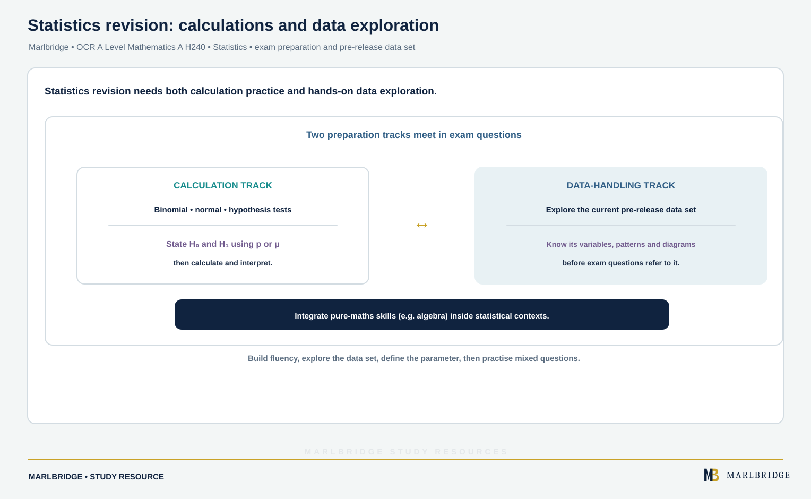

This guide covers **Statistics**, one of three subject-content strands
in OCR A Level Mathematics A (H240), alongside Pure Mathematics and
Mechanics. Statistics is examined together with Pure Mathematics in
component 02, Pure Mathematics and Statistics, which carries 33⅓% of
the full A Level (or 50% of the AS Level, where the equivalent
component is worth 75 marks with roughly 50 of pure and 25 of
statistics).

## Syllabus coverage

**OCR A LEVEL MATHEMATICS A H240 -- STATISTICS**

- **Statistical sampling** -- understanding and evaluating different
  sampling methods (including random, systematic, stratified,
  opportunity, quota and cluster sampling), and assessing the
  suitability of a given method for a real statistical investigation.
- **Data presentation and interpretation** -- interpreting and
  producing standard graphical and numerical summaries of data,
  understanding measures of central tendency and spread, and
  interpreting real, often large, data sets, including the
  specification's pre-release large data set that some questions are
  based on directly; and bivariate data (2.02c-e) -- interpreting
  scatter diagrams and regression lines, including recognising
  scatter diagrams that include distinct sections of the population,
  the informal interpretation of correlation, and understanding that
  correlation does not imply causation. You may be asked to add to a
  scatter diagram but not to draw a complete one, and calculating the
  equation of a regression line is excluded.
- **Probability** -- calculating probabilities using the laws of
  probability, including conditional probability, mutual exclusivity
  and independence, and applying probability models to real
  situations.
- **Statistical distributions** -- using the binomial distribution and
  the normal distribution to model real data and calculate
  probabilities, including recognising when each distribution is an
  appropriate model.
- **Statistical hypothesis testing** -- carrying out and interpreting
  three types of test: a test for the proportion in a binomial
  distribution (2.05b-c, where use of the normal approximation is
  excluded), a test for the mean of a normal distribution with known,
  given or assumed variance (2.05d-e), and a test using Pearson's
  product-moment correlation coefficient (2.05f-g); including stating
  hypotheses correctly, identifying critical regions, and interpreting
  the result of a test in the context of the original question.

## Bivariate data and the correlation test

Pearson's product-moment correlation coefficient, r, measures how
close data points lie to a straight line (2.05f). You use and
interpret it in a hypothesis test, comparing it with either a given
critical value or, using a p-value, a table of critical values that
OCR provides in the examination (2.05g). The data may be assumed to
come from a bivariate normal distribution, and **calculating** a
correlation coefficient is excluded -- you will be given r.

Worked example: for a random sample of 15 pairs of values, r = 0.62.
Test at the 5% level whether there is positive correlation in the
population, given that the critical value is 0.4409.

H₀: ρ = 0, H₁: ρ > 0, where ρ is the population product-moment
correlation coefficient (one-tailed, because the question asks about
positive correlation). Since 0.62 > 0.4409, reject H₀. There is
evidence at the 5% level of positive correlation in the population.
Remember that correlation does not imply causation (2.02e): a
significant result says the variables are linearly associated, not
that one causes the other.

<figure class="topic-figure">
  
  <figcaption>Variance is the mean of the squared distances from the mean; the standard deviation is the side of that mean square.</figcaption>
</figure>

## Why Statistics is assessed with a pre-release data set

Unlike Pure Mathematics or Mechanics, Statistics at OCR is examined
partly through familiarity with a genuine, pre-released large data
set, issued in advance of the exam series. Some questions in the data
presentation and interpretation strand are set directly on this data,
which means revision for Statistics cannot be purely abstract -- a
student needs to have actually explored the specific released data
set, understood its variables and context, and practised summarising
and interpreting it, since the exam expects familiarity with its
particular structure and quirks rather than generic data-handling
skill alone.

## Worked example: binomial probability

A biased coin lands on heads with probability 0.6. It is tossed 5
times. Find the probability of getting exactly 3 heads.

Using the binomial distribution, X ~ B(5, 0.6):

P(X = 3) = C(5,3) × 0.6³ × 0.4² = 10 × 0.216 × 0.16 = **0.3456**

Recognising that a scenario is binomial -- a fixed number of
independent trials, each with the same two possible outcomes and the
same probability of success -- is the first and most commonly
mis-assessed step, before any calculation is attempted at all.

## Worked example: hypothesis test set-up

A machine is supposed to produce components with a 5% defect rate. In
a sample of 100 components, 9 are found to be defective. Test at the
5% significance level whether the defect rate has increased.

Null hypothesis H₀: p = 0.05 (defect rate unchanged)
Alternative hypothesis H₁: p > 0.05 (defect rate has increased) --
this is a one-tailed test, since the question specifically asks about
an *increase*.

Under H₀, X ~ B(100, 0.05). The test then compares the observed value
(9) against the critical region for a 5% significance level, and the
conclusion must be stated in the context of the original question,
never just "reject H₀" on its own. The specification also requires
conclusions to be worded so that they reflect the fact that they are
not certain: "There is evidence at the 5% level to reject H₀. It is
likely that the defect rate has increased." for a significant result,
or "There is insufficient evidence at the 5% level to reject H₀. There
is no reason to suppose that the defect rate has increased." for a
non-significant one. A flat "H₀ is rejected. The defect rate has
increased." is the form the specification lists as incorrect.

For these data, P(X ≥ 9) = 0.0631 (to 4 d.p.), which is greater than
0.05, and the critical region is X ≥ 10 (P(X ≥ 10) = 0.0282). The
observed 9 is not in the critical region, so H₀ is not rejected: there
is insufficient evidence at the 5% level that the defect rate has
increased.

## Common mistakes

- **Stating hypotheses in words instead of using p (the population
  proportion) with a correct inequality**, or getting the direction of
  a one-tailed test wrong relative to the question's wording.
- **Confusing the sample and the population** when describing a
  sampling method, or failing to justify why a chosen method (for
  example, stratified over simple random) suits the specific
  investigation described in a question.
- **Choosing the wrong distribution to model a scenario** -- using a
  normal approximation where a binomial model is appropriate, or
  vice versa, without checking the conditions each distribution
  requires.
- **Forgetting to interpret a hypothesis test conclusion in context.**
  A numerically correct test with no contextual conclusion, or one
  that inverts "reject" and "do not reject," loses marks even when the
  calculation itself is right.
- **Treating the large data set as optional revision** rather than
  genuine exam content -- since specific questions are set directly on
  it, not exploring the actual released data set in advance is a
  common and avoidable gap.

## How to approach it

<!-- marlbridge-diagram:math-b71-statistics-revision-two-track-plan -->
<figure class="lesson-diagram" style="margin: 2rem 0;">
  
  <figcaption>The source recommends balancing binomial/normal probabilities and hypothesis tests with exploration of the current pre-released large data set, formal hypotheses in p or μ, and pure-maths skills within statistical problems. Select the image to enlarge it.</figcaption>
</figure>
<!-- /marlbridge-diagram:math-b71-statistics-revision-two-track-plan -->

Because Statistics carries a genuine data-handling component alongside
its calculation-based content, split revision time between the two:
practise the standard calculations (binomial and normal probabilities,
hypothesis tests) until fluent, and separately spend time actually
exploring the current pre-released large data set so that questions
referencing it are not encountered cold in the exam. Build a habit of
writing hypotheses formally in terms of a population parameter (p or
μ) before attempting any calculation, since this is where marks are
most often lost even by students who calculate correctly afterwards.
Since Statistics is assessed alongside Pure Mathematics in the same
paper, practise questions that require using a pure-maths skill (for
example, algebraic manipulation to find an unknown probability) inside
a statistics context, since OCR's papers are not written to keep the
two strands in fully separate questions.

## Frequently asked questions

**Which paper is statistics on in OCR A Level Mathematics A (H240)?**
Statistics is examined with pure mathematics in Component 02, Pure Mathematics and Statistics, which carries 33⅓% of the full A Level.

**Which hypothesis tests are in OCR A Level Mathematics A?**
There are three: a test for the proportion in a binomial distribution, a test for the mean of a normal distribution with known, given or assumed variance, and a test using Pearson's product-moment correlation coefficient.

**Is the normal approximation used in the OCR H240 binomial hypothesis test?**
No. For the binomial test of a proportion, references 2.05b and 2.05c, use of the normal approximation is excluded.

**Do you need to calculate a regression line in OCR A Level Mathematics?**
No. You interpret scatter diagrams and regression lines and may add to a diagram, but drawing a complete diagram and calculating the equation of a regression line are excluded.

## Related resources

- [Statistics revision notes](/resources/ocr-a-level-mathematics-statistics-revision-notes/)
- [Statistics practice questions](/resources/ocr-a-level-mathematics-statistics-practice/)

<figure class="topic-figure">
  
  <figcaption>How each method picks its sample; quota is stratified without random selection.</figcaption>
</figure>

<figure class="topic-figure">
  
  <figcaption>A statistic varies from sample to sample, and its sampling distribution shows how it behaves.</figcaption>
</figure>

## Official syllabus

OCR, *AS and A Level Mathematics A (H230, H240) Specification at a
Glance*, Subject content, Statistics,
https://www.ocr.org.uk/qualifications/as-and-a-level/mathematics-a-h230-h240-from-2017/specification-at-a-glance/,
fetched and verified in full 2026-09-02. Full specification PDF:
https://www.ocr.org.uk/Images/308723-specification-accredited-a-level-gce-mathematics-a-h240.pdf.
