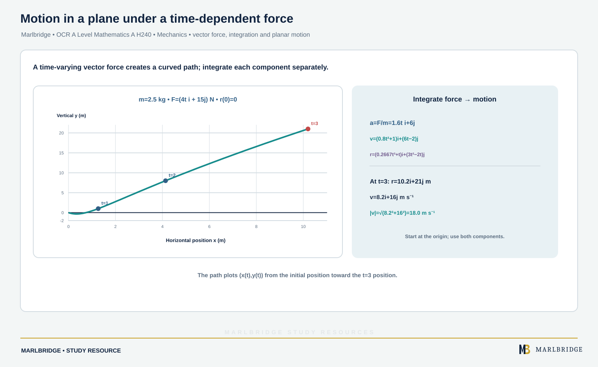

This guide covers part of section 3.03, Forces and Newton's Laws, of the OCR A Level Mathematics A specification (H240, Version 3.1, August 2026, for first assessment in 2018): outcomes 3.03l, 3.03m, 3.03n, 3.03o, 3.03p and 3.03q. Only 3.03n is Stage 1, common with AS. The rest is Stage 2, so it is **A Level only**. The specification says the Pure Mathematics and Mechanics component assesses mechanics in its own section. Use g = 9.8 m s⁻² unless told otherwise.

Use it with the [revision notes](/resources/ocr-a-level-mathematics-two-dimensional-equilibrium-connected-particles-and-revision-notes/) and the [practice questions](/resources/ocr-a-level-mathematics-two-dimensional-equilibrium-connected-particles-and-practice/). The course page is [OCR A Level Mathematics](/boards/ocr/a-level/mathematics/), the printable list is the [checklist](/checklists/ocr/a-level/mathematics/), and the [free diagnostics](/diagnostics/) show what to revise first. The [exam preparation guide](/resources/ocr-a-level-mathematics-exam-preparation/) covers the whole course.

## What this guide covers

| Ref | What you must be able to do | Stage |
|---|---|---|
| 3.03l | Extend Newton's third law to situations where forces are resolved (two dimensions) | A Level only |
| 3.03m | Use the principle that a particle is in equilibrium if and only if the resolved parts in any given direction sum to zero | A Level only |
| 3.03n | Solve simple equilibrium problems in two dimensions using vectors | Stage 1 (AS) |
| 3.03o | Resolve forces in harder problems with connected particles and smooth pulleys | A Level only |
| 3.03p | Understand "resultant" for two or more forces; use vector addition and perpendicular components | A Level only |
| 3.03q | Solve dynamics problems for a particle moving in a plane under one or more forces | A Level only |

Friction and rough surfaces belong to a separate page. Every surface here is smooth.

## Components and resultants (3.03p)

Take a force of size F inclined at θ to a chosen line. Its part along that line is F cos θ and its part at right angles to it is F sin θ. The **resultant** of several forces is their vector sum: add all the i-components, then all the j-components. Then

```
|R| = √(Rx² + Ry²)      angle to the x-axis: tan α = |Ry| / |Rx|
```

Always sketch the resultant before you quote an angle, so you know which quadrant it is in. The acceleration always points the way the resultant force points. The velocity shows the direction of motion.

**Worked example 1.** P = 15 N acts at 40° above the positive x-axis. Q = 11 N acts at 25° below the negative x-axis. Find the resultant.

```
P = (15 cos 40°, 15 sin 40°) = (11.49, 9.64)
Q = (−11 cos 25°, −11 sin 25°) = (−9.97, −4.65)
R = (1.52, 4.99)
|R| = √(1.52² + 4.99²) = 5.22 N
angle = tan⁻¹(4.99 / 1.52) = 73.1° above the positive x-axis
```

## Equilibrium of a particle (3.03m, 3.03n)

A particle is in equilibrium if and only if the resultant force is zero. In practice this means the sum of the resolved parts is zero in every direction you choose. You need two independent directions in two dimensions. A closed polygon of forces says the same thing: placed head to tail, the forces return to the start.

For vectors, add the components and set each total to zero.

**Worked example 2.** Forces (6i − 2j) N and (−i + 9j) N act on a particle. Find the extra force F that keeps it in equilibrium, with its magnitude and direction.

```
6 − 1 + Fx = 0  →  Fx = −5
−2 + 9 + Fy = 0 →  Fy = −7
F = (−5i − 7j) N,  |F| = √74 = 8.60 N
angle below the negative x-axis = tan⁻¹(7/5) = 54.5°
```

**Worked example 3 (angled strings).** A 3 kg particle is suspended by two light strings from a horizontal ceiling, one either side. The strings slope at 35° and 50° to the ceiling. Find both tensions.

```
Horizontal:  T₁ cos 35° = T₂ cos 50°
Vertical:    T₁ sin 35° + T₂ sin 50° = 3 × 9.8 = 29.4
From the first:  T₁ = 0.7847 T₂
Substitute:  (0.4501 + 0.7660) T₂ = 29.4
T₂ = 24.2 N,  T₁ = 19.0 N
```

Choose directions that make the working short. If you resolve along one string, the tension in it drops out of one equation.

<figure class="topic-figure">
  
  <figcaption>In equilibrium the forces sum to zero in every direction, so they close into a triangle.</figcaption>
</figure>


## Inclined planes (3.03o)

On a plane at angle α to the horizontal, resolve **parallel** and **perpendicular** to the plane. The weight mg has components mg sin α down the plane and mg cos α into it. The normal reaction R is perpendicular to the plane. A smooth surface gives no force along the plane.

**Worked example 4.** A 4 kg particle rests on a smooth plane inclined at 28°. A horizontal force P, acting in the vertical plane containing the steepest line of the slope, holds it in equilibrium. Find P and R.

```
Along the plane:        P cos 28° = 4g sin 28°  →  P = 4g tan 28° = 20.8 N
Perpendicular to plane: R = 4g cos 28° + P sin 28° = 44.4 N
Check: R = 4g / cos 28° = 44.4 N
```

The horizontal force presses the particle into the plane, so R is larger than 4g cos 28°. Forces at an angle to the plane change R in the same way.

<figure class="topic-figure">
  
  <figcaption>Resolve the weight along and across the slope: R = mg cos θ and the net force down the slope is mg sin θ − μR.</figcaption>
</figure>


## Newton's third law and connected particles (3.03l)

When two bodies interact, the force of A on B equals the force of B on A in size and is opposite in direction. A taut string has the same tension at both ends, pulling each body towards the string. If nothing in a system moves relative to the rest, you can treat it as one particle. Use that to find the acceleration. Then separate the bodies to find a force between them.

**Worked example 5.** Blocks A (5 kg) and B (3 kg) touch on a smooth horizontal table, B on the right. A force of 40 N acts on A, directed 30° below the horizontal towards B. Find the acceleration, the contact force between the blocks, and the normal reaction on A.

```
Whole system, horizontal:  40 cos 30° = (5 + 3)a  →  a = 4.33 m s⁻²
B alone:  X = 3a = 13.0 N        (A pushes B; B pushes A with 13.0 N back)
A, vertical:  R = 5g + 40 sin 30° = 69.0 N
```

The vertical component of the push adds to the reaction on A. It does not affect the acceleration.

<figure class="topic-figure">
  
  <figcaption>The reaction R is larger than the weight when the lift accelerates upwards and smaller when it accelerates downwards; third-law pairs act on different bodies.</figcaption>
</figure>

<figure class="topic-figure">
  
  <figcaption>Treat the whole system first, then one part to find the tow-bar force; a rigid bar can push (thrust).</figcaption>
</figure>

<figure class="topic-figure">
  
  <figcaption>Friction matches the push up to a maximum μR; only when on the point of moving or sliding is F = μR.</figcaption>
</figure>

<figure class="topic-figure">
  
  <figcaption>The resultant of tension and weight points to the centre of the circle and equals mrω².</figcaption>
</figure>


## Strings and pulleys (3.03o, 3.03q)

The specification's model is a **light inextensible string** over a **smooth peg or light pulley**. Light means the tension is the same on both sides of the pulley. Inextensible means the connected particles have the same speed and the same acceleration size. Smooth means no friction on the string. Draw a diagram, give each particle its own equation of motion, and mark the acceleration direction on each.

**Worked example 6.** A string over a smooth pulley carries masses of 7 kg and 5 kg, each hanging. Find the acceleration and the tension.

```
Heavier particle down:   7g − T = 7a
Lighter particle up:     T − 5g = 5a
Add:  2g = 12a  →  a = 1.63 m s⁻²
T = 5(g + a) = 57.2 N
```

**Worked example 7.** Particle A, 4 kg, lies on a smooth horizontal table. A light string runs from A across the table and over a smooth pulley fixed at its edge, then down to a 1.5 kg particle B hanging freely. The system is released. Find a, T and the force the string exerts on the pulley.

```
A:  T = 4a
B:  1.5g − T = 1.5a
Add:  1.5g = 5.5a  →  a = 2.67 m s⁻²,  T = 10.7 N
```

The string pulls the pulley horizontally with T and vertically down with T. These are perpendicular, so the resultant is T√2 = 15.1 N, directed at 45° below the horizontal towards the table.

**Worked example 8 (pulley at the top of a plane).** A 6 kg particle A is on a smooth plane inclined at 30°. A string parallel to the plane runs over a light smooth pulley at the top to a 4 kg particle B, hanging. Find the acceleration and the tension.

```
B down:         4g − T = 4a
A up the plane: T − 6g sin 30° = 6a
Add:  39.2 − 29.4 = 10a  →  a = 0.98 m s⁻²
T = 4(g − a) = 35.3 N
```

A moves up only because 4g is larger than 6g sin 30°. If it were smaller, A would slide down. If you guess the direction wrongly, a comes out negative, which tells you the true direction.

<figure class="topic-figure">
  
  <figcaption>Write one F = ma equation per particle; tension is the same each side of a smooth pulley.</figcaption>
</figure>


## Motion in a plane under a force (3.03q)

<!-- marlbridge-diagram:math-b73-time-dependent-force-planar-motion -->
<figure class="lesson-diagram" style="margin: 2rem 0;">
  <a href="/public/images/learning/mathematics/math-b73-time-dependent-force-planar-motion.svg" aria-label="Open full-size diagram: math-b73-time-dependent-force-planar-motion"></a>
  <figcaption>For m=2.5 kg and F=(4t i+15j) N, a=(1.6t,6), v=(0.8t²+1,6t−2), r=(0.2667t³+t,3t²−2t). At t=3, r=(10.2,21) m and speed is 18.0 m s⁻¹. Select the image to enlarge it.</figcaption>
</figure>
<!-- /marlbridge-diagram:math-b73-time-dependent-force-planar-motion -->


For a particle of mass m under resultant force F (a vector), F = ma applies to both components. If F depends on time t, integrate: v = ∫a dt, then r = ∫v dt. Use the starting conditions to find each constant, one for each component.

**Worked example 9.** A particle of mass 2.5 kg is acted on by a force (4t i + 15j) N at time t seconds. At t = 0 its velocity is (i − 2j) m s⁻¹ and it is at the origin. Find its position and speed at t = 3.

```
a = F/m = 1.6t i + 6j
v = (0.8t² + 1) i + (6t − 2) j
r = (0.2667t³ + t) i + (3t² − 2t) j
t = 3:  r = 10.2i + 21j  m
        v = 8.2i + 16j,  speed = √(8.2² + 16²) = 18.0 m s⁻¹
```

If the force is constant, the acceleration is constant and the vector forms of the constant-acceleration formulae apply. Where the force is given by magnitude and direction, resolve it first to get its components.

## Common errors

- Resolving with sin and cos the wrong way round. On a plane, mg sin α is along the slope.
- Forgetting that an angled push or pull changes the normal reaction.
- Using different tensions on the two sides of a smooth pulley, or writing the equation of motion with the wrong sign for one particle.
- Quoting an angle from tan⁻¹ without checking the quadrant.
- Giving the force on the pulley as 2T when the two string parts are not parallel.
- Rounding g to 10 or an intermediate value early. Keep full values until the end.

## Frequently asked questions

**How do you find the resultant of several forces?**
Resolve each force into components, add the i-parts and the j-parts, then find the magnitude with √(Rx² + Ry²) and the direction with tan α = |Ry|/|Rx|, checking the quadrant.

**How does an angled force affect the normal reaction?**
An angled push or pull has a component perpendicular to the surface, which changes the normal reaction. A pull upwards reduces it and a push downwards increases it.

**How do you solve a two-particle pulley problem?**
Write an equation of motion for each particle separately, in its own direction of motion, using the same tension and the same size of acceleration, then solve the two equations together.

**How do you find velocity when the force depends on time?**
Divide the force by the mass to get the acceleration, integrate to find v using the initial velocity for the constant, then integrate again to find the position.

## Official syllabus

OCR, A Level Mathematics A (H240), Version 3.1 (August 2026), first assessment 2018: section 3.03, Forces and Newton's Laws.
