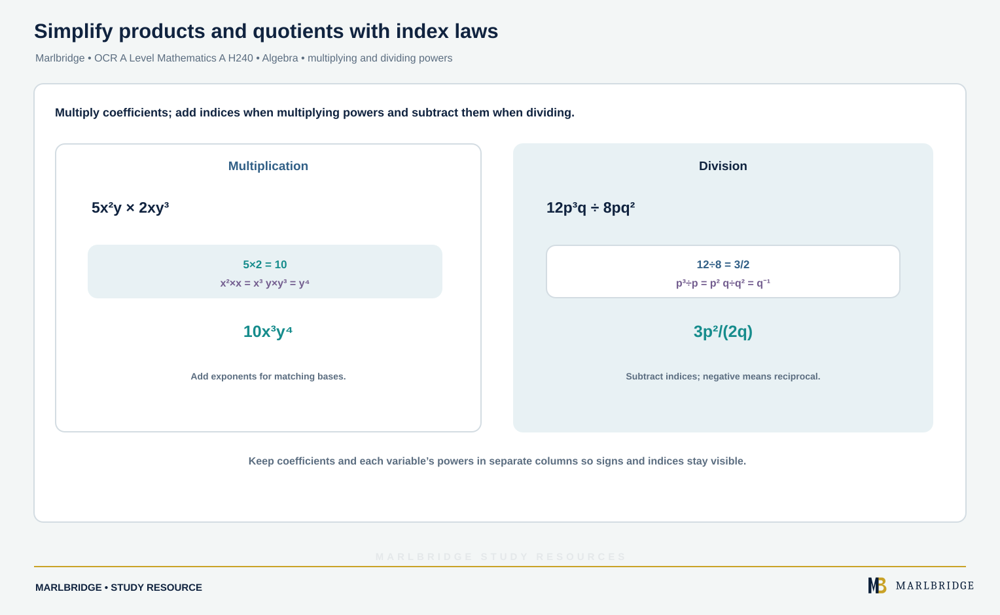

This guide is for OCR GCSE (9-1) Mathematics, aligned to the OCR specification Version 2.1 (August 2026). It covers sections 6.01a to 6.01d: algebraic terminology and proofs, collecting like terms, simplifying products and quotients, and multiplying out brackets. Most of it is for both tiers. Content marked **Higher tier only** is for Higher tier candidates alone. These are algebra skills, so every example is done by hand.

Check your progress with the [printable checklist](/checklists/ocr/gcse/mathematics/) and browse the [OCR GCSE Mathematics hub](/boards/ocr/gcse/mathematics/). Then use the [revision notes](/resources/ocr-gcse-mathematics-algebraic-language-proof-simplifying-and-expanding-revision-notes/) and the [practice questions](/resources/ocr-gcse-mathematics-algebraic-language-proof-simplifying-and-expanding-practice/). Not sure where you stand? Try the [free diagnostics](/diagnostics/). For the number side of indices see [number operations and integers](/resources/ocr-gcse-mathematics-number-operations-and-integers/).

## What this unit covers

| Section | What you must be able to do | Tier |
|---|---|---|
| 6.01a | Use the words expression, equation, formula, inequality, term and factor correctly | Both tiers |
| 6.01a | Tell an equation from an identity; show two expressions are equivalent; construct algebraic arguments | Both tiers |
| 6.01a | Use algebra to construct proofs | Higher tier only |
| 6.01b | Simplify by collecting like terms | Both tiers |
| 6.01c | Simplify products and quotients, including using index laws with positive whole-number powers | Both tiers |
| 6.01c | Use the laws of indices with negative and fractional powers | Higher tier only |
| 6.01d | Expand a single bracket; expand the product of two binomials | Both tiers |
| 6.01d | Expand the product of more than two binomials | Higher tier only |

## Algebraic language (6.01a)

Precise words let you read a question correctly. Learn these.

| Word | Meaning | Example |
|---|---|---|
| Term | One part of an expression, with its sign. Terms are separated by + and − | 5x², −3x and 8 are the terms of 5x² − 3x + 8 |
| Expression | Terms combined with no equals sign. You simplify or expand it, but you cannot solve it | 4a + 7 |
| Equation | Two expressions joined by =, true for particular values of the letter | 3x + 5 = 17 is true only when x = 4 |
| Formula | An equation linking quantities that have a meaning | A = ½bh |
| Inequality | Two expressions joined by <, >, ≤ or ≥ | 4t > 20 |
| Factor | A number or expression that divides exactly into another, or that is multiplied to make it | 3 and a are factors of 12ab |

The number in front of a letter is its coefficient. In 5x² the coefficient is 5.

### Equation or identity?

An **equation** is true only for some values. An **identity** is true for every value of the letters. We write an identity with the sign ≡, though = is often used in questions.

* 3(x + 2) ≡ 3x + 6 is an identity. Any value of x works.
* 5x − 1 = 14 is an equation. Only x = 3 works.

<figure class="topic-figure">
  
  <figcaption>An identity is true for every x; an equation is true only at the point where the two sides meet.</figcaption>
</figure>


### Showing that expressions are equivalent

Take one side and change it, line by line, until it matches the other. Do not work on both sides at once. Do not stop after trying one number.

**Worked example 1.** Show that (x − 2)² + 3 ≡ x² − 4x + 7.

```
(x − 2)² + 3 = (x − 2)(x − 2) + 3
             = x² − 2x − 2x + 4 + 3
             = x² − 4x + 7
```

The left side now equals the right side, so the two are equivalent.

A single test value can show two expressions are **not** equivalent, but it cannot show they are. If someone claims (x + 2)² = x² + 4, try x = 1: the left is 9 and the right is 5. One failure is enough to disprove it.

### Constructing an algebraic argument

Write what is given using letters, simplify, then say what the result means.

**Worked example 2.** A rectangle has length 2x + 5 and width x − 1. Show that its perimeter is 6x + 8.

```
Perimeter = 2 × (length + width)
          = 2 × (2x + 5 + x − 1)
          = 2 × (3x + 4)
          = 6x + 8
```

<figure class="topic-figure">
  
  <figcaption>Adding the four sides of the rectangle gives 6x + 8.</figcaption>
</figure>


### Algebraic proof (Higher tier only)

A proof must hold for every number of its kind, so you cannot use examples. Use these standard forms, where n, k, a and b are integers:

| Idea | Algebra |
|---|---|
| Even number | 2n |
| Odd number | 2n + 1 |
| Consecutive integers | n, n + 1, n + 2, … |
| Two different integers | use two letters, such as a and b |

Method: write the expression, simplify it, then show a common factor that proves the claim. End with a sentence.

**Worked example 3.** Prove that the sum of five consecutive integers is a multiple of 5.

```
n + (n + 1) + (n + 2) + (n + 3) + (n + 4) = 5n + 10
                                          = 5(n + 2)
```

n + 2 is an integer, so the sum is 5 times an integer. It is a multiple of 5. The same method with three consecutive integers gives 3n + 3 = 3(n + 1), a multiple of 3.

**Worked example 4.** Prove that the product of two odd numbers is odd.

Let the numbers be 2a + 1 and 2b + 1. Use different letters, because the numbers need not be equal.

```
(2a + 1)(2b + 1) = 4ab + 2a + 2b + 1
                 = 2(2ab + a + b) + 1
```

2ab + a + b is an integer, so this has the form 2 × integer + 1. It is odd.

**Worked example 5.** Prove that the difference between the squares of two consecutive odd numbers is a multiple of 8.

Let the numbers be 2k + 1 and 2k + 3.

```
(2k + 3)² − (2k + 1)² = 4k² + 12k + 9 − (4k² + 4k + 1)
                      = 8k + 8
                      = 8(k + 1)
```

k + 1 is an integer, so the difference is a multiple of 8.

<figure class="topic-figure">
  
  <figcaption>Pair up the dots: one is always left over, so odd times odd is odd.</figcaption>
</figure>

<figure class="topic-figure">
  
  <figcaption>The L-shaped difference of 7² and 5² splits into 3 blocks of 8, the k = 2 case of 8(k + 1).</figcaption>
</figure>

<figure class="topic-figure">
  
  <figcaption>The sum of three consecutive numbers is always 3(n + 1).</figcaption>
</figure>


## Collecting like terms (6.01b)

**Like terms** have exactly the same letters with exactly the same powers. Add or subtract the coefficients and keep the letters. The sign in front of a term belongs to it.

* 3x and 8x are like terms. 3x and 3x² are not. 3x and 3y are not.
* xy and yx are like terms, because multiplication can be done in either order.

**Worked example 6.** Simplify 7a − 3b + 2a + 5b − a.

```
a-terms: 7a + 2a − a = 8a
b-terms: −3b + 5b = 2b
```

Answer: **8a + 2b**.

**Worked example 7.** Simplify 4x² + 3x − 2 − x² − 5x + 6.

```
x² terms:   4x² − x² = 3x²
x terms:    3x − 5x = −2x
numbers:    −2 + 6 = 4
```

Answer: **3x² − 2x + 4**.

**Worked example 8.** Simplify 5xy − 2yx + x².

5xy − 2yx = 3xy, and x² is a different kind of term. Answer: **3xy + x²**.

<figure class="topic-figure">
  
  <figcaption>Only like terms combine: x^2 tiles with x^2, xy with xy, numbers with numbers.</figcaption>
</figure>


## Simplifying products and quotients (6.01c)

<!-- marlbridge-diagram:math-b75-index-laws-products-quotients -->
<figure class="lesson-diagram" style="margin: 2rem 0;">
  <a href="/public/images/learning/mathematics/math-b75-index-laws-products-quotients.svg" aria-label="Open full-size diagram: math-b75-index-laws-products-quotients"></a>
  <figcaption>Source examples: 5x²y×2xy³=10x³y⁴; 12p³q÷8pq²=3p²/(2q). Coefficients multiply/divide, while indices add/subtract for matching bases. Select the image to enlarge it.</figcaption>
</figure>
<!-- /marlbridge-diagram:math-b75-index-laws-products-quotients -->


### Both tiers

To multiply terms, multiply the numbers, then multiply each letter, adding indices. To divide, divide the numbers, then subtract indices.

| Rule | Example |
|---|---|
| a × a × a = a³ | x × x = x² |
| aᵐ × aⁿ = aᵐ⁺ⁿ | a² × a³ = a⁵ |
| aᵐ ÷ aⁿ = aᵐ⁻ⁿ | 3a³ ÷ a² = 3a |
| (aᵐ)ⁿ = aᵐⁿ | (a³)² = a⁶ |

**Worked example 9.** Simplify 5x²y × 2xy³.

Numbers: 5 × 2 = 10. x: x² × x = x³. y: y × y³ = y⁴. Answer: **10x³y⁴**.

**Worked example 10.** Simplify 18a⁴b³ ÷ 6a²b.

Numbers: 18 ÷ 6 = 3. a: a⁴ ÷ a² = a². b: b³ ÷ b = b². Answer: **3a²b²**.

**Worked example 11.** Simplify 12p³q / 8pq².

Divide the numbers by their common factor 4 to get 3/2. p: p³ ÷ p = p². q: q ÷ q² leaves q on the bottom. Answer: **3p² / 2q**.

<figure class="topic-figure">
  
  <figcaption>Squaring a bracket gives four pieces, so the two middle strips cannot be left out.</figcaption>
</figure>

<figure class="topic-figure">
  
  <figcaption>Multiply every term in one bracket by every term in the other, then collect like terms.</figcaption>
</figure>

<figure class="topic-figure">
  
  <figcaption>Every term in the first bracket multiplies every term in the second.</figcaption>
</figure>


### Negative and fractional powers (Higher tier only)

| Rule | Meaning |
|---|---|
| a⁻ⁿ = 1/aⁿ | a negative power is a reciprocal |
| a^(1/2) = √a | a power of ½ is a square root |
| a^(1/n) | the nth root of a |
| a^(m/n) | take the root, then the power: (a^(1/n))ᵐ |

The first three index laws still apply. Add indices when multiplying and subtract when dividing, even when they are negative or fractions.

**Worked example 12.** Simplify 3x⁵ × 4x⁻².

12 × x^(5 + (−2)) = **12x³**.

**Worked example 13.** Write 8y² ÷ 2y⁵ with a negative power and as a fraction.

4 × y^(2 − 5) = 4y⁻³ = **4 / y³**.

**Worked example 14.** Simplify (9x⁴)^(1/2).

The root of 9 is 3, and x⁴ to the power ½ is x². Answer: **3x²**.

**Worked example 15.** Simplify (8a⁶)^(−1/3).

The negative sign means reciprocal. The cube root of 8 is 2, and a⁶ to the power ⅓ is a². So the answer is **1 / 2a²**.

**Worked example 16.** Simplify 4a³b⁻² × 5a⁻⁵b^(1/2).

Numbers: 20. a: 3 + (−5) = −2. b: −2 + ½ = −3/2. Answer: **20a⁻²b^(−3/2)**.

<figure class="topic-figure">
  
  <figcaption>Multiply adds indices, divide subtracts, power of a power multiplies.</figcaption>
</figure>

<figure class="topic-figure">
  
  <figcaption>Each step down divides by 2, which makes x^0 = 1 and x^-n = 1/x^n.</figcaption>
</figure>

<figure class="topic-figure">
  
  <figcaption>Take the root first, then the power; a negative index means one over.</figcaption>
</figure>


## Multiplying out brackets (6.01d)

### Single brackets (both tiers)

Multiply every term inside by the term outside, including its sign.

**Worked example 17.** Expand 3(2a − 5) and −2(3x − 4).

3(2a − 5) = **6a − 15**. For the second, −2 × 3x = −6x and −2 × (−4) = +8, giving **−6x + 8**.

**Worked example 18.** Expand and simplify 4(2x − 1) − 3(x − 5).

```
4(2x − 1) − 3(x − 5) = 8x − 4 − 3x + 15
                     = 5x + 11
```

The minus before the second bracket changes both signs inside it.

A term outside can be a letter: 3x(2x² − 5) = **6x³ − 15x**.

### Two binomials (both tiers)

A binomial has two terms. Multiply each term in the first bracket by each term in the second, then collect like terms. A grid keeps the four products organised.

**Worked example 19.** Expand (2x − 3)(x + 5).

| × | x | +5 |
|---|---|---|
| **2x** | 2x² | +10x |
| **−3** | −3x | −15 |

Add: 2x² + 10x − 3x − 15 = **2x² + 7x − 15**.

**Worked example 20.** Expand (3x − 2)².

Squaring means multiplying by itself, so write (3x − 2)(3x − 2) and never 9x² + 4.

```
9x² − 6x − 6x + 4 = 9x² − 12x + 4
```

**Worked example 21.** Expand (a + 2b)(a − 3b).

a² − 3ab + 2ab − 6b² = **a² − ab − 6b²**.

### More than two binomials (Higher tier only)

Expand two of the brackets first, tidy the result, then multiply by the third.

**Worked example 22.** Expand (x + 2)(x − 3)(x + 4).

```
(x + 2)(x − 3) = x² − x − 6
(x² − x − 6)(x + 4) = x³ + 4x² − x² − 4x − 6x − 24
                    = x³ + 3x² − 10x − 24
```

Cubing a bracket works the same way. (x − 2)³ = (x − 2)(x − 2)(x − 2). The first two give x² − 4x + 4, and then (x² − 4x + 4)(x − 2) = **x³ − 6x² + 12x − 8**.

A check: put x = 1 into the original and the answer. In worked example 22, the left gives 3 × (−2) × 5 = −30 and the right gives 1 + 3 − 10 − 24 = −30. If the values differ, you made an error.

## Common errors

* Writing (x + 3)² = x² + 9. The middle term 6x is lost.
* Forgetting the sign of the outside term, so −2(3x − 4) becomes −6x − 8.
* Treating 3x and 3x² as like terms.
* Multiplying indices when you should add them: x² × x³ is x⁵, not x⁶.
* Writing 2a × 3b as 5ab. Multiply the numbers: 6ab.
* In a proof, using one letter for two different numbers, or checking a few examples and stopping.
* Ending a proof without saying why the final form shows the property.
* Treating a negative power as a negative number. x⁻² is 1/x², not −x².

## Next steps

Condense this unit with the [revision notes](/resources/ocr-gcse-mathematics-algebraic-language-proof-simplifying-and-expanding-revision-notes/), then test yourself on the [practice questions](/resources/ocr-gcse-mathematics-algebraic-language-proof-simplifying-and-expanding-practice/). Factorising and algebraic fractions follow in 6.01e to 6.01g.

## Frequently asked questions

**Is algebraic proof Higher tier only in OCR GCSE Maths J560?**
Using algebra to construct proofs is Higher tier only in section 6.01a. Both tiers must still tell an equation from an identity, show that two expressions are equivalent and construct simple algebraic arguments.

**What are like terms in algebra?**
Like terms have exactly the same letters raised to exactly the same powers, so 3x and 8x are like terms but 3x and 3x² are not. xy and yx are like terms because multiplication can be done in either order.

**How do you prove that the product of two odd numbers is odd?**
Write the numbers as 2a + 1 and 2b + 1, using different letters because they need not be equal. Expanding gives 4ab + 2a + 2b + 1 = 2(2ab + a + b) + 1, which is 2 times an integer plus 1, so it is odd.

**What does a negative power such as x⁻² mean?**
A negative power means a reciprocal, so x⁻² = 1/x². It is not a negative number, and confusing x⁻² with −x² is a common error.

**How do you expand three brackets such as (x + 2)(x − 3)(x + 4)?**
Expand two of the brackets first and tidy the result, then multiply that quadratic by the third bracket and collect like terms. Expanding more than two binomials is Higher tier only in OCR GCSE Mathematics.

## Official syllabus

OCR GCSE (9-1) Mathematics (J560), Version 2.1 (August 2026), for first assessment in 2017, published by OCR. This guide covers sections 6.01a to 6.01d.
