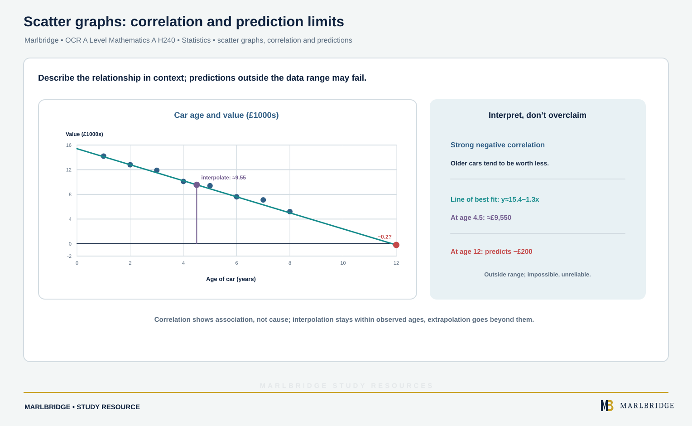

This guide is aligned to the OCR GCSE (9-1) Mathematics J560 specification, Version 2.1 (August 2026). It covers section 12.03 (Analysing data): 12.03a summary statistics, 12.03b misrepresenting data, 12.03c bivariate data and 12.03d outliers. Most of it is for both tiers. Estimating quartiles and the interquartile range from graphs of grouped data, drawing and interpreting box plots, and comparing distributions using the median and interquartile range are **Higher tier only**.

Related pages: the [revision notes](/resources/ocr-gcse-mathematics-analysing-data-averages-spread-box-plots-revision-notes/), the [practice questions](/resources/ocr-gcse-mathematics-analysing-data-averages-spread-box-plots-practice/), the [OCR GCSE Mathematics hub](/boards/ocr/gcse/mathematics/), the [printable checklist](/checklists/ocr/gcse/mathematics/) and the [10-minute diagnostics](/diagnostics/).

## What this unit covers

| Ref | What you must be able to do | Tier |
|---|---|---|
| 12.03a | Mean, mode, median and range for ungrouped data | Both |
| 12.03a | Modal class; estimates of range, mean and median for grouped data; why they are estimates | Both |
| 12.03a | Describe a population using statistics; make simple comparisons using like-for-like summary values | Both |
| 12.03a | Advantages and disadvantages of summary values | Both |
| 12.03a | Estimates of mean, median, mode, range, quartiles and IQR from graphs of grouped data | Higher tier only |
| 12.03a | Draw and interpret box plots; compare distributions using median and IQR | Higher tier only |
| 12.03b | Recognise graphical misrepresentation through incorrect scales, labels and so on | Both |
| 12.03c | Plot and interpret scatter diagrams; recognise correlation | Both |
| 12.03c | Interpret correlation in context; correlation versus causation; line of best fit by eye; interpolation and extrapolation and their limits | Both |
| 12.03d | Identify an outlier in simple cases; errors in data; outliers on a scatter graph | Both |

## 12.03a Averages and range for ungrouped data

- **Mean:** add all the values, then divide by how many there are.
- **Median:** the central value after you sort the data. With an even count, it lies halfway between the two central values.
- **Mode:** the most common value. A set can have no mode or more than one.
- **Range:** largest minus smallest. It measures spread, not a typical value.

**Example 1.** Minutes late for a train over ten days: 3, 0, 7, 2, 3, 12, 3, 5, 1, 4.

```
In order: 0 1 2 3 3 3 4 5 7 12
Sum = 40, so mean = 40 ÷ 10 = 4
Median: 5th and 6th values are 3 and 3, so median = 3
Mode = 3
Range = 12 − 0 = 12
```

The mean (4) is higher than the median (3) because the single large value 12 pulls it upwards.

<figure class="topic-figure">
  
  <figcaption>The mean, median, mode and range of one small list of data.</figcaption>
</figure>


## 12.03a Grouped data

When data are in classes, you no longer know the exact values. That is why every answer below is an **estimate**.

- **Modal class:** the class with the highest frequency (for equal class widths).
- **Estimated mean:** treat every value in a class as sitting at that class's midpoint. Multiply midpoint by frequency, add the results, then divide by the total frequency.
- **Estimated range:** highest class boundary minus lowest class boundary. It is the largest the range could be.
- **Estimated median:** work out which class contains the (n/2)th value, then place it within that class in proportion.
- **From a graph of grouped data** (a histogram, frequency polygon or cumulative frequency graph): the mode is estimated by the tallest bar or the peak of the polygon, and the median by reading across at height n/2. The mean and range come from the same class information as in a table. All of these are estimates.

**Example 2.** Time taken (t minutes) to complete a puzzle, for 50 people.

| Time t | 0 < t ≤ 10 | 10 < t ≤ 20 | 20 < t ≤ 30 | 30 < t ≤ 40 | 40 < t ≤ 50 |
|---|---|---|---|---|---|
| Frequency | 5 | 9 | 18 | 13 | 5 |
| Midpoint | 5 | 15 | 25 | 35 | 45 |

```
Modal class: 20 < t ≤ 30 (frequency 18)
Mean: (5×5 + 15×9 + 25×18 + 35×13 + 45×5) ÷ 50
    = (25 + 135 + 450 + 455 + 225) ÷ 50 = 1290 ÷ 50 = 25.8 minutes
Range (estimate): 50 − 0 = 50 minutes
Median: the 25th value. Running totals: 5, 14, 32, ...
        so it lies in 20 < t ≤ 30, the 11th of 18 values in that class.
        Estimate = 20 + (11/18) × 10 = 26.1 minutes (1 d.p.)
```

These answers are estimates because the actual values inside each class are not known. The true mean could be a little higher or lower than 25.8.

<figure class="topic-figure">
  
  <figcaption>The median of grouped data is found by placing the 25th value within its class in proportion.</figcaption>
</figure>

<figure class="topic-figure">
  
  <figcaption>Use the midpoint of each class, not a boundary, so the mean is only an estimate.</figcaption>
</figure>

<figure class="topic-figure">
  
  <figcaption>Read across at n/4, n/2 and 3n/4, then down; the IQR is UQ minus LQ.</figcaption>
</figure>


## 12.03a Describing and comparing

To **describe a population** with statistics, give an average and a measure of spread, and explain what each tells you in context ("the typical journey takes about 26 minutes, and times vary by up to 50 minutes").

To **compare** two data sets, make a like-for-like comparison: average with average, spread with spread, and always in context.

- Good: "Class B has a higher median score, so B did better typically, and a smaller range, so B's scores were more consistent."

| Summary value | Advantage | Disadvantage |
|---|---|---|
| Mean | Uses every value | Pulled by extreme values |
| Median | Not affected by extreme values | Ignores most of the actual values |
| Mode | Works for non-numerical data; easy to find | May not exist, or may not be central |
| Range | Quick to find | Depends only on the two extreme values |

<figure class="topic-figure">
  
  <figcaption>One extreme value pulls the mean and sets the range, while the median stays put.</figcaption>
</figure>


## 12.03a Quartiles from graphs of grouped data: Higher tier only

For grouped data, the usual graph for this is a **cumulative frequency** graph: plot the running total against the **upper boundary** of each class, starting from zero at the lowest boundary. For n values:

- Lower quartile Q1: the value at height n/4
- Median: the value at height n/2
- Upper quartile Q3: the value at height 3n/4
- Interquartile range (IQR) = Q3 − Q1

**Example 3.** Masses of 80 parcels, in kg.

| Mass m | 0 < m ≤ 2 | 2 < m ≤ 4 | 4 < m ≤ 6 | 6 < m ≤ 8 | 8 < m ≤ 10 |
|---|---|---|---|---|---|
| Frequency | 8 | 14 | 26 | 20 | 12 |
| Cumulative | 8 | 22 | 48 | 68 | 80 |

The graph passes through (0, 0), (2, 8), (4, 22), (6, 48), (8, 68) and (10, 80). Read across from heights 20, 40 and 60. Treating the graph as straight between plotted points:

```
Q1 (height 20): between (2, 8) and (4, 22):  2 + (12/14) × 2 = 3.7
Median (height 40): between (4, 22) and (6, 48):  4 + (18/26) × 2 = 5.4
Q3 (height 60): between (6, 48) and (8, 68):  6 + (12/20) × 2 = 7.2
IQR = 7.2 − 3.7 = 3.5 kg
```

If you read from a smooth curve you drew, your values may differ a little. Show the horizontal and vertical reading lines on the graph so your method is visible. The mean estimate for this table is (1×8 + 3×14 + 5×26 + 7×20 + 9×12) ÷ 80 = 428 ÷ 80 = 5.35 kg.

## 12.03a Box plots: Higher tier only

A box plot is drawn above a number line using five values: **minimum, Q1, median, Q3, maximum**. The box spans Q1 to Q3, with a marker for the median. Lines extend from the box to the smallest and largest values. The box width is the IQR.

With a list of values, put them in order, find the median, then find the median of each half (leave out the median itself when there is an odd number of values).

**Example 4.** Test scores out of 40 for 11 students in each of two classes.

```
Class A: 13 16 19 22 23 25 27 29 31 34 38
Class B: 19 21 22 24 25 26 27 28 29 31 32
```

| | Min | Q1 | Median | Q3 | Max | IQR | Range |
|---|---|---|---|---|---|---|---|
| A | 13 | 19 | 25 | 31 | 38 | 12 | 25 |
| B | 19 | 22 | 26 | 29 | 32 | 7 | 13 |

```
   10   15   20   25   30   35   40
   +    +    +    +    +    +    +
A:    |-----[=====#=====]------|
B:          |--[===#==]--|
```

Key: [ and ] are Q1 and Q3, # is the median, | marks the minimum and maximum.

Comparison: B has a slightly higher median (26 against 25), so B's typical score is a little better. B has a smaller IQR (7 against 12), so B's middle half of scores is more consistent. A has the greater range, but the range uses only the two extremes. Interpret box plots the same way: the median shows the typical value, the IQR shows the spread of the middle 50%.

<figure class="topic-figure">
  
  <figcaption>Compare medians for typical value and IQRs for consistency.</figcaption>
</figure>

<figure class="topic-figure">
  
  <figcaption>Pick the minimum, three quartiles and maximum from the ordered list and draw them on one scale.</figcaption>
</figure>


## 12.03b Misrepresenting data

A graph or chart can mislead through its design, even when the numbers are correct. Look for:

- **A scale that does not start at zero.** Bars for 500, 520 and 540 on an axis starting at 480 are 20, 40 and 60 units tall. The last bar looks three times as tall as the first, but the real increase is only 40 out of 500, which is 8%.
- **Uneven scales.** Gaps on an axis that are not equal steps.
- **Missing or vague labels.** No title, units or axis labels, or a selective time period that hides the pattern.
- **Bars of different widths, or 3D effects**, which change the apparent size.
- **A pictogram with no key**, or icons drawn at different sizes.

When asked what is wrong, name the feature, then say what effect it has: "The vertical axis starts at 480, so small differences look large."

<figure class="topic-figure">
  
  <figcaption>Uneven scales, different-sized icons with no key, and 3D effects change the apparent size.</figcaption>
</figure>

<figure class="topic-figure">
  
  <figcaption>A vertical axis that does not start at zero exaggerates differences.</figcaption>
</figure>


## 12.03c Scatter graphs and correlation

<!-- marlbridge-diagram:math-b75-scatter-correlation-interpolation-extrapolation -->
<figure class="lesson-diagram" style="margin: 2rem 0;">
  <a href="/public/images/learning/mathematics/math-b75-scatter-correlation-interpolation-extrapolation.svg" aria-label="Open full-size diagram: math-b75-scatter-correlation-interpolation-extrapolation"></a>
  <figcaption>Source car-age data show strong negative correlation. The approximate fit y=15.4−1.3x predicts ≈£9,550 at age 4.5 (interpolation), but −£200 at age 12, an impossible and unreliable extrapolation. Select the image to enlarge it.</figcaption>
</figure>
<!-- /marlbridge-diagram:math-b75-scatter-correlation-interpolation-extrapolation -->


A scatter graph plots pairs of values for two variables. **Correlation** describes the relationship:

- **Positive:** as one variable increases, the other tends to increase.
- **Negative:** as one increases, the other tends to decrease.
- **Zero (no correlation):** no clear pattern.
- **Strong or weak:** the closer the points are to a straight line, the stronger the correlation.

Always interpret in context: "The older the car, the lower its value" is better than "negative correlation".

**Correlation is not causation.** Two variables can move together because of a third factor, or by coincidence. Shoe size and reading score are positively correlated among primary school children because both increase with age. Larger feet do not make children read better.

**Line of best fit by eye.** Draw one straight line along the overall trend, leaving the points spread about evenly on either side of it. It need not go through the origin. It should pass close to the point formed by the mean of each variable.

**Example 5.** Age of car (years) and value (£1000s):

| Age | 1 | 2 | 3 | 4 | 5 | 6 | 7 | 8 |
|---|---|---|---|---|---|---|---|---|
| Value | 14.2 | 12.8 | 11.9 | 10.1 | 9.4 | 7.6 | 7.1 | 5.2 |

The points show strong negative correlation. A sensible line passes through (1, 14.1) and (8, 5.0), which is close to a value of 15.4 − 1.3 × age.

- **Interpolation:** predicting inside the range of the data. At age 4.5, value ≈ 15.4 − 1.3 × 4.5 = 9.55, about £9550. This is fairly reliable.
- **Extrapolation:** predicting outside the range. At age 12, the line gives 15.4 − 15.6 = −0.2, a negative value, which is impossible. The trend cannot continue unchanged, so extrapolation is unreliable.

<figure class="topic-figure">
  
  <figcaption>Shoe size and reading score rise together only because both rise with age.</figcaption>
</figure>

<figure class="topic-figure">
  
  <figcaption>Judge the correlation by eye before drawing any line.</figcaption>
</figure>

<figure class="topic-figure">
  
  <figcaption>Readings inside the data are reliable; extending the line beyond age 9 is not.</figcaption>
</figure>


## 12.03d Outliers and errors in data

An **outlier** is a value standing apart from the pattern shown by the rest. At this level you only need to spot clear cases in simple data, and to say that an outlier might be an **error** (a typing slip, a misread instrument) or a genuine unusual value.

**Example 6.** Plant heights (cm): 12, 14, 13, 15, 14, 130, 13, 16.

The value 130 is far from the others. It is probably 13.0 with a misplaced decimal point. The mean with it is 227 ÷ 8 = 28.4 cm, which describes none of the plants. The median is 14 cm, which is a much better summary. Do not remove an outlier without a reason, but do say why it may be wrong, and check it if you can.

On a scatter graph, an outlier is a point well away from the trend that the other points follow. Draw your line of best fit through the main pattern, ignoring the outlier, and comment on it.

<figure class="topic-figure">
  
  <figcaption>An outlier pulls a line of best fit away from the pattern, so draw the line ignoring it and comment.</figcaption>
</figure>

<figure class="topic-figure">
  
  <figcaption>The mean, median, mode and range of one data set, with an outlier pulling the mean up.</figcaption>
</figure>


## Common errors

- Dividing by how many classes there are, rather than by the total frequency, when estimating a mean.
- Using class boundaries rather than midpoints for the grouped mean.
- Plotting cumulative frequency at the lower boundary instead of the upper one.
- Describing correlation with no context, or claiming that correlation proves one variable causes the other.
- Extrapolating far beyond the data and presenting the result as reliable.

## Official syllabus

OCR, GCSE (9-1) Mathematics J560, Version 2.1 (August 2026), for first assessment in 2017, section 12.03 Analysing data (12.03a to 12.03d).
