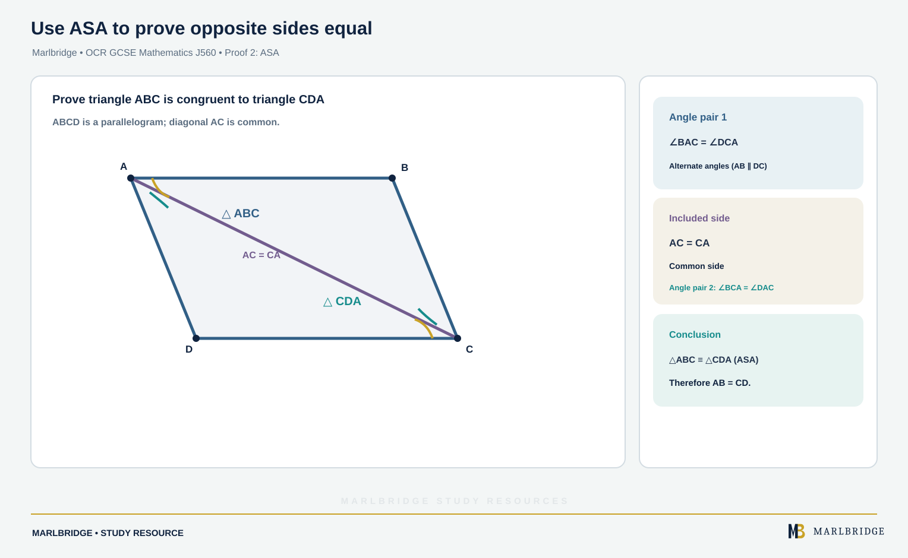

This study guide covers congruence for the OCR GCSE (9-1) Mathematics specification (J560), Version 2.1 (August 2026). It follows content references 9.02a and 9.02b, which sit in content area 9, Congruence and similarity. The content applies to both Foundation tier and Higher tier, and nothing in this unit is marked Higher tier only. The specification expects you to support answers with appropriate working, and some questions ask for an extended line of reasoning, so proofs are written out in full.

Use this page with the [revision notes](/resources/ocr-gcse-mathematics-congruence-and-congruence-proofs-revision-notes/) and the [practice questions](/resources/ocr-gcse-mathematics-congruence-and-congruence-proofs-practice/). The course hub is at [OCR GCSE Mathematics](/boards/ocr/gcse/mathematics/), the printable list is the [checklist](/checklists/ocr/gcse/mathematics/), and the [free diagnostics](/diagnostics/) show where to start. For wider exam habits see [OCR GCSE Mathematics exam preparation](/resources/ocr-gcse-mathematics-exam-preparation/).

## What this unit covers

| Ref | What you must be able to do | Tier |
|---|---|---|
| 9.02a | Identify congruent triangles | Both |
| 9.02a | Prove two triangles are congruent using SSS, ASA, SAS or RHS | Both |
| 9.02b | Apply congruent triangles in calculations | Both |
| 9.02b | Use congruent triangles in simple proofs, for example that the base angles of an isosceles triangle are equal | Both |

## Congruent triangles (9.02a)

Two shapes are congruent if they are exactly the same shape and size. One can be moved onto the other by a combination of translation, rotation and reflection, so a congruent triangle may be turned round or flipped over. Enlargement is not allowed, because it changes the size.

If two triangles are congruent, every side and angle in one has a partner in the other. Partners are called corresponding sides and corresponding angles, and they are equal.

Write the congruence with the vertices in matching order. The statement ABC ≅ ZXY means A matches Z, B matches X and C matches Y. So AB = ZX, BC = XY, angle A = angle Z, and so on. Always read the matching from the order of the letters, never from the picture alone.

### Spot the congruent pair

Four triangles are described below.

| Triangle | Information |
|---|---|
| 1 | sides 7 cm, 9 cm, 11 cm |
| 2 | sides 11 cm, 7 cm, 9 cm |
| 3 | angles 40°, 60°, 80°, one side 7 cm |
| 4 | angles 40°, 60°, 80°, one side 12 cm |

Triangles 1 and 2 have the same three side lengths, so they are congruent (SSS). Triangles 3 and 4 have the same angles, so they have the same shape, but a 7 cm side and a 12 cm side cannot be equal. They are not congruent. One is an enlargement of the other, so they are similar but not congruent.

## The four conditions (9.02a)

You do not need to check all six measurements. Any one of these four sets of facts is enough to prove two triangles congruent.

| Condition | What you need | Notes |
|---|---|---|
| SSS | all three sides equal | no angles needed |
| SAS | two sides equal and the angle between them equal | the angle must be included |
| ASA | two angles equal and one side equal | the side must match in position |
| RHS | both triangles right-angled, hypotenuses equal, one other side equal | right angle is essential |

Each condition is named by the order of facts around the triangle. In SAS the angle sits between the two sides. In ASA the side sits between the two angles, although a side in any matching position works, because the third angle follows from the angle sum.

### Two sets of facts that are not enough

AAA (three equal angles) does not work. Triangles 3 and 4 above show why: same angles, different size.

SSA, two sides and an angle that is not between them, does not work either. Take sides of 8 cm and 6 cm with a 40° angle opposite the 6 cm side. Two different triangles can be drawn, because the 6 cm side can swing to two positions. RHS is a safe special case because the right angle removes that choice. If you reject a condition in an answer, give the reason, as above.

<figure class="topic-figure">
  
  <figcaption>AAA gives similar triangles, and SSA can fit two different triangles, so neither proves congruence.</figcaption>
</figure>


### Example: using the angle sum with ASA

Triangle ABC has angle A = 38°, angle B = 74° and AB = 6.5 cm. Triangle PQR has angle P = 38°, angle R = 68° and PQ = 6.5 cm. Are they congruent?

```
Angle Q = 180° − 38° − 68° = 74°
Angle B = 74° = angle Q
Angle A = 38° = angle P
AB = PQ = 6.5 cm, and AB lies between A and B just as PQ lies between P and Q
```

Two angles and the matching side are equal, so the triangles are congruent (ASA). The statement is ABC ≅ PQR.

<figure class="topic-figure">
  
  <figcaption>Each of SSS, SAS, ASA and RHS is enough on its own to prove two triangles congruent.</figcaption>
</figure>


## Writing a congruence proof (9.02a)

A proof is a chain of reasons. Use this layout every time.

1. Name the two triangles, using letters in matching order.
2. List three equal pairs of facts, each with a reason.
3. State the condition (SSS, SAS, ASA or RHS) and say the triangles are congruent.
4. Use "corresponding" to state what follows from the congruence.

Common reasons you can quote:

| Fact | Reason to write |
|---|---|
| Two lines cross | vertically opposite angles are equal |
| A side shared by both triangles | common side |
| Parallel lines | alternate angles are equal |
| Corners of a square or rectangle | angle of 90° |
| Marked equal lengths | given in the question |
| A point is the midpoint | it divides the line into two equal parts |

### Proof 1: SAS

Lines AB and CD cross at M. M is the midpoint of AB and the midpoint of CD. Prove that AC = BD.

| Statement | Reason |
|---|---|
| AM = BM | M is the midpoint of AB |
| angle AMC = angle BMD | vertically opposite angles |
| CM = DM | M is the midpoint of CD |

The triangles AMC and BMD are congruent (SAS). The angle is between the two equal sides in both triangles. Corresponding sides are equal, so AC = BD.

<figure class="topic-figure">
  
  <figcaption>The SAS proof for two lines crossing at a shared midpoint.</figcaption>
</figure>


### Proof 2: ASA

<!-- marlbridge-diagram:math-b77-ocr-congruence-asa-proof -->
<figure class="lesson-diagram" style="margin: 2rem 0;">
  <a href="/public/images/learning/mathematics/math-b77-ocr-congruence-asa-proof.svg" aria-label="Open full-size diagram: math-b77-ocr-congruence-asa-proof"></a>
  <figcaption>A parallelogram split by diagonal AC, with alternate angle pairs and the shared side identified; ASA gives triangle ABC congruent to CDA and AB equal to CD.</figcaption>
</figure>
<!-- /marlbridge-diagram:math-b77-ocr-congruence-asa-proof -->


ABCD is a parallelogram. Prove that triangle ABC is congruent to triangle CDA, and deduce that AB = CD.

| Statement | Reason |
|---|---|
| angle BAC = angle DCA | alternate angles, AB parallel to DC |
| AC = CA | common side |
| angle BCA = angle DAC | alternate angles, BC parallel to AD |

The triangles are congruent (ASA), with AC lying between the two equal angles in each. The matching is A to C, B to D, C to A. So AB = CD, and BC = DA as well.

<figure class="topic-figure">
  
  <figcaption>The ASA proof splits a parallelogram along a diagonal.</figcaption>
</figure>


### Proof 3: RHS

Triangle ABC has AB = AC. M is the point on BC where the perpendicular from A meets it. Prove that M is the midpoint of BC.

| Statement | Reason |
|---|---|
| angle AMB = angle AMC = 90° | perpendicular from A |
| AB = AC | given (hypotenuses) |
| AM = AM | common side |

The triangles AMB and AMC are right-angled with equal hypotenuses and one equal side, so they are congruent (RHS). Corresponding sides are equal, so BM = MC. M is the midpoint of BC.

<figure class="topic-figure">
  
  <figcaption>RHS proves M is the midpoint, and the 17-15-8 numbers give BC = 16 cm.</figcaption>
</figure>

<figure class="topic-figure">
  
  <figcaption>Each fact in a diagram has a standard reason to quote.</figcaption>
</figure>


## Applying congruent triangles (9.02b)

### Calculations

Congruence turns known measurements in one triangle into unknown ones in the other.

**Example.** Triangle ABC has AB = 9.6 cm, BC = 7.2 cm, angle A = 41° and angle B = 77°. Triangle PQR is congruent to triangle ABC with A matching R, B matching P and C matching Q. Find PQ, RP and angle Q.

```
PQ matches BC, so PQ = 7.2 cm
RP matches AB, so RP = 9.6 cm
Angle C = 180° − 41° − 77° = 62°
Angle Q matches C, so angle Q = 62°
```

The letters P, Q, R appear in a different order from A, B, C, so match them by position in the congruence statement, not by where they sit on the page.

### The isosceles triangle result

An isosceles triangle has two equal sides. The base angles, which sit opposite those sides, are equal. Congruence proves this.

**Proof (base angles equal).** In triangle ABC, AB = AC. Draw AD, the bisector of angle A, meeting BC at D. Prove angle B = angle C.

| Statement | Reason |
|---|---|
| AB = AC | given |
| angle BAD = angle CAD | AD bisects angle A |
| AD = AD | common side |

The triangles ABD and ACD are congruent (SAS). The equal angle lies between the two equal sides in each triangle. So angle ABD = angle ACD, which means the base angles are equal.

You can now use the result in questions without proving it again unless the question says "prove". If a question asks you to prove it, write out the table above.

**Example.** In triangle ABC, AB = AC and angle A = 48°. Find angle B.

```
Angle B = angle C (base angles of an isosceles triangle)
2 × angle B = 180° − 48° = 132°
Angle B = 66°
```

A second example turns this round. If a base angle is 71°, the angle at the top is 180° − 2 × 71° = 38°.

<figure class="topic-figure">
  
  <figcaption>Bisecting the apex angle makes two congruent triangles, which proves the base angles are equal.</figcaption>
</figure>


### Combining the results

The RHS proof above shows that the perpendicular from the apex of an isosceles triangle bisects the base. A numerical use follows.

**Example.** An isosceles triangle ABC has AB = AC = 17 cm. The perpendicular from A meets BC at M, and AM = 15 cm. Find BC.

```
M is the midpoint of BC (RHS congruence)
BM² = 17² − 15² = 289 − 225 = 64
BM = 8 cm
BC = 2 × 8 = 16 cm
```

### Longer proofs

In a longer proof, the first congruence often leads to a second one. Prove one pair of triangles congruent, state which sides or angles are equal as a result, and use those new facts in the next congruence. Write each stage separately. If a diagram has a shared side, mark it "common" so you do not forget it.

<figure class="topic-figure">
  
  <figcaption>Match corresponding parts from the order of the letters in the congruence statement, not from where they sit on the page.</figcaption>
</figure>


## Common errors

- Writing the letters in the wrong order, so that the corresponding sides are wrong.
- Using the pairs "two sides and any angle". The angle must be between the sides for SAS.
- Treating AAA or SSA as a proof. Neither is on the list of four conditions.
- Missing the reason beside a statement. "AB = CD" on its own is weaker than "AB = CD (opposite sides of a parallelogram)", because the reason shows why it is true.
- Assuming something from the diagram, such as a right angle or equal lengths that are not marked or stated.
- Forgetting to finish the proof. Say "congruent (SAS)" and then state what you deduce.
- Using RHS when the triangles are not right-angled.

## Where to go next

Work through the [practice questions](/resources/ocr-gcse-mathematics-congruence-and-congruence-proofs-practice/), then use the [revision notes](/resources/ocr-gcse-mathematics-congruence-and-congruence-proofs-revision-notes/) before a mock. Tick off 9.02a and 9.02b on the [printable checklist](/checklists/ocr/gcse/mathematics/).

## Frequently asked questions

**What transformations keep a shape congruent?**
Translation, rotation and reflection keep a shape congruent, so a congruent triangle may be turned round or flipped over. Enlargement is not allowed, because it changes the size.

**Why does the order of letters matter in a congruence statement?**
The letters show which vertices match. The statement ABC ≅ ZXY means A matches Z, B matches X and C matches Y, so AB = ZX and BC = XY; reading the matching from the picture instead can give the wrong sides.

**How do you prove the base angles of an isosceles triangle are equal?**
Draw the bisector of the apex angle to meet the base. The two triangles formed have the equal sides, equal angles at the apex and a common side, so they are congruent by SAS, and the base angles are equal.

**Can you use a right angle that only looks right in the diagram?**
No. A right angle, parallel lines or equal lengths must be stated or marked in the question before you use them in a proof. Assuming facts from the picture alone is a common error.

## Official syllabus

This page is aligned to the OCR GCSE (9-1) in Mathematics (J560) specification, Version 2.1, August 2026, published by OCR for first assessment in 2017. The relevant content is 9.02a (Congruent triangles) and 9.02b (Applying congruent triangles).
