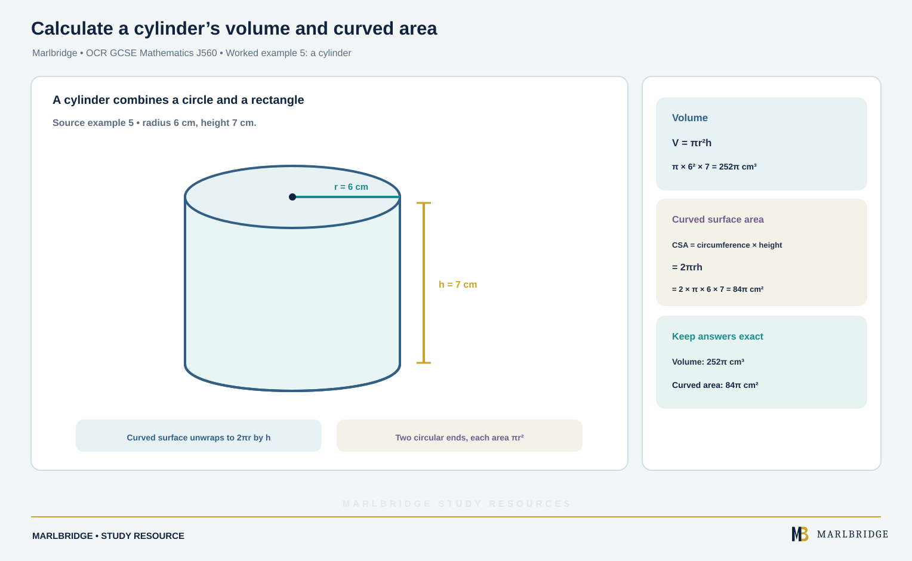

This guide is for OCR GCSE (9-1) Mathematics, aligned to the OCR specification Version 2.1 (August 2026). It covers sections 3.03a and 3.03b, exact calculations. Fractions and multiples of π are assessed at both tiers. Surds are **Higher tier only**. These sections are worded "without a calculator", so you should be able to do every skill here by hand. Each tier has papers with and without a calculator, and the specification adds that any content can be assessed on either type.

Check your progress with the [printable checklist](/checklists/ocr/gcse/mathematics/), browse the [OCR GCSE Mathematics hub](/boards/ocr/gcse/mathematics/), then use the [revision notes](/resources/ocr-gcse-mathematics-exact-calculations-with-fractions-pi-and-surds-revision-notes/) and the [practice questions](/resources/ocr-gcse-mathematics-exact-calculations-with-fractions-pi-and-surds-practice/). For wider fraction work see [fractions, decimals and percentages](/resources/ocr-gcse-mathematics-fractions-decimals-and-percentages/). Not sure where you stand? Try the [free diagnostics](/diagnostics/).

## What this unit covers

| Section | What you must be able to do | Tier |
|---|---|---|
| 3.03a | Use fractions in exact calculations without a calculator | Both tiers |
| 3.03a | Use multiples of π in exact calculations without a calculator | Both tiers |
| 3.03a | Use surds in exact calculations without a calculator | Higher tier only |
| 3.03b | Simplify expressions with surds, including rationalising denominators | Higher tier only |

"Exact" means no rounding. An answer such as 5/3, 20π or 4√5 is exact. The decimals 1.666…, 62.83 and 8.944 are approximations. When a question says "give your answer in terms of π", "give an exact answer" or "do not use a calculator", leave the answer in fraction, π or surd form.

## Exact calculations with fractions (3.03a)

Fractions stay exact because you never convert to a decimal that might recur. Work with them like this.

**Add and subtract.** Use a common denominator. Change mixed numbers to improper fractions first if that is easier.

**Multiply.** Multiply the numerators and the denominators. Cancel common factors before you multiply to keep the numbers small.

**Divide.** Keep the first fraction, flip the second, then multiply.

**Fraction of an amount.** "a/b of N" means (a/b) × N. To find the whole from a part, divide the part by the fraction.

### Worked example 1: adding mixed numbers

Work out 3 5/6 + 1 7/9. Give the answer as a mixed number.

```
3 5/6 = 23/6        1 7/9 = 16/9
Common denominator 18:
23/6 = 69/18        16/9 = 32/18
69/18 + 32/18 = 101/18
101 ÷ 18 = 5 remainder 11
```

Answer: **5 11/18**.

<figure class="topic-figure">
  
  <figcaption>Adding in eighteenths, 15 + 14 = 29 eighteenths is one whole and 11/18 more.</figcaption>
</figure>


### Worked example 2: multiplying and dividing together

Work out 2 1/4 ÷ 1 1/8 × 5/6.

```
2 1/4 = 9/4        1 1/8 = 9/8
9/4 ÷ 9/8 = 9/4 × 8/9 = 2
2 × 5/6 = 10/6 = 5/3
```

Answer: **5/3** (or 1 2/3). Working left to right matters because the division and multiplication have equal rank.

### Worked example 3: fractions of an amount

A monthly budget is £84. 2/7 goes on rent and 1/3 on food. What fraction is left, and how much money is that?

```
Spent: 2/7 + 1/3 = 6/21 + 7/21 = 13/21
Left: 1 - 13/21 = 8/21
Amount: 8/21 × 84 = 8 × 4 = 32
```

Answer: **8/21, which is £32**.

Reverse case: if 3/5 of a length is 21 cm, the whole is 21 ÷ 3/5 = 21 × 5/3 = **35 cm**.

<figure class="topic-figure">
  
  <figcaption>Cutting £84 into 21 parts of £4 shows rent, food and what is left.</figcaption>
</figure>

<figure class="topic-figure">
  
  <figcaption>Dividing by 5/8 counts how many 5/8 m pieces fit, and the answer is 12.</figcaption>
</figure>


## Exact calculations with multiples of π (3.03a)

π is a number, so you can add, subtract and multiply multiples of it like any other term. 4π + 3π = 7π and 6 × 5π = 30π. You do not replace π with 3.14 until the final line, and often not at all.

### Circles

Circumference = πd = 2πr. Area = πr². Keep π as a symbol throughout.

### Worked example 4: area of a ring

A circular path has an outer radius of 9 m and an inner radius of 5 m. Find the area of the path in terms of π.

```
Outer circle: π × 9² = 81π
Inner circle: π × 5² = 25π
Path: 81π - 25π = 56π
```

Answer: **56π m²**.

<figure class="topic-figure">
  
  <figcaption>A ring is the outer circle minus the inner one, and π stays a symbol.</figcaption>
</figure>


### Worked example 5: a cylinder

<!-- marlbridge-diagram:math-b77-ocr-cylinder-volume-curved-area -->
<figure class="lesson-diagram" style="margin: 2rem 0;">
  <a href="/public/images/learning/mathematics/math-b77-ocr-cylinder-volume-curved-area.svg" aria-label="Open full-size diagram: math-b77-ocr-cylinder-volume-curved-area"></a>
  <figcaption>Cylinder labeled r=6 cm and h=7 cm, with exact volume 252π cm³ and curved surface area 84π cm²; the curved surface unwraps to a rectangle.</figcaption>
</figure>
<!-- /marlbridge-diagram:math-b77-ocr-cylinder-volume-curved-area -->


A tin is a cylinder with radius 6 cm and height 7 cm. Work out its volume and its curved surface area, both in terms of π.

```
Volume = πr²h = π × 36 × 7 = 252π
Curved surface area = 2πrh = 2 × π × 6 × 7 = 84π
```

Answer: **252π cm³ and 84π cm²**.

<figure class="topic-figure">
  
  <figcaption>Volume is base area times height, and the unrolled curved surface is a 12π by 7 rectangle.</figcaption>
</figure>


### Worked example 6: a sector

A sector has angle 72° and radius 5 cm. Find its area, then find the ratio of its area to the whole circle.

```
Sector area = 72/360 × π × 5² = 1/5 × 25π = 5π
Whole circle = 25π
Ratio = 5π : 25π = 1 : 5
```

Answer: **5π cm²**. The π cancels in a ratio, which is why exact methods are neat.

<figure class="topic-figure">
  
  <figcaption>Arc length and sector area are the same fraction, angle over 360, of the circumference and the area.</figcaption>
</figure>


### Working backwards

If a circumference is 14π cm, then 2πr = 14π, so r = 7. The area is π × 7² = **49π cm²**. Divide both sides by π and you never need a decimal.

## Exact calculations with surds (3.03a, Higher tier only)

A **surd** is a root whose value is not a fraction of two integers, such as √2, √7 or √10. √16 = 4 is not a surd because it is a whole number. Surds are irrational, so their decimals never end or repeat. Leaving them in root form keeps the answer exact.

## Manipulating surds (3.03b, Higher tier only)

### Rules for multiplying and dividing

| Rule | Example |
|---|---|
| √a × √b = √(ab) | √6 × √15 = √90 |
| √a ÷ √b = √(a/b) | √48 ÷ √3 = √16 = 4 |

Also √a × √a = a, so (√7)² = 7 and (3√2)² = 9 × 2 = 18.

These rules do not work for addition. √9 + √16 = 3 + 4 = 7, but √(9 + 16) = √25 = 5.

<figure class="topic-figure">
  
  <figcaption>Walking the two short sides of a 3-4-5 triangle is further than the direct hypotenuse.</figcaption>
</figure>


### Simplifying a surd

Find the largest square number that divides into the number under the root, then take its root outside.

```
√12 = √(4 × 3) = √4 × √3 = 2√3
√72 = √(36 × 2) = 6√2
```

If you spot only a smaller square factor, simplify in two stages: √72 = √(9 × 8) = 3√8 = 3 × 2√2 = 6√2.

<figure class="topic-figure">
  
  <figcaption>The exact length 4√2 cm is a surd; 5.657 is only a rounded value.</figcaption>
</figure>


### Adding and subtracting

Simplify each surd first. You can then collect terms with the same surd, just like 3x + 2x.

### Worked example 7

Simplify √45 + √20 − √5.

```
√45 = 3√5     √20 = 2√5
3√5 + 2√5 - √5 = 4√5
```

Answer: **4√5**.

### Multiplying and expanding

Expand brackets as normal and use √a × √a = a.

<figure class="topic-figure">
  
  <figcaption>An area grid gives each product, and √a × √a = a makes the surd cells rational.</figcaption>
</figure>


### Worked example 8

Expand and simplify (2 + √3)(5 − √3).

```
2 × 5 = 10
2 × (-√3) = -2√3
√3 × 5 = 5√3
√3 × (-√3) = -3
Total: 10 - 3 + (-2√3 + 5√3) = 7 + 3√3
```

Answer: **7 + 3√3**.

Squaring a bracket needs two full brackets: (3 + √2)² = 9 + 3√2 + 3√2 + 2 = **11 + 6√2**.

### Rationalising a denominator: one surd

To remove a surd from the bottom, multiply top and bottom by that surd. This multiplies the fraction by 1, so its value does not change.

```
1/√3 = (1 × √3)/(√3 × √3) = √3/3
```

Simplify the surd first if you can, because it keeps numbers smaller.

### Worked example 9

Write 4/√12 with a rational denominator.

```
√12 = 2√3
4/(2√3) = 2/√3
2/√3 × √3/√3 = 2√3/3
```

Answer: **2√3/3**.

### Rationalising a denominator: two terms

For a denominator such as a + √b, multiply top and bottom by the **conjugate** a − √b (change the sign in the middle). The denominator becomes a difference of two squares: (a + √b)(a − √b) = a² − b, which is rational.

```
1/(√3 + 1) × (√3 - 1)/(√3 - 1) = (√3 - 1)/(3 - 1) = (√3 - 1)/2
```

<figure class="topic-figure">
  
  <figcaption>Multiplying by the conjugate gives a difference of two squares, so the surd disappears.</figcaption>
</figure>


### Worked example 10

Rationalise 7/(√6 − 2).

```
Conjugate of √6 - 2 is √6 + 2
Denominator: (√6 - 2)(√6 + 2) = 6 - 4 = 2
Numerator: 7(√6 + 2) = 7√6 + 14
```

Answer: **(7√6 + 14)/2**.

### Worked example 11

Write (1 + √5)/(3 − √5) in the form a + b√5.

```
Multiply by (3 + √5)/(3 + √5)
Numerator: (1 + √5)(3 + √5) = 3 + √5 + 3√5 + 5 = 8 + 4√5
Denominator: 9 - 5 = 4
(8 + 4√5)/4 = 2 + √5
```

Answer: **a = 2, b = 1**.

### Worked example 12: exact lengths

A right-angled isosceles triangle has hypotenuse 10 cm. Find the exact length of each short side and the area.

```
x² + x² = 100, so x² = 50
x = √50 = 5√2
Area = 1/2 × 5√2 × 5√2 = 1/2 × 25 × 2 = 25
```

Answer: **5√2 cm and 25 cm²**. The area is a whole number even though the sides are surds.

## Common errors

- Adding denominators: 1/3 + 1/4 is not 2/7.
- Writing 3.14 for π in an answer that asks for terms of π. Leave π as a symbol.
- Treating √(a + b) as √a + √b.
- Stopping at √72 because it "looks done". Always check for a square factor.
- Rationalising 1/(√3 + 1) by multiplying by √3 only. A two-term denominator needs its conjugate.
- Sign slips in the conjugate. Write the middle sign explicitly and expand fully.
- Giving a final answer such as 6/√2 with a surd still in the denominator when the question says to rationalise.
- Rounding part-way through a calculation and losing the exact form.

## Frequently asked questions

**What is an exact answer in GCSE Maths?**
An exact answer has not been rounded, such as 5/3, 20π or 4√5. Decimals such as 1.666…, 62.83 and 8.944 are approximations, so use fraction, π or surd form when the question asks for an exact answer.

**What is a surd?**
A surd is a root that cannot be written as a fraction of two integers, such as √2, √7 or √10. √16 is not a surd, because it equals the whole number 4.

**Do you need a calculator for exact calculations in OCR GCSE Maths?**
No. OCR GCSE Mathematics J560 sections 3.03a and 3.03b are worded "without a calculator", so you should be able to do every skill by hand. The specification also says any content can be assessed on either type of paper.

**How do you find the radius of a circle from a circumference given in terms of π?**
Set 2πr equal to the circumference and divide both sides by π. For a circumference of 14π cm, 2r = 14, so r = 7 cm and the area is 49π cm², with no decimal needed.

## Official syllabus

OCR GCSE (9-1) Mathematics (J560), Version 2.1 (August 2026), for first assessment in 2017, published by OCR. This guide covers sections 3.03a and 3.03b.
