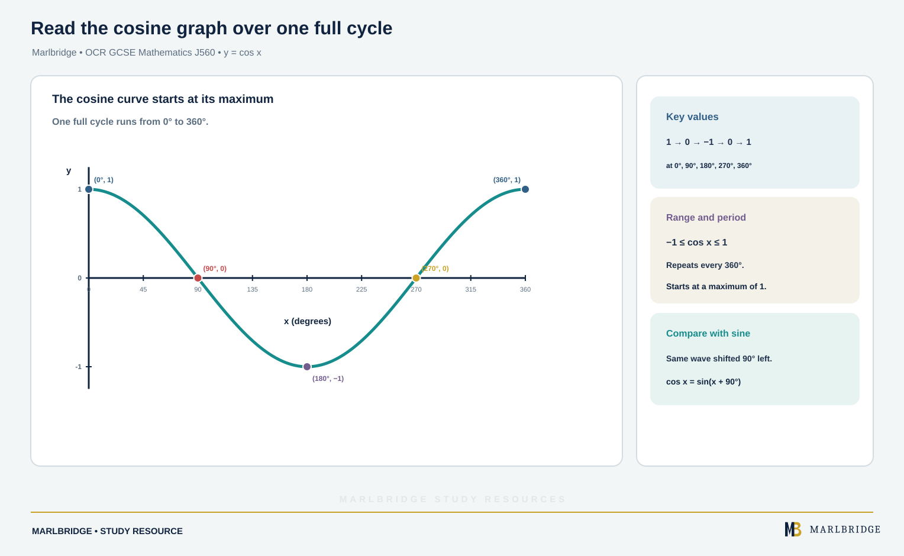

This guide is written for OCR GCSE (9-1) Mathematics J560, using the specification Version 2.1 (August 2026). It covers statements 7.01b (plotting exponential graphs), 7.01d (exponential functions), 7.01e (trigonometric functions) and 7.03a (translations and reflections of curves). **All of it is Higher tier only.** It sits in column 3 of the specification, so Foundation tier candidates are not assessed on it. Function notation is not required for 7.03a, so this guide talks about "the graph of y = ..." throughout.

Related pages: the [OCR GCSE Mathematics hub](/boards/ocr/gcse/mathematics/), the [printable checklist](/checklists/ocr/gcse/mathematics/), the [revision notes](/resources/ocr-gcse-mathematics-exponential-and-trigonometric-graphs-and-revision-notes/) and the [practice questions](/resources/ocr-gcse-mathematics-exponential-and-trigonometric-graphs-and-practice/). To find your weak spots first, try the [free 10-minute diagnostics](/diagnostics/).

## What this unit covers

| Ref | What you must be able to do | Tier |
|---|---|---|
| 7.01b | Use a table of values to plot exponential graphs, e.g. y = 3 × 1.1ˣ | Higher tier only |
| 7.01d | Recognise and sketch graphs of y = kˣ for positive k | Higher tier only |
| 7.01e | Recognise and sketch y = sin x, y = cos x and y = tan x | Higher tier only |
| 7.03a | Identify and sketch translations and reflections of a given graph or equation, e.g. y = sin x + 2, y = (x + 2)² − 1, y = −x² | Higher tier only |

The specification says content may be assessed on either a calculator or a non-calculator paper. Higher tier has Papers 4, 5 and 6, and Paper 5 is the one where a calculator is not permitted. So practise sketching and simple table values by hand.

## Exponential graphs (7.01b, 7.01d)

In an exponential function the variable is in the power: y = kˣ, where k is a positive constant. Compare y = x², where x is the base and 2 is fixed.

### Plotting from a table of values (7.01b)

Work through the table one column at a time. A negative power means "one over": 3⁻² = 1/3² = 1/9.

**Worked example 1.** Plot y = 3ˣ for −2 ≤ x ≤ 3.

```
x   | -2  | -1  | 0 | 1 | 2 | 3
3ˣ  | 1/9 | 1/3 | 1 | 3 | 9 | 27
```

Plot (−2, 0.11), (−1, 0.33), (0, 1), (1, 3), (2, 9) and (3, 27), then join with a smooth curve. Use a y-axis scale that copes with 27, which means the left-hand points sit very close to the x-axis. That is the correct shape, not a mistake.

**Worked example 2.** The specification's style of example has a multiplier: y = 3 × 1.1ˣ. Find y when x = 0, 5 and 10.

```
x = 0:   3 × 1.1⁰  = 3 × 1      = 3
x = 5:   3 × 1.1⁵  = 3 × 1.61051 = 4.83 (3 s.f.)
x = 10:  3 × 1.1¹⁰ = 3 × 2.59374 = 7.78 (3 s.f.)
```

The graph rises slowly at first and more steeply later. At x = 0 the multiplier 3 is the y-intercept. In y = 3 × 1.1ˣ the starting value is 3 and each step of 1 in x multiplies y by 1.1.

<figure class="topic-figure">
  
  <figcaption>Each table pair becomes a point, and the left-hand points sit very close to the x-axis.</figcaption>
</figure>

<figure class="topic-figure">
  
  <figcaption>Starting at 3 and multiplying by 1.1 gives a curve that rises slowly then more steeply.</figcaption>
</figure>


### Recognising and sketching y = kˣ (7.01d)

Every graph y = kˣ with k > 0 has these features:

- It passes through (0, 1), because k⁰ = 1.
- It is always above the x-axis. y is never zero or negative.
- It gets closer and closer to the x-axis on one side without touching it. That line, y = 0, is called an asymptote.

The value of k decides the direction:

| k | Shape |
|---|---|
| k > 1 (e.g. 2, 3, 1.5) | Rises left to right (growth). Larger k is steeper for x > 0. |
| 0 < k < 1 (e.g. 0.5) | Falls left to right (decay), approaching the x-axis on the right. |
| k = 1 | Horizontal line y = 1, since 1ˣ = 1. |

Compare y = 2ˣ and y = 0.5ˣ. Because 0.5ˣ = (1/2)ˣ = 2⁻ˣ, the second graph is the mirror image of the first in the y-axis. This links to 7.03a below.

**Worked example 3.** A curve y = kˣ passes through (3, 64). Find k.

```
k³ = 64
k  = ∛64 = 4
```

Check: 4³ = 64. So the curve is y = 4ˣ. If a curve y = kˣ passes through (−1, 1/5), then k⁻¹ = 1/5, so k = 5.

**Worked example 4.** A town's recorded population is modelled by P = 200 × 0.8ˣ, where x is the number of years since 2020, and P is in thousands.

```
x = 0:  200
x = 1:  160
x = 2:  128
x = 3:  102.4
```

Here 0.8 < 1, so P decays. The graph falls steeply at first, then flattens towards the x-axis. It never reaches zero, which is a limitation of the model.

<figure class="topic-figure">
  
  <figcaption>y = 2ˣ and y = 0.5ˣ both pass through (0, 1) and mirror each other in the y-axis.</figcaption>
</figure>

<figure class="topic-figure">
  
  <figcaption>Only k = 4 sends y = kˣ through (3, 64) because 4³ = 64.</figcaption>
</figure>


## Trigonometric graphs (7.01e)

For this unit, x is an angle in degrees, and you are expected to recognise and sketch the three graphs. Learn their key points.

### y = sin x

- Starts at (0, 0), rises to a maximum of 1 at 90°, returns to 0 at 180°, falls to a minimum of −1 at 270°, and is back at 0 at 360°.
- It repeats every 360°. This repeat length is the period.
- The values never go above 1 or below −1.

<figure class="topic-figure">
  
  <figcaption>Draw a horizontal line across the graph; each crossing is a solution.</figcaption>
</figure>


### y = cos x

<!-- marlbridge-diagram:math-b79-ocr-cosine-key-graph -->
<figure class="lesson-diagram" style="margin: 2rem 0;">
  <a href="/public/images/learning/mathematics/math-b79-ocr-cosine-key-graph.svg" aria-label="Open full-size diagram: math-b79-ocr-cosine-key-graph"></a>
  <figcaption>Cosine graph over 0° to 360° with maximum, zeros, minimum, period and range labeled.</figcaption>
</figure>
<!-- /marlbridge-diagram:math-b79-ocr-cosine-key-graph -->


- Starts at (0, 1), falls to 0 at 90°, reaches the minimum −1 at 180°, returns to 0 at 270° and reaches 1 again at 360°.
- Same period (360°) and same range (−1 to 1). It is the sine curve shifted 90° to the left.

### y = tan x

- Passes through (0, 0), (180°, 0) and (360°, 0). tan 45° = 1 and tan 225° = 1.
- It has vertical asymptotes at x = 90° and x = 270° (and every 180° after that). The curve shoots up towards the asymptote and comes in from far below on the other side.
- It repeats every 180° and has no maximum or minimum.

A quick comparison:

| Graph | At x = 0 | Range | Repeats every |
|---|---|---|---|
| y = sin x | 0 | −1 to 1 | 360° |
| y = cos x | 1 | −1 to 1 | 360° |
| y = tan x | 0 | all values | 180° |

**Worked example 5.** Sketch y = sin x for 0° ≤ x ≤ 720° and state how many solutions sin x = 0.4 has in that interval.

Sketch two full waves: zeros at 0°, 180°, 360°, 540°, 720°; maxima at 90° and 450°; minima at 270° and 630°. Draw the horizontal line y = 0.4. It sits between 0 and 1, so it cuts each wave twice (once on the way up, once on the way down). Two waves give **4 solutions**. For the first wave they are about 23.6° and 156.4°, which are symmetrical about 90°.

**Worked example 6.** A graph passes through (0, 1), has no values above 1 or below −1, and crosses the x-axis at 90°. Which graph is it?

Starting at 1 rules out sine and tangent (both start at 0). It is **y = cos x**.

<figure class="topic-figure">
  
  <figcaption>Sin and cos are waves between -1 and 1 that repeat every 360 degrees.</figcaption>
</figure>

<figure class="topic-figure">
  
  <figcaption>Tan x has asymptotes at 90 and 270 degrees and repeats every 180 degrees.</figcaption>
</figure>

<figure class="topic-figure">
  
  <figcaption>Reciprocal and exponential curves approach their asymptotes but never cross or touch them.</figcaption>
</figure>


## Translations and reflections (7.03a)

Take any graph and call it the original. Four operations are in scope, and you must be able to describe them and to sketch the result. You are given the original graph or its equation.

| Change to the equation | What happens to the graph |
|---|---|
| Add a number a to the right-hand side: y = (...) + a | Translation a units up (a negative a moves it down) |
| Replace x by (x + a) throughout | Translation a units to the left (so (x − a) moves it right) |
| Put a minus sign in front of the whole right-hand side | Reflection in the x-axis |
| Replace x by −x throughout | Reflection in the y-axis |

The horizontal case is the one that catches people out. The graph of y = (x + 2)² is the graph of y = x² moved **2 to the left**, not to the right. Check by finding where the turning point is: it needs x + 2 = 0, so x = −2.

**Worked example 7.** Sketch y = (x + 2)² − 1 starting from y = x².

1. y = x² has its turning point at (0, 0).
2. (x + 2) moves it 2 left: turning point (−2, 0).
3. The −1 moves it 1 down: turning point **(−2, −1)**.
4. y-intercept: x = 0 gives (0 + 2)² − 1 = 3, so (0, 3).
5. Roots: (x + 2)² = 1, so x + 2 = 1 or x + 2 = −1, giving x = −1 and x = −3.

Sketch a U-shaped curve through (−3, 0), (−1, 0) and (0, 3) with its lowest point at (−2, −1).

**Worked example 8.** Starting from y = 2ˣ, sketch y = 2ˣ − 3 and y = −2ˣ.

- y = 2ˣ − 3 is 3 units down. The y-intercept is 1 − 3 = −2. The asymptote moves down with it, to **y = −3**.
- y = −2ˣ is the reflection in the x-axis. It passes through (0, −1), lies entirely below the x-axis, and still has the asymptote y = 0.

**Worked example 9.** Describe y = sin x + 2, and then y = cos x − 1.

- y = sin x + 2 is the sine wave moved 2 up: it runs from 1 to 3 and starts at (0, 2).
- y = cos x − 1 is the cosine wave moved 1 down: it runs from −2 to 0 and starts at (0, 0).

**Worked example 10.** Reflect y = x² − 6x in each axis.

The original has its turning point at (3, −9), because x² − 6x = (x − 3)² − 9.

- In the x-axis: y = −(x² − 6x) = −x² + 6x. Turning point (3, 9), an upside-down U.
- In the y-axis: replace x by −x to get y = x² + 6x. Turning point (−3, −9).

You can also reflect a curve by reflecting its key points. For the x-axis, change the sign of every y-coordinate. For the y-axis, change the sign of every x-coordinate. For a translation, add the same amount to each coordinate. Asymptotes move and reflect too.

**Symmetry shortcuts.** Reflecting y = x² in the y-axis changes nothing, since (−x)² = x². Reflecting y = x³ in the y-axis gives y = −x³, which is the same curve as the reflection in the x-axis. Reflecting y = sin x in the y-axis gives y = −sin x.

<figure class="topic-figure">
  
  <figcaption>Replacing x by x + 2 moves the curve 2 left and the −1 moves it 1 down.</figcaption>
</figure>

<figure class="topic-figure">
  
  <figcaption>Subtracting 3 moves the curve and its asymptote down; a minus sign flips it in the x-axis.</figcaption>
</figure>

<figure class="topic-figure">
  
  <figcaption>Adding 2 lifts the sine wave and subtracting 1 lowers the cosine wave without changing its shape.</figcaption>
</figure>

<figure class="topic-figure">
  
  <figcaption>Reflecting in the x-axis flips the sign of y; reflecting in the y-axis flips the sign of x.</figcaption>
</figure>


## Common errors

- Sketching an exponential that touches or crosses the x-axis. It must approach it only.
- Missing the point (0, 1) for y = kˣ, or putting (0, 0) on it.
- Treating y = (x + 2)² − 1 as a move 2 right.
- Moving the asymptote wrongly. A translation of 3 down takes y = 0 to y = −3.
- Writing tan x with a maximum. It has asymptotes instead.
- Using radians. Angles here are in degrees.

When you are ready, test yourself with the [practice questions](/resources/ocr-gcse-mathematics-exponential-and-trigonometric-graphs-and-practice/) and use the [revision notes](/resources/ocr-gcse-mathematics-exponential-and-trigonometric-graphs-and-revision-notes/) for quick recall.

## Official syllabus

OCR GCSE (9-1) Mathematics J560, specification Version 2.1 (August 2026), first assessment 2017, published by OCR. This guide is based on statements 7.01b, 7.01d, 7.01e and 7.03a.
