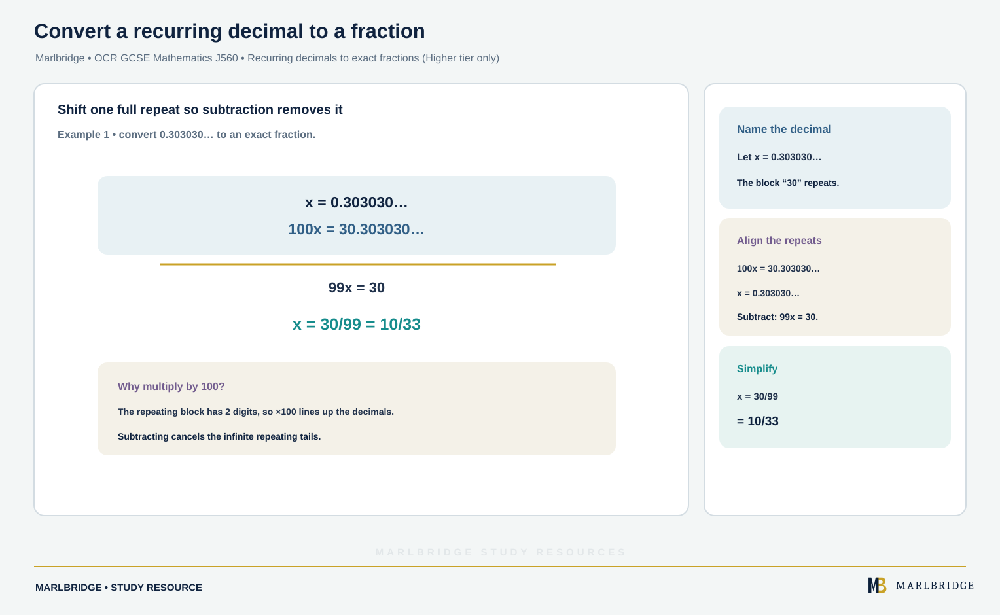

This guide is written for OCR GCSE (9-1) Mathematics, J560, Version 2.1 of the specification (August 2026). It covers sections **2.01 Fractions** and **2.02 Decimal fractions** of topic area 2. Almost everything here is for both tiers. One skill, converting a recurring decimal to an exact fraction, is **Higher tier only**. The specification says all content may be assessed on calculator or non-calculator papers, and that Paper 2 (Foundation) and Paper 5 (Higher) do not allow a calculator, so every method below is one you can do by hand.

Pair it with the [revision notes](/resources/ocr-gcse-mathematics-fractions-and-decimal-fractions-revision-notes/) and the [practice questions](/resources/ocr-gcse-mathematics-fractions-and-decimal-fractions-practice/). Percentages sit in the same topic area and are covered on the [fractions, decimals and percentages overview](/resources/ocr-gcse-mathematics-fractions-decimals-and-percentages/). The whole course is at the [OCR GCSE Mathematics hub](/boards/ocr/gcse/mathematics/), with a [printable checklist](/checklists/ocr/gcse/mathematics/). If you are unsure where to start, a [free 10-minute diagnostic](/diagnostics/) will show you.

## What this unit covers

| Spec ref | What you must be able to do | Tier |
|---|---|---|
| 2.01a | Use equivalence between simple fractions and mixed numbers | Both |
| 2.01b | Add, subtract, multiply and divide fractions, including mixed numbers and negative fractions | Both |
| 2.01b | Carry out more complex calculations, including with improper fractions | Both |
| 2.01c | Find a fraction of a quantity; express one quantity as a fraction of another | Both |
| 2.01c | Calculate with fractions greater than 1 | Both |
| 2.02a | Change a simple fraction to a terminating decimal and back, without a calculator; use place value in decimals | Both |
| 2.02a | Use division to convert a simple fraction to a decimal, such as 1/6 = 0.1666... | Both |
| 2.02a | Convert a recurring decimal to an exact fraction and back | Higher tier only |
| 2.02b | Add, subtract and multiply decimals, including negatives, without a calculator | Both |
| 2.02c | Divide a decimal by a whole number, including negatives, without a calculator | Both |
| 2.02c | Divide a decimal by a decimal without a calculator | Both |

## 2.01a Equivalent fractions and mixed numbers

Equivalent fractions have the same value. Multiply or divide the top and bottom by the same number: 5/12 = 25/60 because both parts are multiplied by 5. To simplify, divide top and bottom by their highest common factor.

**Example.** Simplify 18/48. The highest common factor of 18 and 48 is 6, so 18/48 = 3/8.

A mixed number is a whole number plus a fraction. An improper fraction has a top larger than its bottom. To convert:

- Mixed to improper: multiply the whole number by the bottom, then add the top. 4 3/7 = (4 × 7 + 3)/7 = 31/7.
- Improper to mixed: divide the top by the bottom. 47 ÷ 9 = 5 remainder 2, so 47/9 = 5 2/9.

Whole numbers are fractions too: 6 = 6/1 = 18/3. Write a negative fraction with the minus sign in front: −5/6 means the same as (−5)/6 and 5/(−6).

<figure class="topic-figure">
  
  <figcaption>A mixed number is whole bars plus extra parts, all counted in the same unit fraction.</figcaption>
</figure>

<figure class="topic-figure">
  
  <figcaption>The overlap gives the HCF; every prime factor used once gives the LCM.</figcaption>
</figure>


## 2.01b Calculations with fractions

### Adding and subtracting

You need a common denominator. Use the lowest common multiple of the denominators to keep the numbers small.

**Example.** Work out 3/8 + 5/12.

```
LCM of 8 and 12 is 24
3/8  = 9/24
5/12 = 10/24
9/24 + 10/24 = 19/24
```

The answer is **19/24**. It cannot be simplified because 19 is prime.

For mixed numbers, the safest route is to convert to improper fractions first. This is the "more complex calculation with improper fractions" the specification asks for.

**Example.** Work out 3 1/4 − 1 5/6.

```
3 1/4 = 13/4 = 39/12
1 5/6 = 11/6 = 22/12
39/12 − 22/12 = 17/12 = 1 5/12
```

The answer is **1 5/12**.

Subtracting the whole numbers and fractions separately is awkward here, because 1/4 − 5/6 is negative and you would have to borrow.

<figure class="topic-figure">
  
  <figcaption>Line the points up to add or subtract, and count the decimal places in both factors to place the point when multiplying.</figcaption>
</figure>


### Negative fractions

The sign rules are the same as for integers. Adding a negative is subtracting. Same signs give a positive product or quotient, different signs a negative one.

**Example.** Work out −5/6 − 3/8.

```
LCM of 6 and 8 is 24
−5/6 = −20/24
 3/8 =   9/24
−20/24 − 9/24 = −29/24 = −1 5/24
```

The answer is **−29/24**, or −1 5/24.

### Multiplying

Multiply the tops and multiply the bottoms. Cancel first, because it keeps the numbers small.

**Example.** Work out 7/9 × 3/14. The 7 and 14 share a factor 7, and the 3 and 9 share a factor 3:

```
7/9 × 3/14 = (1 × 1)/(3 × 2) = 1/6
```

For mixed numbers, convert first. 2 1/3 × 1 4/5 = 7/3 × 9/5 = 63/15 = 21/5 = **4 1/5**. Never multiply the whole numbers and the fractions separately.

### Dividing

Keep the first fraction, change ÷ to ×, and flip the second fraction (use its reciprocal).

**Example.** Work out −7/10 ÷ 14/15.

```
−7/10 ÷ 14/15 = −7/10 × 15/14
              = −(7 × 15)/(10 × 14)
              = −(1 × 3)/(2 × 2)
              = −3/4
```

The answer is **−3/4**. A negative divided by a positive is negative.

<figure class="topic-figure">
  
  <figcaption>Cutting both fractions into the lowest common denominator lets you add the parts.</figcaption>
</figure>

<figure class="topic-figure">
  
  <figcaption>Dividing by 0.15 counts how many 0.15s fit, and scaling both numbers by 100 does not change the answer.</figcaption>
</figure>

<figure class="topic-figure">
  
  <figcaption>Cancel common factors before multiplying, and decide the sign from the signs of the two numbers.</figcaption>
</figure>

<figure class="topic-figure">
  
  <figcaption>Subtracting a positive fraction moves left on the number line, further below zero.</figcaption>
</figure>

<figure class="topic-figure">
  
  <figcaption>Dividing by 5/8 counts how many 5/8 m pieces fit, and the answer is 12.</figcaption>
</figure>


## 2.01c Fractions of a quantity

"Of" means multiply. Taking a fraction of an amount means dividing by the bottom, then multiplying by the top.

**Example.** Find 3/8 of £6.40.

```
£6.40 ÷ 8 = £0.80
£0.80 × 3 = £2.40
```

The answer is **£2.40**.

### Fractions greater than 1

A fraction greater than 1 gives more than the whole quantity. The method is identical.

**Example.** Find 7/4 of 36 kg. 36 ÷ 4 = 9, and 9 × 7 = **63 kg**. The answer is bigger than 36 kg, which is what you expect from a fraction above 1.

### One quantity as a fraction of another

Write the first quantity over the second, in the same units, then simplify.

**Example 1.** Write 35 minutes as a fraction of 2 hours. Convert 2 hours to 120 minutes: 35/120 = **7/24**.

**Example 2.** Write 60 cm as a fraction of 1.5 m. Convert 1.5 m to 150 cm: 60/150 = **2/5**.

The quantity after "of" goes on the bottom. Check that you have not put the bigger value on top by accident, unless the question really does ask for something greater than 1.

## 2.02a Decimals and fractions

### Place value

Moving one place right of the decimal point divides the place value by ten.

| Digit in 3.074 | tenths | hundredths | thousandths |
|---|---|---|---|
| Value | 0 | 7 | 4 |

In 3.074, the 7 is worth 7 hundredths (7/100) and the 4 is worth 4 thousandths. Understanding this lets you read a decimal as a fraction straight away.

### Terminating decimals to fractions

Write the digits over 10, 100 or 1000 (one, two or three decimal places), then simplify.

**Example.** Write 0.065 as a fraction. Three decimal places, so 65/1000. Divide both parts by 5: **13/200**.

### Fractions to terminating decimals

If the denominator is a factor of 10, 100 or 1000, scale up. 7/20 = 35/100 = **0.35**.

Otherwise, divide the top by the bottom. This is also how you meet the "use division" outcome.

**Example.** Convert 7/8 to a decimal.

```
      0.875
8 ) 7.000
```

7 ÷ 8: 70 ÷ 8 = 8 remainder 6; 60 ÷ 8 = 7 remainder 4; 40 ÷ 8 = 5. So 7/8 = **0.875**.

### Division that does not stop

Some fractions give a decimal that repeats. 5/12 = 0.41666... because the remainders cycle. 3/11 = 0.272727..., where the block "27" repeats. A dot over a digit marks a repeating digit, and dots over the first and last digits mark a repeating block. If you cannot type dots, write "recurring" and show enough digits to make the pattern clear.

### Recurring decimals to exact fractions (Higher tier only)

<!-- marlbridge-diagram:math-b79-ocr-recurring-decimal-fraction -->
<figure class="lesson-diagram" style="margin: 2rem 0;">
  <a href="/public/images/learning/mathematics/math-b79-ocr-recurring-decimal-fraction.svg" aria-label="Open full-size diagram: math-b79-ocr-recurring-decimal-fraction"></a>
  <figcaption>Aligned decimal equations show why subtracting 100x−x removes the repeating tail and gives 10/33.</figcaption>
</figure>
<!-- /marlbridge-diagram:math-b79-ocr-recurring-decimal-fraction -->


Call the decimal x, multiply to line up the repeating part, and subtract to remove it.

**Example 1.** Write 0.303030... (0.30 recurring) as a fraction.

```
x    = 0.303030...
100x = 30.303030...
99x  = 30
x    = 30/99 = 10/33
```

**Example 2.** Write 0.3555... (3 then 5 recurring) as a fraction. Multiply by 10 to reach the repeating part and by 100 to move one full cycle further:

```
10x  = 3.555...
100x = 35.555...
90x  = 32
x    = 32/90 = 16/45
```

Match the multiplier to the length of the repeating block: one repeating digit needs a difference of 10x and x (or 100x and 10x), two repeating digits need 100x and x, and so on. For a pure block, the fraction is the block over 9, 99 or 999. Going the other way, a fraction becomes a recurring decimal by division: 5/6 = 0.8333..., with the 3 recurring.

<figure class="topic-figure">
  
  <figcaption>When only part of the decimal repeats, subtract the two multiples whose tails match.</figcaption>
</figure>

<figure class="topic-figure">
  
  <figcaption>Each column is a tenth of the one before, so the digits can be read straight off as a fraction.</figcaption>
</figure>

<figure class="topic-figure">
  
  <figcaption>Divide, carry the remainder to the next zero, and stop when the remainder is 0.</figcaption>
</figure>

<figure class="topic-figure">
  
  <figcaption>7/16 as a fraction, decimal and percentage are all the same point.</figcaption>
</figure>

<figure class="topic-figure">
  
  <figcaption>Multiplying by 100 lines up the repeating tails so that subtracting removes them.</figcaption>
</figure>


## 2.02b Adding, subtracting and multiplying decimals

### Adding and subtracting

Line up the decimal points and fill the gaps with zeros.

**Example.** Work out 14.6 − 8.375.

```
 14.600
− 8.375
 ------
  6.225
```

The answer is **6.225**.

For negatives, think about the number line or use the same sign rules as integers. −3.4 − 0.85 means moving 0.85 further below −3.4, which is **−4.25**.

### Multiplying

Ignore the decimal points, multiply the whole numbers, then place the point so the answer has as many decimal places as both numbers together.

**Example.** Work out 2.4 × 0.35. Treat as 24 × 35 = 840. The factors have 1 + 2 = 3 decimal places, so the answer is 0.840 = **0.84**.

With negatives, decide the sign first. (−0.8) × (−0.15): two negatives give a positive, and 8 × 15 = 120 with 3 decimal places gives **0.12**.

Estimate first: 2.4 × 0.35 is roughly 2 × 0.4 = 0.8, so 0.84 is sensible.

## 2.02c Dividing decimals

### By a whole number

Divide as normal and keep the decimal point directly above its place in the answer.

**Example 1.** Work out 0.48 ÷ 6. 48 ÷ 6 = 8, and the answer has two decimal places, so **0.08**.

**Example 2.** Work out −7.2 ÷ 4. 72 ÷ 4 = 18, so 7.2 ÷ 4 = 1.8. A negative divided by a positive is negative: **−1.8**.

### By a decimal

Scale both numbers up by one power of 10, chosen so the divisor becomes a whole number. The quotient does not change, because you are making an equivalent fraction.

**Example 1.** Work out 4.5 ÷ 0.15. Multiply both by 100: 450 ÷ 15 = **30**.

**Example 2.** Work out 0.072 ÷ 0.9. Multiply both by 10: 0.72 ÷ 9 = **0.08**.

**Example 3.** Work out 0.3 ÷ 0.6. Multiply both by 10: 3 ÷ 6 = **0.5**.

Check by estimating: 4.5 ÷ 0.15 asks how many 0.15s fit in 4.5. Ten of them make 1.5, so thirty make 4.5.

## Common errors

- **Adding the denominators.** 3/4 + 2/5 is not 5/9. Convert to twentieths: 15/20 + 8/20 = 23/20.
- **Multiplying mixed numbers part by part.** 2 1/3 × 1 4/5 is not 2 × 1 and 1/3 × 4/5. Convert to improper fractions.
- **Flipping the wrong fraction.** Only the second fraction, the divisor, is inverted.
- **Dropping the sign.** In −7/10 ÷ 14/15, the answer carries the minus sign.
- **Unmatched units** in a fraction such as 35 minutes over 2 hours. Convert first.
- **Misplacing the point** in a decimal product: count decimal places in both factors, not the answer.
- **Moving only the divisor.** When you multiply the divisor by 100, multiply the dividend by 100 too.
- **Treating 0.3555... as 0.355 recurring.** Only the digits under the dot repeat, so identify the repeating part before you set up x.

## Next steps

Work through the [practice questions](/resources/ocr-gcse-mathematics-fractions-and-decimal-fractions-practice/), then use the [revision notes](/resources/ocr-gcse-mathematics-fractions-and-decimal-fractions-revision-notes/) for quick recall.

## Official syllabus

OCR, *GCSE (9-1) Mathematics J560 specification*, Version 2.1 (August 2026), for first assessment in 2017, sections 2.01 Fractions and 2.02 Decimal fractions. Published by OCR (Oxford Cambridge and RSA).
