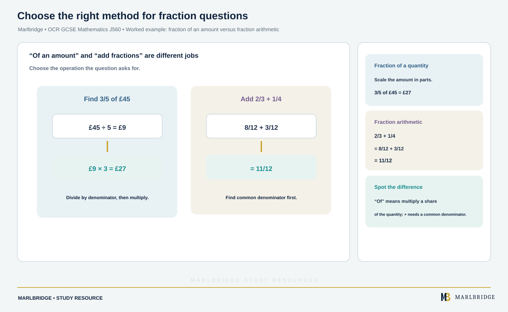

This guide covers **Topic 2: Fractions, decimals and percentages**,
the second of twelve topic areas in OCR GCSE (9-1) Mathematics (J560),
for first assessment 2017. As with every OCR maths topic, content is
arranged by topic area and applies to both Foundation and Higher tier
-- any topic may be assessed on any of the three papers a candidate
sits, so this content reappears throughout the paper rather than being
confined to a single question.

## Syllabus coverage

**OCR GCSE (9-1) MATHEMATICS J560 -- TOPIC 2 FRACTIONS, DECIMALS AND PERCENTAGES**

- **2.1 Fractions** -- simplifying fractions, converting between mixed
  numbers and improper fractions, comparing the size of fractions, and
  carrying out the four operations (addition, subtraction,
  multiplication and division) with fractions, including mixed
  numbers.
- **2.2 Decimal fractions** -- converting between fractions and
  decimals, ordering decimals, and using place value to multiply and
  divide by powers of ten.
- **2.3 Percentages** -- understanding that a percentage is "number of
  parts per hundred"; converting between fractions, decimals and
  percentages; calculating a percentage of a given quantity, and
  expressing one quantity as a percentage of another, with and without
  a calculator; increasing or decreasing a quantity by a percentage,
  including using decimal or fractional multipliers; and applying this
  to original-value problems and simple interest.
- **2.4 Ordering fractions, decimals and percentages** -- converting
  between the three forms as needed to compare and order a mixed set
  of values.

## Why this topic follows Number directly

Topic 1 (Number operations and integers) established calculation with
whole numbers; Topic 2 extends the same four operations to
non-integer values, which is why fluent recall of the Topic 1 methods
matters here -- a student who is shaky on long division, for instance,
will also struggle converting a fraction to a decimal by dividing
numerator by denominator. Topics 1 and 2 together form the foundation
that Topic 5 (Ratio, proportion and rates of change) builds on
directly, since ratio and proportion problems are, structurally,
fraction and percentage problems in a different context.

## Worked example: reverse percentage (original value)

A jacket costs £68 after a 15% discount. Find the original price.

£68 represents (100% − 15%) = 85% of the original price.

original price = £68 ÷ 0.85 = **£80**

This "reverse percentage" or "original value" calculation is one of
the most commonly misapplied percentage skills on this specification
-- students often calculate 15% of £68 and add it back on, which gives
the wrong answer (£78.20) because £68 is 85% of the original, not
100% of it minus something.

<figure class="topic-figure">
  
  <figcaption>The sale price is 85% of the original, so divide by 0.85.</figcaption>
</figure>

## Worked example: percentage multiplier

A quantity of £1,800 grows by 5% per year, compounded annually, for
two years. Find its value after two years.

multiplier = 1 + (5 ÷ 100) = 1.05

value after two years = £1,800 × 1.05² = £1,800 × 1.1025 = **£1,984.50**

Using a single multiplier (1.05) rather than calculating 5% and adding
it on each year is faster and less error-prone, and generalises
directly to compound growth and decay problems that reappear in
Topic 5.

<figure class="topic-figure">
  
  <figcaption>Each year the 5% is taken of the new, larger amount, so the single multiplier is raised to a power.</figcaption>
</figure>

<figure class="topic-figure">
  
  <figcaption>A percentage change is a single multiplication: increase 20% is x 1.2, decrease 20% is x 0.8.</figcaption>
</figure>

## Common mistakes

- **Reverse percentage errors**, as above -- calculating a percentage
  of the *final* value instead of recognising the final value as a
  percentage of the original.
- **Confusing simple and compound percentage change** -- using
  repeated addition of the same percentage of the *original* amount
  (simple interest logic) when a question specifies compounding, or
  vice versa.
- **Losing accuracy converting recurring decimals to fractions**, a
  Higher-tier skill that is often skipped in revision because it feels
  like a Number-topic task, even though it is examined as part of
  fluency with the fraction-decimal relationship.
- **Getting the direction of a percentage multiplier wrong** --
  writing 0.85 for a 15% increase instead of a 15% decrease, or
  forgetting that a multiplier above 1 always represents growth.
- **Ordering a mixed set of fractions, decimals and percentages by
  eye** rather than converting them all to a common form first, which
  is unreliable once denominators or decimal places differ.

<figure class="topic-figure">
  
  <figcaption>Further left on the number line always means smaller, whatever the form or sign.</figcaption>
</figure>

<figure class="topic-figure">
  
  <figcaption>Multiplying by 100 lines up the repeating tails so that subtracting removes them.</figcaption>
</figure>

## Worked example: fraction of an amount versus fraction arithmetic

<!-- marlbridge-diagram:math-b79-ocr-fraction-of-amount-versus-addition -->
<figure class="lesson-diagram" style="margin: 2rem 0;">
  
  <figcaption>Side-by-side worked examples distinguish scaling an amount by a fraction from adding fractions using a common denominator.</figcaption>
</figure>
<!-- /marlbridge-diagram:math-b79-ocr-fraction-of-amount-versus-addition -->

It is worth distinguishing two skills that both fall under 2.1 but are
tested differently. Finding a fraction *of* a quantity -- for example,
three-fifths of £45 -- is a division-then-multiplication calculation:
£45 divided by 5, then multiplied by 3, gives **£27**. Adding or
subtracting two fractions, by contrast, requires a common denominator
first: 2/3 + 1/4 requires converting to twelfths (8/12 + 3/12 = 11/12)
before the numerators can be combined. Students who are confident with
one skill sometimes default to it for both -- for example, trying to
find a common denominator when the question actually asks for a
fraction of an amount -- which wastes time without being wrong in
principle, just inefficient under exam conditions. The specification
treats both as part of the same 2.1 Fractions sub-topic, so a revision
plan that only drills one of the two skills leaves a genuine gap.

<figure class="topic-figure">
  
  <figcaption>Divide by the bottom, then multiply by the top.</figcaption>
</figure>

<figure class="topic-figure">
  
  <figcaption>Convert both fractions to twelfths, then add the tops only.</figcaption>
</figure>

## How to approach it

Because this topic is tested through calculation fluency rather than
recall of facts, the most effective revision is doing calculations
under timed conditions rather than re-reading notes -- fraction
arithmetic, percentage-of-a-quantity, percentage change and reverse
percentage problems, in that order, since each builds on the last.
Build the multiplier method (1 ± percentage/100) into every percentage
calculation from the start, since it removes an entire category of
errors around adding or subtracting the wrong amount, and it is the
only practical method for compound growth and decay questions.
Practise identifying, from the wording of a question alone, whether
you are given the original value (calculate a percentage of it
directly) or the final value after a change (use a reverse-percentage
approach) -- this is the single most examined distinction in this
topic. Finally, since any topic can appear on any paper, do not assume
percentage questions will be confined to a "non-calculator" or
"calculator" paper specifically -- practise both mental-method and
calculator-method percentage calculations.

## Related resources

- [Fractions, Decimals and Percentages revision notes](/resources/ocr-gcse-mathematics-fractions-decimals-percentages-revision-notes/)
- [Fractions, Decimals and Percentages practice questions](/resources/ocr-gcse-mathematics-fractions-decimals-percentages-practice/)

## Official syllabus

OCR, *GCSE (9-1) Mathematics (J560) Specification at a Glance*,
Content overview, Topic 2 Fractions, decimals and percentages,
https://www.ocr.org.uk/qualifications/gcse/mathematics-j560-from-2015/specification-at-a-glance/,
fetched and verified in full 2026-09-02. Full specification PDF:
https://www.ocr.org.uk/Images/168982-specification-gcse-mathematics.pdf.

<figure class="topic-figure">
  
  <figcaption>7/16 as a fraction, decimal and percentage are all the same point.</figcaption>
</figure>

