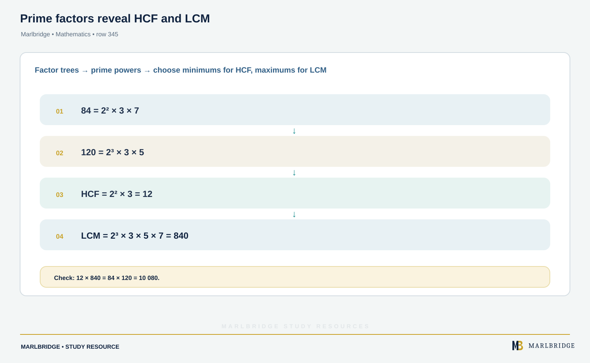
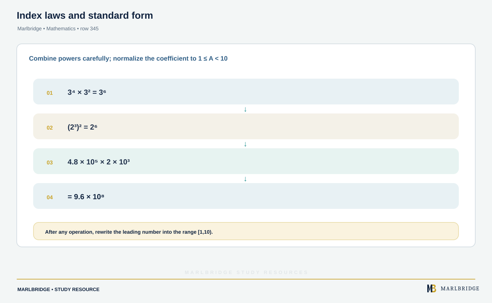
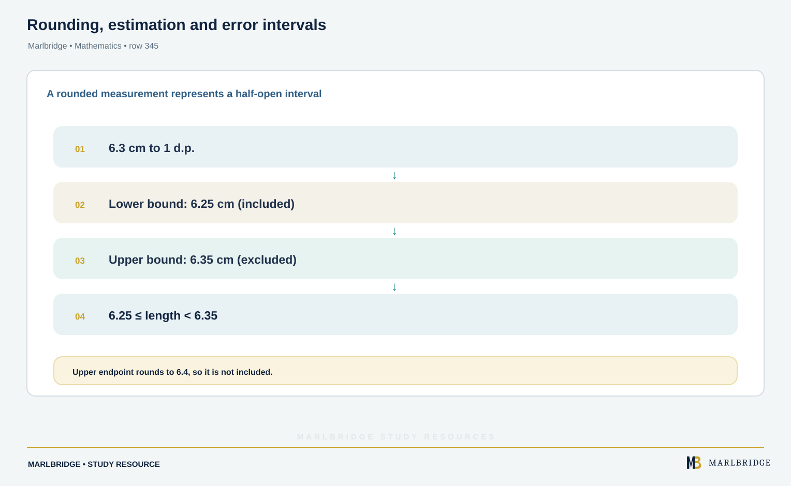
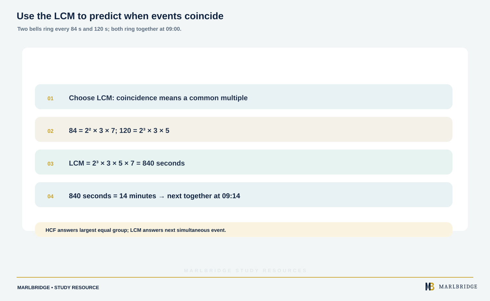

This guide covers **Topic 1 Number operations and integers**, the
first of twelve topic areas in OCR GCSE (9-1) Mathematics (J560),
qualification number 601/4606/0. The qualification is tiered
(Foundation, papers 1-3, grades 5-1; Higher, papers 4-6, grades 9-4),
and content is arranged by topic area rather than by paper -- any
topic may be assessed on any paper within the candidate's tier.

## Where this fits in J560

Number operations and integers builds the arithmetic fluency --
correct use of the four operations, order of operations, and factor
and multiple relationships -- that underpins every other topic area,
from fractions and percentages through to algebra and ratio.

## Syllabus coverage

**OCR GCSE MATHEMATICS (J560) — TOPIC 1 NUMBER OPERATIONS AND
INTEGERS**

- 1.1 Calculations with integers — applying the four operations to
positive and negative integers
- 1.2 Whole number theory — factors, multiples, primes, and related
number properties
- 1.3 Combining arithmetic operations — correct use of order of
operations, including brackets, powers and roots, across multi-step
calculations
- 1.4 Inverse operations — recognising and using inverse operations to
check or reverse a calculation

## How to approach it

Calculations with integers (1.1) is foundational and needs to be
automatic before tackling multi-step problems, since errors here
compound into every later calculation. Whole number theory (1.2) --
factors, multiples and primes -- recurs throughout the specification
in contexts like simplifying fractions and working with ratio, so
build genuine fluency rather than memorising isolated definitions.
Combining arithmetic operations (1.3) is where most careless errors
occur on non-calculator papers: practise multi-step calculations
using the correct order of operations until sequencing brackets,
powers and roots correctly becomes second nature. Inverse operations
(1.4) is a useful self-checking habit -- get into the practice of
verifying an answer using its inverse operation, which both catches
errors and reinforces the underlying arithmetic relationships. Since
any topic can appear on any paper, this content is never confined to a
single "number" question -- expect it to surface as a supporting step
within algebra, ratio and statistics questions too, so treat fluency
here as a standing requirement rather than a box to tick once.

<figure class="topic-figure">
  
  <figcaption>Undo a calculation by reversing the order and using the inverse of each step.</figcaption>
</figure>


## Official syllabus

OCR GCSE (9-1) Mathematics (J560) specification, for first assessment
2017 —
[ocr.org.uk](https://www.ocr.org.uk/qualifications/gcse/mathematics-j560-from-2015/specification-at-a-glance/).

## Supporting content from Topics 3 and 4

The sections on powers, roots and standard form, and on rounding,
estimation and error intervals, go beyond Topic 1: they belong to
**Topic 3 Indices and surds** (3.01 Powers and roots, 3.02 Standard
form) and **Topic 4 Approximation and estimation** (4.01). They are
included here because Topic 1 calculations depend on them; the full
Topic 1 content is the four sub-topics listed above.

## Order of operations and negative numbers

<!-- marlbridge-diagram:math-final-345-bidmas-negative-signs -->
<figure class="lesson-diagram" style="margin: 2rem 0;">
  <a href="/images/learning/mathematics/math-final-345-bidmas-negative-signs.svg" aria-label="Open full-size diagram: math-final-345-bidmas-negative-signs"></a>
  <figcaption>Step-by-step BIDMAS calculation ending in 8 with a separate negative-number sign reminder.</figcaption>
</figure>
<!-- /marlbridge-diagram:math-final-345-bidmas-negative-signs -->


Calculations follow **BIDMAS**: brackets, indices, division and multiplication (left to right), then addition and subtraction (left to right). Division and multiplication rank equally, as do addition and subtraction — working strictly left to right within each pair is what prevents most errors.

With negative numbers, two signs together combine: subtracting a negative is equivalent to adding, and multiplying or dividing two negatives gives a positive. An odd number of negative factors gives a negative product; an even number gives a positive.

<figure class="topic-figure">
  
  <figcaption>An even number of negative factors gives a positive result, an odd number a negative.</figcaption>
</figure>

<figure class="topic-figure">
  
  <figcaption>Work out indices and brackets first, then multiply and divide left to right, then add and subtract.</figcaption>
</figure>

<figure class="topic-figure">
  
  <figcaption>Subtracting a negative is the same as adding.</figcaption>
</figure>


## Factors, multiples and primes

<figure class="learning-diagram" style="margin:1.5rem 0;"><a href="/public/images/learning/mathematics/math-sub-345-prime-factor-hcf-lcm.svg" aria-label="Open full-size diagram: math-sub-345-prime-factor-hcf-lcm"></a><figcaption>Prime factors reveal HCF and LCM — Marlbridge Mathematics</figcaption></figure>

A **factor** divides exactly into a number; a **multiple** is in its times table; a **prime** has exactly two distinct factors, so 1 is not prime and 2 is the only even prime.

Prime factorisation is the reliable route to HCF and LCM:

```
84  = 2^2 x 3 x 7
120 = 2^3 x 3 x 5

HCF: lowest power of each shared prime  = 2^2 x 3       = 12
LCM: highest power of every prime seen  = 2^3 x 3 x 5 x 7 = 840
```

A useful check: HCF x LCM = product of the two numbers. Here 12 x 840 = 10 080 = 84 x 120.

<figure class="topic-figure">
  
  <figcaption>The overlap gives the HCF 12; each prime used once gives the LCM 840.</figcaption>
</figure>

<figure class="topic-figure">
  
  <figcaption>The overlap gives the HCF; every prime factor used once gives the LCM.</figcaption>
</figure>


## Powers, roots and standard form (Topic 3)

<figure class="learning-diagram" style="margin:1.5rem 0;"><a href="/public/images/learning/mathematics/math-sub-345-indices-standard-form.svg" aria-label="Open full-size diagram: math-sub-345-indices-standard-form"></a><figcaption>Index laws and standard form — Marlbridge Mathematics</figcaption></figure>

Index laws: multiplying adds indices, dividing subtracts, a power of a power multiplies, anything to the power zero is 1, and a negative index gives the reciprocal (negative integer indices are Foundation, 3.01a). **(Higher tier only, 3.01a-b)** A fractional index is a root.

Standard form is A x 10^n with 1 <= A < 10. When multiplying, multiply the numbers and add the indices; when dividing, divide and subtract. Always check the result is still in standard form and adjust if A has drifted outside the range.

<figure class="topic-figure">
  
  <figcaption>Work on the numbers and the indices separately, then adjust A back into 1 to 10.</figcaption>
</figure>

<figure class="topic-figure">
  
  <figcaption>Counting factors explains add, multiply and subtract for indices.</figcaption>
</figure>

<figure class="topic-figure">
  
  <figcaption>Each step down divides by 5, so 5^0 = 1 and 5^-n is 1 over 5^n.</figcaption>
</figure>

<figure class="topic-figure">
  
  <figcaption>The denominator is the root, the numerator is the power, and a minus sign flips.</figcaption>
</figure>

<figure class="topic-figure">
  
  <figcaption>Move the decimal point until the number is between 1 and 10; the count of moves is the power of 10.</figcaption>
</figure>


## Rounding, estimation and error intervals (Topic 4)

<figure class="learning-diagram" style="margin:1.5rem 0;"><a href="/public/images/learning/mathematics/math-sub-345-rounding-error-intervals.svg" aria-label="Open full-size diagram: math-sub-345-rounding-error-intervals"></a><figcaption>Rounding, estimation and error intervals — Marlbridge Mathematics</figcaption></figure>

Round to a given number of decimal places or significant figures, remembering that leading zeros are never significant. Estimate by rounding every value to 1 significant figure before calculating.

**Error intervals** describe the range a rounded value could have come from. A length recorded as 6.3 cm to 1 decimal place satisfies:

```
6.25 <= length < 6.35
```

The lower bound uses <= and the upper uses <, because 6.35 would round up. Writing an error interval is Foundation content (4.01c); calculating the upper and lower bounds of a calculation that uses rounded values is Higher tier only.

<figure class="topic-figure">
  
  <figcaption>The lower bound of the area uses both lower bounds; the upper bound uses both upper bounds.</figcaption>
</figure>

<figure class="topic-figure">
  
  <figcaption>Count significant figures from the first non-zero digit and keep zeros that show accuracy, as in 0.070.</figcaption>
</figure>

<figure class="topic-figure">
  
  <figcaption>A value given to 1 d.p. can be up to half a unit (0.05) either side: 4.55 &lt;= mass &lt; 4.65.</figcaption>
</figure>


## Worked example

<figure class="learning-diagram" style="margin:1.5rem 0;"><a href="/public/images/learning/mathematics/math-sub-345-lcm-bells.svg" aria-label="Open full-size diagram: math-sub-345-lcm-bells"></a><figcaption>Use the LCM to predict when events coincide — Marlbridge Mathematics</figcaption></figure>

Two bells ring at intervals of 84 seconds and 120 seconds. They ring together at 09:00. When do they next ring together?

```
This is an LCM problem, not HCF -- the bells coincide on a common multiple.

84  = 2^2 x 3 x 7
120 = 2^3 x 3 x 5
LCM = 2^3 x 3 x 5 x 7 = 840 seconds

840 s = 14 minutes  ->  09:14
```

Choosing between HCF and LCM is the real difficulty. LCM answers "when do things coincide again"; HCF answers "what is the largest equal group I can make".

## Common mistakes

Treating 1 as prime. Applying BIDMAS by doing all multiplication before all division rather than left to right. Using HCF where LCM is needed. Writing standard form with A outside 1 to 10. Rounding partway through a multi-step calculation instead of at the end. Using <= for the upper bound of an error interval.

## Quick revision checklist

- Apply BIDMAS correctly, including left-to-right rules for equal-priority operations.
- Calculate confidently with negative numbers.
- Write a number as a product of primes and use it for HCF and LCM.
- Decide correctly between HCF and LCM from the wording of a problem.
- Apply all index laws and calculate in standard form.
- Round to decimal places and significant figures, estimate, and write error intervals with the correct inequality signs.

<figure class="topic-figure">
  
  <figcaption>Bells coincide at the lowest common multiple, 840 s = 14 minutes.</figcaption>
</figure>

## Frequently asked questions

**What topics are in OCR GCSE Maths J560 Topic 1?**
Topic 1, Number operations and integers, covers calculations with integers, whole number theory such as factors, multiples and primes, combining arithmetic operations, and inverse operations. It is the first of twelve topic areas in OCR GCSE (9-1) Mathematics J560.

**What grades can you get on each tier of OCR GCSE Maths?**
Foundation tier, Papers 1 to 3, covers grades 5 to 1, and Higher tier, Papers 4 to 6, covers grades 9 to 4. Any topic may be assessed on any paper within the candidate's tier.

**When do you use the LCM instead of the HCF in a word problem?**
Use the LCM when you need to know when repeating events next coincide, such as two bells ringing together. Use the HCF to find the largest equal group you can make.

**How do you write an error interval for a rounded measurement?**
Give the lower bound with ≤ and the upper bound with <, half a unit either side of the rounded value. A length of 6.3 cm to 1 decimal place gives 6.25 ≤ length < 6.35, because 6.35 would round up.
