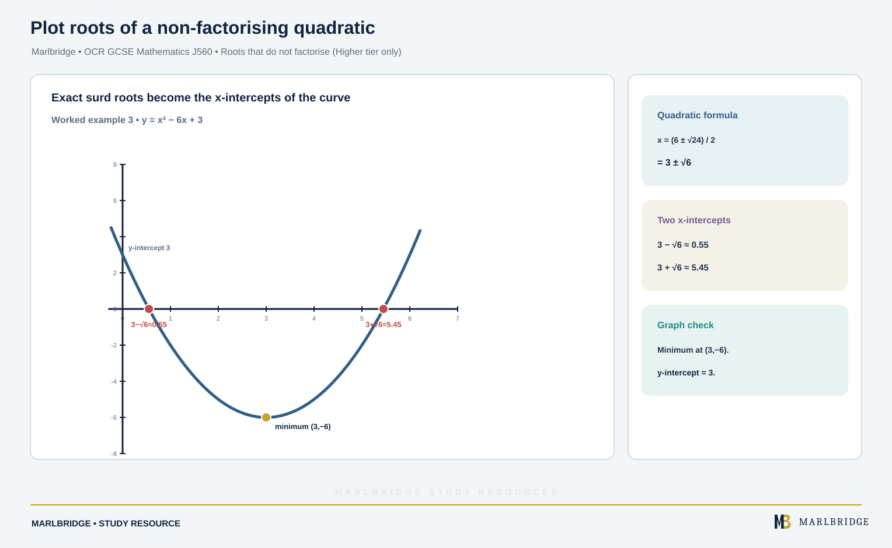

This guide is aligned to the OCR GCSE (9-1) Mathematics J560 specification, Version 2.1 (August 2026). It covers 7.01a (x- and y-coordinates), 7.01b (using a table of values to plot graphs) and 7.01c (recognising and sketching polynomial and reciprocal graphs). Most of it is assessed at both tiers. Solving quadratics with the quadratic formula or by completing the square, and sketching a quadratic with its turning point found by completing the square, are **Higher tier only**. Exponential graphs, straight-line gradient work and circles are covered in other units.

Related pages: the [revision notes](/resources/ocr-gcse-mathematics-plotting-and-sketching-linear-quadratic-cubic-and-revision-notes/), the [practice questions](/resources/ocr-gcse-mathematics-plotting-and-sketching-linear-quadratic-cubic-and-practice/), the [OCR GCSE Mathematics hub](/boards/ocr/gcse/mathematics/), the [printable checklist](/checklists/ocr/gcse/mathematics/) and the [10-minute diagnostics](/diagnostics/).

## What this unit covers

| Ref | What you must be able to do | Tier |
|---|---|---|
| 7.01a | Work with x- and y-coordinates in all four quadrants | Both |
| 7.01b | Use a table of values to plot linear and quadratic graphs | Both |
| 7.01b | Use a table of values to plot other polynomial graphs and reciprocals | Both |
| 7.01c | Recognise and sketch simple linear and quadratic graphs | Both |
| 7.01c | Recognise and sketch y = x³ and y = 1/x | Both |
| 7.01c | Identify intercepts and, using symmetry, the turning point of a quadratic graph | Both |
| 7.01c | Find the roots of a quadratic equation algebraically (by factorising) | Both |
| 7.01c | Find roots that are not whole numbers, by the quadratic formula or completing the square | Higher tier only |
| 7.01c | Sketch a quadratic, identifying the turning point by completing the square | Higher tier only |

The specification separates two skills. A **plot** is drawn on squared paper by calculating points and joining them. A **sketch** is freehand. It needs labelled axes, the right quadrants, the correct behaviour at the ends, and correct contact with the axes. It only needs labelled intercepts or turning points when the question asks for them. Do not waste time calculating a table for a sketch.

## 7.01a Coordinates in four quadrants

A point (x, y) is x units across, then y units up. Negative x means left of the y-axis. Negative y means below the x-axis. The axes cross at the origin (0, 0).

```
 2nd quadrant  |  1st quadrant
 (−, +)        |  (+, +)
 --------------+--------------
 3rd quadrant  |  4th quadrant
 (−, −)        |  (+, −)
```

A point on the x-axis has y = 0. A point on the y-axis has x = 0.

**Worked example.** Three vertices of a square are (−1, −2), (3, −2) and (3, 2). Find the fourth vertex.

The bottom side runs from x = −1 to x = 3, so the side length is 4. The right side runs from y = −2 to y = 2, also 4. The missing vertex is above (−1, −2) and level with (3, 2). It is **(−1, 2)**. It lies in the second quadrant.

<figure class="topic-figure">
  
  <figcaption>The signs of x and y tell you the quadrant; on the x-axis y = 0 and on the y-axis x = 0.</figcaption>
</figure>

<figure class="topic-figure">
  
  <figcaption>S shares its x with P and its y with R.</figcaption>
</figure>


## 7.01b Plotting from a table of values

Method for any equation:

1. Write the x-values in a table (the question usually gives them).
2. Substitute each into the equation. Work in brackets when x is negative.
3. Plot the points as crosses.
4. Join them. Use a ruler for a line. Use one smooth curve for anything else, with no gaps and no flat sections.

### Linear graphs

**Worked example.** Plot y = 1 − 2x for x from −2 to 3.

| x | −2 | −1 | 0 | 1 | 2 | 3 |
|---|---|---|---|---|---|---|
| −2x | 4 | 2 | 0 | −2 | −4 | −6 |
| y | 5 | 3 | 1 | −1 | −3 | −5 |

The points lie on a straight line. If one does not, recheck that value. The y-values fall by 2 each time x rises by 1.

Equations such as 3x + 2y = 12 have x and y on the same side. Find y for each x by rearranging: y = (12 − 3x)/2.

| x | 0 | 2 | 4 |
|---|---|---|---|
| y | 6 | 3 | 0 |

The line crosses the y-axis at (0, 6) and the x-axis at (4, 0). Two points are enough for a line, and a third is a check.

<figure class="topic-figure">
  
  <figcaption>Make a table, plot every point and rule one line across the whole range.</figcaption>
</figure>

<figure class="topic-figure">
  
  <figcaption>For x and y on the same side, set x = 0 and y = 0 to find the axis crossing points, then check a third point.</figcaption>
</figure>


### Quadratic graphs

**Worked example.** Plot y = x² − 2x − 6 for x from −2 to 4.

| x | −2 | −1 | 0 | 1 | 2 | 3 | 4 |
|---|---|---|---|---|---|---|---|
| y | 2 | −3 | −6 | −7 | −6 | −3 | 2 |

For x = −2: (−2)² − 2(−2) − 6 = 4 + 4 − 6 = 2. The y-values are symmetrical about x = 1, and the lowest point is (1, −7). The curve is a smooth U-shape, called a parabola. Round the bottom. Do not draw a point there.

<figure class="topic-figure">
  
  <figcaption>Plot a table, then draw one smooth curve; the table is symmetrical about x = 1.</figcaption>
</figure>


### Cubic graphs

**Worked example.** Plot y = x³ − 8x for x from −3 to 3.

| x | −3 | −2 | −1 | 0 | 1 | 2 | 3 |
|---|---|---|---|---|---|---|---|
| y | −3 | 8 | 7 | 0 | −7 | −8 | 3 |

For x = −3: (−3)³ − 8(−3) = −27 + 24 = −3. The curve rises, falls, then rises again. It has a local maximum near x = −1.6 and a local minimum near x = 1.6. Extra points between the main ones, such as x = ±1.5 (giving 8.625 and −8.625), help you place the turns.

<figure class="topic-figure">
  
  <figcaption>Plot y = x³ − 8x and add extra points to place the turns.</figcaption>
</figure>


### Reciprocal graphs

A reciprocal graph has x in a denominator. You cannot substitute x = 0, so there is no point there and the curve has a break.

**Worked example.** Plot y = x + 4/x for the values below.

| x | −4 | −2 | −1 | 1 | 2 | 4 |
|---|---|---|---|---|---|---|
| y | −5 | −4 | −5 | 5 | 4 | 5 |

For x = −4: −4 + 4/(−4) = −4 − 1 = −5. There are two separate branches, one on each side of the y-axis. Draw each as its own smooth curve and do not join them across x = 0. Near x = 0 the values become very large (half of 1 gives y = 8.5, a quarter gives 16.25), so the branches climb or fall steeply beside the y-axis.

<figure class="topic-figure">
  
  <figcaption>A reciprocal graph has two separate branches and no value at x = 0.</figcaption>
</figure>


## 7.01c Recognising and sketching graphs

### Straight lines

| Equation | Graph |
|---|---|
| y = c | Horizontal line through (0, c) |
| x = c | Vertical line through (c, 0) |
| y = mx | Straight line through the origin; slopes up if m > 0, down if m < 0 |

For example y = −3 is horizontal, 3 units below the x-axis. The line x = 4 is vertical and crosses the x-axis at 4. The line y = −2x passes through (0, 0) and (1, −2), sloping down from left to right. Gradient work in general is in the straight-line graphs unit.

### The shapes to recognise

| Equation | Shape | Key facts |
|---|---|---|
| y = x² | U-shaped parabola | Turning point (0, 0), symmetrical about the y-axis, never below the x-axis |
| y = −x² | Upside-down U | Maximum at (0, 0) |
| y = x³ | Rises from bottom left, through (0, 0), to top right | Flattens briefly at the origin; quadrants 1 and 3 |
| y = 1/x | Two branches | Quadrants 1 and 3; never touches either axis |

For y = 1/x, as x gets very large the curve gets close to the x-axis without touching it. As x gets close to 0 it climbs towards the y-axis without touching it. For y = −1/x the branches are in quadrants 2 and 4.

<figure class="topic-figure">
  
  <figcaption>The four shapes OCR expects you to recognise and sketch.</figcaption>
</figure>


### Sketching a quadratic

A quadratic y = ax² + bx + c is a parabola. If a > 0 it is U-shaped (a minimum). If a < 0 it is upside down (a maximum). Use these steps:

1. **y-intercept:** put x = 0. The answer is c.
2. **Roots (x-intercepts):** solve ax² + bx + c = 0.
3. **Turning point:** it lies exactly halfway between the two roots, so its x-value is the mean of the roots. Substitute that x into the equation for y.
4. Draw a smooth parabola through these points, labelling what the question asks for.

**Worked example 1.** Sketch y = x² + 2x − 24, labelling the intercepts and turning point.

```
y-intercept: x = 0 gives y = −24, so (0, −24)
Roots: x² + 2x − 24 = 0
       (x + 6)(x − 4) = 0, so x = −6 or x = 4
Turning point: x = (−6 + 4)/2 = −1
       y = (−1)² + 2(−1) − 24 = 1 − 2 − 24 = −25, so (−1, −25)
```

The coefficient of x² is positive, so the curve is U-shaped with its minimum at (−1, −25). It crosses the x-axis at −6 and 4 and the y-axis at −24.

**Worked example 2.** Sketch y = 8 + 2x − x². Here a = −1, so the curve is upside down.

```
y-intercept: (0, 8)
Roots: 8 + 2x − x² = 0, so x² − 2x − 8 = 0
       (x − 4)(x + 2) = 0, so x = 4 or x = −2
Turning point: x = (4 + (−2))/2 = 1
       y = 8 + 2 − 1 = 9, so (1, 9), a maximum
```

<figure class="topic-figure">
  
  <figcaption>The turning point is halfway between the roots; substitute to find y.</figcaption>
</figure>

<figure class="topic-figure">
  
  <figcaption>A sketch shows shape, roots, y-intercept and symmetry; Extended adds the turning point.</figcaption>
</figure>


### Roots that do not factorise (Higher tier only)

<!-- marlbridge-diagram:math-b78-ocr-nonfactorising-quadratic-roots -->
<figure class="lesson-diagram" style="margin: 2rem 0;">
  <a href="/public/images/learning/mathematics/math-b78-ocr-nonfactorising-quadratic-roots.svg" aria-label="Open full-size diagram: math-b78-ocr-nonfactorising-quadratic-roots"></a>
  <figcaption>Graph of y=x²−6x+3 marks exact roots 3±√6 and decimal intercepts about 0.55 and 5.45, with minimum at (3,−6).</figcaption>
</figure>
<!-- /marlbridge-diagram:math-b78-ocr-nonfactorising-quadratic-roots -->


When a quadratic does not factorise, Higher tier candidates find the roots with the quadratic formula or by completing the square. These are algebraic methods, so exact answers use surds.

**Worked example 3.** Solve x² − 6x + 3 = 0.

```
x = (6 ± √(36 − 12))/2 = (6 ± √24)/2 = (6 ± 2√6)/2 = 3 ± √6
```

The roots are **x = 3 + √6 ≈ 5.45** and **x = 3 − √6 ≈ 0.55** (to 2 decimal places). If the part under the root is negative, there are no roots and the graph does not meet the x-axis.

<figure class="topic-figure">
  
  <figcaption>The quadratic formula gives roots 3 +/- root 6, symmetric about the turning point.</figcaption>
</figure>


### Completing the square for the turning point (Higher tier only)

Writing y = (x + p)² + q shows the turning point directly at **(−p, q)**, because the bracket is never negative and equals 0 when x = −p.

**Worked example 4.** Sketch y = x² + 6x + 7.

```
x² + 6x + 7 = (x + 3)² − 9 + 7 = (x + 3)² − 2
Turning point: (−3, −2), a minimum
y-intercept: (0, 7)
Roots: (x + 3)² = 2, so x + 3 = ±√2, so x = −3 ± √2
       x ≈ −1.59 and x ≈ −4.41
```

The curve is U-shaped, with its minimum below the x-axis, so it crosses the x-axis twice, to the left of the y-axis.

**Worked example 5.** Sketch y = −x² + 4x − 7.

```
−x² + 4x − 7 = −(x² − 4x) − 7 = −[(x − 2)² − 4] − 7 = −(x − 2)² − 3
Turning point: (2, −3), a maximum
y-intercept: (0, −7)
```

The curve is upside down with its highest point at (2, −3), which is below the x-axis. So the curve never reaches the x-axis and there are no roots. Check: (x − 2)² = −3 has no solution.

<figure class="topic-figure">
  
  <figcaption>Completed-square form (x + p)² + q shows the turning point (−p, q) and whether there are roots.</figcaption>
</figure>

<figure class="topic-figure">
  
  <figcaption>Horizontal lines are y = c, vertical lines are x = c, and y = mx passes through the origin.</figcaption>
</figure>


## Common errors

- Mixing up the order of a coordinate pair: (x, y) is across first, then up.
- Squaring a negative number wrongly: (−3)² = 9, not −9.
- Joining the two branches of a reciprocal graph, or letting a branch cross an axis.
- Drawing a flat or pointed bottom on a parabola instead of a smooth curve.
- Finding the turning point from the mean of the roots, then forgetting to substitute to get y.
- Taking the turning point as (p, q) instead of (−p, q) after completing the square.
- Sketching a cubic y = x³ with a U-shape, or a y = 1/x curve that meets an axis.

## Next steps

Test yourself with the [practice questions](/resources/ocr-gcse-mathematics-plotting-and-sketching-linear-quadratic-cubic-and-practice/), then condense the unit with the [revision notes](/resources/ocr-gcse-mathematics-plotting-and-sketching-linear-quadratic-cubic-and-revision-notes/). Use the [checklist](/checklists/ocr/gcse/mathematics/) to mark off 7.01a to 7.01c, and the [diagnostics](/diagnostics/) to find weak spots.

## Frequently asked questions

**What does the graph of y = 1/x look like?**
It has two separate branches in the first and third quadrants and never touches either axis. There is no point at x = 0, because you cannot divide by zero.

**What is the difference between the graphs of y = x² and y = x³?**
Both pass through the origin. y = x² is a U-shape symmetrical about the y-axis and never below the x-axis, while y = x³ rises from the bottom left through the origin to the top right, in quadrants 1 and 3.

**What is the equation of a horizontal or vertical line?**
A horizontal line through (0, c) has equation y = c, and a vertical line through (c, 0) has equation x = c. For example, y = −3 is horizontal and x = 4 is vertical.

**How do you find where a line like 3x + 2y = 12 crosses the axes?**
Put x = 0 to find the y-intercept and y = 0 to find the x-intercept. For 3x + 2y = 12, the line crosses at (0, 6) and (4, 0).

## Official syllabus

OCR, GCSE (9-1) Mathematics J560, Version 2.1 (August 2026), for first assessment in 2017, section 7.01 Graphs of equations and functions (7.01a to 7.01c).
