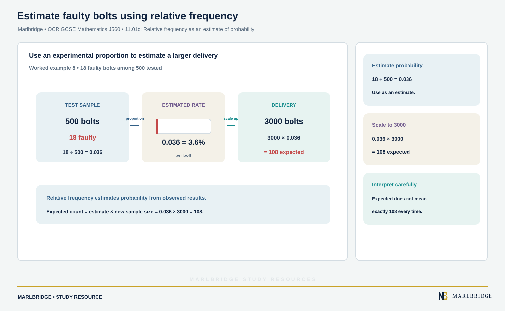

This guide covers unit 11.01 (Basic probability and experiments) of the OCR GCSE (9-1) Mathematics J560 specification, Version 2.1 (August 2026), outcomes 11.01a to 11.01d. All of this content is for both tiers: the specification lists nothing in this unit as Higher tier only. Outcome 11.01c is split across the columns, so using relative frequency as an estimate is initial learning, and understanding that relative frequencies approach the theoretical probability as trials increase is listed for Foundation tier learners and carries on into Higher.

Use it with the [revision notes](/resources/ocr-gcse-mathematics-probability-scale-relative-frequency-and-equally-revision-notes/) and the [practice questions](/resources/ocr-gcse-mathematics-probability-scale-relative-frequency-and-equally-practice/). The [course hub](/boards/ocr/gcse/mathematics/) and the [printable checklist](/checklists/ocr/gcse/mathematics/) show where this unit sits, and the [free 10-minute diagnostics](/diagnostics/) help you find weak spots. The specification says that where it does not mention calculator use, you should be able to use both calculator and non-calculator methods, so practise each of the calculations below by hand.

## What this unit covers

| Ref | What you must be able to do | Tier |
|---|---|---|
| 11.01a | Use the 0 to 1 probability scale as a measure of likelihood: impossible is 0, evens is 0.5, certain is 1 | Both |
| 11.01b | Record, describe and analyse the relative frequency of outcomes of repeated experiments, using tables and frequency trees | Both |
| 11.01c | Use relative frequency as an estimate of probability; understand that relative frequencies approach the theoretical probability as the number of trials increases | Both |
| 11.01d | Calculate probabilities as fractions or decimals when outcomes are equally likely (coins, dice); apply ideas of randomness and fairness; find probabilities of simple combined events such as the totals of two dice; use probabilities to find expected outcomes in repeated experiments | Both |

## 11.01a: The probability scale

A probability is a number from 0 to 1 that measures how likely a random event is.

| Value | Meaning | Example |
|---|---|---|
| 0 | Impossible | A normal dice shows 9 |
| 0.5 (or 1/2) | Evens: as likely to happen as not | A fair coin lands tails |
| 1 | Certain | A fair dice shows a number less than 7 |

Values between 0 and 0.5 are unlikely and values between 0.5 and 1 are likely. A probability can be written as a fraction, a decimal or a percentage, but it can never be negative or bigger than 1. Probabilities of all the possible outcomes of one experiment add up to 1, so the probability that something does not happen is 1 minus the probability that it does.

**Worked example 1.** The probability that a bus is late is 0.12. Is the bus more likely to be late or on time? Find the probability that it is on time.

```
0.12 is well below 0.5, so late is unlikely: on time is more likely.
P(on time) = 1 - 0.12 = 0.88
```

<figure class="topic-figure">
  
  <figcaption>Probabilities run from 0 (impossible) to 1 (certain), with 0.5 an even chance.</figcaption>
</figure>

<figure class="topic-figure">
  
  <figcaption>All the probabilities of one event add to 1, so not happening is 1 minus happening.</figcaption>
</figure>


## 11.01d: Equally likely outcomes

When every outcome is equally likely, as with a fair coin, a fair dice or a bag of identical counters:

```
P(event) = number of outcomes that give the event / total number of outcomes
```

This is the theoretical probability. It comes from reasoning about the experiment and needs no trials.

**Worked example 2.** Ten letter tiles spell STATISTICS. One tile is picked at random. Find P(T), P(I) and P(not S).

```
Letters: S appears 3 times, T 3 times, I 2 times, A once, C once. Total 10.
P(T) = 3/10
P(I) = 2/10 = 1/5
P(not S) = 1 - 3/10 = 7/10
```

**Worked example 3.** A fair dice is rolled. Find P(prime number) and P(not 5).

```
Primes on a dice: 2, 3, 5 so 3 outcomes out of 6.
P(prime) = 3/6 = 1/2
P(not 5) = 5/6
```

State the fraction first, then simplify. Write the answer as a fraction or decimal as the question asks.

### Randomness and fairness

An experiment is **random** if you cannot predict the next outcome, even though you know the possible outcomes. It is **fair** (unbiased) if each outcome is equally likely. A random experiment need not be fair: a weighted dice is still random, but a six may come up more often.

Randomness also means that past results do not change the next one. If a fair coin has landed heads four times in a row, the chance of heads next time is still 1/2. Short runs of the same result are normal in random experiments.

<figure class="topic-figure">
  
  <figcaption>With equally likely outcomes, probability is wanted tiles divided by all tiles.</figcaption>
</figure>

<figure class="topic-figure">
  
  <figcaption>A run of heads does not change the chance of heads next time.</figcaption>
</figure>


## 11.01d: Two dice and simple combined events

<!-- marlbridge-diagram:math-b40-ocr-j560-two-dice-sample-space-total-seven -->
<figure class="lesson-diagram" style="margin: 2rem 0;">
  <a href="/images/learning/mathematics/math-b40-ocr-j560-two-dice-sample-space-total-seven.svg" aria-label="Open full-size diagram: math-b40-ocr-j560-two-dice-sample-space-total-seven"></a>
  <figcaption>Two dice: the 36-outcome sample space for a total of 7 Select the image to enlarge it.</figcaption>
</figure>
<!-- /marlbridge-diagram:math-b40-ocr-j560-two-dice-sample-space-total-seven -->


When two fair dice are rolled and the scores added, list every pair in a table. There are 36 equally likely pairs.

```
Total | 1  2  3  4  5  6   (second dice across the top)
  1   | 2  3  4  5  6  7
  2   | 3  4  5  6  7  8
  3   | 4  5  6  7  8  9
  4   | 5  6  7  8  9  10
  5   | 6  7  8  9  10 11
  6   | 7  8  9  10 11 12
```

The number of ways to make each total, in order from 2 to 12, is 1, 2, 3, 4, 5, 6, 5, 4, 3, 2, 1. These add to 36, which is a useful check.

**Worked example 4.** Two fair dice are rolled and the scores added. Find the probability that the total is (a) 7, (b) a prime number, (c) the two dice show the same score.

```
(a) Total 7 can be made 6 ways: (1,6) (2,5) (3,4) (4,3) (5,2) (6,1).
    P = 6/36 = 1/6
(b) Prime totals: 2, 3, 5, 7, 11.
    Ways: 1 + 2 + 4 + 6 + 2 = 15.
    P = 15/36 = 5/12
(c) Doubles are on the diagonal of the grid: (1,1) to (6,6), 6 ways.
    P = 6/36 = 1/6
```

Do not use 11 totals as the sample space. The totals 2 to 12 are not equally likely, which is why you list the 36 pairs.

<figure class="topic-figure">
  
  <figcaption>Totals are not equally likely, so count the 36 pairs.</figcaption>
</figure>

<figure class="topic-figure">
  
  <figcaption>The doubles sit on the diagonal of the grid: 6 of the 36 pairs.</figcaption>
</figure>

<figure class="topic-figure">
  
  <figcaption>A sample space diagram lists every equally likely outcome so you can count the favourable ones.</figcaption>
</figure>


## 11.01d: Expected outcomes

If an experiment is repeated n times and the probability of an outcome is p, the expected number of times it happens is:

```
expected number = p × n
```

The expected number is an average over many repeats. It is not a promise. You may well get 28 sevens or 33 sevens in a run where 30 is expected, and the expected number need not be a whole number.

**Worked example 5.** Two fair dice are rolled 180 times and the scores added. How many times would you expect a total of 7? How many times would you expect the dice to show a prime total in 144 rolls?

```
P(total 7) = 6/36 = 1/6, so expected = 1/6 × 180 = 30
P(prime total) = 15/36 = 5/12, so expected = 5/12 × 144 = 60
```

**Worked example 6.** A fair dice is rolled 240 times. Expected number of multiples of 3 (3 and 6): P = 2/6 = 1/3, so 1/3 × 240 = **80**.

<figure class="topic-figure">
  
  <figcaption>Expected frequency is probability times number of trials, an average rather than an exact result.</figcaption>
</figure>


## 11.01b: Relative frequency, tables and frequency trees

When you cannot work out a probability by reasoning, for example for a bent coin, a weighted spinner or a seed, you run an experiment. The **relative frequency** of an outcome is:

```
relative frequency = number of times the outcome happened / total number of trials
```

Give it as a fraction, decimal or percentage. The relative frequencies of all outcomes add up to 1.

A **frequency tree** records how a group splits into categories, with the number (not the probability) on each branch. The numbers on branches that leave a box must add up to the number in the box.

**Worked example 7.** A gardener sows 400 seeds: 250 on a sunny shelf and 150 on a shaded shelf. On the sunny shelf, 205 germinate. On the shaded shelf, 96 germinate. Complete the frequency tree and compare the relative frequencies.

```
400 seeds
  Sunny 250
     Germinated 205
     Did not germinate 250 - 205 = 45
  Shaded 150
     Germinated 96
     Did not germinate 150 - 96 = 54

Sunny: 205/250 = 0.82
Shaded: 96/150 = 0.64
Overall: (205 + 96)/400 = 301/400 = 0.7525
```

Seeds on the sunny shelf germinated more often (0.82 compared with 0.64), so in this experiment light seems to help germination. Describe the pattern in words as well as giving the numbers.

When you are asked to record results, a tally table with a total row and a relative frequency column is clear and easy to check.

<figure class="topic-figure">
  
  <figcaption>A frequency tree holds counts, and relative frequencies compare the groups.</figcaption>
</figure>


## 11.01c: Relative frequency as an estimate of probability

<!-- marlbridge-diagram:math-b78-ocr-relative-frequency-bolts -->
<figure class="lesson-diagram" style="margin: 2rem 0;">
  <a href="/public/images/learning/mathematics/math-b78-ocr-relative-frequency-bolts.svg" aria-label="Open full-size diagram: math-b78-ocr-relative-frequency-bolts"></a>
  <figcaption>A test sample of 500 bolts with 18 faulty gives estimated probability 0.036; scaling that proportion to 3000 predicts 108 faulty bolts.</figcaption>
</figure>
<!-- /marlbridge-diagram:math-b78-ocr-relative-frequency-bolts -->


If you cannot find a theoretical probability, the relative frequency from an experiment is your estimate of it. You can then use it for expected outcomes.

**Worked example 8.** A box of 500 bolts is tested and 18 are faulty. Estimate the probability that a bolt is faulty, and the number of faulty bolts expected in a delivery of 3000.

```
Relative frequency = 18/500 = 0.036
Expected faulty = 0.036 × 3000 = 108
```

### More trials give better estimates

The relative frequency changes from trial to trial, but as the number of trials increases it settles close to the theoretical probability. A spinner has 8 equal sectors, 2 of them red, so the theoretical P(red) = 2/8 = 0.25.

| Trials | Reds | Relative frequency | Distance from 0.25 |
|---|---|---|---|
| 20 | 3 | 0.15 | 0.1 |
| 50 | 11 | 0.22 | 0.03 |
| 100 | 27 | 0.27 | 0.02 |
| 500 | 128 | 0.256 | 0.006 |
| 2000 | 497 | 0.2485 | 0.0015 |

Small samples can be far from the true value, so 3 reds in 20 spins is not evidence that the spinner is unfair. The largest sample is the best estimate. Even then, the figures do not reach 0.25 exactly.

**Worked example 9.** A coin is flipped 1000 times and lands heads 561 times. Does this suggest the coin is biased?

```
Relative frequency of heads = 561/1000 = 0.561
A fair coin has P(heads) = 0.5.
```

With 1000 trials, a gap of 0.061 is bigger than you would usually expect from chance, so the result suggests the coin may be biased towards heads. It does not prove it. To be more confident, repeat the experiment with more trials. If the relative frequency stayed near 0.56 as the trials grew, the case for bias would be stronger.

<figure class="topic-figure">
  
  <figcaption>With more spins the relative frequency settles close to the theoretical 0.25.</figcaption>
</figure>

<figure class="topic-figure">
  
  <figcaption>With more trials the relative frequency settles, so use the estimate from the most trials.</figcaption>
</figure>

<figure class="topic-figure">
  
  <figcaption>Results far from 0.25 after many spins suggest, but do not prove, a biased spinner.</figcaption>
</figure>


## Common errors

- Writing a probability as a ratio such as 2:3 or as "2 out of 3 chance" when the question asks for a fraction or decimal.
- Giving a probability bigger than 1 or a negative one. Check that every answer lies between 0 and 1.
- Using the 11 possible totals of two dice as the denominator. Use 36.
- Saying a result is "due" after a run of the same outcome.
- Using relative frequency from a small sample when a larger one is given.
- Writing the expected number as a probability, or rounding a non-whole expected number without saying it is an estimate.
- Putting probabilities instead of frequencies on a frequency tree.

## Next steps

Test yourself with the [practice questions](/resources/ocr-gcse-mathematics-probability-scale-relative-frequency-and-equally-practice/), use the [revision notes](/resources/ocr-gcse-mathematics-probability-scale-relative-frequency-and-equally-revision-notes/) close to the exam, and tick off 11.01a to 11.01d on the [checklist](/checklists/ocr/gcse/mathematics/). The [free diagnostics](/diagnostics/) are a quick check on the whole course.

## Frequently asked questions

**What is relative frequency?**
Relative frequency is the number of times an outcome happened divided by the total number of trials. It is used as an estimate of probability when the probability cannot be worked out by reasoning.

**What happens to relative frequency as the number of trials increases?**
As the number of trials increases, the relative frequency settles closer to the theoretical probability, although it may not reach it exactly. The estimate from the largest sample is the most reliable.

**If a fair coin lands heads four times in a row, is tails more likely next?**
No. Past results do not change the next one, so the probability of heads on a fair coin is still 1/2. Short runs of the same result are normal in random experiments.

**What is the difference between theoretical probability and relative frequency?**
Theoretical probability comes from reasoning about equally likely outcomes and needs no trials. Relative frequency comes from the results of an experiment, so it is an estimate.

## Official syllabus

OCR GCSE (9-1) Mathematics J560, Version 2.1 (August 2026), for first assessment in 2017, published by OCR. Unit 11.01: Basic probability and experiments.
