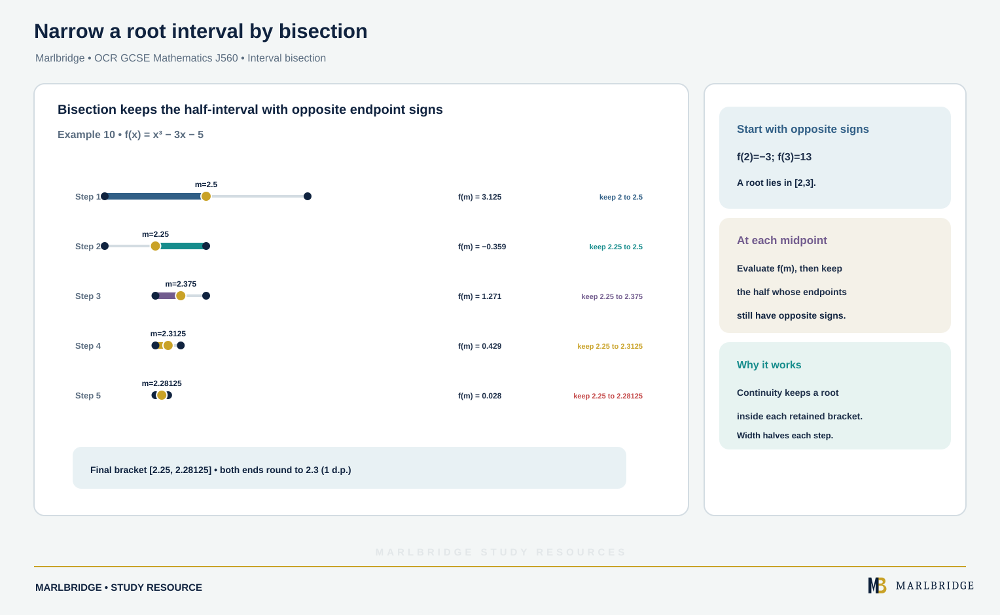

This guide follows sections 6.03c, 6.03d and 6.03e of the OCR GCSE (9-1) Mathematics J560 specification, Version 2.1 (August 2026). It covers simultaneous equations, using graphs for approximate solutions, and sign-change methods. Both tiers study the linear simultaneous equations and the graph work on straight lines and quadratics. Anything labelled **Higher tier only** is for Higher tier candidates alone. The specification states that any content can be set on either type of paper, so practise the algebra by hand.

Links: [OCR GCSE Mathematics hub](/boards/ocr/gcse/mathematics/), [printable checklist](/checklists/ocr/gcse/mathematics/), [revision notes](/resources/ocr-gcse-mathematics-simultaneous-equations-graphical-solutions-and-revision-notes/), [practice questions](/resources/ocr-gcse-mathematics-simultaneous-equations-graphical-solutions-and-practice/) and the [10-minute diagnostics](/diagnostics/).

## What this unit covers

| Ref | Skill | Tier |
|---|---|---|
| 6.03c | Set up and solve two linear simultaneous equations in two variables | Both tiers |
| 6.03c | Solve simultaneous equations where one is quadratic, or where the working gives a quadratic | Higher tier only |
| 6.03d | Use a graph to find an approximate solution of a linear equation | Both tiers |
| 6.03d | Use graphs to find approximate roots of quadratics and the solution of two linear simultaneous equations | Both tiers |
| 6.03d | Know that the intersections of a curve and a straight line are the solutions of the simultaneous equations | Higher tier only |
| 6.03e | Find approximate solutions using sign-change methods such as decimal search or interval bisection | Higher tier only |

## 6.03c Two linear simultaneous equations

Two equations with two unknowns have one pair of values that makes both true. You remove one unknown, solve for the other, then substitute back.

### Elimination

Use it when both equations have the form ax + by = c.

1. Multiply one or both equations so a pair of terms has the same coefficient size.
2. If the matching terms have the same sign, subtract. If the signs differ, add.
3. Solve for the remaining unknown.
4. Substitute into an original equation to find the other unknown.
5. Check in the other original equation.

**Example 1.** Solve 4x + 3y = 29 and 3x − 2y = 9.

```
4x + 3y = 29   ×2  →  8x + 6y = 58
3x − 2y = 9    ×3  →  9x − 6y = 27
Add (the y terms have opposite signs):  17x = 85,  so x = 5
Substitute in 4x + 3y = 29:  20 + 3y = 29,  so y = 3
Check in 3x − 2y: 15 − 6 = 9 ✓
```

**x = 5, y = 3**

### Substitution

Use it when one equation already gives a letter, as in y = 2x − 5.

**Example 2.** Solve 3x + 2y = 32 and y = 2x − 5.

```
Replace y:  3x + 2(2x − 5) = 32
Expand:     3x + 4x − 10 = 32
Collect:    7x = 42,  so x = 6
Then:       y = 2(6) − 5 = 7
Check:      3(6) + 2(7) = 32 ✓
```

**x = 6, y = 7**

### Setting up from words

Name the unknowns, write one equation for each statement, then solve.

**Example 3.** A museum charges £a for an adult and £c for a child. Three adults and two children pay £41. Two adults and five children pay £53. Find a and c.

```
3a + 2c = 41   ×2  →  6a + 4c = 82
2a + 5c = 53   ×3  →  6a + 15c = 159
Subtract:  11c = 77,  so c = 7
Then 3a + 14 = 41,  so a = 9
```

An adult ticket costs **£9** and a child ticket costs **£7**. Check the second statement: 18 + 35 = 53.

## 6.03d Approximate solutions from graphs

### Linear equations (both tiers)

To solve an equation using a graph, draw the graph of one side and read where it meets the other side. For 2x − 5 = 3, draw y = 2x − 5 and the horizontal line y = 3. Read the x-coordinate where they cross. The exact crossing is x = 4. A hand-drawn graph gives a reading close to this, not necessarily exactly it, so a graph reading is an approximation and you should say so.

<figure class="topic-figure">
  
  <figcaption>Draw each side of the equation as a line and read the x-coordinate where they cross.</figcaption>
</figure>

<figure class="topic-figure">
  
  <figcaption>The solution of simultaneous equations is where their graphs cross.</figcaption>
</figure>


### Roots of a quadratic (both tiers)

The roots of a quadratic are the x-coordinates where its graph meets the x-axis, because y = 0 there.

**Example 4.** Use the table to draw y = x² − 3x − 3 and estimate its roots.

| x | −2 | −1 | 0 | 1 | 2 | 3 | 4 | 5 |
|---|---|---|---|---|---|---|---|---|
| y | 7 | 1 | −3 | −5 | −5 | −3 | 1 | 7 |

Mark each point, then sweep one smooth curve through them rather than ruling short segments. The curve cuts the x-axis between −1 and 0, and between 3 and 4. The y-value changes sign across each gap (1 to −3, then −3 to 1), so readings near −0.8 and 3.8 are sensible. The roots are **x ≈ −0.8 and x ≈ 3.8**. The exact values are (3 ± √21)/2, which are −0.791 and 3.791 to 3 decimal places.

<figure class="topic-figure">
  
  <figcaption>Plot a table, then draw one smooth curve; the table is symmetrical about x = 1.</figcaption>
</figure>


### Two linear simultaneous equations (both tiers)

Draw both lines. The coordinates of their crossing point are the solution.

**Example 5.** Solve 2x + y = 8 and y = x − 1 by drawing.

To draw 2x + y = 8, find two points. Put x = 0 to get (0, 8). Put y = 0 to get (4, 0). For y = x − 1, use (0, −1) and (3, 2). Draw both lines on one set of axes with a ruler. They cross at (3, 2), so **x = 3, y = 2**. Substituting gives 2(3) + 2 = 8 and 3 − 1 = 2, so both equations hold.

A graph can only give an approximate reading unless the crossing falls exactly on grid lines. If the question asks for exact values, use algebra.

### Curve and straight line (Higher tier only)

The coordinates of the points where a curve meets a straight line are the solutions of the pair of simultaneous equations for the curve and the line. Each intersection point gives one pair of x and y values.

**Example 6.** The curve is y = x² − 3x − 3 from Example 4, and the line is y = x + 1. Use the graph to solve the pair.

Draw the line through (0, 1) and (3, 4). It meets the curve at two points. Reading the graph gives roughly (−0.8, 0.2) and (4.8, 5.8). The solutions are **x ≈ −0.8, y ≈ 0.2** and **x ≈ 4.8, y ≈ 5.8**. Algebra confirms this: equating gives x² − 4x − 4 = 0, so x = 2 ± 2√2, which is −0.828 and 4.828.

The same idea solves a quadratic equation with a non-zero right-hand side. To solve x² − 3x − 3 = 2, draw the horizontal line y = 2 on the same axes as the curve. The x-coordinates of the crossings are the solutions: x ≈ −1.2 and x ≈ 4.2. The exact values are (3 ± √29)/2.

A line can cross a curve twice, touch it once, or miss it. The number of intersections is the number of solutions of the pair.

<figure class="topic-figure">
  
  <figcaption>Each crossing of a curve and a line is one solution pair of the simultaneous equations.</figcaption>
</figure>

<figure class="topic-figure">
  
  <figcaption>Draw the curve once, then choose the line that matches the equation to solve.</figcaption>
</figure>


## 6.03c Quadratic simultaneous equations (Higher tier only)

Use substitution, because one equation is linear and the other is not.

1. Rearrange the linear equation to give x or y alone.
2. Replace that letter in the quadratic equation.
3. Expand and collect terms into the form ax² + bx + c = 0.
4. Solve the quadratic by whichever of factorising, completing the square or the formula suits it.
5. Substitute each value into the linear equation, not the quadratic, to find its partner.

**Example 7.** Solve x² + y² = 41 and x − y = 1.

```
Rearrange:  y = x − 1
Substitute: x² + (x − 1)² = 41
Expand:     x² + x² − 2x + 1 = 41
Collect:    2x² − 2x − 40 = 0   →   x² − x − 20 = 0
Factorise:  (x − 5)(x + 4) = 0,  roots 5 and −4
Use y = x − 1:  x = 5 gives y = 4;  x = −4 gives y = −5
Check: 25 + 16 = 41 ✓   and   16 + 25 = 41 ✓
```

**Solutions: (5, 4) and (−4, −5).** Write each pair together. Pairing 5 with −5 would be wrong.

**Example 8.** A rectangle has perimeter 26 cm and area 36 cm². Find its sides.

```
Let the sides be x and y.   2x + 2y = 26,  so y = 13 − x
Area:  x(13 − x) = 36   →   x² − 13x + 36 = 0
Factorise:  (x − 4)(x − 9) = 0
x = 4 gives y = 9;  x = 9 gives y = 4
```

Both solutions describe the same rectangle: **4 cm by 9 cm**.

When the quadratic does not factorise, the answers are surds or decimals. For x² − 6x + 4 = 0 the formula gives x = 3 ± √5, so both roots are irrational. The graph of the line then crosses the curve at points that do not sit on grid lines, which is why a graph only gives approximations.

<figure class="topic-figure">
  
  <figcaption>The two solution pairs are the two points where the line meets the circle.</figcaption>
</figure>

<figure class="topic-figure">
  
  <figcaption>Two roots, one rectangle: the sides swap.</figcaption>
</figure>


## 6.03e Sign-change methods (Higher tier only)

Some equations have no simple method that gives the answer exactly, such as x³ + 3x − 8 = 0. Rewrite the equation as f(x) = 0. Suppose f(a) and f(b) have opposite signs and the graph of f has no breaks between a and b. Then the graph must cross the x-axis in that interval, so it holds a root.

The specification states that specific methods will not be requested, so you can choose either method below. Whichever you choose, show your values in a table.

### Decimal search

Test values one decimal place apart, then narrow to the next place.

**Example 9.** Show that x³ + 3x − 8 = 0 has a root between 1 and 2, then find it to 2 decimal places.

```
f(1) = −4  (negative)      f(2) = 6  (positive)
Sign change, so a root lies between 1 and 2.

f(1.5) = −0.125    f(1.6) = 0.896    root between 1.5 and 1.6
f(1.51) = −0.027   f(1.52) = 0.072   root between 1.51 and 1.52
f(1.515) = 0.022   (positive)        root between 1.51 and 1.515
```

Every number between 1.51 and 1.515 rounds to 1.51, so **x = 1.51 to 2 decimal places**. The last test at the half-way value 1.515 settles the rounding. Without it you could not tell 1.51 from 1.52.

<figure class="topic-figure">
  
  <figcaption>Each zoom keeps the sign change; the half-way test settles the rounding.</figcaption>
</figure>


### Interval bisection

<!-- marlbridge-diagram:math-b74-ocr-interval-bisection -->
<figure class="lesson-diagram" style="margin: 2rem 0;">
  <a href="/public/images/learning/mathematics/math-b74-ocr-interval-bisection.svg" aria-label="Open full-size diagram: math-b74-ocr-interval-bisection"></a>
  <figcaption>Five bisection steps show midpoint signs and retained intervals narrowing from [2,3] to [2.25,2.28125], giving root 2.3 to one decimal place.</figcaption>
</figure>
<!-- /marlbridge-diagram:math-b74-ocr-interval-bisection -->


Take the midpoint, find its sign, and keep the half that still has the sign change.

**Example 10.** Use bisection to find the root of f(x) = x³ − 3x − 5 to 1 decimal place.

| Interval | Midpoint | f(midpoint) | Keep |
|---|---|---|---|
| 2 to 3 | 2.5 | 3.125 | 2 to 2.5 |
| 2 to 2.5 | 2.25 | −0.359 | 2.25 to 2.5 |
| 2.25 to 2.5 | 2.375 | 1.271 | 2.25 to 2.375 |
| 2.25 to 2.375 | 2.3125 | 0.429 | 2.25 to 2.3125 |
| 2.25 to 2.3125 | 2.28125 | 0.028 | 2.25 to 2.28125 |

Here f(2) = −3 and f(3) = 13, so the start is a valid sign change. The final interval runs from 2.25 to 2.28125. The value f(2.25) is negative, so the root is above 2.25, and both ends of the interval round to 2.3. The root is **2.3 to 1 decimal place**.

Each bisection halves the interval, so you gain accuracy steadily but slowly.

<figure class="topic-figure">
  
  <figcaption>Each bisection halves the interval that must contain the root.</figcaption>
</figure>


## Common errors

- Subtracting when the signs differ, or adding when they match. Write the operation beside the line.
- Multiplying only one term of an equation when scaling it. Multiply every term, including the right-hand side.
- Substituting back into a rearranged equation you made an error in. Check in both original equations.
- In a quadratic pair, writing the x-values and y-values as separate lists. Pair them as coordinates.
- Substituting into the quadratic equation to find y. That creates extra false pairs.
- Joining plotted quadratic points with a ruler. Draw a smooth curve.
- Claiming a graph reading is exact.
- Testing only one end of an interval in a sign-change argument. Show both values and their signs.
- Stopping a decimal search without testing the half-way point when you need a rounded answer.

## Next steps

Next, use the [revision notes](/resources/ocr-gcse-mathematics-simultaneous-equations-graphical-solutions-and-revision-notes/), and then attempt the [practice questions](/resources/ocr-gcse-mathematics-simultaneous-equations-graphical-solutions-and-practice/). Use the [checklist](/checklists/ocr/gcse/mathematics/) to track progress, and the [diagnostics](/diagnostics/) to find weak spots.

## Frequently asked questions

**How do you solve simultaneous equations using a graph?**
Draw both lines on the same axes, using a ruler, and read the coordinates where they cross. A graph reading is approximate unless the crossing falls exactly on grid lines.

**How do you find the roots of a quadratic from its graph?**
Read the x-coordinates where the curve meets the x-axis, because y = 0 there. To solve a quadratic equal to a number k, draw the line y = k and read where it crosses the curve.

**What is interval bisection?**
Interval bisection tests the midpoint of an interval where the sign of f changes, then keeps the half that still contains the sign change. The interval halves each time; this method is Higher tier only.

**Which sign-change method should you use in OCR GCSE Maths?**
The OCR GCSE Mathematics J560 specification states that specific methods will not be requested, so you can use either a decimal search or interval bisection. Show your test values and their signs in a table.

## Official syllabus

OCR GCSE (9-1) Mathematics J560, Version 2.1 (August 2026), for first assessment in 2017, published by OCR.
