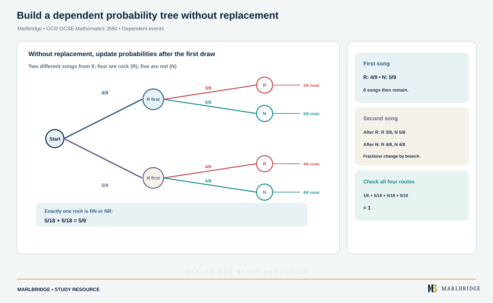

This guide covers tree diagrams, the addition law, the multiplication law and conditional probability for OCR GCSE (9-1) Mathematics (J560), Version 2.1 (August 2026), content references 11.02d, 11.02e and 11.02f. Most of it is for both tiers. The parts marked **Higher tier only** are conditional probability from first principles, the formula p(A and B) = p(A given B)p(B) and the test for independence. Work through the [revision notes](/resources/ocr-gcse-mathematics-tree-diagrams-addition-and-multiplication-laws-and-revision-notes/) for a quick recap and the [practice questions](/resources/ocr-gcse-mathematics-tree-diagrams-addition-and-multiplication-laws-and-practice/) to test yourself. Course pages: [OCR GCSE Mathematics hub](/boards/ocr/gcse/mathematics/), [checklist](/checklists/ocr/gcse/mathematics/) and the [free diagnostics](/diagnostics/).

## What this unit covers

| Reference | What you must be able to do | Tier |
|---|---|---|
| 11.02d | Use tree diagrams to list outcomes and record the probabilities of successive events. Tree frames may be given, and some are partly completed. | Both |
| 11.02e | Use the addition law for mutually exclusive events and p(A) + p(not A) = 1 | Both |
| 11.02e | Understand and apply p(A or B) = p(A) + p(B) - p(A and B) | Both |
| 11.02f | Use tree diagrams and other representations for independent and dependent combined events | Both |
| 11.02f | Understand conditional probability and calculate it from first principles in known contexts | Higher tier only |
| 11.02f | Apply p(A and B) = p(A given B)p(B) | Higher tier only |
| 11.02f | Know that A and B are independent if and only if p(A given B) = p(A) | Higher tier only |

Sample spaces, systematic listing and Venn diagrams belong to other parts of the specification and are not repeated here.

## Probability notation

p(A) means the probability that event A happens. p(not A) is the probability that it does not. Probabilities lie between 0 and 1 and can be written as fractions, decimals or percentages. Give fractions in simplest form unless the question asks otherwise.

For one event, p(A) + p(not A) = 1, so p(not A) = 1 - p(A). This is useful whenever the event you want is awkward but its opposite is easy.

## The addition law for mutually exclusive events (11.02e)

Two events are **mutually exclusive** if they cannot both happen on the same trial. Then

```
p(A or B) = p(A) + p(B)
```

The same idea extends to three or more events that cannot overlap: add their probabilities.

**Worked example 1.** A packet holds sweets that are red, green, yellow or orange. A sweet is taken at random. p(red) = 0.25, p(green) = 0.35 and p(yellow) = 0.15.

Find (a) p(orange), (b) p(red or yellow), (c) p(not green).

```
(a) The four colours cover every outcome and cannot overlap, so they sum to 1.
    p(orange) = 1 - 0.25 - 0.35 - 0.15 = 0.25
(b) A sweet cannot be both red and yellow.
    p(red or yellow) = 0.25 + 0.15 = 0.40
(c) p(not green) = 1 - 0.35 = 0.65
```

Check (c) another way: 0.25 + 0.15 + 0.25 = 0.65.

<figure class="topic-figure">
  
  <figcaption>All the probabilities of one event add to 1, so not happening is 1 minus happening.</figcaption>
</figure>


## The general addition law (11.02e)

If events can happen together, adding p(A) and p(B) counts the overlap twice. Subtract it once:

```
p(A or B) = p(A) + p(B) - p(A and B)
```

"A or B" here includes the case where both happen. When A and B are mutually exclusive, p(A and B) = 0 and this reduces to the simpler law.

**Worked example 2.** At a school, p(a pupil is in the football squad) = 0.45 and p(a pupil is in the chess club) = 0.30. p(a pupil is in both) = 0.12. Find the probability that a pupil chosen at random is in at least one of the two, and the probability that they are in neither.

```
p(football or chess) = 0.45 + 0.30 - 0.12 = 0.63
p(neither) = 1 - 0.63 = 0.37
```

The common mistake is to answer 0.75 by adding without subtracting. That would count the 0.12 twice.

<figure class="topic-figure">
  
  <figcaption>Adding p(A) and p(B) counts the overlap twice, so subtract p(A and B) once.</figcaption>
</figure>

<figure class="topic-figure">
  
  <figcaption>Shade the region you want, add its counts, and divide by the total of 32.</figcaption>
</figure>


## Tree diagrams for successive events (11.02d)

A tree diagram shows the outcomes of one event after another. Each stage is a set of branches. Each branch carries a probability and the branches leaving any one point add up to 1.

```
Rules for using a tree
1. Multiply along the branches to get the probability of one full route.
2. Add the route probabilities when more than one route gives the outcome you want.
3. All the route probabilities together must add up to 1.
```

Rule 1 is the multiplication law in action. Rule 2 is the addition law, because different routes are mutually exclusive.

A tree frame may be printed for you with some probabilities missing. Fill in the missing branches first, using the fact that branches from one point sum to 1.

### Independent events

Events are **independent** when the result of one does not change the probability of the other. The same probabilities appear on every second-stage set of branches. For independent events, p(A and B) = p(A) × p(B).

**Worked example 3.** A cyclist meets two sets of traffic lights. p(stopped at the first) = 0.4 and p(stopped at the second) = 0.3. The two sets work independently.

Frame and route probabilities, where S means stopped and G means goes straight through:

```
First light      Second light       Route probability
S (0.4) ------- S (0.3)             0.4 × 0.3 = 0.12
         \----- G (0.7)             0.4 × 0.7 = 0.28
G (0.6) ------- S (0.3)             0.6 × 0.3 = 0.18
         \----- G (0.7)             0.6 × 0.7 = 0.42
```

The four routes sum to 0.12 + 0.28 + 0.18 + 0.42 = 1.

(a) Stopped at exactly one set: the routes SG and GS are mutually exclusive, so 0.28 + 0.18 = **0.46**.

(b) Stopped at least once: use the opposite. Only GG gives no stop, so 1 - 0.42 = **0.58**. Adding the three routes with a stop gives 0.12 + 0.28 + 0.18 = 0.58 as well.

<figure class="topic-figure">
  
  <figcaption>With replacement the second branches repeat the first; multiply along paths and add the paths you want.</figcaption>
</figure>


### Three or more stages

The same method extends. If each of three independent attempts succeeds with probability 0.2, p(at least one success) = 1 - 0.8 × 0.8 × 0.8 = 1 - 0.512 = **0.488**. Drawing the whole tree would need eight routes, so "at least one" is a good moment to use p(not A).

<figure class="topic-figure">
  
  <figcaption>For at least one, work out the single route for none and subtract from 1.</figcaption>
</figure>


### Dependent events

<!-- marlbridge-diagram:math-b74-ocr-dependent-song-tree -->
<figure class="lesson-diagram" style="margin: 2rem 0;">
  <a href="/public/images/learning/mathematics/math-b74-ocr-dependent-song-tree.svg" aria-label="Open full-size diagram: math-b74-ocr-dependent-song-tree"></a>
  <figcaption>A two-draw tree for selecting two different songs from nine shows the changing second-draw fractions and highlights the RN and NR routes totalling 5/9.</figcaption>
</figure>
<!-- /marlbridge-diagram:math-b74-ocr-dependent-song-tree -->


Events are **dependent** when the first result changes the probability of the second. The usual cause is selecting without replacement, but a question can also state the changed probabilities directly.

**Worked example 4.** A playlist holds 9 songs, 4 of them rock. Two different songs are played at random, one after the other. Find the probability that exactly one is rock.

After a first song is played, 8 remain, so the second-stage fractions have denominator 8.

```
First song       Second song        Route probability
R (4/9) ------- R (3/8)             4/9 × 3/8 = 1/6
         \----- N (5/8)             4/9 × 5/8 = 5/18
N (5/9) ------- R (4/8)             5/9 × 4/8 = 5/18
         \----- N (4/8)             5/9 × 4/8 = 5/18
```

Check: 1/6 = 3/18, and 3/18 + 5/18 + 5/18 + 5/18 = 1.

Exactly one rock is RN or NR: 5/18 + 5/18 = 10/18 = **5/9**.

**Worked example 5.** If it rains on Monday, the probability of rain on Tuesday is 0.6. If Monday is dry, it is 0.2. p(rain on Monday) = 0.3. Find p(rain on Tuesday).

```
Rain Monday, rain Tuesday:  0.3 × 0.6 = 0.18
Dry Monday, rain Tuesday:   0.7 × 0.2 = 0.14
p(rain on Tuesday) = 0.18 + 0.14 = 0.32
```

The Tuesday branches are different on the two Monday branches, which tells you the events are dependent. You still multiply along and add across.

<figure class="topic-figure">
  
  <figcaption>The second-stage branches change with the first result, so the events are dependent.</figcaption>
</figure>

<figure class="topic-figure">
  
  <figcaption>Without replacement the second branches change because the bag has one fewer counter.</figcaption>
</figure>


## Conditional probability from first principles (Higher tier only)

p(A given B) is the probability that A happens when you already know B has happened. Knowing B shrinks the set of possible outcomes to those in B. Count only inside that reduced set.

**Higher tier only: worked example 6.** A card is drawn from a full pack of 52. Find the probability it is a diamond, given that it is red.

```
Knowing the card is red leaves 26 possible cards.
13 of those 26 are diamonds.
p(diamond given red) = 13/26 = 1/2
```

Compare p(diamond) = 13/52 = 1/4. The information that the card is red has changed the probability.

**Higher tier only: worked example 7.** The table shows how 80 pupils travel to school.

| | Year 10 | Year 11 |
|---|---|---|
| Cycle | 14 | 10 |
| Bus | 18 | 22 |
| Walk | 8 | 8 |

A pupil is chosen at random. Find (a) p(cycles given Year 11) and (b) p(Year 10 given bus).

```
(a) Year 11 pupils: 10 + 22 + 8 = 40. Of these, 10 cycle.
    p(cycles given Year 11) = 10/40 = 1/4
(b) Bus users: 18 + 22 = 40. Of these, 18 are in Year 10.
    p(Year 10 given bus) = 18/40 = 9/20
```

Your denominator is the size of the group named after "given", not the total of 80.

**Higher tier only: worked example 8.** Use the playlist from example 4. Given that exactly one of the two songs is rock, find the probability that the first was the rock song.

```
Exactly one rock has probability 5/9 = 10/18.
First rock and exactly one rock is the route RN: 5/18.
p(first rock given exactly one rock) = (5/18) ÷ (10/18) = 1/2
```

<figure class="topic-figure">
  
  <figcaption>Given a condition, only the part of the diagram that satisfies it counts.</figcaption>
</figure>

<figure class="topic-figure">
  
  <figcaption>From a table, the given condition picks one row or column as the whole sample space.</figcaption>
</figure>


## The multiplication law and conditional probability (Higher tier only)

Rearranging the reasoning above gives

```
p(A and B) = p(A given B) × p(B)
```

This is the tree rule in symbols: first B happens, then A happens given B. Dividing both sides by p(B) gives p(A given B) = p(A and B) ÷ p(B).

**Higher tier only: worked example 9.** On a given morning p(rain) = 0.6 and p(a bus is late given rain) = 0.25. Find p(rain and late bus).

```
p(rain and late) = 0.25 × 0.6 = 0.15
```

<figure class="topic-figure">
  
  <figcaption>p(A and B) = p(A given B) x p(B) shown as the area of a rectangle.</figcaption>
</figure>


## Testing for independence (Higher tier only)

Events A and B are independent if and only if p(A given B) = p(A). Equivalently, knowing B tells you nothing about A.

**Higher tier only: worked example 10.** p(A) = 0.4, p(B) = 0.5 and p(A and B) = 0.2. Are A and B independent?

```
p(A given B) = p(A and B) ÷ p(B) = 0.2 ÷ 0.5 = 0.4
This equals p(A) = 0.4, so A and B are independent.
```

In example 6, p(diamond given red) = 1/2 but p(diamond) = 1/4. The two are different, so "diamond" and "red" are not independent.

<figure class="topic-figure">
  
  <figcaption>Independent means p(A given B) = p(A).</figcaption>
</figure>


## Common errors

- Adding probabilities along a branch or multiplying across different routes. Multiply along, add across.
- Leaving the second-stage denominators unchanged in a without-replacement question.
- Using p(A) + p(B) when the events can overlap.
- Dividing by the total instead of the "given" group in a conditional probability.
- Treating p(A given B) and p(B given A) as the same. In general they differ.
- Giving route probabilities that do not sum to 1 and not checking.

## Next steps

Try the [practice questions](/resources/ocr-gcse-mathematics-tree-diagrams-addition-and-multiplication-laws-and-practice/), then tick the unit off the [checklist](/checklists/ocr/gcse/mathematics/). The [diagnostics](/diagnostics/) show where else to revise.

## Frequently asked questions

**What is the addition law for probability?**
For mutually exclusive events, p(A or B) = p(A) + p(B). When the events can happen together, use p(A or B) = p(A) + p(B) − p(A and B), so the overlap is not counted twice.

**How can you check a tree diagram is correct?**
The branches leaving any one point must add up to 1, and all the route probabilities together must also add up to 1. If they do not, look for a wrong branch value.

**Is p(A given B) the same as p(B given A)?**
No. In general the two are different, because the denominator is the size of the group named after "given". For example, p(diamond given red) is 1/2, but p(red given diamond) is 1.

**How do you find a conditional probability from a two-way table?**
Use the total of the row or column named after "given" as the denominator, not the overall total. For example, if 10 of the 40 Year 11 pupils cycle, p(cycles given Year 11) = 10/40 = 1/4.

## Official syllabus

OCR GCSE (9-1) Mathematics (J560), Version 2.1 (August 2026), for first assessment in 2017, published by OCR. Content references 11.02d, 11.02e and 11.02f.
