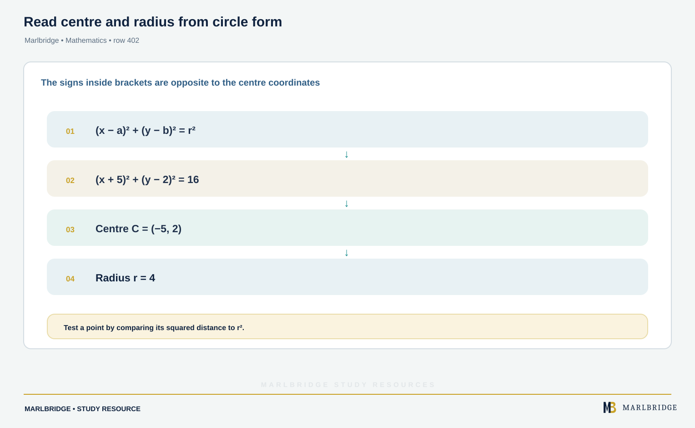
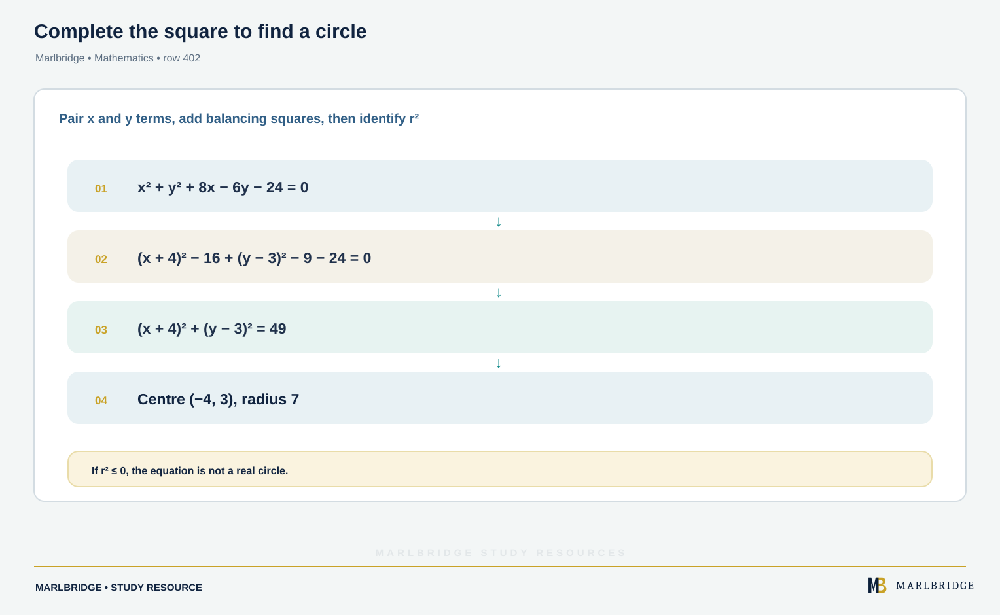
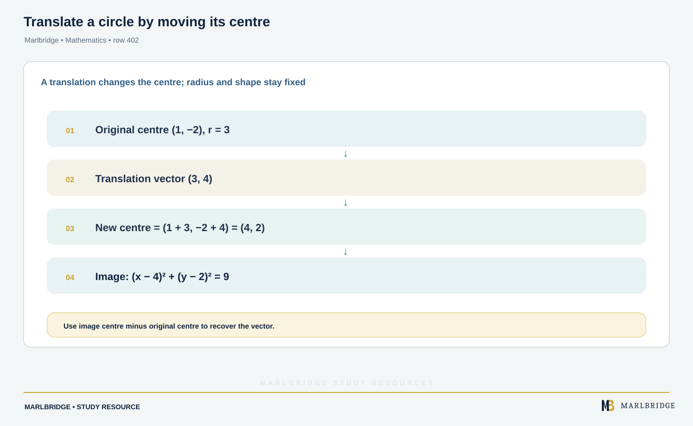
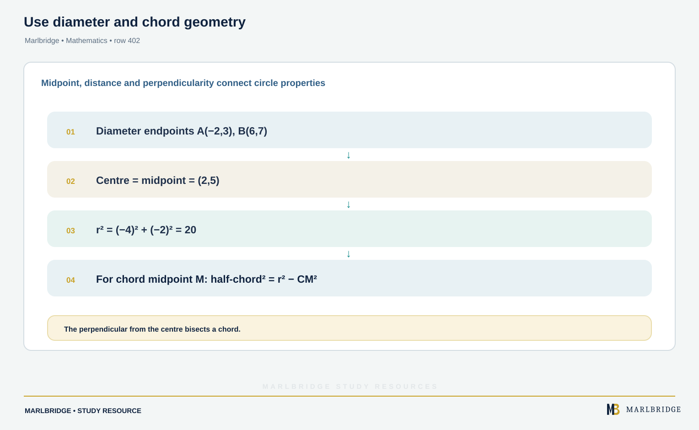

This guide covers the circle for the OxfordAQA International AS and A-level Mathematics (9660) specification, Version 5.2. It follows content area PP1.1 (Circle) in section 3.2.1 of the specification. The specification places this content in International AS, Unit PSM1, and gives no further tier labels. Two companion pages are the [revision notes](/resources/oxfordaqa-a-level-mathematics-equation-of-a-circle-tangents-and-circle-geometry-revision-notes/) and the [practice questions](/resources/oxfordaqa-a-level-mathematics-equation-of-a-circle-tangents-and-circle-geometry-practice/). The course page is the [OxfordAQA A-level Mathematics hub](/boards/oxfordaqa/a-level/mathematics/) and the printable [checklist](/checklists/oxfordaqa/a-level/mathematics/) lists every topic. If you are unsure where you stand, take a [free 10-minute diagnostic](/diagnostics/) first.

## What PP1.1 requires

| Content | Skills needed |
|---|---|
| Equation (x – a)² + (y – b)² = r² | Write it down from a centre and radius, and read both from it |
| Completing the square | Turn an expanded equation into a centre and a radius |
| Translation of circles | Say how the equation changes under a translation |
| Coordinate geometry of the circle | Use the angle in a semicircle, the line from the centre that meets a chord at right angles, and the tangent–radius right angle |
| Tangent and normal at a point | Find both equations using gradients. Implicit differentiation is not required |

You also need straight-line coordinate geometry: gradient, midpoint, distance, perpendicular gradients (product −1) and the form y − y₁ = m(x − x₁). If any of that is shaky, revise it first.

## 1. The equation of a circle

<figure class="learning-diagram" style="margin:1.5rem 0;"><a href="/public/images/learning/mathematics/math-sub-402-circle-equation-centre-radius.svg" aria-label="Open full-size diagram: math-sub-402-circle-equation-centre-radius"></a><figcaption>Read centre and radius from circle form — Marlbridge Mathematics</figcaption></figure>

A circle is every point at a fixed distance r (the radius) from a fixed point (a, b) (the centre). Applying the distance formula to a general point (x, y) and squaring gives

```
(x − a)² + (y − b)² = r²
```

Each bracket carries the opposite sign to the matching centre coordinate. So (x + 5)² + (y − 2)² = 16 has centre (−5, 2) and radius 4, because x + 5 = x − (−5).

**Worked example 1.** State the equation of the circle with centre (−5, 2) and radius 4, then expand it.

```
(x + 5)² + (y − 2)² = 16
x² + 10x + 25 + y² − 4y + 4 = 16
x² + y² + 10x − 4y + 13 = 0
```

Expanded equations always have x² and y² with equal coefficients and no xy term. That is how you recognise a possible circle.

**Testing a point.** Substitute (x, y) into (x − a)² + (y − b)². Equal to r² means the point is on the circle, less than r² means inside, and more than r² means outside.

<figure class="topic-figure">
  
  <figcaption>The gradient triangle, the midpoint and the perpendicular bisector all come from the same two points.</figcaption>
</figure>

<figure class="topic-figure">
  
  <figcaption>Every point on the circle satisfies Pythagoras with the centre, which is why the equation has that form.</figcaption>
</figure>

<figure class="topic-figure">
  
  <figcaption>After completing the square the right-hand side is r squared, so it must be positive for a circle to exist.</figcaption>
</figure>

<figure class="topic-figure">
  
  <figcaption>A diameter subtends a right angle at any other point of the circle, which can be proved with gradients.</figcaption>
</figure>

<figure class="topic-figure">
  
  <figcaption>The centre always lies on the perpendicular bisector of any chord, so two chords fix the centre.</figcaption>
</figure>

<figure class="topic-figure">
  
  <figcaption>Substituting a line into a circle gives a quadratic whose discriminant counts the intersections.</figcaption>
</figure>

<figure class="topic-figure">
  
  <figcaption>Compare the distance between centres with the sum and difference of the radii.</figcaption>
</figure>


## 2. Completing the square

<figure class="learning-diagram" style="margin:1.5rem 0;"><a href="/public/images/learning/mathematics/math-sub-402-complete-square-circle.svg" aria-label="Open full-size diagram: math-sub-402-complete-square-circle"></a><figcaption>Complete the square to find a circle — Marlbridge Mathematics</figcaption></figure>

To find the centre and radius from an expanded equation:

1. If x² and y² have a coefficient other than 1, divide every term by it.
2. Group the x terms and the y terms.
3. Rewrite each variable using x² + px = (x + p/2)² − p²/4, and the same for y.
4. Move the constants to the right-hand side. That number is r².

**Worked example 2.** Find the centre and radius of x² + y² + 8x − 6y − 24 = 0.

```
(x + 4)² − 16 + (y − 3)² − 9 − 24 = 0
(x + 4)² + (y − 3)² = 49
```

Centre (−4, 3), radius 7.

**Worked example 3.** Find the centre and radius of 2x² + 2y² + 12x − 8y − 10 = 0.

```
x² + y² + 6x − 4y − 5 = 0          (divide by 2)
(x + 3)² − 9 + (y − 2)² − 4 − 5 = 0
(x + 3)² + (y − 2)² = 18
```

Centre (−3, 2), radius √18 = 3√2. Leave the radius as a surd unless the question asks for a decimal.

**When it is not a circle.** If the right-hand side comes out zero, the "circle" is a single point. If it is negative, no points satisfy the equation. For example x² + y² + 2x − 6y + 15 = 0 gives (x + 1)² + (y − 3)² = −5, so there is no circle.

## 3. Translation of circles

<figure class="learning-diagram" style="margin:1.5rem 0;"><a href="/public/images/learning/mathematics/math-sub-402-translate-circle.svg" aria-label="Open full-size diagram: math-sub-402-translate-circle"></a><figcaption>Translate a circle by moving its centre — Marlbridge Mathematics</figcaption></figure>

A translation moves every point without turning or resizing it. So the radius is unchanged and only the centre moves.

If the circle (x − a)² + (y − b)² = r² is translated by the vector (p, q), the centre moves from (a, b) to (a + p, b + q). The image is

```
(x − a − p)² + (y − b − q)² = r²
```

Each x is replaced by (x − p) and each y by (y − q).

**Worked example 4.** The circle (x − 1)² + (y + 2)² = 9 is translated by the vector (3, 4). Find the equation of the image.

The centre (1, −2) moves to (1 + 3, −2 + 4) = (4, 2). The radius stays 3.

Image: (x − 4)² + (y − 2)² = 9, which expands to x² + y² − 8x − 4y + 11 = 0.

To find an unknown translation, compare the two centres: the vector is image centre minus original centre.

<figure class="topic-figure">
  
  <figcaption>The tangent is perpendicular to the radius, and the normal runs along it through the centre.</figcaption>
</figure>


## 4. Circle properties in coordinate form

<figure class="learning-diagram" style="margin:1.5rem 0;"><a href="/public/images/learning/mathematics/math-sub-402-circle-chord-properties.svg" aria-label="Open full-size diagram: math-sub-402-circle-chord-properties"></a><figcaption>Use diameter and chord geometry — Marlbridge Mathematics</figcaption></figure>

The specification names three properties. Each one turns into a gradient or distance calculation.

**The angle in a semicircle is a right angle.** Suppose AB is a diameter and P is any other point on the circle. Then AP and BP are perpendicular, so (gradient AP) × (gradient BP) = −1. The converse also holds: if the gradients of AP and BP multiply to −1, then P is on the circle with diameter AB.

**Worked example 5.** The segment from A(−2, 3) to B(6, 7) is a diameter. Work out the equation of the circle, and prove that P(4, 9) lies on it.

<!-- marlbridge-diagram:math-b42-oxfordaqa-circle-diameter-right-angle-proof -->
<figure class="lesson-diagram" style="margin: 2rem 0;">
  <a href="/images/learning/mathematics/math-b42-oxfordaqa-circle-diameter-right-angle-proof.svg" aria-label="Open full-size diagram: math-b42-oxfordaqa-circle-diameter-right-angle-proof"></a>
  <figcaption>Circle geometry: a diameter subtends a right angle Select the image to enlarge it.</figcaption>
</figure>
<!-- /marlbridge-diagram:math-b42-oxfordaqa-circle-diameter-right-angle-proof -->


```
centre = midpoint of AB = (2, 5)
r² = (−2 − 2)² + (3 − 5)² = 16 + 4 = 20
equation: (x − 2)² + (y − 5)² = 20
```

Check P: (4 − 2)² + (9 − 5)² = 4 + 16 = 20, so P is on the circle.

Check with the semicircle property: gradient AP = (9 − 3)/(4 + 2) = 1, gradient BP = (9 − 7)/(4 − 6) = −1. The product is −1, so angle APB is a right angle. Both methods agree.

**A perpendicular dropped from the centre onto a chord splits it into two equal halves.** This gives a right-angled triangle: centre, midpoint of the chord, and one end of the chord. Then r² = d² + (half the chord)², where d measures how far the chord lies from the centre.

In reverse, every chord has a perpendicular bisector that goes through the centre. Two chords therefore fix the centre where their perpendicular bisectors cross.

**Worked example 6.** A circle has centre C(4, 1) and radius √50. A chord has midpoint M(1, 7). Find the length of the chord.

```
CM² = (1 − 4)² + (7 − 1)² = 9 + 36 = 45
half-chord² = 50 − 45 = 5
chord length = 2√5
```

Note that the midpoint is given, so CM is perpendicular to the chord automatically.

## 5. Tangents and normals

<!-- marlbridge-diagram:math-final-402-circle-tangent-normal -->
<figure class="lesson-diagram" style="margin: 2rem 0;">
  <a href="/images/learning/mathematics/math-final-402-circle-tangent-normal.svg" aria-label="Open full-size diagram: math-final-402-circle-tangent-normal"></a>
  <figcaption>Coordinate graph marking centre C, point P, radius, perpendicular tangent and normal, with exact line equations.</figcaption>
</figure>
<!-- /marlbridge-diagram:math-final-402-circle-tangent-normal -->


A tangent meets the circle at exactly one point and is at right angles to the radius there. The normal at a point is the line perpendicular to the tangent there, so it runs along the radius and passes through the centre.

No calculus is needed. The method is:

1. Find the centre C and the point of contact P.
2. Gradient of radius CP = (y_P − y_C)/(x_P − x_C).
3. Gradient of tangent = −1 ÷ (gradient of CP). Gradient of normal = gradient of CP.
4. Use y − y₁ = m(x − x₁) with P as (x₁, y₁).

If the radius is horizontal, the tangent is vertical (x = constant). If the radius is vertical, the tangent is horizontal (y = constant). Do not divide by zero.

**Worked example 7.** Find the tangent and normal to (x − 3)² + (y + 1)² = 40 at P(5, 5).

Check P is on the circle: (5 − 3)² + (5 + 1)² = 4 + 36 = 40. ✓

```
gradient of CP = (5 − (−1))/(5 − 3) = 6/2 = 3
tangent gradient = −1/3
tangent:  y − 5 = −(1/3)(x − 5)   →   x + 3y = 20
normal:   y − 5 = 3(x − 5)        →   y = 3x − 10
```

Check: the normal should pass through the centre (3, −1). 3(3) − 10 = −1. ✓

**Length of a tangent from an outside point.** The tangent, the radius to the contact point and the line from the outside point to the centre form a right-angled triangle, with the right angle at the contact point. So

```
(tangent length)² = (distance from point to centre)² − r²
```

**Worked example 8.** Find the length of a tangent drawn from T(9, 7) to the circle in example 7.

```
TC² = (9 − 3)² + (7 + 1)² = 36 + 64 = 100
tangent length² = 100 − 40 = 60
tangent length = 2√15
```

## Common errors

- Reading the centre with the wrong signs: (x + 3)² means a centre at x = −3, not +3.
- Forgetting to divide by the coefficient of x² before completing the square.
- Giving r² as the radius. After completing the square the right-hand side is r², so take the square root.
- Using the radius gradient as the tangent gradient. The tangent gradient is its negative reciprocal.
- Skipping the check that the given point lies on the circle before finding the tangent.
- In a translation, moving the centre the wrong way. A translation by (3, 4) adds 3 to x and 4 to y.
- Finding the equation of the tangent in a form that is not simplified when the question asks for whole-number coefficients.

## Working by hand

Every example here is short algebra that you can do by hand, so write each step out. A clear line of working shows your method even if you slip on the arithmetic later.

## Next steps

Work through the [practice questions](/resources/oxfordaqa-a-level-mathematics-equation-of-a-circle-tangents-and-circle-geometry-practice/), then use the [revision notes](/resources/oxfordaqa-a-level-mathematics-equation-of-a-circle-tangents-and-circle-geometry-revision-notes/) for quick recall. The wider [Unit P1 pure maths guide](/resources/a-level-oxfordaqa-mathematics-unit-p1/) covers the straight-line and quadratics skills used here. The [diagnostics](/diagnostics/) show which topics to prioritise.

## Frequently asked questions

**How do you find the centre and radius of a circle from its equation?**
Write the equation in the form (x − a)² + (y − b)² = r², completing the square if it is expanded. The centre is (a, b), with signs opposite to those in the brackets, and the radius is the square root of the right-hand side.

**Do you need calculus to find a tangent to a circle in OxfordAQA 9660?**
No. The OxfordAQA 9660 specification says implicit differentiation is not required for tangents and normals to a circle. You use the fact that the tangent is perpendicular to the radius, so its gradient is the negative reciprocal of the radius gradient.

**How can you tell whether a point is inside, on or outside a circle?**
Substitute the point into (x − a)² + (y − b)². If the result equals r² the point is on the circle, if it is less than r² the point is inside, and if it is more than r² the point is outside.

**When does an equation like x² + y² + 2x − 6y + 15 = 0 not give a circle?**
After completing the square, the right-hand side is r². If it comes out zero the equation describes a single point, and if it is negative no points satisfy it, so there is no circle.

**How do you find the length of a tangent from a point outside a circle?**
The tangent, the radius to the point of contact and the line to the centre form a right-angled triangle. So the tangent length squared equals the distance from the point to the centre squared, minus r².

## Official syllabus

OxfordAQA International AS and A-level Mathematics (9660), Version 5.2, section 3.2.1 PP1.1 (Circle), published by OxfordAQA. For International AS exams from May/June 2018 and International A-level exams from May/June 2019.
