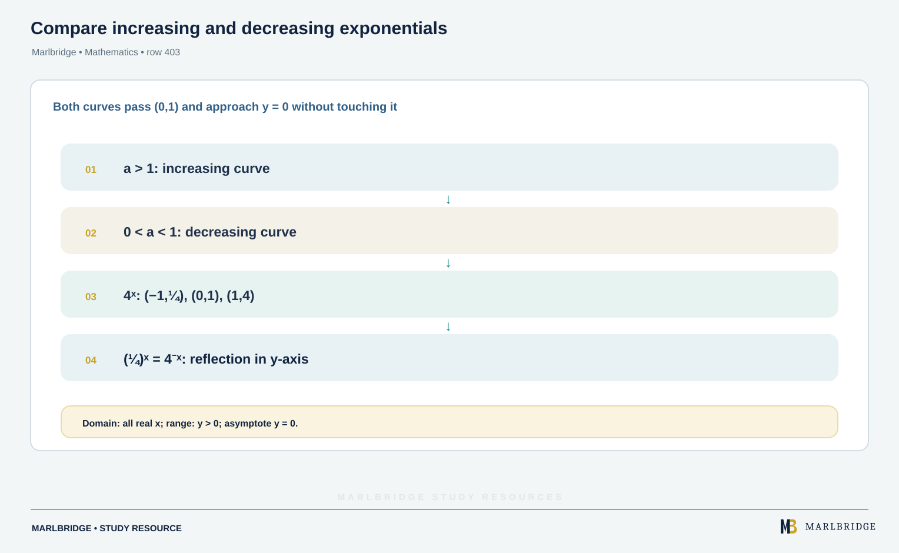
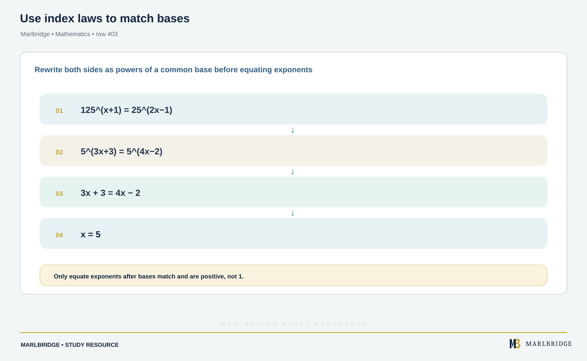
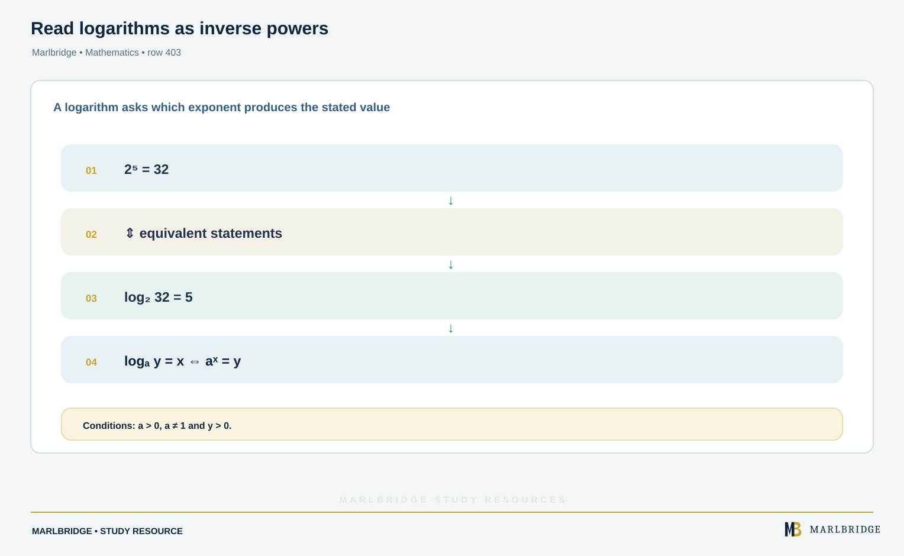
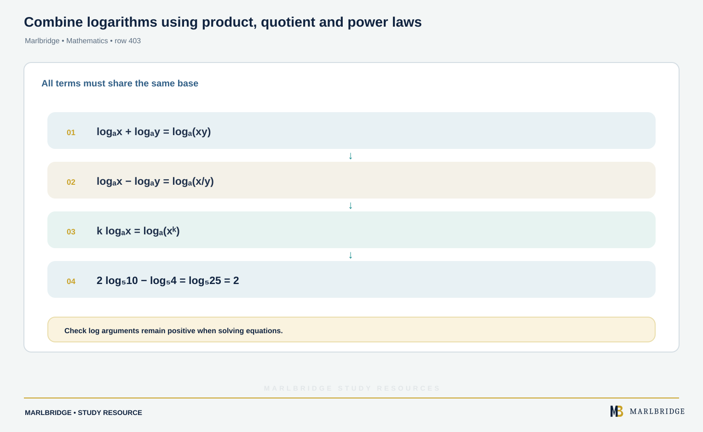
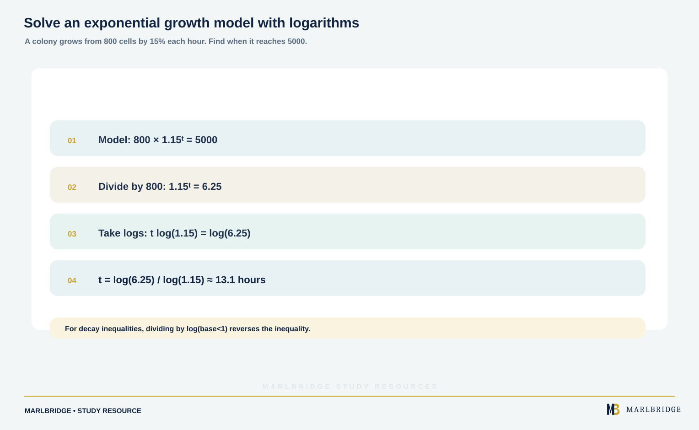

This guide follows the *OxfordAQA International AS and A-level Mathematics (9660) specification, Version 5.2*, section PP1.3 (Exponential and logarithms). The specification places this content in International AS, Unit PSM1 (3.2, PP1), and it applies to International AS exams from May/June 2018 and International A-level exams from May/June 2019.

Use it with the [revision notes](/resources/oxfordaqa-a-level-mathematics-exponential-functions-logarithms-and-solving-a-x-b-revision-notes/) and the [practice questions](/resources/oxfordaqa-a-level-mathematics-exponential-functions-logarithms-and-solving-a-x-b-practice/). The course page is [OxfordAQA A-level Mathematics](/boards/oxfordaqa/a-level/mathematics/), and the [printable checklist](/checklists/oxfordaqa/a-level/mathematics/) lets you tick off each outcome. If you are not sure where to start, take a [free 10-minute diagnostic](/diagnostics/) first.

## What PP1.3 asks you to do

| Specification item | What you must be able to do |
|---|---|
| y = a^x and its graph | Sketch the graph for a > 1 and 0 < a < 1, using the laws of indices where they help |
| Logarithms and the laws of logarithms | Use logₐx + logₐy = logₐ(xy), logₐx − logₐy = logₐ(x/y) and k logₐx = logₐ(x^k) |
| Equivalence of y = a^x and x = logₐy | Move between index form and logarithm form |
| Solving a^x = b | Solve equations such as 3^(2x) = 2, including by using the logarithm function on your calculator |

## 1. The graph of y = a^x

<figure class="learning-diagram" style="margin:1.5rem 0;"><a href="/public/images/learning/mathematics/math-sub-403-exponential-graphs.svg" aria-label="Open full-size diagram: math-sub-403-exponential-graphs"> 1: increasing curve; 0 < a < 1: decreasing curve; 4ˣ: (−1,¼), (0,1), (1,4); (¼)ˣ = 4⁻ˣ: reflection in y-axis" loading="lazy" decoding="async" style="display:block;width:100%;height:auto;" /></a><figcaption>Compare increasing and decreasing exponentials — Marlbridge Mathematics</figcaption></figure>

Take a > 0 and a ≠ 1. The graph of y = a^x always has these features.

- The point (0, 1) is always on the curve, since a⁰ = 1.
- It lies above the x-axis for every x, because a^x is never zero or negative.
- The x-axis is an asymptote: the curve gets closer to y = 0 but never reaches it.
- If a > 1 the curve rises, and it rises faster as x increases. If 0 < a < 1 it falls.

Here are values for y = 4^x and y = (1/4)^x.

| x | −2 | −1 | 0 | 1 | 2 |
|---|---|---|---|---|---|
| 4^x | 1/16 | 1/4 | 1 | 4 | 16 |
| (1/4)^x | 16 | 4 | 1 | 1/4 | 1/16 |

The second row is the first row reversed. That is because (1/4)^x = 4^(−x), so the graph of y = (1/4)^x is the reflection of y = 4^x in the y-axis.

Sketch description for y = 4^x: start just above the negative x-axis on the left, cross the y-axis at (0, 1), then climb steeply, passing (1, 4) and (2, 16). Label the intercept (0, 1) and say "asymptote y = 0".

### Laws of indices you will use

<figure class="learning-diagram" style="margin:1.5rem 0;"><a href="/public/images/learning/mathematics/math-sub-403-index-laws-exponential-equations.svg" aria-label="Open full-size diagram: math-sub-403-index-laws-exponential-equations"></a><figcaption>Use index laws to match bases — Marlbridge Mathematics</figcaption></figure>

```
a^m × a^n = a^(m+n)        a^m ÷ a^n = a^(m−n)
(a^m)^n = a^(mn)           a^(−n) = 1/a^n
a^0 = 1                    a^(1/n) is the n-th root of a
```

**Example 1.** Solve 125^(x+1) = 25^(2x−1).

Write both sides as powers of 5.

```
125 = 5³ and 25 = 5²
5^(3(x+1)) = 5^(2(2x−1))
3(x+1) = 2(2x−1)
3x + 3 = 4x − 2
x = 5
```

Check: 125⁶ = 5¹⁸ and 25⁹ = 5¹⁸. This only works when both sides can be written with the same base. When they cannot, you need logarithms (section 4).

<figure class="topic-figure">
  
  <figcaption>The graph of ln x is the reflection of eˣ in y = x.</figcaption>
</figure>

<figure class="topic-figure">
  
  <figcaption>Every aˣ passes through (0, 1); a &gt; 1 grows and a &lt; 1 decays.</figcaption>
</figure>

<figure class="topic-figure">
  
  <figcaption>Taking logs solves aˣ = b, and a negative log reverses an inequality.</figcaption>
</figure>

<figure class="topic-figure">
  
  <figcaption>Substituting u = eˣ turns e²ˣ − 5eˣ + 6 = 0 into a quadratic with roots ln 2 and ln 3.</figcaption>
</figure>


## 2. Logarithms and the equivalence with indices

<figure class="learning-diagram" style="margin:1.5rem 0;"><a href="/public/images/learning/mathematics/math-sub-403-logarithm-inverse.svg" aria-label="Open full-size diagram: math-sub-403-logarithm-inverse"></a><figcaption>Read logarithms as inverse powers — Marlbridge Mathematics</figcaption></figure>

The logarithm answers the question "what power?". The two statements below say the same thing.

```
y = a^x   ⇔   x = logₐ y        (a > 0, a ≠ 1, y > 0)
```

So log₂32 = 5 because 2⁵ = 32. The logarithm is the inverse of the exponential, so the graph of y = logₐx is the graph of y = a^x reflected in the line y = x. You can only take the logarithm of a positive number.

Two results follow straight from a¹ = a and a⁰ = 1:

```
logₐ a = 1        logₐ 1 = 0
```

**Example 2.** Evaluate (a) log₅(1/25), (b) log₉27, (c) log₈4.

(a) Let log₅(1/25) = k. Then 5^k = 1/25 = 5⁻², so **k = −2**.

(b) Let log₉27 = k. Then 9^k = 27, so 3^(2k) = 3³. Hence 2k = 3 and **k = 3/2**.

(c) Let log₈4 = k. Then 8^k = 4, so 2^(3k) = 2². Hence 3k = 2 and **k = 2/3**.

The method is always the same: write the logarithm equal to k, convert to index form, then match powers of a common base.

**Example 3.** Find x when (a) log_x 81 = 4, (b) log₂x = −3.

(a) x⁴ = 81, so x = 3 (a base must be positive).

(b) x = 2⁻³ = **1/8**.

## 3. The laws of logarithms

<figure class="learning-diagram" style="margin:1.5rem 0;"><a href="/public/images/learning/mathematics/math-sub-403-log-laws.svg" aria-label="Open full-size diagram: math-sub-403-log-laws"></a><figcaption>Combine logarithms using product, quotient and power laws — Marlbridge Mathematics</figcaption></figure>

All three laws need the same base on every term.

```
logₐ x + logₐ y = logₐ(xy)
logₐ x − logₐ y = logₐ(x/y)
k logₐ x = logₐ(x^k)
```

Why they hold: if x = a^p and y = a^q, then xy = a^(p+q), so logₐ(xy) = p + q = logₐx + logₐy. The other laws come from the same idea with a^p ÷ a^q and (a^p)^k.

**Example 4.** Evaluate without a calculator.

(a) log₆4 + log₆9 = log₆36 = **2**

(b) log₃54 − log₃2 = log₃27 = **3**

(c) 2log₅10 − log₅4 = log₅100 − log₅4 = log₅25 = **2**

**Example 5.** Suppose logₐ2 = p and logₐ3 = q. Write logₐ12 and logₐ(9/8) in terms of p and q.

```
logₐ12 = logₐ(4 × 3) = 2logₐ2 + logₐ3 = 2p + q
logₐ(9/8) = 2logₐ3 − 3logₐ2 = 2q − 3p
```

Split the number into factors that are powers of 2 and 3 first, then apply the laws.

**Example 6.** Solve log₂x + log₂(x − 2) = 3.

```
log₂[x(x − 2)] = 3
x(x − 2) = 2³ = 8
x² − 2x − 8 = 0
(x − 4)(x + 2) = 0
```

The roots are x = 4 and x = −2. Because log₂x needs x > 0, discard x = −2. The solution is **x = 4**. Check: log₂4 + log₂2 = 2 + 1 = 3.

<figure class="topic-figure">
  
  <figcaption>Logarithms turn products into sums: lengths on a log ruler add.</figcaption>
</figure>

<figure class="topic-figure">
  
  <figcaption>A straight line on log axes gives gradient and intercept for power and exponential laws.</figcaption>
</figure>

<figure class="topic-figure">
  
  <figcaption>ln x differentiates to 1/x and the area under 1/x from 1 to e is 1.</figcaption>
</figure>


## 4. Solving a^x = b

<!-- marlbridge-diagram:math-final-403-logarithmic-equation-solve -->
<figure class="lesson-diagram" style="margin: 2rem 0;">
  <a href="/images/learning/mathematics/math-final-403-logarithmic-equation-solve.svg" aria-label="Open full-size diagram: math-final-403-logarithmic-equation-solve"></a>
  <figcaption>Equation flow takes logarithms, brings down the exponent and solves to x about 0.315.</figcaption>
</figure>
<!-- /marlbridge-diagram:math-final-403-logarithmic-equation-solve -->


When the bases will not match, take logarithms of both sides. You may choose any base for the logarithms provided both sides use the same one; the calculator's logarithm function then gives numerical values. The key step is the third law: it brings the unknown power down in front.

```
a^x = b
x log a = log b
x = log b / log a
```

**Example 7 (the specification's own type).** Solve 3^(2x) = 2.

```
2x log 3 = log 2
x = log 2 / (2 log 3) = 0.6931 / 2.1972
x = 0.315   (3 s.f.)
```

Check: 3^(0.6309) = 2.

**Example 8.** Solve 7^(2x−1) = 30.

```
(2x − 1) log 7 = log 30
2x − 1 = log 30 / log 7 = 1.7479
2x = 2.7479
x = 1.37   (3 s.f.)
```

Divide first, then rearrange. Avoid rounding 1.7479 early; carry the unrounded calculator value to the final line.

**Example 9.** Solve 2^(x+1) = 3^x.

```
(x + 1) log 2 = x log 3
x log 2 + log 2 = x log 3
log 2 = x (log 3 − log 2)
x = log 2 / (log 3 − log 2) = 1.71   (3 s.f.)
```

When the unknown is on both sides, collect the x terms on one side and factor.

**Example 10.** Solve 0.8^x = 0.3.

```
x log 0.8 = log 0.3
x = log 0.3 / log 0.8 = 5.40   (3 s.f.)
```

Both logarithms are negative, so the quotient is positive. That agrees with the graph: 0.8^x falls, and it equals 0.3 at a positive x.

### Using this in context

<figure class="learning-diagram" style="margin:1.5rem 0;"><a href="/public/images/learning/mathematics/math-sub-403-growth-context.svg" aria-label="Open full-size diagram: math-sub-403-growth-context"></a><figcaption>Solve an exponential growth model with logarithms — Marlbridge Mathematics</figcaption></figure>

**Example 11.** A colony starts at 800 cells and grows by 15% each hour, so after t hours it has 800 × 1.15^t cells. When does it reach 5000?

```
800 × 1.15^t = 5000
1.15^t = 6.25
t = log 6.25 / log 1.15 = 13.1 hours
```

**Example 12.** A value falls by 10% each year from a start of 1. Find the first whole number of years n for which 0.9^n < 0.2.

```
n log 0.9 < log 0.2
```

Now divide by log 0.9. It is negative, so the inequality reverses.

```
n > log 0.2 / log 0.9 = 15.28
```

The smallest whole number is **n = 16**. Check: 0.9¹⁵ = 0.206 (not below 0.2) and 0.9¹⁶ = 0.185 (below 0.2).

<figure class="topic-figure">
  
  <figcaption>Exponential decay has a constant half-life of ln 2 ÷ k.</figcaption>
</figure>


## Common errors

- Splitting log(x + y) into log x + log y. Only a product inside the bracket splits, as in logₐ(xy).
- Writing log 6 − log 2 = log 4. Subtraction of logarithms gives log(6/2) = log 3.
- Writing (log x)² = 2 log x. The third law applies to log(x²), not to (log x)².
- Combining logarithms with different bases without changing them first.
- Forgetting to check log equations. A root that makes an argument zero or negative must be rejected.
- Rounding part-way through a^x = b, which can change the third significant figure.
- Dividing an inequality by a negative logarithm and keeping the sign. If the base is between 0 and 1, the logarithm is negative and the sign reverses.
- Saying a^x can be negative or zero. It cannot, so an equation such as 3^x = −2 has no solution.

## Where to go next

Try the [practice questions](/resources/oxfordaqa-a-level-mathematics-exponential-functions-logarithms-and-solving-a-x-b-practice/) and then recheck with the [revision notes](/resources/oxfordaqa-a-level-mathematics-exponential-functions-logarithms-and-solving-a-x-b-revision-notes/). For the pure maths in the neighbouring Unit P1, see the [Unit P1 study guide](/resources/a-level-oxfordaqa-mathematics-unit-p1/).

## Frequently asked questions

**What is a logarithm?**
A logarithm answers the question "what power?". The statement y = a^x means the same as x = logₐy, so log₂32 = 5 because 2⁵ = 32.

**When do you need logarithms to solve an exponential equation?**
If both sides can be written as powers of the same base, you can simply equate the indices. When they cannot, as in 3^(2x) = 2, take logarithms of both sides and bring the index down.

**Can 3^x ever equal a negative number?**
No. a^x is always positive for a > 0, so an equation such as 3^x = −2 has no solution.

**Is solving a^x = b with a calculator in the OxfordAQA 9660 syllabus?**
Yes. Section PP1.3 of the OxfordAQA 9660 specification includes solving equations such as 3^(2x) = 2, including by using the logarithm function on a calculator.

**How is the graph of y = (1/4)^x related to y = 4^x?**
Because (1/4)^x = 4^(−x), the graph of y = (1/4)^x is the reflection of y = 4^x in the y-axis.

## Official syllabus

OxfordAQA International AS and A-level Mathematics (9660), Version 5.2: section PP1.3, Exponential and logarithms. Published by OxfordAQA for International AS exams from May/June 2018 and International A-level exams from May/June 2019.
