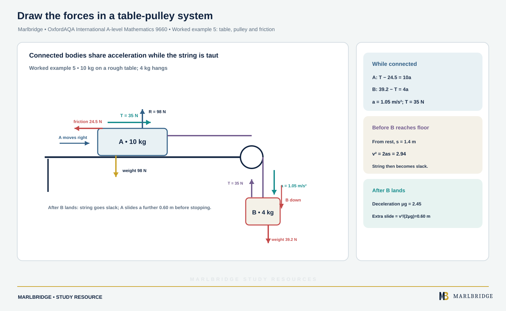

This guide covers sections M1.3 (Forces and Newton's Laws) and M1.4 (Momentum and impulse) of the OxfordAQA International AS and A-level Mathematics (9660) specification, Version 5.2 (International AS exams from May/June 2018, A-level from May/June 2019). The specification states this content is part of International AS, Unit PSM1, in the Mechanics (M1) strand, so it also counts towards the International A-level. Everything is restricted to motion in a straight line.

Related pages: [revision notes](/resources/oxfordaqa-a-level-mathematics-forces-newtons-laws-connected-particles-momentum-and-revision-notes/), [practice questions](/resources/oxfordaqa-a-level-mathematics-forces-newtons-laws-connected-particles-momentum-and-practice/), [exam preparation](/resources/oxfordaqa-a-level-mathematics-exam-preparation/), the [course hub](/boards/oxfordaqa/a-level/mathematics/), the [printable checklist](/checklists/oxfordaqa/a-level/mathematics/) and the free [10-minute diagnostics](/diagnostics/).

## What you must be able to do

| Section | Content | Limits set by the specification |
|---|---|---|
| M1.3 | Weight, tension, thrust, normal reaction, resistive forces, dynamic friction | W = mg with g = 9.8 m/s²; F = μR |
| M1.3 | Newton's three laws | Straight-line motion, horizontal or vertical |
| M1.3 | Connected particles | Light inextensible string over a smooth fixed peg or smooth light pulley, constant forces; car and trailer. Resolution of forces is not required |
| M1.4 | Momentum, conservation of momentum | Two particles; Newton's law of restitution is not required |
| M1.4 | Impulse, direct impact with a fixed surface | Impulse = change in momentum; particle moves perpendicular to a smooth fixed surface |

The specification lists these formulae as ones you must learn, because they are not in the formulae booklet: W = mg, momentum = mv, F = ma (or force = rate of change of momentum), and F = μR for dynamic friction.

<figure class="topic-figure">
  
  <figcaption>In equilibrium the forces sum to zero in every direction, so they close into a triangle.</figcaption>
</figure>

<figure class="topic-figure">
  
  <figcaption>The resultant of tension and weight points to the centre of the circle and equals mrω².</figcaption>
</figure>


## Forces and modelling words

Forces are measured in newtons (N). Draw a force diagram for every problem, with one arrow per force, before writing any equation.

* **Weight** W = mg acts vertically downwards. With m in kg and g = 9.8, a 58 kg person weighs 58 × 9.8 = 568.4 N.
* **Normal reaction R** is the force from a surface, perpendicular to it. It is not always equal to the weight: in a lift it changes.
* **Tension** pulls along a string or rod. **Thrust** pushes along a rod. A string can only pull; a rod can pull or push.
* **Resistive forces** (air, water, oil, friction) oppose motion.
* **Dynamic friction** acts on a sliding object and has magnitude F = μR, where μ is the coefficient of friction. It acts against the direction of sliding.

Modelling words carry information. "Light" means massless, so the tension is the same at both ends. "Inextensible" means both particles have the same speed and acceleration magnitude. "Smooth" means no friction, so tension is unchanged round a peg or pulley. "Particle" means size is ignored.

## Newton's three laws

1. A particle keeps its state of rest or constant velocity unless a net force acts on it.
2. The net force equals mass multiplied by acceleration, F = ma. In momentum form, force = rate of change of momentum.
3. Two bodies exert forces on each other that are equal in size and opposite in direction.

The third law pairs act on different objects, so they never cancel. A crate on the floor presses down on the floor with a force of magnitude R, and the floor pushes up on the crate with a force of the same magnitude. These two are a pair. The crate's weight (pulled by Earth) and the normal reaction are not a pair, even though they are equal when there is no vertical acceleration.

**Method for the second law.** Choose a positive direction (the direction of acceleration if you know it). Write "resultant force in that direction = ma" for each particle, then solve.

### Worked example 1: lift

A lift of mass 350 kg carries a person of mass 58 kg. The lift accelerates downwards at 1.3 m/s². Find (a) the normal reaction between the person and the floor, (b) the tension in the cable.

```
(a) Person, taking down as positive:
    58g − R = 58 × 1.3
    R = 58 × (9.8 − 1.3) = 58 × 8.5 = 493 N

(b) Lift and person together, mass 408 kg:
    408g − T = 408 × 1.3
    T = 408 × 8.5 = 3468 N
```

The person feels lighter (493 N compared with 568.4 N at rest) because the acceleration is downwards.

<figure class="topic-figure">
  
  <figcaption>The reaction R is larger than the weight when the lift accelerates upwards and smaller when it accelerates downwards; third-law pairs act on different bodies.</figcaption>
</figure>


### Worked example 2: friction and resistance

A crate of mass 12 kg is pulled across rough horizontal ground by a horizontal rope with tension 75 N. The coefficient of friction is 0.35. (a) Find the acceleration. (b) After 4 s the rope is cut. Find the distance the crate then travels before stopping.

```
(a) R = 12 × 9.8 = 117.6 N          (no vertical acceleration)
    F = 0.35 × 117.6 = 41.16 N
    75 − 41.16 = 12a
    a = 33.84 / 12 = 2.82 m/s²

(b) Speed when cut: v = 2.82 × 4 = 11.28 m/s
    Now only friction acts: −41.16 = 12a, so a = −3.43 m/s²
    0 = 11.28² − 2 × 3.43 × s
    s = 127.2384 / 6.86 = 18.5 m (3 s.f.)
```

After the cut, the deceleration is μg whatever the mass.

<figure class="topic-figure">
  
  <figcaption>Friction matches the push up to a maximum μR; only when on the point of moving or sliding is F = μR.</figcaption>
</figure>

<figure class="topic-figure">
  
  <figcaption>A pull at an angle lowers R and so the friction limit; a push at an angle raises it.</figcaption>
</figure>

<figure class="topic-figure">
  
  <figcaption>Resolve the weight along and across the slope: R = mg cos θ and the net force down the slope is mg sin θ − μR.</figcaption>
</figure>


### Worked example 3: falling through oil

A sphere of mass 0.5 kg is released in oil and falls with acceleration 3 m/s² downwards. Find the constant resistance.

```
Down positive: 0.5 × 9.8 − D = 0.5 × 3
4.9 − D = 1.5
D = 3.4 N
```

Weight is the larger force, which agrees with a downward acceleration.

## Connected particles

Treat each particle separately, then solve the equations together. For a string over a smooth peg or pulley, the tension T is the same on both sides, and the accelerations have the same magnitude.

### Worked example 4: two hanging particles

Particles of mass 7 kg and 3 kg hang from the ends of a light inextensible string over a smooth pulley. They are released from rest. Find the acceleration and the tension.

```
7 kg (moving down):  7g − T = 7a
3 kg (moving up):    T − 3g = 3a
Add:  4g = 10a, so a = 39.2 / 10 = 3.92 m/s²
T = 3(9.8 + 3.92) = 41.16 N
Check with the 7 kg: 7 × (9.8 − 3.92) = 41.16 ✓
```

### Worked example 5: table, pulley and friction

<!-- marlbridge-diagram:math-b72-oxfordaqa-connected-particles-table-pulley-friction -->
<figure class="lesson-diagram" style="margin: 2rem 0;">
  <a href="/public/images/learning/mathematics/math-b72-oxfordaqa-connected-particles-table-pulley-friction.svg" aria-label="Open full-size diagram: math-b72-oxfordaqa-connected-particles-table-pulley-friction"></a>
  <figcaption>A 10 kg block on a rough table connects over a pulley to a hanging 4 kg block; force arrows, shared acceleration, tension and the later slack-string slide are shown.</figcaption>
</figure>
<!-- /marlbridge-diagram:math-b72-oxfordaqa-connected-particles-table-pulley-friction -->


A block A of mass 10 kg rests on a rough horizontal table, with μ = 0.25. A light string runs from A to a block B of mass 4 kg, passing over a smooth pulley at the table edge so that B hangs beneath it. Both are let go together. (a) Find the acceleration and the tension. (b) B reaches the floor after falling 1.4 m. Find how much further A slides, assuming it does not reach the pulley.

```
(a) R = 10g = 98 N, F = 0.25 × 98 = 24.5 N
    A: T − 24.5 = 10a
    B: 4g − T = 4a        (4g = 39.2)
    Add: 39.2 − 24.5 = 14a, so a = 14.7 / 14 = 1.05 m/s²
    T = 10 × 1.05 + 24.5 = 35 N

(b) B lands: v² = 2 × 1.05 × 1.4 = 2.94
    The string goes slack. A decelerates at μg = 2.45 m/s²
    0 = 2.94 − 2 × 2.45 × s
    s = 2.94 / 4.9 = 0.6 m
```

### Worked example 6: car and trailer

A car of mass 900 kg tows a trailer of mass 350 kg by a light horizontal tow bar. The driving force is 3100 N. Resistances are 450 N on the car and 200 N on the trailer. Find the acceleration, and the tension in the bar.

```
Whole system: 3100 − 450 − 200 = 1250a, so a = 2450 / 1250 = 1.96 m/s²
Trailer:      T − 200 = 350 × 1.96, so T = 886 N
Check, car:   3100 − 450 − 886 = 1764 = 900 × 1.96 ✓
```

The same car with a rigid rod instead of a tow bar can have a thrust. Suppose the engine is off and a braking force of 1500 N acts on the car, with the same resistances. Treat the whole system first:

```
Deceleration: (1500 + 450 + 200) / 1250 = 1.72 m/s²
Trailer, forces backwards: 200 + X = 350 × 1.72 = 602, so X = 402 N
```

The rod must push the trailer backwards with 402 N, so it is in thrust. Check on the car: backward forces are 1500 + 450 − 402 = 1548 = 900 × 1.72 ✓.

<figure class="topic-figure">
  
  <figcaption>Write one F = ma equation per particle; tension is the same each side of a smooth pulley.</figcaption>
</figure>

<figure class="topic-figure">
  
  <figcaption>Treat the whole system first, then one part to find the tow-bar force; a rigid bar can push (thrust).</figcaption>
</figure>


## Momentum and conservation of momentum

Momentum = mv, measured in kg m/s (or N s). It is a vector: in a straight line, give each velocity a sign.

**Conservation of momentum.** For two particles that collide with no external force along the line, total momentum before equals total momentum after:

m₁u₁ + m₂u₂ = m₁v₁ + m₂v₂

The specification does not require Newton's law of restitution, so you will be given enough information to find the unknown speed without it, for example that the particles join together.

### Worked example 7

(a) A trolley of mass 2.5 kg moving at 4 m/s hits a stationary trolley of mass 1.5 kg and they join. Find their common speed. (b) Particle A (3 kg) moves right at 5 m/s and particle B (2 kg) moves left at 2 m/s. After they collide, A moves right at 1 m/s. Find the velocity of B.

```
(a) 2.5 × 4 = (2.5 + 1.5)v, so v = 10 / 4 = 2.5 m/s

(b) Right positive: 3 × 5 + 2 × (−2) = 3 × 1 + 2v
    15 − 4 = 3 + 2v, so v = 4 m/s (to the right)
```

If two bodies start at rest and push apart, the total momentum stays zero. For masses 2 kg and 3 kg, if the 2 kg body moves at 1.5 m/s to the left, then 3v = 2 × 1.5 and the 3 kg body moves right at 1 m/s.

## Impulse and impact with a fixed surface

**Impulse = change in momentum = mv − mu.** The unit is N s. For a constant force F acting for time t, impulse = Ft. This follows from Newton's second law in momentum form.

In the example above, B's impulse is 2 × (4 − (−2)) = 12 N s. A's is 3 × (1 − 5) = −12 N s. Equal and opposite impulses are Newton's third law again.

For a **direct impact with a fixed smooth surface**, the particle moves perpendicular to the surface. The wall does not move, so momentum of the particle alone is not conserved. Use impulse = final momentum − initial momentum, with the direction of travel before impact as positive, and the rebound velocity negative.

### Worked example 8

A ball of mass 0.4 kg hits a wall at 12 m/s and rebounds at 9 m/s. The contact lasts 0.02 s. Find the impulse and the average force on the ball, assuming the force is constant.

```
Towards wall positive: u = 12, v = −9
Impulse on ball = 0.4 × (−9 − 12) = −8.4 N s
Magnitude 8.4 N s, directed away from the wall
Force = 8.4 / 0.02 = 420 N
```

## Common errors

* Using W = m instead of W = mg, or giving mass in grams.
* Forgetting that R changes in a lift, or whenever a vertical force other than weight acts.
* Writing one equation for a connected system without checking each particle's direction. A particle moving up needs T − mg = ma.
* Using μmg for friction when the normal reaction is not mg.
* Treating the tension as equal to the weight of the hanging particle when the system accelerates.
* Dropping signs in momentum questions: a velocity towards the left is negative if right is positive.
* Using conservation of momentum for a ball and a fixed wall.
* Forgetting the string goes slack once the hanging particle lands, so the other particle's acceleration changes.

## Next steps

Try the [practice questions](/resources/oxfordaqa-a-level-mathematics-forces-newtons-laws-connected-particles-momentum-and-practice/), then condense your notes with the [revision notes](/resources/oxfordaqa-a-level-mathematics-forces-newtons-laws-connected-particles-momentum-and-revision-notes/). The [free diagnostics](/diagnostics/) show where to start.

## Frequently asked questions

**Do you need to resolve forces in OxfordAQA M1 forces and Newton's laws questions?**
No. For this content the specification limits motion to a straight line that is horizontal or vertical, so forces are horizontal or vertical and resolution of forces is not required.

**How do you calculate dynamic friction?**
For a sliding object, friction has magnitude F = μR, where μ is the coefficient of friction and R is the normal reaction. It acts against the direction of sliding.

**Is the tension in a string equal to the weight of the hanging particle?**
Only when the system is at rest or moving at constant velocity. If the particles accelerate, the tension differs from the weight and must be found from F = ma for each particle.

**What does "light inextensible string" mean in mechanics?**
Light means the string has no mass, so the tension is the same at both ends. Inextensible means it does not stretch, so connected particles have the same speed and the same size of acceleration.

**How do you find the impulse on a ball that rebounds from a wall?**
Choose a positive direction, give both velocities a sign and use impulse = mv − mu. For a constant force acting for time t, the impulse also equals Ft.

## Official syllabus

OxfordAQA International AS and A-level Mathematics (9660), Version 5.2, published by OxfordAQA: Unit PSM1, sections M1.3 and M1.4.
