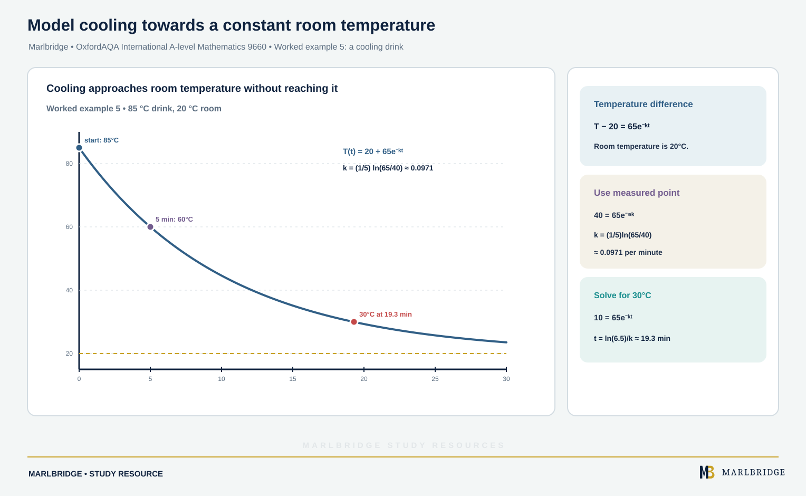

This guide covers section P2.8 (Differential equations) of the OxfordAQA International AS and A-level Mathematics (9660) specification, Version 5.2. Unit P2 (Pure Maths) is part of the International A-level (A2), and this content does not appear at International AS. You need two skills: forming a simple differential equation from a description, including growth and decay, and solving a first-order equation with separable variables, including in practical problems.

Related pages: [revision notes](/resources/oxfordaqa-a-level-mathematics-forming-and-solving-first-order-differential-equations-revision-notes/), [practice questions](/resources/oxfordaqa-a-level-mathematics-forming-and-solving-first-order-differential-equations-practice/), the [course hub](/boards/oxfordaqa/a-level/mathematics/), the [printable checklist](/checklists/oxfordaqa/a-level/mathematics/) and the [free 10-minute diagnostics](/diagnostics/).

## What P2.8 asks for

| Spec content | What you must be able to do |
|---|---|
| Formation of simple differential equations | Turn a sentence about a rate of change into an equation. Include growth and decay contexts. |
| Analytical solution of simple first-order equations with separable variables | Separate, integrate, find the constant and give y or the quantity as a function. Include applications to practical problems. |

"Analytical" means you find a formula by integration, not a numerical estimate.

## What a differential equation is

A differential equation connects a quantity with how fast it is changing. First order means the highest derivative is the first one: dy/dx or dN/dt, never d²y/dx². The general solution contains one arbitrary constant. A particular solution uses extra information (an initial condition such as y = 3 when x = 0) to fix that constant.

## Forming differential equations

Read the sentence in three parts: the quantity, the rate, and the link between them.

- "Rate of change of N" means dN/dt (change in N with respect to time t).
- "Proportional to" means multiply by a constant k. Write the constant in, do not guess its value yet.
- "Inversely proportional to" means k divided by the quantity.
- Increase gives a positive rate. Decrease gives a negative rate.

| Statement | Equation |
|---|---|
| Population P increases in proportion to P | dP/dt = kP, with k > 0 |
| Mass m falls in proportion to m | dm/dt = −km, with k > 0 |
| The temperature T falls at a rate proportional to the excess over the surroundings temperature S | dT/dt = −k(T − S), with k > 0 |
| The depth h falls at a rate proportional to √h | dh/dt = −k√h, with k > 0 |

The minus sign is your choice to show a decrease with k positive. If you write dm/dt = km with k < 0 instead, the working is the same and k comes out negative. Say which convention you use.

Some contexts give a rate of change of a different quantity, so you need the chain rule to connect them.

### Worked example 1: forming with the chain rule

A solid ice sphere melts, losing volume V at a rate that is proportional to its surface area. Show that its radius r decreases at a constant rate.

```
V = (4/3)πr³, surface area S = 4πr²
dV/dt = −k × 4πr²                  (k > 0)
dV/dr = 4πr²
dr/dt = (dV/dt) ÷ (dV/dr) = −k × 4πr² ÷ 4πr² = −k
```

So dr/dt = −k, a constant. The radius falls at a constant rate.

<figure class="topic-figure">
  
  <figcaption>The constant A gives a whole family of solutions; an initial condition picks out one curve.</figcaption>
</figure>

<figure class="topic-figure">
  
  <figcaption>Each thin slice is nearly a disc of volume πy² δx; adding them gives the volume of revolution.</figcaption>
</figure>


## Solving by separation of variables

An equation is separable when the right side factorises into a function of x multiplied by a function of y, that is dy/dx = f(x) × g(y), which is a product of two separate factors.

Method:

1. Write dy/dx = f(x)g(y).
2. Move all y terms to one side with dy, all x terms to the other with dx: (1/g(y)) dy = f(x) dx.
3. Integrate each side: ∫ 1/g(y) dy = ∫ f(x) dx. Add a single +c to one side only.
4. Use the initial condition to find c.
5. Rearrange for y if the question asks for it, or if it is neat.

The step "multiply by dx" is shorthand. It is justified because integrating (1/g(y)) dy/dx with respect to x gives the integral of 1/g(y) with respect to y.

### Worked example 2: a pure algebra equation

Solve dy/dx = (4x + 2)/(3y²), given y = 1 when x = 0.

```
3y² dy = (4x + 2) dx
∫ 3y² dy = ∫ (4x + 2) dx
y³ = 2x² + 2x + c
x = 0, y = 1:  1 = c
y³ = 2x² + 2x + 1
y = (2x² + 2x + 1)^(1/3)
```

### Worked example 3: logarithms on both sides

Solve dy/dx = 2y/(x + 3) for x > −3, y > 0, given y = 32 when x = 1.

```
(1/y) dy = 2/(x + 3) dx
ln y = 2 ln(x + 3) + c
```

Write the constant as ln A to combine the logarithms.

```
ln y = ln(x + 3)² + ln A = ln[A(x + 3)²]
y = A(x + 3)²
x = 1, y = 32:  32 = A × 16, so A = 2
y = 2(x + 3)²
```

Taking exponentials of ln y = 2 ln(x + 3) + c gives y = e^c (x + 3)², and e^c is just another positive constant. Writing it as A from the start is quicker.

## Exponential growth and decay

When dy/dt = ky, separating gives ln y = kt + c, so y = Ae^(kt), where A is the starting value (when t = 0). If k > 0 this is growth. For decay, dy/dt = −ky gives y = Ae^(−kt).

Two time measures often appear:

- Doubling time for growth: A e^(kT) = 2A gives T = (ln 2)/k.
- Half-life for decay: T = (ln 2)/k.

Neither depends on the starting amount.

### Worked example 4: radioactive decay

A sample has mass 50 g. After 4 hours it is 38 g. Its mass m grams decays at a rate proportional to m. Find the half-life and the mass after 10 hours.

```
dm/dt = −km  →  m = 50e^(−kt)
t = 4, m = 38:  38 = 50e^(−4k)
e^(−4k) = 38/50
k = (1/4) ln(50/38) = 0.0686 (3 s.f.)
Half-life = (ln 2)/k = 10.1 hours (3 s.f.)
m(10) = 50e^(−10k) = 50 × (38/50)^2.5 = 25.2 g (3 s.f.)
```

Keep k in exact form until the last step. Rounding k early shifts later answers.

<figure class="topic-figure">
  
  <figcaption>Equal time steps halve the mass because the rate is proportional to what is left.</figcaption>
</figure>


## Cooling towards a constant

Newton's law of cooling gives dT/dt = −k(T − S), where S is the surroundings temperature. Substitute u = T − S, or separate directly and use ln(T − S).

### Worked example 5: a cooling drink

<!-- marlbridge-diagram:math-b72-oxfordaqa-newton-cooling-toward-limit -->
<figure class="lesson-diagram" style="margin: 2rem 0;">
  <a href="/public/images/learning/mathematics/math-b72-oxfordaqa-newton-cooling-toward-limit.svg" aria-label="Open full-size diagram: math-b72-oxfordaqa-newton-cooling-toward-limit"></a>
  <figcaption>Exponential cooling curve from 85°C through 60°C at 5 minutes to 30°C at about 19.3 minutes, approaching the 20°C room-temperature asymptote.</figcaption>
</figure>
<!-- /marlbridge-diagram:math-b72-oxfordaqa-newton-cooling-toward-limit -->


A drink at 85 °C is left in a room at 20 °C. Its temperature T satisfies dT/dt = −k(T − 20), with t in minutes. After 5 minutes T = 60. Find when T reaches 30 °C.

```
dT/(T − 20) = −k dt
ln(T − 20) = −kt + c           (T > 20 throughout)
T − 20 = Be^(−kt)
t = 0, T = 85:  B = 65
t = 5, T = 60:  40 = 65e^(−5k)  →  k = (1/5) ln(65/40) = 0.0971
T = 30:  10 = 65e^(−kt)  →  t = ln(6.5)/k = 19.3 minutes
```

The temperature approaches 20 °C but never reaches it. That is why the model uses T − 20, not T.

<figure class="topic-figure">
  
  <figcaption>The temperature approaches room temperature but never reaches it, because the model uses the gap T − 20.</figcaption>
</figure>


## Practical problems that are not exponential

### Worked example 6: a draining tank

Water drains from a tank. The depth h metres satisfies dh/dt = −k√h, with t in minutes. Initially h = 4. After 10 minutes h = 2.25. Find k and the time to empty.

```
h^(−1/2) dh = −k dt
2h^(1/2) = −kt + c
t = 0, h = 4:  4 = c
√h = 2 − kt/2
t = 10, h = 2.25:  1.5 = 2 − 5k  →  k = 0.1
Empty when √h = 0:  2 − 0.05t = 0  →  t = 40 minutes
```

The tank empties in finite time. An exponential model never reaches zero, so the form of the equation matters.

### Worked example 7: rate in, rate out

A patient receives a drug by a steady infusion. The amount x mg in the body satisfies dx/dt = 6 − 0.3x, with t in hours and x = 0 at t = 0. The rate in is 6 mg per hour. The rate out is proportional to the amount present. Solve the equation and find the long-term amount.

```
dx/(6 − 0.3x) = dt
−(1/0.3) ln(6 − 0.3x) = t + c
ln(6 − 0.3x) = −0.3t − 0.3c
6 − 0.3x = Be^(−0.3t)
x = 0, t = 0:  B = 6
x = 20 − 20e^(−0.3t) = 20(1 − e^(−0.3t))
t → ∞:  x → 20 mg
```

At t = 5 hours the amount is 15.5 mg (3 s.f.). Rate in minus rate out is the pattern for mixing, infusion and filling problems.

<figure class="topic-figure">
  
  <figcaption>The long-term amount is where the rate in equals the rate out.</figcaption>
</figure>

<figure class="topic-figure">
  
  <figcaption>The form of the equation decides whether the tank empties in finite time.</figcaption>
</figure>

<figure class="topic-figure">
  
  <figcaption>When x runs backwards, take the limits in the order that makes x increase, otherwise the area comes out negative.</figcaption>
</figure>


## Common errors

- Putting +c on both sides. One constant is enough.
- Integrating y terms with respect to x. Everything with y goes with dy.
- Dropping the constant before using the initial condition. Find c immediately after integrating.
- Writing ln(y) = kt + c and then y = kt + c. Exponentiate the whole of the right side.
- Mixing up the sign of k. State "k > 0" and put the minus sign in the equation for decay.
- Quoting a rounded k in later working. Use the exact expression.
- Forgetting the units or the meaning of t = 0 in a context question.
- Leaving a solution as ln y = ... when the question asks for y in terms of x or t.

## Next steps

Condense this with the [revision notes](/resources/oxfordaqa-a-level-mathematics-forming-and-solving-first-order-differential-equations-revision-notes/), then test yourself with the [practice questions](/resources/oxfordaqa-a-level-mathematics-forming-and-solving-first-order-differential-equations-practice/). Integration skills from Unit P1 are reviewed in the [Pure Maths 1 study guide](/resources/a-level-oxfordaqa-mathematics-unit-p1/). Use the [free 10-minute diagnostics](/diagnostics/) to find weak areas.

<figure class="topic-figure">
  
  <figcaption>Dividing by y − 4 hides the constant solution y = 4, which is the case A = 0.</figcaption>
</figure>

## Frequently asked questions

**What is a first-order differential equation?**
A differential equation connects a quantity with how fast it is changing. First order means the highest derivative in it is a first derivative such as dy/dx.

**How do you know if a differential equation is separable?**
It is separable when the right-hand side factorises as a function of x multiplied by a function of y. dy/dx = x + y is not separable, because it cannot be written that way.

**How do you find the half-life from an exponential decay model?**
For y = Ae^(−kt), the half-life is (ln 2)/k. The doubling time for growth y = Ae^(kt) is also (ln 2)/k.

**What does Newton's law of cooling say?**
It says the temperature T falls at a rate proportional to its excess over the surroundings temperature S, so dT/dt = −k(T − S) with k > 0. The temperature tends towards S over time.

**What is in section P2.8 of the OxfordAQA 9660 specification?**
P2.8 covers forming simple differential equations from statements about rates of change, and finding analytical solutions of simple first-order equations with separable variables.

## Official syllabus

OxfordAQA International AS and A-level Mathematics (9660), Version 5.2 (International AS exams from May/June 2018, A-level from May/June 2019), published by OxfordAQA. This guide covers section P2.8 of Unit P2.
