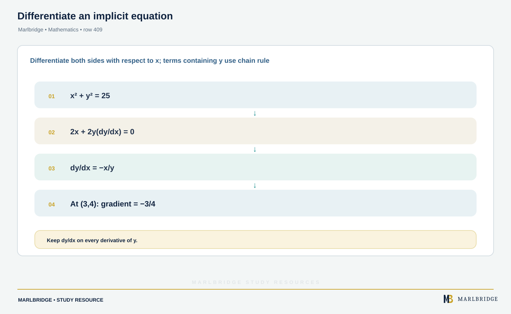
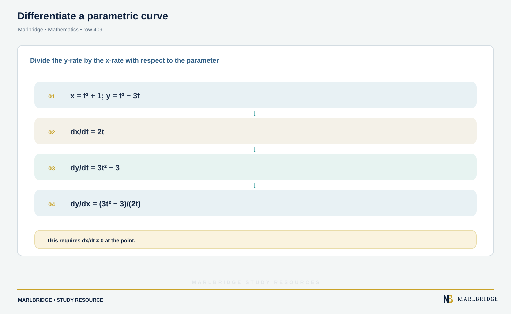
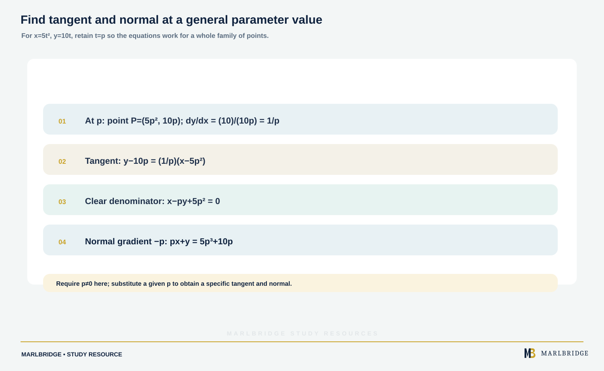
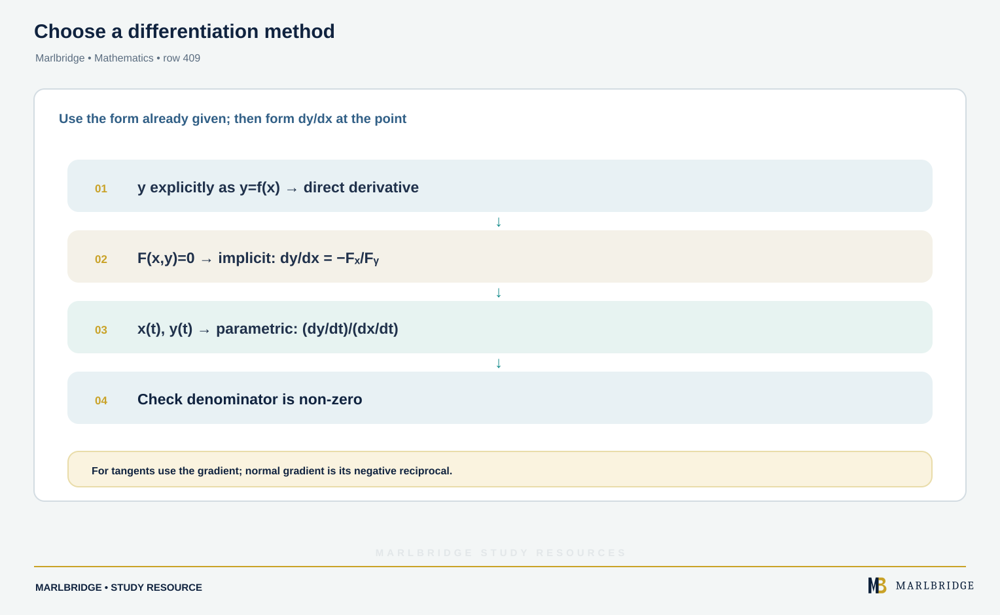

This guide follows the OxfordAQA International AS and A-level Mathematics (9660) specification, Version 5.2. It covers the second part of content area P2.6: differentiating curves defined implicitly or parametrically, and finding the equations of their tangents and normals. The specification places this content in International A-level (A2) Unit P2 (Pure Maths). It is not examined at International AS. Second derivatives of implicit or parametric curves are not required.

You need the derivatives and rules from the first part of P2.6 (exponentials, logarithms, trigonometric functions, product, quotient and chain rules). They are used here without being re-taught.

Related pages: [revision notes](/resources/oxfordaqa-a-level-mathematics-implicit-and-parametric-differentiation-tangents-and-revision-notes/), [practice questions](/resources/oxfordaqa-a-level-mathematics-implicit-and-parametric-differentiation-tangents-and-practice/), [course hub](/boards/oxfordaqa/a-level/mathematics/), [printable checklist](/checklists/oxfordaqa/a-level/mathematics/), [free diagnostics](/diagnostics/), [P1 differentiation](/resources/oxfordaqa-a-level-mathematics-differentiation-gradients-tangents-normals-and/) and [parametric equations](/resources/oxfordaqa-a-level-mathematics-parametric-equations-and-exponential-and-logarithmic/).

## What this unit covers

| Spec | What you must be able to do | Section |
|---|---|---|
| P2.6 | Differentiate simple functions defined implicitly | 1 |
| P2.6 | Find tangents and normals for curves specified implicitly | 2 |
| P2.6 | Differentiate simple functions defined parametrically | 3 |
| P2.6 | Find tangents and normals for parametric curves, including at a general point | 4 and 5 |

## 1. Differentiating implicitly

<figure class="learning-diagram" style="margin:1.5rem 0;"><a href="/public/images/learning/mathematics/math-sub-409-implicit-differentiation.svg" aria-label="Open full-size diagram: math-sub-409-implicit-differentiation"></a><figcaption>Differentiate an implicit equation — Marlbridge Mathematics</figcaption></figure>

Some curves cannot be rearranged into y = f(x), for example x²y + xy² = 12. You still want dy/dx. Differentiate every term with respect to x and treat y as an unknown function of x. The chain rule then gives

```
d/dx (yⁿ) = n yⁿ⁻¹ × dy/dx
```

The extra factor dy/dx appears on every term that contains y, and on nothing else.

| Term | Derivative with respect to x |
|---|---|
| y⁴ | 4y³ dy/dx |
| 3x² | 6x |
| xy | y + x dy/dx (product rule) |
| x²y³ | 2xy³ + 3x²y² dy/dx |
| sin 3y | 3 cos 3y × dy/dx |
| e²ʸ | 2e²ʸ × dy/dx |
| ln y | (1/y) × dy/dx |

**Method.**
1. Differentiate both sides term by term. Use the product rule on any term that multiplies x-parts by y-parts.
2. Collect every term containing dy/dx on one side and everything else on the other.
3. Factorise out dy/dx and divide.

The answer is usually written in terms of both x and y. You need both coordinates of a point to find its gradient, and the point must lie on the curve.

<figure class="topic-figure">
  
  <figcaption>The gradient of the composite is the product of the two gradients: 16 × 0.1 = 1.6.</figcaption>
</figure>


## 2. Tangents and normals for implicit curves

<!-- marlbridge-diagram:math-final-409-implicit-curve-tangent-normal -->
<figure class="lesson-diagram" style="margin: 2rem 0;">
  <a href="/images/learning/mathematics/math-final-409-implicit-curve-tangent-normal.svg" aria-label="Open full-size diagram: math-final-409-implicit-curve-tangent-normal"></a>
  <figcaption>Implicit curve through (1,3), with its tangent and perpendicular normal shown and labeled by their exact equations.</figcaption>
</figure>
<!-- /marlbridge-diagram:math-final-409-implicit-curve-tangent-normal -->


Once you have the gradient m of the tangent at (a, b), use y − b = m(x − a). The normal is perpendicular to the tangent, so its gradient is −1/m (if m ≠ 0).

**Worked example 1.** The curve C has equation x²y + xy² = 12. Find the tangent and normal at (1, 3).

```
Check: 1²(3) + 1(3²) = 3 + 9 = 12, so (1, 3) lies on C.
Differentiate: 2xy + x² dy/dx + y² + 2xy dy/dx = 0
Collect:       dy/dx (x² + 2xy) = −(2xy + y²)
               dy/dx = −(2xy + y²)/(x² + 2xy)
At (1, 3):     dy/dx = −(6 + 9)/(1 + 6) = −15/7
Tangent:       y − 3 = −(15/7)(x − 1)  →  15x + 7y = 36
Normal gradient: 7/15
Normal:        y − 3 = (7/15)(x − 1)   →  7x − 15y + 38 = 0
```

**Worked example 2.** A curve has equation ln y + xy = 2. Find the tangent and normal at (2, 1).

```
Check: ln 1 + 2(1) = 2.
Differentiate: (1/y) dy/dx + y + x dy/dx = 0
Collect:       dy/dx (1/y + x) = −y
               dy/dx = −y/(1/y + x) = −y²/(1 + xy)
At (2, 1):     dy/dx = −1/3
Tangent:       y − 1 = −(1/3)(x − 2)  →  x + 3y = 5
Normal:        y − 1 = 3(x − 2)       →  y = 3x − 5
```

**Horizontal and vertical tangents.** A tangent is horizontal where the numerator of dy/dx is zero and the denominator is not. It is vertical where the denominator is zero and the numerator is not. Use the equation of the curve to find the other coordinate.

**Worked example 3.** Find the points on x² − xy + y² = 12 where the tangent is horizontal or vertical.

```
Differentiate: 2x − y − x dy/dx + 2y dy/dx = 0
               dy/dx = (2x − y)/(x − 2y)

Horizontal: 2x − y = 0, so y = 2x.
  x² − 2x² + 4x² = 12  →  3x² = 12  →  x = ±2
  Points (2, 4) and (−2, −4).

Vertical: x − 2y = 0, so x = 2y.
  4y² − 2y² + y² = 12  →  3y² = 12  →  y = ±2
  Points (4, 2) and (−4, −2).
```

At each point the other factor is non-zero (at (2, 4) the denominator is 2 − 8 = −6), so the classification is safe. At a vertical tangent the normal is horizontal, and the other way round.

<figure class="topic-figure">
  
  <figcaption>The tangent and normal at P(2, 3) are perpendicular because their gradients multiply to −1.</figcaption>
</figure>

<figure class="topic-figure">
  
  <figcaption>Horizontal tangents occur where the numerator of dy/dx is zero and vertical tangents where the denominator is zero.</figcaption>
</figure>


## 3. Differentiating parametric curves

<figure class="learning-diagram" style="margin:1.5rem 0;"><a href="/public/images/learning/mathematics/math-sub-409-parametric-differentiation.svg" aria-label="Open full-size diagram: math-sub-409-parametric-differentiation"></a><figcaption>Differentiate a parametric curve — Marlbridge Mathematics</figcaption></figure>

A parametric curve has x = f(t), y = g(t). Both coordinates change with t, so the chain rule gives

```
dy/dx = (dy/dt) ÷ (dx/dt)
```

Differentiate each equation separately, then divide. Simplify if you can, and leave the result in terms of t. The result is a gradient at the point with that value of t. It is not a function of x unless you convert it.

**Worked example 4.** A curve has x = t³ + 2t and y = 3t² − 5. Find the tangent and normal at the point where t = 1.

```
dx/dt = 3t² + 2        dy/dt = 6t
dy/dx = 6t/(3t² + 2)
At t = 1:  dy/dx = 6/5
Point:     x = 1 + 2 = 3,  y = 3 − 5 = −2   →  (3, −2)
Tangent:   y + 2 = (6/5)(x − 3)    →  6x − 5y − 28 = 0
Normal:    y + 2 = −(5/6)(x − 3)   →  5x + 6y − 3 = 0
```

**Worked example 5.** A curve has x = sin 2t and y = cos t. Find the exact tangent at t = π/6.

```
dx/dt = 2 cos 2t       dy/dt = −sin t
dy/dx = −sin t/(2 cos 2t)
At t = π/6:  dy/dx = −(1/2)/(2 × 1/2) = −1/2
Point:       x = sin(π/3) = √3/2,  y = cos(π/6) = √3/2
Tangent:     y − √3/2 = −(1/2)(x − √3/2)
             x + 2y = 3√3/2
```

**Special values of t.** The tangent is horizontal where dy/dt = 0 and dx/dt ≠ 0. It is vertical where dx/dt = 0 and dy/dt ≠ 0. If both are zero, the formula gives 0/0 and the gradient needs more care. At the simple curves met in this unit that rarely happens.

<figure class="topic-figure">
  
  <figcaption>At t = 2 the gradient is dy/dt ÷ dx/dt = 9/6, with the normal gradient −2/3.</figcaption>
</figure>


## 4. Tangents and normals at a general point

<figure class="learning-diagram" style="margin:1.5rem 0;"><a href="/public/images/learning/mathematics/math-sub-409-general-tangent-normal.svg" aria-label="Open full-size diagram: math-sub-409-general-tangent-normal"></a><figcaption>Find tangent and normal at a general parameter value — Marlbridge Mathematics</figcaption></figure>

"At a general point" means you keep the parameter as a letter. Write the point as the one with t = p, find the gradient in terms of p, and build the equation. The answer contains x, y and p. Simplify it into a clean form.

**Worked example 6.** The curve C has x = 5t² and y = 10t. Find the equations of the tangent and normal at the point P where t = p (p ≠ 0).

```
dx/dt = 10t     dy/dt = 10     dy/dx = 1/t
At P:  point (5p², 10p), gradient 1/p
Tangent: y − 10p = (1/p)(x − 5p²)
         py − 10p² = x − 5p²
         x − py + 5p² = 0
Normal gradient: −p
Normal:  y − 10p = −p(x − 5p²)
         px + y = 5p³ + 10p
```

You can now use the result. The tangent meets the x-axis where y = 0, so x = −5p². If a tangent passes through (−20, 0), then −5p² = −20 and p = ±2. The points of contact are (20, 20) and (20, −20).

**Worked example 7.** An ellipse has x = 3 cos θ and y = 2 sin θ. Show that the tangent at the point where θ = φ has equation 2x cos φ + 3y sin φ = 6.

```
dx/dθ = −3 sin θ     dy/dθ = 2 cos θ
dy/dx = −2 cos θ/(3 sin θ)
At θ = φ:  y − 2 sin φ = −(2 cos φ)/(3 sin φ) × (x − 3 cos φ)
Multiply by 3 sin φ:
  3y sin φ − 6 sin²φ = −2x cos φ + 6 cos²φ
  2x cos φ + 3y sin φ = 6(sin²φ + cos²φ) = 6
```

This uses sin²φ + cos²φ = 1, a step you should always look for. At φ = π/3 the point is (3/2, √3) and the tangent is x + (3√3/2)y = 6.

<figure class="topic-figure">
  
  <figcaption>How chord gradients 12 + 2h approach the tangent gradient 12 at x = 3 on y = 2x².</figcaption>
</figure>

<figure class="topic-figure">
  
  <figcaption>The slope of eˣ equals its height and the slope of ln x at x is 1/x.</figcaption>
</figure>


## 5. Choosing between methods

<figure class="learning-diagram" style="margin:1.5rem 0;"><a href="/public/images/learning/mathematics/math-sub-409-choose-differentiation-method.svg" aria-label="Open full-size diagram: math-sub-409-choose-differentiation-method"></a><figcaption>Choose a differentiation method — Marlbridge Mathematics</figcaption></figure>

If you can eliminate the parameter, check your result with the Cartesian form, but you are not required to. When the question says "parametric", use dy/dx = (dy/dt) ÷ (dx/dt) and show dx/dt and dy/dt. To find the point, substitute the given value of t into both equations. To find t from a point, solve one coordinate equation and check it in the other.

## Common errors

- Forgetting the dy/dx factor on a y-term, so y³ becomes 3y² instead of 3y² dy/dx.
- Missing the product rule on xy or x²y terms.
- Writing dx/dt ÷ dy/dt. The gradient has dy on top.
- Using the tangent gradient for the normal, or forgetting to negate and invert.
- Substituting a point that does not lie on the curve into a dy/dx expression. Check it first.
- Finding the gradient at t = a but then using the wrong point for the line.
- Leaving a general-point equation as a fraction with p in the denominator. Multiply through to tidy it.
- Dividing by sin φ or p without noting that it must not be zero.

## Next steps

Condense these methods with the [revision notes](/resources/oxfordaqa-a-level-mathematics-implicit-and-parametric-differentiation-tangents-and-revision-notes/), then test yourself on the [practice questions](/resources/oxfordaqa-a-level-mathematics-implicit-and-parametric-differentiation-tangents-and-practice/). Use the [free diagnostics](/diagnostics/) to find any gaps and the [checklist](/checklists/oxfordaqa/a-level/mathematics/) to track progress.

<figure class="topic-figure">
  
  <figcaption>Why the product rule has two terms: the rectangle area uv grows by v du + u dv.</figcaption>
</figure>


## Official syllabus

OxfordAQA International AS and A-level Mathematics (9660) specification, Version 5.2, published by OxfordAQA. Content area P2.6: Differentiation.
