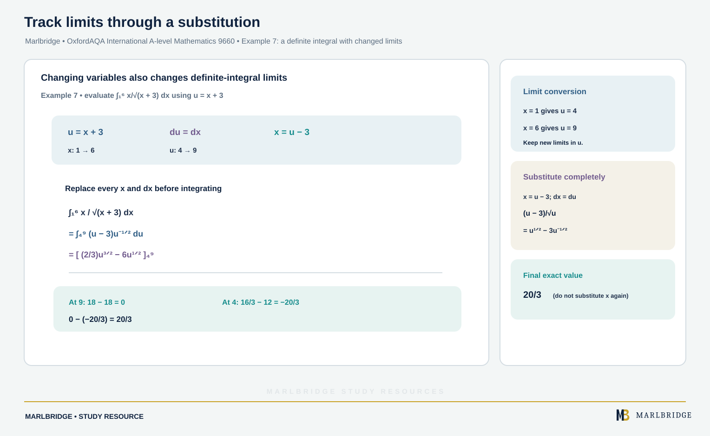

This guide covers the first part of section P2.7 (Integration) of the OxfordAQA International AS and A-level Mathematics (9660) specification, Version 5.2: the standard integrals of eˣ, 1/x, sin x and cos x, the reverse chain rule by inspection and by substitution, and integrals of the form f′(x)/f(x). The specification places this content in International A-level (A2) Unit P2 (Pure Maths); it is not examined at International AS. Integration by parts, partial fractions and volumes of revolution are the other parts of P2.7 and are not covered here. Pair this guide with the [revision notes](/resources/oxfordaqa-a-level-mathematics-integration-by-inspection-and-substitution-revision-notes/) and the [practice questions](/resources/oxfordaqa-a-level-mathematics-integration-by-inspection-and-substitution-practice/). The basics of integrating powers are in the [P1.4 integration guide](/resources/oxfordaqa-a-level-mathematics-integration-indefinite-definite-integrals-areas-and/). The course home is the [OxfordAQA A-level Mathematics hub](/boards/oxfordaqa/a-level/mathematics/), with a [printable checklist](/checklists/oxfordaqa/a-level/mathematics/). If you are unsure where you stand, take a [free diagnostic](/diagnostics/) first.

## What this unit asks you to do

| Specification content | What you must be able to do |
|---|---|
| Integration of eˣ, 1/x, sin x, cos x | Integrate these, and the versions with a linear argument such as e^(kx), sin kx, cos kx |
| Reverse chain rule by inspection | Spot that the integrand looks like a derivative from the chain rule, write down the answer and adjust the constant factor |
| Integration by substitution | Choose u, rewrite the whole integral in u, integrate, and return to x (or change the limits) |
| f′(x)/f(x) | Recognise it, and write the integral as ln\|f(x)\| + c |

The specification treats inspection and substitution as the reverse process of the chain rule. If you are rusty on the chain rule, revise the [differentiation guide](/resources/oxfordaqa-a-level-mathematics-differentiation-gradients-tangents-normals-and/) first. Every result below can be checked by differentiating your answer, and you should get into the habit of doing so.

## Standard integrals, including a linear argument

Angles are in radians throughout. In each row, k and a are non-zero constants.

| Integrand | Integral |
|---|---|
| eˣ | eˣ + c |
| e^(kx) | e^(kx)/k + c |
| 1/x | ln\|x\| + c |
| 1/(ax + b) | (1/a) ln\|ax + b\| + c |
| sin kx | −cos(kx)/k + c |
| cos kx | sin(kx)/k + c |

The factor 1/k appears because differentiating e^(kx) brings down a factor k. To undo that, divide by k. The modulus signs in ln|x| are needed because 1/x exists for negative x, where ln x does not.

### Example 1: a mixed integral

Find ∫ (10e^(−x/2) − 7 sin 2x + 4/x) dx, for x > 0.

```
∫ 10e^(−x/2) dx = 10 × e^(−x/2)/(−½) = −20e^(−x/2)
∫ 7 sin 2x dx   = 7 × (−cos(2x)/2) = −(7/2) cos 2x
∫ 4/x dx        = 4 ln x
```

The middle term has a minus sign in front of it, so it contributes +(7/2) cos 2x. The integral is −20e^(−x/2) + (7/2) cos 2x + 4 ln x + c.

Check: differentiating −20e^(−x/2) gives 10e^(−x/2), and differentiating (7/2) cos 2x gives −7 sin 2x. Both match.

<figure class="topic-figure">
  
  <figcaption>The area between two curves is the integral of the top curve minus the bottom curve.</figcaption>
</figure>

<figure class="topic-figure">
  
  <figcaption>Integration by parts is the statement that two complementary areas fill a rectangle.</figcaption>
</figure>


### Example 2: definite integrals

Evaluate (a) ∫ from 0 to π/6 of cos 3x dx and (b) ∫ from 1 to 4 of 1/(2x − 1) dx.

(a) The antiderivative is sin(3x)/3.

```
[sin(3x)/3] from 0 to π/6 = sin(π/2)/3 − sin 0/3 = 1/3
```

(b) The antiderivative is ½ ln|2x − 1|. On the interval from 1 to 4, 2x − 1 runs from 1 to 7 and stays positive.

```
[½ ln(2x − 1)] from 1 to 4 = ½ ln 7 − ½ ln 1 = ½ ln 7
```

The exact answer is ½ ln 7 (about 0.973). Keep answers exact when the question says "exact" or "in terms of ln".

<figure class="topic-figure">
  
  <figcaption>Regions below the axis give negative integrals, so find the area in separate pieces.</figcaption>
</figure>

<figure class="topic-figure">
  
  <figcaption>As strips get thinner, the rectangle sums close in on the integral.</figcaption>
</figure>

<figure class="topic-figure">
  
  <figcaption>An infinitely long region can still have a finite area.</figcaption>
</figure>

<figure class="topic-figure">
  
  <figcaption>With a substitution, convert the limits and the definite integral keeps its value.</figcaption>
</figure>


## The reverse chain rule by inspection

The chain rule says that d/dx [F(g(x))] = F′(g(x)) × g′(x). Reading it backwards:

```
∫ F′(g(x)) × g′(x) dx = F(g(x)) + c
```

You are looking for an integrand made of an "inside" function g(x) and a copy of its derivative g′(x) (possibly missing a constant factor). The method has four steps.

1. Spot the inside function g(x) and check that its derivative appears, up to a constant.
2. Write down the answer as if the derivative were present.
3. Differentiate your guess and compare it with the integrand.
4. Divide or multiply by the constant needed to match.

### Example 3: power of a bracket

Find ∫ x(4x² − 5)³ dx.

The inside function is g = 4x² − 5, with g′ = 8x. The integrand has x, which is g′/8.

```
Guess: (4x² − 5)⁴
Differentiate: 4(4x² − 5)³ × 8x = 32x(4x² − 5)³
```

That is 32 times too large, so divide by 32.

```
∫ x(4x² − 5)³ dx = (4x² − 5)⁴/32 + c
```

### Example 4: exponential and trigonometric inside functions

(a) Evaluate ∫ from 0 to 1 of x e^(5 − 2x²) dx.

The inside function is 5 − 2x², with derivative −4x. Differentiating e^(5 − 2x²) gives −4x e^(5 − 2x²), so the antiderivative of x e^(5 − 2x²) is −¼ e^(5 − 2x²).

```
[−¼ e^(5 − 2x²)] from 0 to 1 = −¼ e³ + ¼ e⁵ = (e⁵ − e³)/4
```

(b) Find ∫ sin x cos³x dx.

The inside function is cos x, with derivative −sin x. Differentiating cos⁴x gives −4cos³x sin x, so

```
∫ sin x cos³x dx = −cos⁴x/4 + c
```

## Integrals of the form f′(x)/f(x)

Differentiating ln|f(x)| gives f′(x)/f(x). So

```
∫ f′(x)/f(x) dx = ln|f(x)| + c
```

The numerator must be the derivative of the denominator, up to a constant factor. Take the constant outside the integral and apply the result.

### Example 5: three recognitions

(a) ∫ (6x − 4)/(3x² − 4x + 7) dx. The derivative of the denominator is 6x − 4, which is exactly the numerator. The answer is ln(3x² − 4x + 7) + c. The quadratic has a negative discriminant, so it is always positive and the modulus signs can be dropped.

(b) ∫ x²/(x³ + 5) dx. The derivative of x³ + 5 is 3x², so the numerator is one third of it. The answer is ⅓ ln|x³ + 5| + c.

(c) ∫ from π/6 to π/3 of cot x dx, where cot x = cos x/sin x. The derivative of sin x is cos x, so the numerator is exactly the derivative of the denominator.

```
∫ cot x dx = ln|sin x| + c
[ln(sin x)] from π/6 to π/3 = ln(√3/2) − ln(1/2) = ln √3 = ½ ln 3
```

## Integration by substitution

When the match is not obvious, substitute. The method is the same each time.

1. Choose u, usually the inside function or the awkward bracket.
2. Differentiate: du/dx = ..., then write dx = du/(du/dx) or du = (...) dx.
3. Replace every x in the integrand, including dx. If an x is left over, rearrange u = ... to write x in terms of u.
4. For a definite integral, change the limits using u = ... at each x-limit.
5. Integrate with respect to u. For an indefinite integral, put x back at the end.

If you change the limits, you do not go back to x. If you keep the original limits, you must write the answer in x before using them. Mixing the two is a common way to lose marks.

### Example 6: a leftover x

Find ∫ x(3x − 2)⁴ dx using u = 3x − 2.

```
u = 3x − 2  →  du = 3 dx  →  dx = du/3,   x = (u + 2)/3
∫ x(3x − 2)⁴ dx = ∫ ((u + 2)/3) × u⁴ × (du/3)
                = (1/9) ∫ (u⁵ + 2u⁴) du
                = (1/9)(u⁶/6 + 2u⁵/5) + c
                = u⁶/54 + 2u⁵/45 + c
```

Replace u by 3x − 2 to finish: (3x − 2)⁶/54 + 2(3x − 2)⁵/45 + c.

### Example 7: a definite integral with changed limits

<!-- marlbridge-diagram:math-b70-oxfordaqa-substitution-changed-limits -->
<figure class="lesson-diagram" style="margin: 2rem 0;">
  <a href="/public/images/learning/mathematics/math-b70-oxfordaqa-substitution-changed-limits.svg" aria-label="Open full-size diagram: math-b70-oxfordaqa-substitution-changed-limits"></a>
  <figcaption>A step-by-step substitution changes x-limits 1 and 6 to u-limits 4 and 9, rewrites the integrand, and evaluates the exact result 20/3.</figcaption>
</figure>
<!-- /marlbridge-diagram:math-b70-oxfordaqa-substitution-changed-limits -->


Evaluate ∫ from 1 to 6 of x/√(x + 3) dx using u = x + 3.

```
u = x + 3  →  du = dx,   x = u − 3
Limits: x = 1 → u = 4;   x = 6 → u = 9
∫ x/√(x + 3) dx = ∫ from 4 to 9 of (u − 3) u^(−1/2) du
                = ∫ (u^(1/2) − 3u^(−1/2)) du
                = [ (2/3)u^(3/2) − 6u^(1/2) ] from 4 to 9
At u = 9: (2/3)(27) − 6(3) = 18 − 18 = 0
At u = 4: (2/3)(8) − 6(2) = 16/3 − 12 = −20/3
0 − (−20/3) = 20/3
```

The answer is 20/3.

### Example 8: a trigonometric substitution

Evaluate ∫ from 0 to π/2 of cos x √(1 + 3 sin x) dx using u = 1 + 3 sin x.

```
du = 3 cos x dx  →  cos x dx = du/3
Limits: x = 0 → u = 1;   x = π/2 → u = 4
∫ from 1 to 4 of √u × (du/3) = ⅓ [ (2/3)u^(3/2) ] from 1 to 4
                             = (2/9)(8 − 1) = 14/9
```

This one could also be done by inspection. Both methods must agree, which makes a useful check.

<figure class="topic-figure">
  
  <figcaption>Integrating gives a family of curves; a known point picks out one of them.</figcaption>
</figure>

<figure class="topic-figure">
  
  <figcaption>Splitting into partial fractions splits the area into two simple logarithmic bands.</figcaption>
</figure>


## Choosing between the methods

Try inspection first when the integrand is one function of g(x) multiplied by g′(x), or divided by g(x). Use substitution when a factor of x is left over that is not the derivative of the inside function, as in Examples 6 and 7. When a question says "use the substitution u = ...", follow it exactly, because the working is usually what earns the credit. A "show that" question needs every step of the substitution written out.

## Common errors

- Writing k e^(kx) as the integral of e^(kx), when the factor has to be 1/k.
- Writing ∫ 1/(3x + 2) dx = ln|3x + 2| and leaving out the factor ⅓.
- Applying the f′/f rule when the numerator is not a multiple of the derivative. For example, ∫ 1/(x² + 1) dx is not ln(x² + 1), and ∫ x/(x + 1) dx is not a ln integral either.
- Giving cos(kx)/k for ∫ sin kx dx. The correct result is −cos(kx)/k.
- Leaving x in the integrand after substituting, or forgetting to replace dx.
- Changing the limits to u-values, then substituting x-values into the answer (or the reverse).
- Using degrees. These integrals assume radians.
- Missing + c on an indefinite integral.

## Next steps

Try the [practice questions](/resources/oxfordaqa-a-level-mathematics-integration-by-inspection-and-substitution-practice/), then use the [revision notes](/resources/oxfordaqa-a-level-mathematics-integration-by-inspection-and-substitution-revision-notes/) to recall the results quickly. Tick off the topic on the [checklist](/checklists/oxfordaqa/a-level/mathematics/).

## Official syllabus

OxfordAQA International AS and A-level Mathematics (9660), Version 5.2, published by OxfordAQA. This guide follows the content and additional information listed under P2.7.
