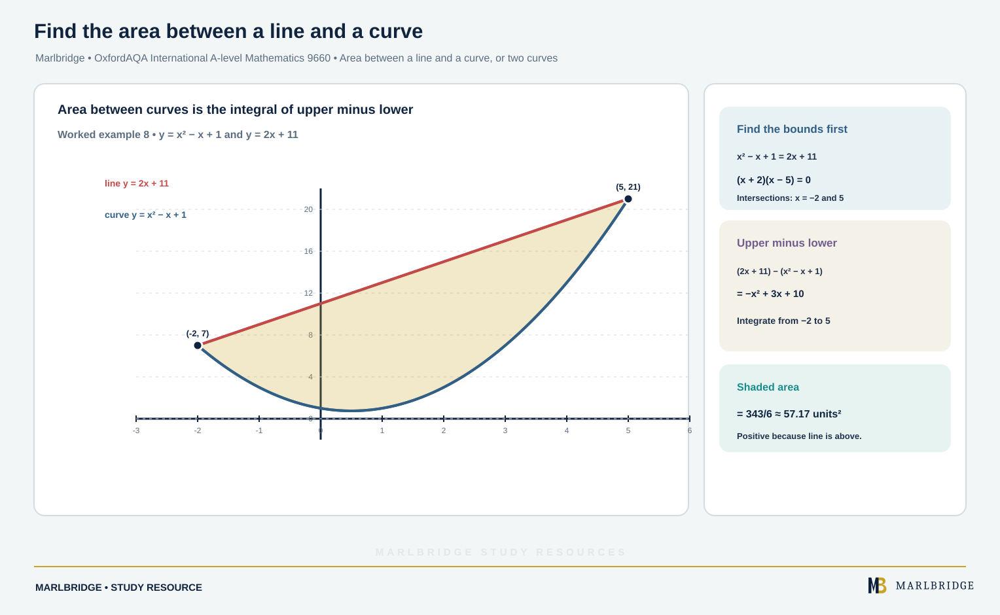

This guide covers section P1.4 (Integration) of the OxfordAQA International AS and A-level Mathematics (9660) specification, Version 5.2. The specification places this content in International AS, Unit P1 (Pure Maths); it is not labelled Core, Extension or Higher, and it carries into the International A-level. Pair it with the [revision notes](/resources/oxfordaqa-a-level-mathematics-integration-indefinite-definite-integrals-areas-and-revision-notes/) and the [practice questions](/resources/oxfordaqa-a-level-mathematics-integration-indefinite-definite-integrals-areas-and-practice/). The wider unit is on the [Unit P1 overview](/resources/a-level-oxfordaqa-mathematics-unit-p1/), and the course home is the [OxfordAQA A-level Mathematics hub](/boards/oxfordaqa/a-level/mathematics/) with a [printable checklist](/checklists/oxfordaqa/a-level/mathematics/). If you are unsure where you stand, take a [free diagnostic](/diagnostics/) first.

## What P1.4 asks you to do

| Content | What you must be able to do |
|---|---|
| Indefinite integration | Treat it as the reverse of differentiation |
| Integration of xⁿ | Integrate xⁿ for rational n ≠ −1, with sums and differences, including terms that need rewriting as powers |
| Definite integrals | Evaluate them, and interpret them as the area under a curve |
| Area between a curve and the x-axis | Include regions wholly below the axis, where the integral is negative |
| Area between a line and a curve, or two curves | Find the limits from intersections, then integrate (upper − lower) |
| Trapezium rule | Use ordinates, decide over- or under-estimate from a sketch, and improve an estimate with more strips |

The specification says that regions lying partly above and partly below the x-axis will not be set. Differentiation is a separate section (P1.3), but you need it here, because integration is checked by differentiating back.

## Indefinite integration

If dy/dx = f(x), then y = ∫ f(x) dx. Differentiating a constant gives zero, so the reverse process cannot recover it. That is why every indefinite integral ends with + c.

The rule for powers, valid for any rational n except −1:

```
∫ xⁿ dx = xⁿ⁺¹/(n + 1) + c        (n ≠ −1)
∫ k dx = kx + c
```

Add 1 to the power, divide by the new power. Constants multiply through, and you integrate sums and differences term by term. The case n = −1 is excluded here; it gives a different type of function that is not part of P1.4.

**Worked example 1.** Find ∫ (3x^(5/2) − 9x^(−2/3)) dx.

```
3x^(5/2):   power 5/2 + 1 = 7/2.  3 ÷ (7/2) = 6/7   →  (6/7)x^(7/2)
−9x^(−2/3): power −2/3 + 1 = 1/3. −9 ÷ (1/3) = −27  →  −27x^(1/3)
```

Answer: (6/7)x^(7/2) − 27x^(1/3) + c. Check: differentiating gives 3x^(5/2) − 9x^(−2/3).

### Rewriting before you integrate

The integral rule works on single powers only. Brackets, roots and fractions must be turned into a sum of powers first. Three habits cover most cases:

- √x = x^(1/2), and 1/xᵏ = x^(−k).
- x√x = x^(3/2).
- A fraction with a single power in the denominator is split into separate terms.

**Worked example 2.** Find ∫ (x² − 3)/√x dx.

```
(x² − 3)/√x = x²/x^(1/2) − 3/x^(1/2) = x^(3/2) − 3x^(−1/2)
∫ = x^(5/2)/(5/2) − 3x^(1/2)/(1/2) + c
  = (2/5)x^(5/2) − 6x^(1/2) + c
```

**Worked example 3.** Find ∫ (4x√x − 1/x²) dx.

```
4x√x = 4x^(3/2)  →  4 ÷ (5/2) = 8/5  →  (8/5)x^(5/2)
−1/x² = −x^(−2)  →  −x^(−1)/(−1) = +x^(−1)
```

Answer: (8/5)x^(5/2) + 1/x + c.

### Finding a curve from its gradient

A given point fixes c.

**Worked example 4.** The gradient of a curve is dy/dx = 15√x − 4, and the curve passes through (4, 20). Find its equation.

```
y = 15x^(3/2)/(3/2) − 4x + c = 10x^(3/2) − 4x + c
At x = 4:  10(8) − 16 + c = 20   →   c = −44
```

Answer: y = 10x^(3/2) − 4x − 44.

<figure class="topic-figure">
  
  <figcaption>Integrating gives a family of curves; a known point picks out one of them.</figcaption>
</figure>

<figure class="topic-figure">
  
  <figcaption>Integration by parts is the statement that two complementary areas fill a rectangle.</figcaption>
</figure>

<figure class="topic-figure">
  
  <figcaption>Splitting into partial fractions splits the area into two simple logarithmic bands.</figcaption>
</figure>


## Definite integrals

A definite integral has limits a and b. Integrate, substitute b, substitute a, subtract. The constant cancels, so leave it out.

```
∫ₐᵇ f(x) dx = [F(x)]ₐᵇ = F(b) − F(a)
```

**Worked example 5.** Evaluate ∫₁⁹ (3/√x + x) dx.

```
3x^(−1/2) + x  →  F(x) = 6x^(1/2) + x²/2
F(9) = 6(3) + 81/2 = 58.5
F(1) = 6 + 1/2 = 6.5
Integral = 58.5 − 6.5 = 52
```

Do this by hand and keep exact fractions or surds until the end. Swapping the limits changes the sign of the answer.

<figure class="topic-figure">
  
  <figcaption>As strips get thinner, the rectangle sums close in on the integral.</figcaption>
</figure>

<figure class="topic-figure">
  
  <figcaption>An infinitely long region can still have a finite area.</figcaption>
</figure>

<figure class="topic-figure">
  
  <figcaption>With a substitution, convert the limits and the definite integral keeps its value.</figcaption>
</figure>


## Area between a curve and the x-axis

When the curve is above the axis between x = a and x = b, the area is the definite integral from a to b.

**Worked example 6.** Find the area under y = 2√x + 1 between x = 1 and x = 4.

```
F(x) = (4/3)x^(3/2) + x
F(4) = (4/3)(8) + 4 = 44/3
F(1) = 4/3 + 1 = 7/3
Area = 44/3 − 7/3 = 37/3
```

### Regions below the axis

On any interval where the graph sits under the x-axis, y is negative, so the integral is negative. The area is a positive quantity, so write the magnitude. The specification asks you to know that the integral will give a negative value here.

**Worked example 7.** Find the area enclosed by y = x² − 6x and the x-axis.

The curve crosses the axis where x(x − 6) = 0, so at x = 0 and x = 6. Between them x² − 6x < 0 (test x = 3: 9 − 18 = −9).

```
∫₀⁶ (x² − 6x) dx = [x³/3 − 3x²]₀⁶ = (72 − 108) − 0 = −36
```

The integral is −36, so the area is 36 square units.

Regions that cross the axis are not set, but sketching first is still wise, because it shows whether the curve is above or below the axis in the interval you are given.

<figure class="topic-figure">
  
  <figcaption>Regions below the axis give negative integrals, so find the area in separate pieces.</figcaption>
</figure>

<figure class="topic-figure">
  
  <figcaption>The area between two curves is the integral of the top curve minus the bottom curve.</figcaption>
</figure>


## Area between a line and a curve, or two curves

<!-- marlbridge-diagram:math-b70-oxfordaqa-area-between-curves-worked-example -->
<figure class="lesson-diagram" style="margin: 2rem 0;">
  <a href="/public/images/learning/mathematics/math-b70-oxfordaqa-area-between-curves-worked-example.svg" aria-label="Open full-size diagram: math-b70-oxfordaqa-area-between-curves-worked-example"></a>
  <figcaption>A line y=2x+11 and curve y=x²−x+1 meet at x=−2 and 5; the region between them is shaded and labelled with area 343/6.</figcaption>
</figure>
<!-- /marlbridge-diagram:math-b70-oxfordaqa-area-between-curves-worked-example -->


Find where the graphs meet (set the equations equal), then integrate upper minus lower between those x-values. Sketch first so you know which is the upper graph. Subtracting before integrating handles any negative values for you.

**Worked example 8.** The curve y = x² − x + 1 and the line y = 2x + 11 meet at two points. Find the area between them.

```
x² − x + 1 = 2x + 11   →   x² − 3x − 10 = 0   →   x = −2 or x = 5
At x = 0: line gives 11, curve gives 1, so the line is above.
Area = ∫ from −2 to 5 of (2x + 11 − x² + x − 1) dx
     = ∫ from −2 to 5 of (−x² + 3x + 10) dx
     = [−x³/3 + 3x²/2 + 10x]
At 5:  −125/3 + 75/2 + 50 = 275/6
At −2: 8/3 + 6 − 20 = −34/3
Area = 275/6 + 68/6 = 343/6
```

**Worked example 9.** Find the area between y = x² and y = 8√x.

```
x² = 8x^(1/2)   →   x^(3/2) = 8   →   x = 4  (and x = 0)
Between 0 and 4, 8√x is above x² (at x = 1: 8 against 1).
Area = ∫₀⁴ (8x^(1/2) − x²) dx = [(16/3)x^(3/2) − x³/3]₀⁴
     = 128/3 − 64/3 = 64/3
```

## The trapezium rule

Some functions cannot be integrated with the methods in P1. The trapezium rule estimates the area under a curve by replacing it with straight-line tops on equal-width strips.

The specification uses the term **ordinate** for a y-value at an equally spaced x-value. n strips need n + 1 ordinates y₀, y₁, …, yₙ, each strip with width h = (b − a)/n.

```
∫ₐᵇ y dx ≈ (h/2) [ y₀ + yₙ + 2(y₁ + y₂ + … + yₙ₋₁) ]
```

The first and last ordinates are counted once; every other ordinate is counted twice.

**Worked example 10.** Estimate ∫₀² √(x³ + 2) dx using four strips.

h = 2/4 = 0.5. The ordinates:

| x | 0 | 0.5 | 1 | 1.5 | 2 |
|---|---|---|---|---|---|
| y | 1.4142 | 1.4577 | 1.7321 | 2.3184 | 3.1623 |

```
Estimate = (0.5/2)[1.4142 + 3.1623 + 2(1.4577 + 1.7321 + 2.3184)]
         = 0.25 × [4.5765 + 11.0164] = 3.898 (4 s.f.)
```

### Over- or under-estimate

Sketch the curve and draw the trapezium tops as chords.

- Curve bending upwards (convex, like y = x² for x > 0): chords lie above the curve, so the rule **over-estimates**.
- Curve bending downwards (concave, like y = √x): chords lie below the curve, so the rule **under-estimates**.

Example 10 is a curve that steepens, so 3.898 is an over-estimate. With eight strips (h = 0.25) the estimate falls to 3.868, and the true value is 3.858 to 4 s.f. Both estimates are above it.

**Worked example 11.** Use three strips to estimate ∫₁⁴ √x dx and say whether it is an over- or under-estimate.

```
h = 1.  Ordinates: 1, √2, √3, 2
Estimate = (1/2)[1 + 2 + 2(√2 + √3)] = 4.646 (4 s.f.)
Exact:  [(2/3)x^(3/2)]₁⁴ = 16/3 − 2/3 = 14/3 = 4.667 (4 s.f.)
```

√x is concave, so the rule under-estimates: 4.646 < 4.667.

### Improving the estimate

Use more strips. Doubling the strips (here, six instead of three, h = 0.5) gives 4.661, which is closer to 14/3. A narrower strip lets the chord follow the curve more closely. For a curve that stays convex or concave, the sign of the error does not change as the strips increase; the estimate moves towards the true value from the same side.

## Common errors

- Writing xⁿ⁺¹ but dividing by n instead of n + 1.
- Integrating (x² − 3)/√x by dividing the numerator and denominator of the answer separately, instead of rewriting as powers first.
- Dropping + c on an indefinite integral, or keeping it in a definite integral.
- Reporting a negative area. Give the positive magnitude when the question asks for area.
- Substituting the limits in the wrong order, or forgetting to subtract.
- In area between two graphs, integrating the wrong way round: always (upper − lower).
- Trapezium rule: using n ordinates instead of n + 1, or doubling the end ordinates.
- Claiming over- or under-estimate without referring to the shape of the curve.

## Next steps

Work through the [revision notes](/resources/oxfordaqa-a-level-mathematics-integration-indefinite-definite-integrals-areas-and-revision-notes/), then try the [practice questions](/resources/oxfordaqa-a-level-mathematics-integration-indefinite-definite-integrals-areas-and-practice/). The existing [P1 revision notes](/resources/oxfordaqa-a-level-mathematics-p1-revision-notes/) and [P1 practice](/resources/oxfordaqa-a-level-mathematics-p1-practice/) cover the rest of the unit.

## Official syllabus

OxfordAQA International AS and A-level Mathematics (9660), Version 5.2, section P1.4 Integration (International AS exams from May/June 2018, International A-level from May/June 2019), published by OxfordAQA.
