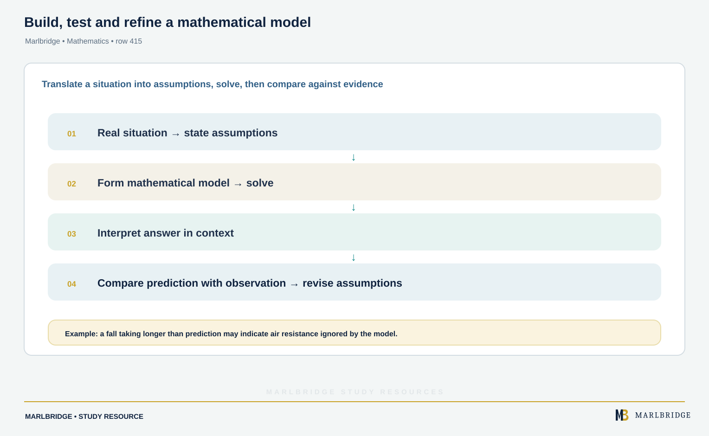

This guide covers sections M2.1 (mathematical modelling) and M2.2 (kinematics) of the OxfordAQA International AS and A-level Mathematics (9660) specification, Version 5.2. The specification places this content in International A-level Unit M2 (Mechanics), taken with Unit P2 as the mechanics option (the alternative is Unit S2); it is not examined at International AS. Unit M2 expects familiarity with the International AS units and Unit P2, so straight-line motion from Unit PSM1 is your starting point.

Use it with the [revision notes](/resources/oxfordaqa-a-level-mathematics-mathematical-modelling-and-kinematics-with-vectors-and-revision-notes/) and the [practice questions](/resources/oxfordaqa-a-level-mathematics-mathematical-modelling-and-kinematics-with-vectors-and-practice/). The course hub is [/boards/oxfordaqa/a-level/mathematics/](/boards/oxfordaqa/a-level/mathematics/) and the printable checklist is [/checklists/oxfordaqa/a-level/mathematics/](/checklists/oxfordaqa/a-level/mathematics/). To find weak spots first, try the [free 10-minute diagnostics](/diagnostics/). For the straight-line version of this work, see the [kinematics in a straight line guide](/resources/oxfordaqa-a-level-mathematics-kinematics-in-a-straight-line-constant-and-variable/); for vector skills, see the [vectors guide](/resources/oxfordaqa-a-level-mathematics-vectors-in-two-and-three-dimensions-and-vector/).

## What this unit covers

| Ref | What you must be able to do |
|---|---|
| M2.1 | Use assumptions to simplify a real situation, analyse the model and interpret the result |
| M2.1 | Judge the validity of a model and comment on assumptions |
| M2.1 | Explain terms such as particle, light, inextensible string, smooth surface and motion under gravity |
| M2.1 | Recognise when a large moving body can be treated as a point mass |
| M2.2 | Relate position, velocity and acceleration in one, two or three dimensions when acceleration varies |
| M2.2 | Differentiate or integrate r = f(t)i + g(t)j + h(t)k with respect to t |
| M2.2 | Work with ai + bj + ck form or column vectors (either is allowed) |

## M2.1 Mathematical modelling

<figure class="learning-diagram" style="margin:1.5rem 0;"><a href="/public/images/learning/mathematics/math-sub-415-mathematical-modelling-cycle.svg" aria-label="Open full-size diagram: math-sub-415-mathematical-modelling-cycle"></a><figcaption>Build, test and refine a mathematical model — Marlbridge Mathematics</figcaption></figure>

A model replaces a real situation by a simpler one you can solve. You make assumptions, solve the maths, then interpret the answer in context and ask whether it is believable. If the prediction and the evidence disagree, you adjust the assumptions and try again.

You must be able to comment on these assumptions.

| Term | What it assumes | Effect on the model |
|---|---|---|
| Particle | The object is a point with mass but no size | Rotation and size are ignored; every part moves the same way |
| Large body as a point mass | Size is small compared with the distances travelled | Acceptable for a lorry on a long journey, not for one reversing into a bay |
| Light (string or rod) | Mass is negligible | Tension is the same throughout the string |
| Inextensible string | Length cannot change | Both ends have the same speed and acceleration along the string while it is taut |
| Smooth surface | No friction | The only contact force is perpendicular to the surface |
| Motion under gravity | Gravity is the only force, with constant g | Air resistance, wind and the variation of g with height are ignored |

**Worked example 1.** A stone is dropped from rest from a bridge 30 m above a river. Model it as a particle under gravity, with g = 9.8 m s⁻². Find the time to reach the water and the speed on impact. The stone is timed at 2.7 s. Comment.

```
s = ut + ½at²  →  30 = ½ × 9.8 × t²
t² = 60/9.8, so t = 2.47 s (3 s.f.)
v = u + at = 9.8 × 2.4744… = 24.2 m s⁻¹ (3 s.f.)
```

The model predicts 2.47 s, but the measured time is longer. That fits an assumption that ignores air resistance, which slows the fall. A refinement is to include a resistive force. Timing error is another source of difference, so you would repeat the timing before blaming the model.

<figure class="topic-figure">
  
  <figcaption>Horizontal motion is uniform and vertical motion has acceleration −g; time links the two.</figcaption>
</figure>


## M2.2 Position, velocity and acceleration with calculus

<!-- marlbridge-diagram:math-final-415-vector-position-velocity-acceleration -->
<figure class="lesson-diagram" style="margin: 2rem 0;">
  <a href="/images/learning/mathematics/math-final-415-vector-position-velocity-acceleration.svg" aria-label="Open full-size diagram: math-final-415-vector-position-velocity-acceleration"></a>
  <figcaption>Position vector flows through first and second derivatives to velocity and acceleration, with the source example evaluated at t=5.</figcaption>
</figure>
<!-- /marlbridge-diagram:math-final-415-vector-position-velocity-acceleration -->


For a particle with position vector r relative to a fixed origin O, at time t:

```
velocity = rate of change of position:   v = dr/dt
acceleration = rate of change of velocity:   a = dv/dt = d²r/dt²
integrating reverses this:   v = ∫ a dt,   r = ∫ v dt
```

In component form, if r = f(t)i + g(t)j + h(t)k, then v = f′(t)i + g′(t)j + h′(t)k and a = f″(t)i + g″(t)j + h″(t)k. You differentiate each component separately. The same works for column vectors, written (x; y; z) in this guide for one column.

Facts you will use repeatedly:

- Speed is the magnitude of the velocity: |v| = √(vx² + vy² + vz²). It is a scalar.
- The distance of the particle from O is |r|. It is not the distance travelled.
- Velocity is always along the direction of motion. Acceleration need not be.
- The constant acceleration equations (such as v = u + at) apply only if a is constant. With a depending on t, you integrate.
- Integration needs a constant of integration, which is a vector. Find it from a given velocity or position at a known time.

**Worked example 2 (differentiating).** A particle has position vector r = (t³ − 12t)i + (4t² − 24t)j metres, for t ≥ 0. Find (a) its velocity and acceleration at t = 5, (b) when it moves parallel to i, (c) when it moves parallel to j.

(a)
```
v = (3t² − 12)i + (8t − 24)j
a = 6t i + 8j
t = 5:  v = 63i + 16j,  a = 30i + 8j
speed = √(63² + 16²) = √4225 = 65 m s⁻¹
```

(b) For motion parallel to i, the j component of v must be zero: 8t − 24 = 0, so t = 3. Then v = 15i and r = −9i − 36j.

(c) Parallel to j means the i component of v is zero: 3t² − 12 = 0, so t = 2 (t = −2 is rejected because t ≥ 0).

Notice that v is never zero here, because the two components vanish at different times (t = 2 and t = 3). If a question says "at rest", set every component to zero and check that the same t works for all of them.

**Worked example 3 (integrating in three dimensions).** A particle moves with acceleration a = (6t; −6; 12t²) m s⁻². When t = 0 its velocity is (2; 5; −1) and its position is (1; 0; 3). Find its velocity and position when t = 2.

Integrate each component and add the constant from the initial conditions:

```
v = (3t² + c1; −6t + c2; 4t³ + c3)
t = 0: (c1; c2; c3) = (2; 5; −1)
v = (3t² + 2; 5 − 6t; 4t³ − 1)
```

Integrate again, using r(0) = (1; 0; 3):

```
r = (t³ + 2t + 1; 5t − 3t²; t⁴ − t + 3)
t = 2:  v = (14; −7; 31),  r = (13; −2; 17)
```

Check the position by differentiating: d/dt of t⁴ − t + 3 is 4t³ − 1, matching the k component of v. Checking one component this way takes seconds and catches a lost constant.

**Worked example 4 (least speed).** A particle has velocity v = (2t − 6)i + (8 − 2t)j m s⁻¹. Find the least speed and the time it occurs.

Speed is a square root, so minimise the speed squared instead:

```
|v|² = (2t − 6)² + (8 − 2t)² = 8t² − 56t + 100
d(|v|²)/dt = 16t − 56 = 0  →  t = 3.5
|v|² = 8(3.5)² − 56(3.5) + 100 = 2
least speed = √2 m s⁻¹ (about 1.41)
```

The second derivative of |v|² is 16, which is positive, so this is a minimum. You could also complete the square: 8(t − 3.5)² + 2. Both methods give the same result, and the completed square shows the minimum without any differentiation.

**Worked example 5 (two particles).** Particle A has position vector (2t + 1)i + t²j and particle B has position vector (5t − 5)i + (3t − 2)j, with distances in metres and t in seconds. Do they collide?

Two particles are at the same place at the same time only if both components match for one value of t.

```
i components:  2t + 1 = 5t − 5  →  t = 2
j components:  t² = 3t − 2  →  t² − 3t + 2 = 0  →  t = 1 or t = 2
```

The i components agree only at t = 2, and t = 2 is also one of the j solutions. At t = 2 both are at 5i + 4j, so they collide at t = 2 s. If the j equation had given only t = 1 and t = 3, the paths would cross but the particles would miss. Treating each particle as a point is itself a modelling assumption: real objects with size could touch earlier.

<figure class="topic-figure">
  
  <figcaption>Gradients give acceleration; areas give displacement, and distance counts every area as positive.</figcaption>
</figure>

<figure class="topic-figure">
  
  <figcaption>Find where v = 0, split the motion there, and add the sizes of the stages for distance.</figcaption>
</figure>

<figure class="topic-figure">
  
  <figcaption>Differentiate each component separately; parallel to j means the i component of velocity is zero.</figcaption>
</figure>


## Common errors

- Using v = u + at or s = ut + ½at² when acceleration depends on t.
- Forgetting the constant of integration, or adding it as a number rather than a vector.
- Calling |r| the distance travelled. Distance travelled needs the path length, which for straight-line motion means splitting at points where the velocity changes sign.
- Finding speed by differentiating |r|, or by taking |v| of the wrong time.
- Solving the i and j equations for meeting and accepting two different values of t.
- Declaring a particle at rest after one component is zero.
- Describing a model as "wrong" without naming the assumption and its effect. Write which assumption fails and in which direction the prediction moves.

## Where next

Move to the [revision notes](/resources/oxfordaqa-a-level-mathematics-mathematical-modelling-and-kinematics-with-vectors-and-revision-notes/) for a compact summary and self-test, then try the [practice questions](/resources/oxfordaqa-a-level-mathematics-mathematical-modelling-and-kinematics-with-vectors-and-practice/). Revisit the course [hub](/boards/oxfordaqa/a-level/mathematics/) or [checklist](/checklists/oxfordaqa/a-level/mathematics/) to tick off M2.1 and M2.2.

<figure class="topic-figure">
  
  <figcaption>The suvat equations are the gradient and area of one straight-line velocity-time graph.</figcaption>
</figure>

## Frequently asked questions

**What does treating an object as a particle mean?**
It means modelling the object as a point with mass but no size, so rotation and size are ignored. A large body can be treated this way when its size is small compared with the distances involved.

**How do you find the speed from a velocity vector?**
Speed is the magnitude of the velocity, |v| = √(vx² + vy² + vz²). It is a scalar, not a vector.

**Can you use column vectors in OxfordAQA M2 kinematics?**
Yes. The OxfordAQA 9660 specification allows either ai + bj + ck form or column vectors for section M2.2.

**Is acceleration always in the direction of motion?**
No. Velocity is always along the direction of motion, but acceleration need not be.

## Official syllabus

OxfordAQA International AS and A-level Mathematics (9660) specification, Version 5.2, published by OxfordAQA. Sections M2.1 and M2.2 of Unit M2 (International A-level only).
