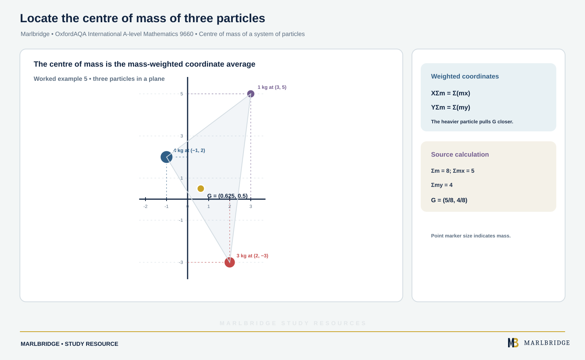

This guide covers the moments and centres of mass part of section M2.3 (Statics and forces) in the OxfordAQA *International AS and A-level Mathematics* specification, Version 5.2. The specification places this content in International A-level Unit M2 (Mechanics), so it is not examined at International AS. Forces at a point, friction and resolving are taught on the [forces, Newton's laws and momentum guide](/resources/oxfordaqa-a-level-mathematics-forces-newtons-laws-connected-particles-momentum-and/). Here you learn what happens when forces act at different places on a body.

Companion pages: [revision notes](/resources/oxfordaqa-a-level-mathematics-moments-rigid-bodies-in-equilibrium-and-centres-of-mass-revision-notes/) and [practice questions](/resources/oxfordaqa-a-level-mathematics-moments-rigid-bodies-in-equilibrium-and-centres-of-mass-practice/). Course pages: [OxfordAQA A-level Mathematics hub](/boards/oxfordaqa/a-level/mathematics/) and the [printable checklist](/checklists/oxfordaqa/a-level/mathematics/). To find weak spots first, try the [free diagnostics](/diagnostics/).

## What this unit covers

| Spec area | What you must be able to do |
|---|---|
| M2.3 moments | Find the moment of a force about a given point |
| M2.3 rigid body in equilibrium | Use resultant force zero and resultant moment zero; parallel forces on a beam; forces in two dimensions on a ladder against a wall |
| M2.3 centres of mass | Use symmetry (circle, rectangle); find the centre of mass of a system of particles; find it for a composite body |
| M2.3 suspended bodies | Find the position of a body hanging from a given point in equilibrium |

Integration methods are not required. The specification takes g as 9.8 m s⁻², and it lists the centre of mass formulae as results you must learn rather than expect to be given.

## Moment of a force

A moment measures the turning effect of a force about a point.

```
moment = F × d, where d is measured at right angles from the point to the line along which F acts
```

The unit is N m. Choose a direction, say anticlockwise as positive, and keep to it.

Suppose the force makes angle θ with a rod and acts at a point a distance d along the rod from the pivot. A right-angled triangle shows that the line of the force lies d sin θ from the pivot. Multiply by F to get the moment F d sin θ. Another way to see it: only the part of F at right angles to the rod turns the rod.

**Worked example 1.** A 25 N force is applied to a spanner at 70° to the handle, at a point 0.35 m from the centre of the bolt. Find the moment about the bolt.

```
perpendicular component = 25 sin 70° 
moment = 25 sin 70° × 0.35 = 8.22 N m (3 s.f.)
```

If a line of action passes straight through the point you are using, that force contributes nothing. Use this on purpose: choose the point that an unknown force passes through, and that force drops out of the equation.

<figure class="topic-figure">
  
  <figcaption>Only the part of the force at right angles to the rod turns it: moment = F d sin theta.</figcaption>
</figure>

<figure class="topic-figure">
  
  <figcaption>Add the moments in one sense and subtract those in the other to find which way the rod turns.</figcaption>
</figure>


## A rigid body in equilibrium

A rigid body keeps its shape. It stays in equilibrium when both of these hold:

1. the resultant force is zero (so resolving in any two perpendicular directions gives zero);
2. the resultant moment about every point is zero.

Because the moment condition holds about any point, choose the point that removes the most unknowns. You then solve with as few simultaneous equations as possible.

### Modelling words

| Phrase | Meaning |
|---|---|
| Uniform | Weight acts at the geometric centre |
| Light | Weight is negligible, so ignore it |
| Smooth | No friction, so the contact force is perpendicular to the surface |
| Rough | Friction can act along the surface |
| Particle at a point | Its weight acts exactly there |

## Parallel forces: beams on supports

When every force is vertical, you need one moment equation and one vertical resolving equation.

**Worked example 2.** A uniform horizontal beam AB has length 4 m and mass 18 kg. It rests on supports at C and D, where AC = 0.5 m and DB = 1 m. A crate of mass 11 kg sits on the beam 0.5 m from B. Find the reactions at C and D.

Distances from A: C at 0.5, centre of beam at 2, D at 3, crate at 3.5.

```
Moments about C (clockwise positive):
R_D × 2.5 = 18g × 1.5 + 11g × 3
R_D × 2.5 = 60g
R_D = 24g = 235 N (3 s.f.)

Resolve vertically:
R_C + R_D = 29g
R_C = 5g = 49 N
```

**Tilting.** If the beam is about to turn about one support, it has just lifted off the other, so the reaction there is zero. Use that as the condition.

**Worked example 3.** The crate is removed from the beam in example 2. A particle of mass m is placed at A. Find the greatest m for which the beam stays at rest.

The beam tilts about C when R_D = 0. At the limit:

```
Moments about C: m g × 0.5 = 18g × 1.5
m = 54 kg
```

So m must be at most 54 kg.

<figure class="topic-figure">
  
  <figcaption>Take moments about a support so one unknown reaction drops out, then resolve vertically for the other.</figcaption>
</figure>

<figure class="topic-figure">
  
  <figcaption>When a beam is about to tilt about one support, the reaction at the other support is zero.</figcaption>
</figure>


## Forces in two dimensions: a ladder against a wall

A ladder problem has four contact forces and weights. Draw them first.

* Smooth wall: a horizontal reaction S at the top, pushing away from the wall.
* Rough ground: a vertical reaction R and a horizontal friction force F at the foot, acting towards the wall (it stops the foot sliding away).
* Weights: the ladder's weight at its midpoint if uniform; any person as a particle at their position.

Resolve vertically and horizontally, then take moments about the foot. The foot is the best point because both R and F pass through it.

**Worked example 4.** A uniform ladder of length 4.5 m and mass 12 kg rests with its top against a smooth vertical wall. Its foot is on rough horizontal ground and the ladder makes 62° with the ground. A person of mass 70 kg stands 3 m up the ladder, measured along it from the foot. The ladder is in equilibrium. Find the friction force and the least possible coefficient of friction.

```
Vertical:    R = (12 + 70)g = 82g = 803.6 N
Horizontal:  F = S

Moments about the foot:
S × 4.5 sin 62° = 12g × 2.25 cos 62° + 70g × 3 cos 62°
S × 4.5 sin 62° = 237g cos 62°
S = 237g / (4.5 tan 62°) = 274 N (3 s.f.)
```

So F = 274 N. Because F must not exceed μR, we need μ ≥ 274.4 / 803.6 = 0.342 (3 s.f.). The least coefficient is 0.342.

The horizontal distance of each weight from the foot is its distance along the ladder times cos 62°. The height of the top above the foot is 4.5 sin 62°. Writing these out stops sign and trig slips.

<figure class="topic-figure">
  
  <figcaption>Taking moments about the hinge removes both hinge components, leaving the tension to find first.</figcaption>
</figure>

<figure class="topic-figure">
  
  <figcaption>Weight acts at a horizontal distance, the wall reaction at a vertical height: cos and sin must not be swapped.</figcaption>
</figure>


## Centres of mass by symmetry

The centre of mass is the single point at which you may place the body's whole weight when taking moments. For a uniform body:

* a rod: its midpoint;
* a rectangle or other lamina with two axes of symmetry: where the axes cross;
* a circular disc or ring: the centre.

If a body has an axis of symmetry, the centre of mass lies on it. For a rectangle with vertices at (2, 1), (10, 1), (10, 7) and (2, 7), the centre of mass is at (6, 4).

## Centre of mass of a system of particles

<!-- marlbridge-diagram:math-b68-oxfordaqa-centre-mass-three-particles -->
<figure class="lesson-diagram" style="margin: 2rem 0;">
  <a href="/public/images/learning/mathematics/math-b68-oxfordaqa-centre-mass-three-particles.svg" aria-label="Open full-size diagram: math-b68-oxfordaqa-centre-mass-three-particles"></a>
  <figcaption>Coordinate plot of the three source particles, with their masses and the calculated centre of mass at (0.625, 0.5).</figcaption>
</figure>
<!-- /marlbridge-diagram:math-b68-oxfordaqa-centre-mass-three-particles -->


For particles of mass m₁, m₂, … at (x₁, y₁), (x₂, y₂), … the centre of mass (X, Y) satisfies:

```
X Σm = Σ m x        Y Σm = Σ m y
```

**Worked example 5.** Masses 4 kg, 1 kg and 3 kg are at (−1, 2), (3, 5) and (2, −3). Find the centre of mass.

```
Σm = 8
Σ m x = 4(−1) + 1(3) + 3(2) = 5      X = 5/8 = 0.625
Σ m y = 4(2) + 1(5) + 3(−3) = 4       Y = 4/8 = 0.5
```

The centre of mass is (0.625, 0.5).

<figure class="topic-figure">
  
  <figcaption>The centre of mass is the mass-weighted average of the positions.</figcaption>
</figure>


## Composite bodies

Split the body into pieces with known centres of mass, treat each piece as a particle at its centre, and use the same formulae. Every part of a uniform lamina is made of the same sheet, so a part's mass is its area multiplied by one fixed constant. The constant cancels, so areas can stand in for masses.

**Worked example 6.** A uniform L-shaped lamina has two parts. Part P is the rectangle 0 ≤ x ≤ 12, 0 ≤ y ≤ 4. Part Q is the rectangle 0 ≤ x ≤ 4, 4 ≤ y ≤ 10. Distances are in cm. Find its centre of mass.

| Part | Area | Centre |
|---|---|---|
| P | 48 | (6, 2) |
| Q | 24 | (2, 7) |
| Whole | 72 | (X, Y) |

```
72 X = 48(6) + 24(2) = 336     X = 14/3
72 Y = 48(2) + 24(7) = 264     Y = 11/3
```

The centre of mass is (14/3, 11/3), about (4.67, 3.67).

**Removing a piece.** Treat the removed piece as a part with negative area.

**Worked example 7.** A uniform square lamina has side 20 cm, with corners at (0, 0) and (20, 20). A square of side 8 cm is cut from the corner at (20, 20), so its centre is (16, 16). Find the centre of mass of what is left.

```
Whole square: area 400, centre (10, 10)
Removed piece: area 64, centre (16, 16)
Remaining area = 336

336 X = 400(10) − 64(16) = 2976     X = 62/7 = 8.86
```

By symmetry about the diagonal y = x, Y = X. The centre of mass is (8.86, 8.86) to 3 s.f.

<figure class="topic-figure">
  
  <figcaption>Use areas as masses and give a hole a negative area.</figcaption>
</figure>


## A body suspended in equilibrium

A body hanging freely from a point P is in equilibrium only when its centre of mass G is vertically below P. The weight at G and the tension or reaction at P then have the same line of action, so their moments about P cancel.

To find the position, find G, then use the right-angled triangle formed by the vertical line PG and the distances of G from P.

**Worked example 8.** The lamina in example 6 is freely suspended from its corner at (0, 10). Find the angle between the edge from (0, 10) to (0, 0) and the vertical.

G is at (14/3, 11/3). The vector from the corner to G is (14/3, −19/3). The vertical through the corner passes through G, so this vector is vertical.

```
tan α = (14/3) ÷ (19/3) = 14/19
α = 36.4° (3 s.f.)
```

The edge makes 36.4° with the vertical.

If a particle is added, include it in the system first, then find the new G.

<figure class="topic-figure">
  
  <figcaption>A freely suspended lamina settles with its centre of mass directly below the suspension point.</figcaption>
</figure>


## Common errors

* Using the distance along a ladder instead of the perpendicular distance. Resolve, or use d cos θ for horizontal distances.
* Forgetting that the weight of a uniform beam acts at its midpoint, not at the support.
* Taking moments about different points inconsistently within one equation.
* Dropping the negative sign for a removed piece of a lamina.
* Using total mass in a composite formula but using an area for one part. Be consistent.
* Measuring a hanging angle from the wrong edge. Draw the vertical line PG first.

## Official syllabus

OxfordAQA, *International AS and A-level Mathematics (9660)*, Version 5.2, section M2.3 (Statics and forces), part of International A-level Unit M2 (Mechanics).
