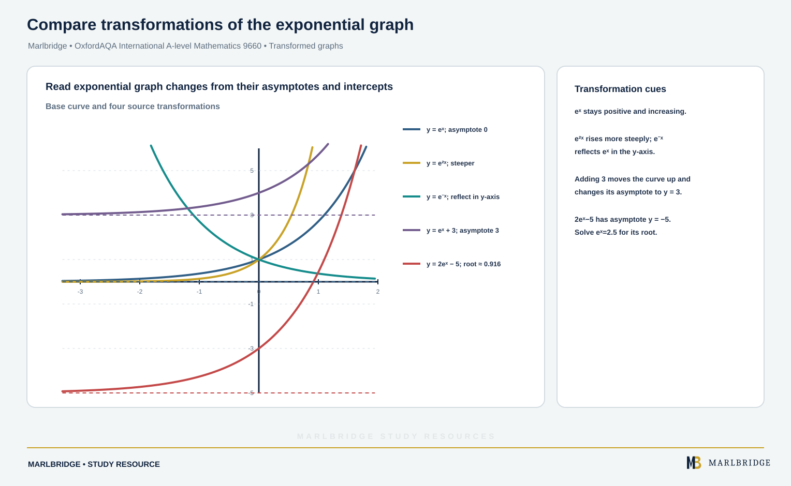

This guide follows the *OxfordAQA International AS and A-level Mathematics (9660) specification, Version 5.2*, sections P2.3 (the parametric part of coordinate geometry) and P2.5 (exponentials and logarithms). This content sits in Unit P2 (Pure Maths), which is part of the International A-level, and no International AS unit examines it. The specification applies to International AS exams from May/June 2018 and International A-level exams from May/June 2019.

Use it with the [revision notes](/resources/oxfordaqa-a-level-mathematics-parametric-equations-and-exponential-and-logarithmic-revision-notes/) and the [practice questions](/resources/oxfordaqa-a-level-mathematics-parametric-equations-and-exponential-and-logarithmic-practice/). The course page is [OxfordAQA A-level Mathematics](/boards/oxfordaqa/a-level/mathematics/) and the [printable checklist](/checklists/oxfordaqa/a-level/mathematics/) lets you tick off each outcome. The laws of logarithms and the graph of y = a^x come from the International AS content: see [exponentials, logarithms and solving a^x = b](/resources/oxfordaqa-a-level-mathematics-exponential-functions-logarithms-and-solving-a-x-b/). If you are unsure where to start, take a [free 10-minute diagnostic](/diagnostics/).

## What this unit covers

| Specification item | What you must be able to do |
|---|---|
| P2.3 | Move between Cartesian and parametric equations of curves |
| P2.3 examples | Work with x = t², y = 2t; x = a cosθ, y = b sinθ; x = 1/t, y = 3t; x = t + 1/t, y = t − 1/t |
| P2.5 | Know the function eˣ and its graph |
| P2.5 | Know ln x and its graph, and that ln x is the inverse of eˣ |
| P2.5 | Use exponential growth and decay, including exponential functions as models |

Differentiating parametric curves and finding tangents and normals belong to P2.6, so they are not covered here.

## 1. Parametric equations

A curve can be given by two equations that both depend on a third variable, the **parameter**. For example

```
x = t²,  y = 2t
```

Each value of t gives one point. Putting t = 0, 1, 2, −1 gives (0, 0), (1, 2), (4, 4), (1, −2). Plot these and the shape of a parabola appears. The **Cartesian equation** links x and y directly with no parameter.

### Converting parametric to Cartesian

1. Make the parameter the subject of the simpler equation.
2. Substitute into the other equation.
3. If the equations are trigonometric, use an identity instead (usually sin²θ + cos²θ = 1).
4. Check whether the parameter restricts the values of x or y.

**Example 1.** Find the Cartesian equation of x = t² + 1, y = 3t.

```
t = y/3
x = (y/3)² + 1 = y²/9 + 1
9(x − 1) = y²
```

The Cartesian equation is **y² = 9(x − 1)**, a parabola with vertex (1, 0). Since t can be any real number, every point of it is traced out.

**Example 2.** Find the Cartesian equation of x = 5cosθ, y = 3sinθ.

```
cosθ = x/5,  sinθ = y/3
(x/5)² + (y/3)² = 1
x²/25 + y²/9 = 1
```

This is an ellipse, **x²/25 + y²/9 = 1**. In general x = a cosθ, y = b sinθ gives x²/a² + y²/b² = 1. It crosses the x-axis at (±a, 0) and the y-axis at (0, ±b). When a = b it is a circle of radius a.

To shift the centre, add constants: x = 2 + 4cosθ, y = −1 + 4sinθ gives (x − 2)² + (y + 1)² = 16, a circle with centre (2, −1) and radius 4.

**Example 3.** Find the Cartesian equation of x = 1/t, y = 3t.

Here the quickest route is to multiply: xy = (1/t)(3t) = 3. So **y = 3/x**. The parameter cannot be 0, so x is never 0. Every x ≠ 0 is reached, because t = 1/x.

**Example 4.** Show that x = t + 1/t, y = t − 1/t lie on x² − y² = 4.

Adding and subtracting the equations gives x + y = 2t and x − y = 2/t. Multiply:

```
(x + y)(x − y) = (2t)(2/t) = 4
x² − y² = 4
```

This is a hyperbola. The sign of t matters. For t > 0 we have t + 1/t ≥ 2, so only the right-hand branch (x ≥ 2) is traced. For t < 0, x ≤ −2 and you get the left-hand branch.

To find points with x = 5/2, solve t + 1/t = 5/2, so 2t² − 5t + 2 = 0 and (2t − 1)(t − 2) = 0. Then t = 2 gives y = 3/2, and t = 1/2 gives y = −3/2. The points are (5/2, 3/2) and (5/2, −3/2), and 25/4 − 9/4 = 4 confirms both.

<figure class="topic-figure">
  
  <figcaption>Substituting u = eˣ turns e²ˣ − 5eˣ + 6 = 0 into a quadratic with roots ln 2 and ln 3.</figcaption>
</figure>


### Converting Cartesian to parametric

Any Cartesian curve can be given a parametric form. There is more than one correct answer.

- For y = f(x), take x = t, y = f(t). So y = x² − 4x becomes x = t, y = t² − 4t.
- For a circle or ellipse, use cosine and sine as in Example 2.
- For a general conic or product curve, choose the parameter so that one coordinate is simple.

**Example 5.** A curve has x = 4sinθ, y = 3 + cos2θ. Find its Cartesian equation.

Use cos2θ = 1 − 2sin²θ. Since sinθ = x/4,

```
y = 3 + 1 − 2(x/4)² = 4 − x²/8
```

So **y = 4 − x²/8**. Because sinθ lies between −1 and 1, the curve only exists for **−4 ≤ x ≤ 4**. Always state this restriction: the parabola continues forever but the parametric curve does not.

### Intersections using the parameter

To find where a curve meets a line, put the parametric expressions into the line.

**Example 6.** The curve x = t², y = 2t meets the line y = x − 8. Find the points.

```
2t = t² − 8
t² − 2t − 8 = 0
(t − 4)(t + 2) = 0
t = 4 or t = −2
```

The points are (16, 8) and (4, −4). Check in y² = 4x: 64 = 64 and 16 = 16.

<figure class="topic-figure">
  
  <figcaption>Taking logs solves aˣ = b, and a negative log reverses an inequality.</figcaption>
</figure>


## 2. The function eˣ and its graph

The number e ≈ 2.71828 is the base for which the exponential function has a particularly simple gradient (you will use this in P2.6). The function f(x) = eˣ has these features.

- It passes through (0, 1), because e⁰ = 1.
- It is positive for every x, so the range is y > 0 and the x-axis is an asymptote.
- It is increasing, and the domain is all real numbers.
- The laws of indices apply: eᵃ × eᵇ = eᵃ⁺ᵇ, (eᵃ)ᵇ = eᵃᵇ and e⁻ᵃ = 1/eᵃ.

Sketch description for y = eˣ: close to the negative x-axis on the left, through (0, 1), then rising ever more steeply, passing roughly (1, 2.72).

### Transformed graphs

<!-- marlbridge-diagram:math-b68-oxfordaqa-exp-transformed-graphs -->
<figure class="lesson-diagram" style="margin: 2rem 0;">
  <a href="/public/images/learning/mathematics/math-b68-oxfordaqa-exp-transformed-graphs.svg" aria-label="Open full-size diagram: math-b68-oxfordaqa-exp-transformed-graphs"></a>
  <figcaption>Graph of y=eˣ, y=e²ˣ, y=e⁻ˣ, y=eˣ+3 and y=2eˣ−5 with horizontal asymptotes and the final curve’s x-intercept marked.</figcaption>
</figure>
<!-- /marlbridge-diagram:math-b68-oxfordaqa-exp-transformed-graphs -->


| Equation | Key features |
|---|---|
| y = e²ˣ | Through (0, 1), steeper than eˣ, asymptote y = 0 |
| y = e⁻ˣ | Reflection of eˣ in the y-axis, falling, through (0, 1) |
| y = eˣ + 3 | Translation up 3, asymptote y = 3, intercept (0, 4) |
| y = 2eˣ − 5 | y-intercept (0, −3), asymptote y = −5 |

For y = 2eˣ − 5, the curve meets the x-axis when eˣ = 5/2, so x = ln(5/2) ≈ 0.916.

<figure class="topic-figure">
  
  <figcaption>The graph of ln x is the reflection of eˣ in y = x.</figcaption>
</figure>

<figure class="topic-figure">
  
  <figcaption>Every aˣ passes through (0, 1); a &gt; 1 grows and a &lt; 1 decays.</figcaption>
</figure>


## 3. The function ln x and its graph

The natural logarithm is the logarithm to base e: ln x means logₑx. Because it is the inverse of eˣ:

```
ln(eˣ) = x   for all real x
e^(ln x) = x  for x > 0
y = eˣ  ⇔  x = ln y
```

The graph of y = ln x is the graph of y = eˣ reflected in the line y = x. So:

- it is defined only for x > 0, and it takes every real value;
- it passes through (1, 0), and through (e, 1), since ln e = 1;
- the y-axis (x = 0) is an asymptote;
- it is increasing, but rises slowly.

Transformations follow the usual rules: y = ln(x − 2) has asymptote x = 2 and crosses the x-axis at (3, 0); y = 2 ln x stretches in the y-direction and keeps the intercept (1, 0).

The laws of logarithms from International AS apply to ln: ln a + ln b = ln(ab), ln a − ln b = ln(a/b) and k ln a = ln(aᵏ).

### Solving equations

**Example 7.** Solve (a) 3e²ˣ⁻¹ = 12, (b) ln(2x + 1) = 3.

(a) Divide by 3: e²ˣ⁻¹ = 4. Take ln: 2x − 1 = ln 4, so **x = (1 + ln 4)/2 ≈ 1.19**.

(b) Convert to index form: 2x + 1 = e³, so **x = (e³ − 1)/2 ≈ 9.54**.

**Example 8.** Solve e²ˣ − 5eˣ + 6 = 0.

This is a quadratic in eˣ. Let u = eˣ, with u > 0.

```
u² − 5u + 6 = 0
(u − 2)(u − 3) = 0
eˣ = 2 or eˣ = 3
x = ln 2 or x = ln 3
```

**Example 9.** Solve ln x + ln(x − 2) = ln 3.

Combine: ln[x(x − 2)] = ln 3, so x² − 2x − 3 = 0 and (x − 3)(x + 1) = 0. Now x = −1 is rejected, because ln(−1 − 2) does not exist. So **x = 3**.

**Example 10.** Find the inverse of f(x) = 2eˣ + 1.

Let y = 2eˣ + 1, so eˣ = (y − 1)/2 and x = ln[(y − 1)/2]. Hence f⁻¹(x) = ln[(x − 1)/2] with domain x > 1, which is the range of f.

<figure class="topic-figure">
  
  <figcaption>Logarithms turn products into sums: lengths on a log ruler add.</figcaption>
</figure>

<figure class="topic-figure">
  
  <figcaption>A straight line on log axes gives gradient and intercept for power and exponential laws.</figcaption>
</figure>


## 4. Exponential growth and decay

A quantity that changes at a rate proportional to its size follows

```
N = A eᵏᵗ
```

where A is the starting value (t = 0) and k is a constant. If k > 0 this is **growth**. For **decay**, write N = A e⁻ᵏᵗ with k > 0, so the graph falls towards 0.

**Example 11 (growth).** The number of yeast cells in a sample is N = 350e^(0.25t) after t hours.

- Initially N = 350.
- N = 1400 when e^(0.25t) = 4, so t = ln 4/0.25 ≈ **5.55 hours**.
- It doubles when e^(0.25t) = 2, so the doubling time is ln 2/0.25 ≈ **2.77 hours**, whatever the starting size.

**Example 12 (finding k from data).** A population is 500 at t = 0 and 800 at t = 4. Then 800 = 500e^(4k), so e^(4k) = 1.6 and k = ln 1.6/4 ≈ 0.1175. At t = 10 it is 500e^(1.175) ≈ 1619.

**Example 13 (half-life).** A substance has half-life 12 days, and m = m₀e⁻ᵏᵗ. At t = 12, m = m₀/2, so e⁻¹²ᵏ = 1/2 and k = ln 2/12 ≈ 0.0578. After 30 days, the fraction remaining is e^(−30k) = 2^(−2.5) ≈ 0.177, about 17.7%. It falls to 10% when t = 12 ln 10/ln 2 ≈ 39.9 days.

**Example 14 (decay to a limit).** A pan of soup cools as T = 15 + 85e^(−0.04t). The room temperature is the limit, since e^(−0.04t) → 0. Initially T = 100. T = 40 when e^(−0.04t) = 25/85 = 5/17, so t = ln 3.4/0.04 ≈ **30.6 minutes**.

### Evaluating a model

You may be asked to comment on the model. Useful points are these.

- Pure growth N = Aeᵏᵗ has no upper limit. Real populations run out of food or space, so the model only holds for a limited time.
- A decay model never reaches zero, but real quantities are measured in whole units.
- State what the numbers mean in context, with units (hours, days, minutes).

<figure class="topic-figure">
  
  <figcaption>The gradient of e^kx is k times its height, so growth is proportional to size.</figcaption>
</figure>

<figure class="topic-figure">
  
  <figcaption>Exponential decay has a constant half-life of ln 2 ÷ k.</figcaption>
</figure>


## Common errors

- Writing x² + y² = 1 for an ellipse. It is x²/a² + y²/b² = 1.
- Forgetting the range of the parameter, or the restriction on x and y that a trig function gives.
- Writing ln(a + b) = ln a + ln b. Only products turn into sums.
- Dividing by eˣ and losing a solution, or leaving eˣ = −2 as a solution. eˣ is always positive.
- Writing 1.10 when the question wants the exact answer ln 3.
- Taking k as negative and then also putting a minus sign in the model, so decay becomes growth.

## Next steps

Try the [practice questions](/resources/oxfordaqa-a-level-mathematics-parametric-equations-and-exponential-and-logarithmic-practice/) and condense the unit with the [revision notes](/resources/oxfordaqa-a-level-mathematics-parametric-equations-and-exponential-and-logarithmic-revision-notes/).

## Official syllabus

*OxfordAQA International AS and A-level Mathematics (9660) specification, Version 5.2*, published by OxfordAQA. This guide covers section P2.3 (Cartesian and parametric equations of curves and conversion between the two forms) and section P2.5 (the function eˣ and its graph, ln x and its graph as the inverse of eˣ, and exponential growth and decay including exponential functions as models).
