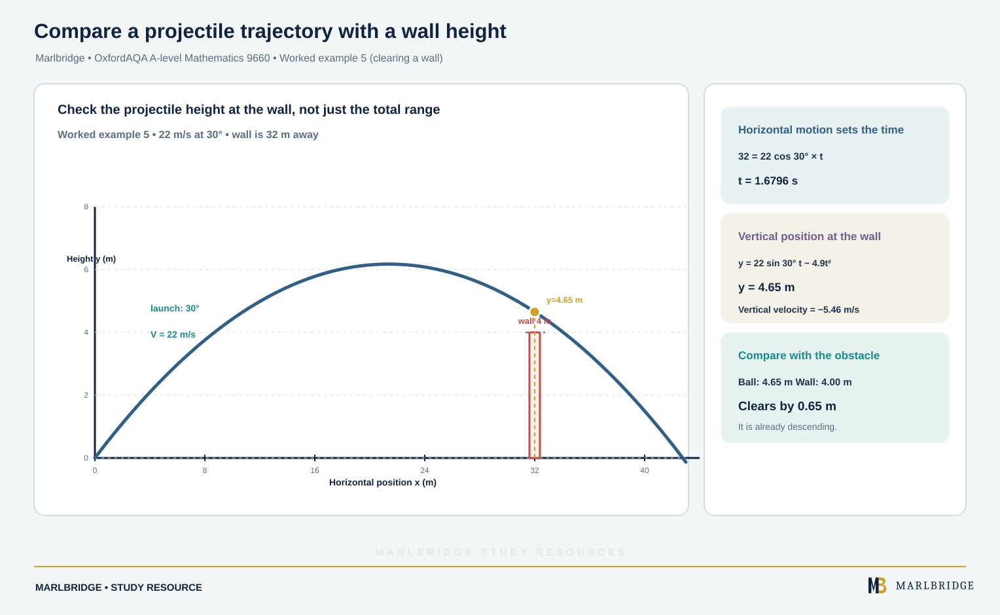

This guide covers section M2.5 (Projectiles) of the OxfordAQA International AS and A-level Mathematics (9660) specification, Version 5.2 (International AS exams from May/June 2018, A-level from May/June 2019). The specification states this content is part of International A-level (A2) Unit M2 (Mechanics) and is not examined at International AS.

Related pages: [revision notes](/resources/oxfordaqa-a-level-mathematics-projectile-motion-revision-notes/), [practice questions](/resources/oxfordaqa-a-level-mathematics-projectile-motion-practice/), [straight-line kinematics](/resources/oxfordaqa-a-level-mathematics-kinematics-in-a-straight-line-constant-and-variable/), [Newton's laws and variable acceleration](/resources/oxfordaqa-a-level-mathematics-newtons-laws-inclined-planes-and-variable-acceleration/), [exam preparation](/resources/oxfordaqa-a-level-mathematics-exam-preparation/), the [course hub](/boards/oxfordaqa/a-level/mathematics/), the [printable checklist](/checklists/oxfordaqa/a-level/mathematics/) and the free [10-minute diagnostics](/diagnostics/).

## What you must be able to do

| Spec | Outcome | Where |
|---|---|---|
| M2.5 | Describe the motion of a particle under gravity in two dimensions; state and use x = (V cos α)t and y = (V sin α)t − ½gt² | Sections 1 and 2 |
| M2.5 | Be aware of the assumptions you are making | Section 1 |
| M2.5 | Calculate range, time of flight and maximum height | Sections 3 and 4 |
| M2.5 | Eliminate time to derive the equation of the trajectory | Section 5 |

The specification says the formulae for range, time of flight and maximum height should not be quoted in exams, and that you do not need to know the trajectory formula but must be able to derive it when needed. So the working below always starts from the two equations of motion. Inclined planes and air resistance are not set.

## 1. The model and its assumptions

A projectile is a particle launched with speed V at angle α above the horizontal. After launch the only force is gravity. Take g = 9.8 m/s² unless a question gives another value.

State these assumptions when asked:

* The object is a particle, so its size, shape and spin are ignored.
* There is no air resistance (resistance problems are not set).
* The acceleration due to gravity is constant, 9.8 m/s² downwards, so the model suits motion near the ground.
* The motion happens in one vertical plane, and the ground is flat unless told otherwise.
* Wind has no effect.

A real ball has air resistance. Resistance slows it down, so a real ball would normally travel a shorter horizontal distance and reach a lower height than the model predicts.

## 2. Components and the two equations

Take the origin at the launch point, x horizontal and y vertically upwards.

| Direction | Acceleration | Velocity at time t | Position at time t |
|---|---|---|---|
| Horizontal | 0 | V cos α (constant) | x = (V cos α)t |
| Vertical | −g | V sin α − gt | y = (V sin α)t − ½gt² |

Horizontal motion is uniform because nothing pushes sideways. Vertical motion has constant acceleration −g, so the constant-acceleration results from straight-line motion apply.

Two habits prevent most mistakes.

1. Treat the directions separately. Time t is the only link between them.
2. Fix a sign convention at the start: up is positive, so a launch below the horizontal has a negative vertical component.

Speed at time t is √((V cos α)² + (V sin α − gt)²). The direction of motion is tan θ = (vertical component)/(horizontal component), measured above or below the horizontal.

<figure class="topic-figure">
  
  <figcaption>Distance adds every leg; displacement only compares start and end, so the two averages differ.</figcaption>
</figure>

<figure class="topic-figure">
  
  <figcaption>Differentiate each component separately; parallel to j means the i component of velocity is zero.</figcaption>
</figure>


## 3. Time of flight, greatest height and range on level ground

You derive each result from the equations rather than quote it.

**Time of flight.** The particle returns to the launch level when y = 0:

```
(V sin α)t − ½gt² = 0
t((V sin α) − ½gt) = 0
t = 0 or t = 2V sin α / g
```

**Greatest height.** The vertical velocity is zero at the top, so V sin α − gt = 0 and t = V sin α / g, half the time of flight. Substituting gives y = (V sin α)²/(2g).

**Range.** Horizontal distance at the end of the flight is x = (V cos α)(2V sin α / g) = 2V² sin α cos α / g = V² sin 2α / g.

Two consequences follow from this. The range is greatest when sin 2α = 1, so α = 45°. Angles α and 90° − α give the same range, because sin 2α = sin(180° − 2α). The two paths have different heights and times of flight.

### Worked example 1

<!-- marlbridge-diagram:math-b42-oxfordaqa-projectile-level-ground-trajectory -->
<figure class="lesson-diagram" style="margin: 2rem 0;">
  <a href="/images/learning/mathematics/math-b42-oxfordaqa-projectile-level-ground-trajectory.svg" aria-label="Open full-size diagram: math-b42-oxfordaqa-projectile-level-ground-trajectory"></a>
  <figcaption>Projectile motion: components and parabolic trajectory Select the image to enlarge it.</figcaption>
</figure>
<!-- /marlbridge-diagram:math-b42-oxfordaqa-projectile-level-ground-trajectory -->


A ball is projected from level ground with speed 24 m/s at 50° above the horizontal. Find the time of flight, the greatest height and the range.

```
Vertical component:   24 sin 50° = 18.385 m/s
Horizontal component: 24 cos 50° = 15.427 m/s
Time of flight: t = 2 × 18.385 / 9.8 = 3.752 s
Greatest height: y = 18.385² / (2 × 9.8) = 17.245 m
Range: x = 15.427 × 3.752 = 57.88 m
```

The time of flight is **3.75 s**, the greatest height is **17.2 m** and the range is **57.9 m** (3 s.f.). A check is to find the range from V² sin 2α / g = 576 sin 100° / 9.8, which gives the same 57.9 m.

<figure class="topic-figure">
  
  <figcaption>Gradients give acceleration; areas give displacement, and distance counts every area as positive.</figcaption>
</figure>

<figure class="topic-figure">
  
  <figcaption>The two roots of the quadratic are the times going up and coming down through the same height.</figcaption>
</figure>


## 4. Launching from a height, or below the horizontal

If the ground is not at the launch level, do not use the level-ground results. Put the landing condition into the y equation and solve.

### Worked example 2

A stone is thrown from the top of a cliff, 20 m above level ground, with speed 18 m/s at 25° above the horizontal. Find the time to reach the ground, the horizontal distance travelled, and the speed on landing.

```
Components: horizontal 18 cos 25° = 16.314, vertical 18 sin 25° = 7.607
Landing: y = −20, so  −20 = 7.607t − 4.9t²
4.9t² − 7.607t − 20 = 0
t = [7.607 + √(7.607² + 4 × 4.9 × 20)] / 9.8 = 2.941 s   (reject the negative root)
Horizontal distance: x = 16.314 × 2.941 = 47.97 m
Vertical velocity on landing: 7.607 − 9.8 × 2.941 = −21.21 m/s
Speed = √(16.314² + 21.21²) = 26.76 m/s
```

The stone lands after **2.94 s**, **48.0 m** from the foot of the cliff, at speed **26.8 m/s**. The negative root is the time at which the extended path would have passed through ground level before launch, so it has no meaning here.

### Worked example 3 (horizontal projection)

A stone is thrown horizontally at 16 m/s from the top of a cliff. It lands 40 m from the base of the cliff. Find the height of the cliff and the direction of motion on landing.

Here α = 0, so the initial vertical velocity is zero.

```
Horizontal: 40 = 16t, so t = 2.5 s
Vertical: drop = ½ × 9.8 × 2.5² = 30.625 m
Vertical velocity on landing: 9.8 × 2.5 = 24.5 m/s downwards
tan θ = 24.5 / 16, θ = 56.9° below the horizontal
```

The cliff is **30.6 m** high and the stone lands moving at **56.9° below the horizontal**, at speed √(16² + 24.5²) = 29.3 m/s.

<figure class="topic-figure">
  
  <figcaption>Horizontal motion is uniform and vertical motion has acceleration −g; time links the two.</figcaption>
</figure>

<figure class="topic-figure">
  
  <figcaption>When the landing level differs, put the landing height into y and reject the negative root.</figcaption>
</figure>


## 5. Eliminating time: the equation of the trajectory

The path is a curve in x and y alone. To find it, eliminate t.

```
From x = (V cos α)t:        t = x / (V cos α)
Substitute into y = (V sin α)t − ½gt²:
y = (V sin α) x / (V cos α) − ½g x² / (V² cos² α)
y = x tan α − g x² / (2V² cos² α)
```

Using 1/cos² α = sec² α:

```
y = x tan α − g x² sec² α / (2V²)
```

The specification does not ask you to remember this, but you should be able to produce it. It is a downward-opening parabola. For problems where the angle is the unknown, use sec² α = 1 + tan² α to turn it into a quadratic in tan α.

### Worked example 4 (finding the angle)

A ball is projected from O with speed 14 m/s. It passes through the point 10 m horizontally from O and 5 m above O. Find the possible angles of projection.

```
y = x tan α − g x² (1 + tan² α) / (2V²)
5 = 10T − 4.9 × 100 × (1 + T²) / 196        where T = tan α
5 = 10T − 2.5(1 + T²)
2.5T² − 10T + 7.5 = 0
T² − 4T + 3 = 0
(T − 1)(T − 3) = 0
```

So tan α = 1 or tan α = 3, giving α = **45°** or α = **71.6°** (1 d.p.). Two angles appear because the point can be reached on the way up or on the way down.

### Worked example 5 (clearing a wall)

<!-- marlbridge-diagram:math-b66-oxfordaqa-projectile-wall-clearance -->
<figure class="lesson-diagram" style="margin: 2rem 0;">
  <a href="/public/images/learning/mathematics/math-b66-oxfordaqa-projectile-wall-clearance.svg" aria-label="Open full-size diagram: math-b66-oxfordaqa-projectile-wall-clearance"></a>
  <figcaption>A parabolic trajectory for a ball launched at 22 m/s and 30° crosses a 4 m wall 32 m from the launch point at height 4.65 m, clearing it by 0.65 m while descending.</figcaption>
</figure>
<!-- /marlbridge-diagram:math-b66-oxfordaqa-projectile-wall-clearance -->


A ball is projected from level ground at 22 m/s at 30° above the horizontal. A vertical wall 4 m high stands 32 m from the launch point on the same level. Does the ball clear it?

```
Horizontal: 32 = 22 cos 30° × t, so t = 1.6796 s
Height at that time: y = 22 sin 30° × 1.6796 − 4.9 × 1.6796² = 18.476 − 13.823 = 4.65 m
```

The height is 4.65 m, which is greater than 4 m, so the ball **clears the wall by 0.65 m**. The vertical velocity at that moment is 11 − 9.8 × 1.6796 = −5.46 m/s, so the ball is on its way down. For a "does it clear" question, always compare heights at the horizontal distance of the obstacle, and say whether the ball is above or below it.

<figure class="topic-figure">
  
  <figcaption>Eliminating t gives a quadratic in tan α, so there are usually two launch angles.</figcaption>
</figure>


## Common errors

* Using V instead of the components V cos α and V sin α in the equations.
* Using the level-ground range or time formulae when the landing point is above or below the launch point.
* Giving the speed at the greatest height as zero. Only the vertical component is zero there, so the speed is V cos α.
* Forgetting the sign: the landing condition from a cliff is y = −20, not 20.
* Rounding the time too early and losing accuracy in x. Keep full unrounded values and round at the end.
* Giving a time of flight without rejecting a negative root.
* Stating assumptions vaguely ("ignore friction"). Name the specific ones: air resistance ignored, particle model, g constant.

## Where to go next

Practise with the [projectile practice questions](/resources/oxfordaqa-a-level-mathematics-projectile-motion-practice/), condense with the [revision notes](/resources/oxfordaqa-a-level-mathematics-projectile-motion-revision-notes/) and tick off the topic on the [printable checklist](/checklists/oxfordaqa/a-level/mathematics/). The [hub](/boards/oxfordaqa/a-level/mathematics/) lists the other units, and the [diagnostics](/diagnostics/) show which topics need attention first.

<figure class="topic-figure">
  
  <figcaption>The suvat equations are the gradient and area of one straight-line velocity-time graph.</figcaption>
</figure>

<figure class="topic-figure">
  
  <figcaption>Find where v = 0, split the motion there, and add the sizes of the stages for distance.</figcaption>
</figure>

## Frequently asked questions

**Which OxfordAQA 9660 section covers projectile motion?**
Projectile motion is section M2.5, in Unit M2 (Mechanics) of OxfordAQA International A-level Mathematics 9660. It includes range, time of flight, maximum height and the equation of the trajectory.

**How do you find the equation of the trajectory of a projectile?**
Eliminate time t between x = (V cos α)t and y = (V sin α)t − ½gt². This gives y in terms of x alone.

**What links the horizontal and vertical motion of a projectile?**
Time is the only link. Treat the two directions separately, and find t from one equation before using it in the other.

**Are air resistance questions set on projectiles in OxfordAQA 9660?**
No. The model ignores air resistance and resistance problems are not set, so state that assumption precisely rather than writing "ignore friction".

## Official syllabus

OxfordAQA International AS and A-level Mathematics (9660), Version 5.2, published by OxfordAQA. Section M2.5: Projectiles.
