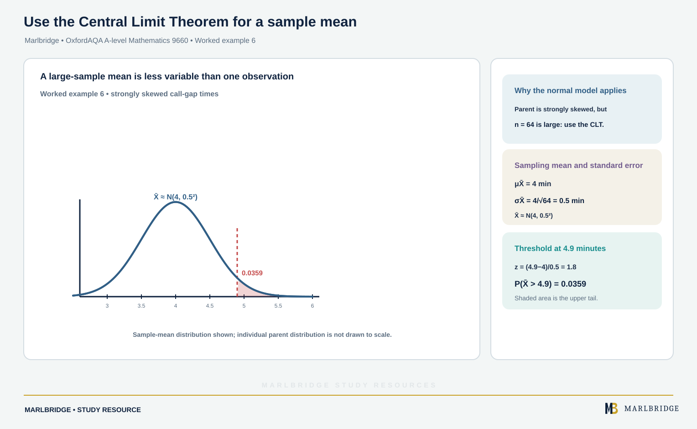

This study guide covers section S2.5 (Estimation) of the OxfordAQA International AS and A-level Mathematics (9660) specification, Version 5.2. The specification states that this content belongs to International A-level (A2) Unit S2 (Statistics). It is not examined at International AS. You should already be comfortable with the normal distribution (S2.4), including the result for sums of independent normal variables.

Revise from the [course hub](/boards/oxfordaqa/a-level/mathematics/) and tick off skills on the [printable checklist](/checklists/oxfordaqa/a-level/mathematics/). When you finish, use the [revision notes](/resources/oxfordaqa-a-level-mathematics-sampling-unbiased-estimators-and-the-central-limit-revision-notes/) for recall and the [practice set](/resources/oxfordaqa-a-level-mathematics-sampling-unbiased-estimators-and-the-central-limit-practice/) for timed work. If you are unsure where to start, try a [free 10-minute diagnostic](/diagnostics/).

## What this unit covers

| Spec ref | What you must be able to do |
|---|---|
| S2.5 | Use the terms population, sample, parameter and statistic. Understand a simple random sample. |
| S2.5 | Use x̄ and S² as unbiased estimators of the population mean and variance. |
| S2.5 | State and use the sampling distribution of the mean of a random sample from a normal distribution, including the standard error σ/√n and its estimator S/√n. |
| S2.5 | Know and apply the Central Limit Theorem: the mean of a large sample from any distribution is approximately normal. |

The specification says that methods of obtaining simple random samples are not tested directly. You need the idea, not a list of techniques.

## Population, sample, parameter, statistic

A **population** is the whole collection of items you want to know about. A **sample** is the part of it you actually observe.

A **parameter** is a number that describes the population, such as the population mean μ or variance σ². It is fixed, and usually unknown. A **statistic** is a number calculated from a sample, such as x̄. Its value changes from sample to sample, so a statistic is itself a random variable.

A **simple random sample** of size n is chosen so that every possible group of n items from the population is equally likely to be the sample. Every item has the same chance of inclusion, and the choices do not influence each other.

### Worked example 1

A school has 840 pupils. The head selects 60 of them using random numbers on a numbered list and records each pupil's travel time to school. The mean of the 60 times is 24.5 minutes.

- Population: the travel times of all 840 pupils.
- Sample: the 60 recorded times.
- 24.5 minutes is a statistic, because it comes from the sample.
- The mean travel time of all 840 pupils is a parameter. It is unknown unless everyone is asked.

If the head had asked only the pupils in the first bus queue, the sample would not be simple random, because most groups of 60 pupils would have no chance of being chosen.

<figure class="topic-figure">
  
  <figcaption>How each method picks its sample; quota is stratified without random selection.</figcaption>
</figure>


## Unbiased estimators

An **estimator** is a statistic used to estimate a parameter. An estimator T of a parameter θ is **unbiased** if E(T) = θ. On average, over all possible samples, it gives the right value. It does not claim that any one estimate is correct.

The specification names two unbiased estimators.

| Parameter | Unbiased estimator | Value from data |
|---|---|---|
| Population mean μ | X̄ | x̄ = Σx / n |
| Population variance σ² | S² | s² = Σ(x − x̄)² / (n − 1) |

The same estimate of variance can be found from summary data:

```
s² = (Σx² − n x̄²) / (n − 1)
```

The divisor is n − 1, not n. If you divide by n, the estimator has mean (n − 1)σ²/n, which is too small on average. So the n − 1 version is the one to use whenever the question says "unbiased estimate of the variance". The square root s is the usual estimate of the standard deviation σ, although S is not exactly unbiased for σ.

### Worked example 2: from raw data

Six masses (kg): 12.4, 13.1, 11.8, 12.9, 13.5, 12.2. Find unbiased estimates of the population mean and variance.

```
Σx = 75.9, so x̄ = 75.9 / 6 = 12.65
Σx² = 962.11
Σx² − n x̄² = 962.11 − 6 × 12.65² = 962.11 − 960.135 = 1.975
s² = 1.975 / 5 = 0.395
```

Estimate of the mean: **12.65 kg**. Estimate of the variance: **0.395 kg²**. The same 1.975 comes from adding the six squared deviations from 12.65.

<figure class="topic-figure">
  
  <figcaption>Frequency = frequency density times class width, so areas add up to the total frequency.</figcaption>
</figure>

<figure class="topic-figure">
  
  <figcaption>Variance is the mean of the squared distances from the mean; the standard deviation is the side of that mean square.</figcaption>
</figure>

<figure class="topic-figure">
  
  <figcaption>Predictions are reliable inside the range of the data and unreliable outside it.</figcaption>
</figure>


### Worked example 3: from summary data

A sample of n = 25 has Σx = 312.5 and Σx² = 3948.2.

```
x̄ = 312.5 / 25 = 12.5
s² = (3948.2 − 25 × 12.5²) / 24 = (3948.2 − 3906.25) / 24 = 41.95 / 24 = 1.748 (3 d.p.)
s = 1.32 (3 s.f.)
```

So the estimate of μ is 12.5 and the estimate of σ² is 1.748.

## Sampling distribution of the mean (normal parent)

Take a random sample X₁, X₂, …, Xₙ from a normal distribution N(μ, σ²). The sample mean X̄ = (X₁ + … + Xₙ)/n has its own distribution, called the **sampling distribution of the mean**.

Because a sum of independent normal variables is normal:

```
X̄ ~ N(μ, σ²/n)
```

This is exact for any n. Two facts follow:

- E(X̄) = μ, so X̄ is unbiased for μ.
- Var(X̄) = σ²/n. The spread of X̄ shrinks as n grows.

The standard deviation of X̄ is σ/√n. It is called the **standard error** of the sample mean. When σ is unknown, estimate it by S, so the standard error is estimated by **S/√n**.

Quadrupling the sample size halves the standard error. This is why larger samples give more reliable estimates.

### Worked example 4

Packs have mass X ~ N(250, 6²) grams. A random sample of 9 packs is taken. Find P(X̄ < 247) and compare it with P(X < 247).

```
X̄ ~ N(250, 6²/9) = N(250, 2²)
z = (247 − 250) / 2 = −1.5
P(X̄ < 247) = Φ(−1.5) = 0.0668
```

For a single pack: z = (247 − 250)/6 = −0.5, so P(X < 247) = Φ(−0.5) = 0.3085.

A mean of 9 packs falls 3 g or more below target far less often than a single pack does, since the mean varies less.

### Worked example 5: choosing n

Using the packs above, find the smallest n for which P(|X̄ − 250| < 2) exceeds 0.95.

For a central 95% region, the z-value needed is 1.96 (1.959964 to 6 d.p.). We need 2 / (6/√n) > 1.96.

```
√n > 1.96 × 6 / 2 = 5.88
n > 34.57
```

Since n is a whole number, **n = 35**. Check: with n = 34 the probability is 0.9481, and with n = 35 it is 0.9514.

<figure class="topic-figure">
  
  <figcaption>A value beyond Q3 + 1.5 x IQR is a possible outlier, but it is removed only if it is an error or not in the population.</figcaption>
</figure>

<figure class="topic-figure">
  
  <figcaption>Two fair random samples from the same firm give different means, so samples are only estimates.</figcaption>
</figure>

<figure class="topic-figure">
  
  <figcaption>A statistic varies from sample to sample, and its sampling distribution shows how it behaves.</figcaption>
</figure>

<figure class="topic-figure">
  
  <figcaption>For large n the sample mean is approximately normal whatever the parent, with standard error sigma over root n.</figcaption>
</figure>


## The Central Limit Theorem

Many populations are not normal: waiting times are skewed, and counts are discrete. The **Central Limit Theorem** (CLT) says that if X has mean μ and finite variance σ², then for a large sample

```
X̄ is approximately N(μ, σ²/n)
```

whatever the shape of the parent distribution. The approximation improves as n increases. The specification says "large sample" without fixing a number, so state that you are using the CLT because n is large. Many courses treat n around 30 or more as large, and a very skewed parent needs more.

Three things to keep clear:

- The CLT is about the mean (or the total) of the sample. It does not make the individual values normal.
- If the parent is already normal, X̄ is normal for every n, so you do not need the CLT.
- For a total T = X₁ + … + Xₙ, the same result gives T approximately N(nμ, nσ²).

When σ² is unknown and n is large, use s² as the estimate of σ² and write the standard error as s/√n.

### Worked example 6

<!-- marlbridge-diagram:math-b66-oxfordaqa-clt-sample-mean-upper-tail -->
<figure class="lesson-diagram" style="margin: 2rem 0;">
  <a href="/public/images/learning/mathematics/math-b66-oxfordaqa-clt-sample-mean-upper-tail.svg" aria-label="Open full-size diagram: math-b66-oxfordaqa-clt-sample-mean-upper-tail"></a>
  <figcaption>A normal sampling-mean curve centred at 4 minutes has standard error 0.5 minutes; the upper-tail area beyond 4.9 minutes is shaded and labelled 0.0359.</figcaption>
</figure>
<!-- /marlbridge-diagram:math-b66-oxfordaqa-clt-sample-mean-upper-tail -->


The time between calls to a helpline has mean 4 minutes and standard deviation 4 minutes (the distribution is strongly skewed). A random sample of 64 gaps is taken. Find the probability that the sample mean exceeds 4.9 minutes.

The parent is not normal, but n = 64 is large, so by the CLT

```
X̄ ≈ N(4, 4²/64) = N(4, 0.5²)
z = (4.9 − 4) / 0.5 = 1.8
P(X̄ > 4.9) = 1 − Φ(1.8) = 0.0359
```

The probability is **0.0359** (3 s.f.).

### Worked example 7: a total

For the same 64 gaps, find the probability that the total time exceeds 300 minutes.

```
T ≈ N(64 × 4, 64 × 4²) = N(256, 32²)
z = (300 − 256) / 32 = 1.375
P(T > 300) = 1 − Φ(1.375) = 0.0846
```

## Common errors

- **Dividing by n for S².** Use n − 1 when asked for an unbiased estimate.
- **Forgetting to square-root.** The standard error is σ/√n, not σ/n. The variance of X̄ is σ²/n. Check which you are putting into your normal distribution.
- **Using σ in place of σ/√n** when finding a probability about a sample mean.
- **Calling a statistic a parameter.** The mean of your sample is a statistic. The mean of the whole population is the parameter.
- **Applying the CLT without saying why.** Write that the sample is large, so X̄ is approximately normal.
- **Claiming the CLT makes a single observation normal.** It only applies to means and totals.
- **Treating an estimate as certain.** An unbiased estimator is right on average, so a single estimate can still be off.
- **Rounding too early** in z-values. Keep full values until the end.

## Next steps

Condense this unit with the [revision notes](/resources/oxfordaqa-a-level-mathematics-sampling-unbiased-estimators-and-the-central-limit-revision-notes/), then test yourself on the [practice questions](/resources/oxfordaqa-a-level-mathematics-sampling-unbiased-estimators-and-the-central-limit-practice/). Estimation is the base for hypothesis testing of a mean (S2.6), so make sure the sampling distribution of X̄ is secure first. The [diagnostics](/diagnostics/) show which topics to prioritise.

## Frequently asked questions

**What does the Central Limit Theorem say?**
For a large random sample from any distribution with mean μ and variance σ², the sample mean X̄ is approximately N(μ, σ²/n).

**Does the Central Limit Theorem make individual values normal?**
No. It applies only to the sample mean or the total of the sample, not to single observations.

**What is the sampling distribution of the mean from a normal population?**
If the population is N(μ, σ²), then X̄ ~ N(μ, σ²/n) exactly, for any sample size n.

**Which OxfordAQA 9660 section covers sampling and the Central Limit Theorem?**
Section S2.5 (Estimation), in Unit S2 of OxfordAQA 9660, covers population and sample, unbiased estimators, the sampling distribution of the mean and the Central Limit Theorem.

## Official syllabus

This guide follows section S2.5 of the OxfordAQA International AS and A-level Mathematics (9660) specification, Version 5.2 (International AS exams from May/June 2018, A-level from May/June 2019), published by OxfordAQA.
