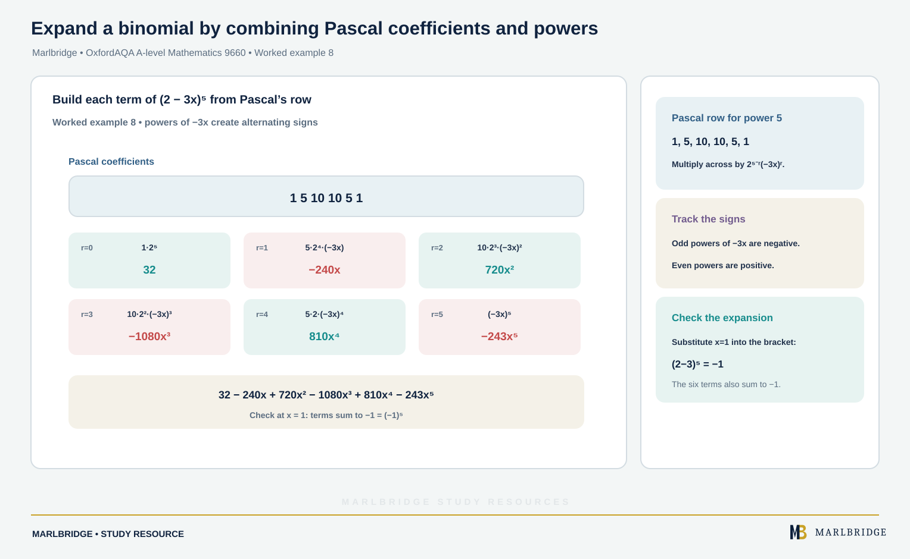

This guide covers section P1.5 (Sequences and series) of the OxfordAQA International AS and A-level Mathematics (9660) specification, Version 5.2. The specification states this content is part of International AS Unit P1 (Pure Maths), so it also counts towards the International A-level.

Use the [revision notes](/resources/oxfordaqa-a-level-mathematics-sequences-arithmetic-and-geometric-series-and-binomial-revision-notes/) for quick recall and the [practice set](/resources/oxfordaqa-a-level-mathematics-sequences-arithmetic-and-geometric-series-and-binomial-practice/) to test yourself. The wider unit is covered in the [Unit P1 study guide](/resources/a-level-oxfordaqa-mathematics-unit-p1/), and see the [OxfordAQA A-level Mathematics course hub](/boards/oxfordaqa/a-level/mathematics/). The printable [checklist](/checklists/oxfordaqa/a-level/mathematics/) lets you tick off each outcome. To find your weak spots first, try the [free 10-minute diagnostics](/diagnostics/).

## What this unit covers

| Spec content (P1.5) | What you must be able to do |
|---|---|
| Sequences, including those given by a formula for the nth term | Generate terms, find a term, find n for a given value |
| Sequences generated by x(n+1) = f(x(n)) | Generate terms; find a limit L by solving L = f(L) |
| Arithmetic series | Use the nth term and the sum; sum of the first n natural numbers; Σ notation |
| Sum of a finite geometric series | Use the nth term and the sum of n terms |
| Sum to infinity of a convergent geometric series | State and use |r| < 1; find the sum to infinity |
| Binomial expansion of (1 + x)ⁿ, n a positive integer | Use n! and nCr; use Pascal's triangle or the formula; (a + b)ⁿ accepted |

Where a result below needs a formula, check which ones appear in your formulae booklet, and learn them anyway. Do not rely on being given them.

## 1. Sequences given by a formula for the nth term

A sequence is an ordered list of terms. If the nth term is given by a formula in n, substitute n = 1, 2, 3, ... to get the terms. The specification uses the notation x(n) for a general term, and this guide writes x(n) the same way.

### Worked example 1

A sequence has nth term x(n) = n² − 3n + 5.

(a) Write down the first four terms.
(b) Find which term equals 59.

```
(a) n=1: 1 - 3 + 5 = 3
    n=2: 4 - 6 + 5 = 3
    n=3: 9 - 9 + 5 = 5
    n=4: 16 - 12 + 5 = 9
    Terms: 3, 3, 5, 9
(b) n² - 3n + 5 = 59
    n² - 3n - 54 = 0
    (n - 9)(n + 6) = 0
    n = 9 or n = -6
```

n must be a positive integer, so reject n = −6. The 9th term is 59. Check: 81 − 27 + 5 = 59.

## 2. Recurrence relations and limits

A recurrence relation gives each term from the one before: x(n+1) = f(x(n)). You also need a starting value, usually x(1).

If the sequence settles down to a limit L as n → ∞, then x(n+1) and x(n) both tend to L. Putting x(n+1) = x(n) = L gives the equation

```
L = f(L)
```

Solve it to find the limit. This tells you what the limit would be if there is one. It does not prove the sequence converges.

### Worked example 2

x(n+1) = 0.6 x(n) + 8, with x(1) = 5.

(a) Find x(2), x(3), x(4).
(b) Find the limit.

```
(a) x(2) = 0.6(5) + 8 = 11
    x(3) = 0.6(11) + 8 = 14.6
    x(4) = 0.6(14.6) + 8 = 16.76
(b) L = 0.6L + 8
    0.4L = 8
    L = 20
```

The terms are increasing and approach 20.

### Worked example 3 (more than one root)

x(n+1) = √(x(n) + 12), with x(1) = 1.

```
L = √(L + 12)
L² = L + 12
L² - L - 12 = 0
(L - 4)(L + 3) = 0
L = 4 or L = -3
```

Squaring can introduce a false root. Every term is a positive square root, so the limit cannot be negative. Reject L = −3, so L = 4. The first terms are 1, 3.606, 3.950, 3.994 (3 d.p.), which agree with 4.

Some recurrences never settle. For example, x(n+1) = 1/(1 − x(n)) with x(1) = 3 gives 3, −1/2, 2/3, 3, ... The sequence repeats every three terms. It is periodic, so it has no limit. To find a late term, use the period: x(100) is the same as x(1), because 100 leaves remainder 1 when divided by 3.

<figure class="topic-figure">
  
  <figcaption>A recurrence settles at the limit L where L = f(L); the cobweb shows the terms closing in on it.</figcaption>
</figure>


## 3. Arithmetic series

In an arithmetic sequence you add the same common difference d each time. With first term a:

```
nth term:   x(n) = a + (n - 1)d
sum:        S(n) = n/2 × (2a + (n - 1)d)  =  n/2 × (a + l)
```

Here l is the last term. Use the second form when you know the last term.

### Sum of the first n natural numbers

Take a = 1, d = 1:

```
1 + 2 + 3 + ... + n = n(n + 1)/2
```

For example, 1 + 2 + ... + 100 = 100 × 101/2 = 5050.

### Σ notation

Σ means "add up". The expression Σ from r = 1 to 24 of (5r − 2) means: put r = 1, 2, ..., 24 into 5r − 2 and add. It is an arithmetic series with first term 3, common difference 5 and 24 terms.

```
S = 24/2 × (3 + 118) = 12 × 121 = 1452
```

Check using the natural-number result: 5 × (24 × 25/2) − 2 × 24 = 5 × 300 − 48 = 1452.

### Worked example 4

The 5th term of an arithmetic sequence is 23 and the 12th term is 58.

(a) Find a and d.
(b) Find the sum of the first 20 terms.
(c) Find the smallest n for which the sum of the first n terms exceeds 500.

```
(a) a + 4d = 23
    a + 11d = 58
    Subtract: 7d = 35, so d = 5 and a = 3.
(b) S(20) = 20/2 × (2(3) + 19(5)) = 10 × 101 = 1010
(c) S(n) = n/2 × (6 + 5(n - 1)) = n(5n + 1)/2
    n(5n + 1)/2 > 500
    5n² + n - 1000 > 0
```

The positive root of 5n² + n − 1000 = 0 is n = (−1 + √20001)/10 ≈ 14.04. So n must be at least 15. Check both sides of the boundary: S(14) = 497, which is not above 500, and S(15) = 570. The answer is n = 15.

<figure class="topic-figure">
  
  <figcaption>An arithmetic progression adds the same amount each time; a geometric progression multiplies by the same ratio.</figcaption>
</figure>

<figure class="topic-figure">
  
  <figcaption>Pairing each term with its reverse shows why S_n = half n times (a + l).</figcaption>
</figure>

<figure class="topic-figure">
  
  <figcaption>Sequences can decrease then increase, repeat in a cycle, or climb towards a limit.</figcaption>
</figure>


## 4. Geometric series

In a geometric sequence you multiply by the same common ratio r each time. With first term a:

```
nth term:   x(n) = a rⁿ⁻¹
sum:        S(n) = a(1 - rⁿ)/(1 - r)  =  a(rⁿ - 1)/(r - 1),   r ≠ 1
```

Use whichever form has the positive denominator. The sum comes from subtracting rS from S, so almost all terms cancel.

### Worked example 5

A geometric series has first term 4 and common ratio 1.5.

(a) Find the sum of the first 8 terms.
(b) Find the smallest n for which S(n) exceeds 10 000.

```
(a) S(8) = 4(1.5⁸ - 1)/(1.5 - 1) = 8(1.5⁸ - 1)
    1.5⁸ = 6561/256
    S(8) = 8 × 6305/256 = 6305/32 = 197.03125
(b) 8(1.5ⁿ - 1) > 10 000
    1.5ⁿ > 1251
    n > ln 1251 / ln 1.5 = 17.6...
```

Because n must be a whole number, n = 18. Check: S(17) = 7874.09... and S(18) = 11 815.1..., so 17 terms is not enough.

## 5. Sum to infinity

If |r| < 1, that is −1 < r < 1, the terms shrink towards zero and the sum of n terms approaches a limit as n → ∞. In S(n), the rⁿ term vanishes, leaving

```
S∞ = a/(1 - r),     |r| < 1
```

If |r| ≥ 1 the series does not converge, so there is no sum to infinity.

### Worked example 6

A geometric series has all terms positive. Its 2nd term is 12 and its 4th term is 3.

```
ar = 12 and ar³ = 3
Divide: r² = 3/12 = 1/4
r = 1/2 or r = -1/2
```

All terms are positive, so reject r = −1/2. Then r = 1/2 and a = 24. The series converges because |r| < 1, and S∞ = 24/(1 − 1/2) = 48.

### Worked example 7 (range of x)

Find the values of x for which 1 + (2x − 1) + (2x − 1)² + ... converges, and its sum when it does.

The ratio is r = 2x − 1. Convergence needs |2x − 1| < 1, so −1 < 2x − 1 < 1, which gives 0 < x < 1. The sum is 1/(1 − (2x − 1)) = 1/(2 − 2x).

### Recurring decimals

0.272727... = 0.27 + 0.0027 + ... is geometric with a = 0.27 and r = 0.01. So S∞ = 0.27/0.99 = 27/99 = 3/11.

<figure class="topic-figure">
  
  <figcaption>Partial sums of a convergent geometric series level off at S_infinity = a/(1 - r).</figcaption>
</figure>

<figure class="topic-figure">
  
  <figcaption>A geometric series has a sum to infinity only when |r| &lt; 1.</figcaption>
</figure>


## 6. The binomial expansion

### Factorials and nCr

n! = n × (n − 1) × ... × 2 × 1, with 0! = 1. The number of ways to choose r items from n is written nCr (the specification also shows it as a bracket with n over r):

```
nCr = n! / (r!(n - r)!)
```

For example, 7C3 = 7!/(3! 4!) = 35, and nC0 = nCn = 1. Also nCr = nC(n−r), so the coefficients are symmetric.

### Pascal's triangle

Each row begins and ends with 1, and every other entry is the sum of the two above it. Row n gives the coefficients of (1 + x)ⁿ.

```
n=0:           1
n=1:          1 1
n=2:         1 2 1
n=3:        1 3 3 1
n=4:       1 4 6 4 1
n=5:     1 5 10 10 5 1
n=6:   1 6 15 20 15 6 1
```

### The expansion

For positive integer n:

```
(1 + x)ⁿ = 1 + nx + [n(n-1)/2!] x² + [n(n-1)(n-2)/3!] x³ + ... + xⁿ
```

For (a + b)ⁿ, the term in aⁿ⁻ʳbʳ has coefficient nCr, and the powers of a and b in each term add up to n. The specification says Pascal's triangle or formulae will be accepted, so use whichever is faster and safer for you.

### Worked example 8

<!-- marlbridge-diagram:math-b64-oxfordaqa-binomial-expansion-power-five -->
<figure class="lesson-diagram" style="margin: 2rem 0;">
  <a href="/public/images/learning/mathematics/math-b64-oxfordaqa-binomial-expansion-power-five.svg" aria-label="Open full-size diagram: math-b64-oxfordaqa-binomial-expansion-power-five"></a>
  <figcaption>Six term cards pair Pascal coefficients with powers of 2 and −3x to expand (2−3x)⁵, producing alternating signs and a final check at x=1.</figcaption>
</figure>
<!-- /marlbridge-diagram:math-b64-oxfordaqa-binomial-expansion-power-five -->


Expand (2 − 3x)⁵.

The coefficients are 1, 5, 10, 10, 5, 1. Take a = 2 and b = −3x.

```
32                    =  32
5 × 2⁴ × (-3x)        =  5 × 16 × (-3x)    = -240x
10 × 2³ × (-3x)²      =  10 × 8 × 9x²      =  720x²
10 × 2² × (-3x)³      =  10 × 4 × (-27x³)  = -1080x³
5 × 2 × (-3x)⁴        =  5 × 2 × 81x⁴      =  810x⁴
(-3x)⁵                =                      -243x⁵
```

So (2 − 3x)⁵ = 32 − 240x + 720x² − 1080x³ + 810x⁴ − 243x⁵. Put x = 1 as a check: (−1)⁵ = −1 and the coefficients sum to 32 − 240 + 720 − 1080 + 810 − 243 = −1.

### Worked example 9 (a single coefficient)

Find the coefficient of x³ in (1 + 2x)⁷. The x³ term is 7C3 × (2x)³ = 35 × 8x³ = 280x³. The coefficient is 280.

### Worked example 10 (a product)

Find the coefficient of x² in (3 + x)(1 − 2x)⁶. First, (1 − 2x)⁶ = 1 − 12x + 60x² − 160x³ + ... For x², take 3 × 60x² from the first bracket's 3 and x × (−12x) from its x:

```
3 × 60 + (-12) = 180 - 12 = 168
```

The coefficient is 168.

### Worked example 11 (approximation)

Use the first three terms of (1 + x)⁶ with x = 0.02 to estimate 1.02⁶.

```
1 + 6(0.02) + 15(0.02)² = 1 + 0.12 + 0.006 = 1.126
```

The exact value is 1.126162... so the estimate is a little low, because the omitted terms are positive.

<figure class="topic-figure">
  
  <figcaption>Row n of Pascal’s triangle gives the binomial coefficients; the terms of (4 + 3x)^5 sum to 7^5 at x = 1.</figcaption>
</figure>

<figure class="topic-figure">
  
  <figcaption>The series for a rational power only represents the function when |bx/a| &lt; 1.</figcaption>
</figure>


## Common errors

- Using n for the number of terms and also for the power of r. In x(n) = arⁿ⁻¹ the power is n − 1, not n.
- Forgetting to reject a root. A limit must suit the recurrence, as in example 3, and n must be a positive integer.
- Writing L = f(L) and stopping. Check the answer is sensible, and remember it only applies if the sequence converges.
- Quoting S∞ = a/(1 − r) without checking |r| < 1.
- In inequality questions, rounding n down. If S(14) falls short, the answer is 15, not 14.
- Dropping brackets on a negative term, for example (−3x)² is 9x², not −9x².
- Leaving out the coefficient when b has a number in front of x: (2x)³ is 8x³, so the 8 must multiply the nCr value.

## Frequently asked questions

**What is nCr?**
nCr = n!/(r!(n − r)!) is the number of ways of choosing r items from n. It gives the coefficients in the binomial expansion of (1 + x)ⁿ.

**How do you find one coefficient in a binomial expansion?**
Write down only the term you need, using nCr and the power of each part. For example, the x³ term of (1 + 2x)⁷ is 7C3 × (2x)³.

**How can you write a recurring decimal as a fraction using series?**
Treat it as a geometric series. For example, 0.272727... has a = 0.27 and r = 0.01, so its sum to infinity is 0.27/0.99.

**Which OxfordAQA 9660 section covers sequences, series and binomial expansion?**
Section P1.5 of the OxfordAQA 9660 specification, in Unit P1, covers sequences, recurrence relations, arithmetic and geometric series and the binomial expansion of (1 + x)ⁿ for positive integer n.

## Official syllabus

OxfordAQA International AS and A-level Mathematics (9660), Version 5.2, published by OxfordAQA: section P1.5, Sequences and series, under International AS Unit P1 (Pure Maths).
