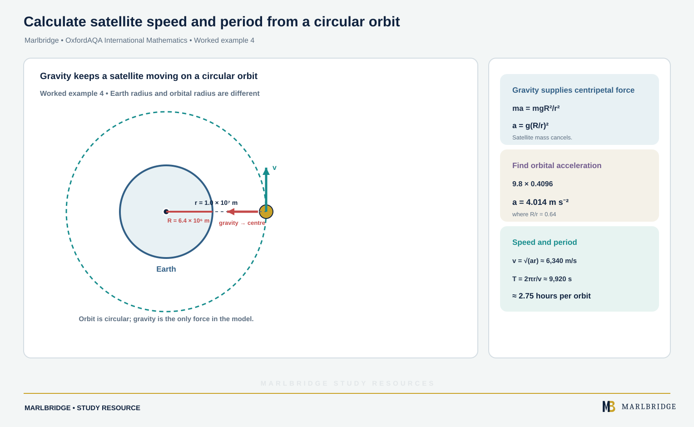

This guide covers section M2.7 (uniform circular motion) of the OxfordAQA International AS and A-level Mathematics (9660) specification, Version 5.2. The specification places this content in International A-level (A2) Unit M2 (Mechanics), the mechanics option that sits beside Unit S2; it is not examined at International AS. Unit M2 assumes the International AS units, so Newton's second law and resolving forces are your starting point.

Use it with the [revision notes](/resources/oxfordaqa-a-level-mathematics-uniform-circular-motion-and-the-conical-pendulum-revision-notes/) and the [practice questions](/resources/oxfordaqa-a-level-mathematics-uniform-circular-motion-and-the-conical-pendulum-practice/). The course hub is [/boards/oxfordaqa/a-level/mathematics/](/boards/oxfordaqa/a-level/mathematics/) and the printable checklist is [/checklists/oxfordaqa/a-level/mathematics/](/checklists/oxfordaqa/a-level/mathematics/). To find weak spots first, try the [free 10-minute diagnostics](/diagnostics/). Supporting skills are in the [forces and Newton's laws guide](/resources/oxfordaqa-a-level-mathematics-forces-newtons-laws-connected-particles-momentum-and/), the [vector kinematics guide](/resources/oxfordaqa-a-level-mathematics-mathematical-modelling-and-kinematics-with-vectors-and/) and the [radians and arcs guide](/resources/oxfordaqa-a-level-mathematics-sine-and-cosine-rules-radians-arcs-and-sectors/).

## What this unit covers

| Ref | What you must be able to do |
|---|---|
| M2.7 | Describe the motion of a particle in a circle at constant speed |
| M2.7 | Know and use v = rω, a = rω² and a = v²/r |
| M2.7 | Find angular speed in radians per second from revolutions per minute or the time for one revolution |
| M2.7 | Use position, velocity and acceleration vectors in terms of i and j, and show motion is circular |
| M2.7 | Solve problems on the conical pendulum |

The specification says problems involve either horizontal circles or situations, such as a satellite in a circular orbit, where the gravitational force is towards the centre of the circle. It also lists these three formulae among those you must learn because they are not in the formulae booklet. Learn them.

## Angular speed

When a particle moves round a circle of radius r, the angle it has turned through changes steadily. The rate of change of that angle is its **angular speed**, ω, measured in radians per second (rad s⁻¹).

One full turn is 2π radians. So if one revolution takes T seconds:

```
ω = 2π/T
```

From revolutions per minute (rev/min), multiply by 2π and divide by 60. Angles in this unit are always in radians, so convert before you substitute.

The speed along the circle follows from arc length s = rθ. Divide by time:

```
v = rω
```

Speed is constant, but velocity is not: its direction changes all the time. That is why the particle accelerates even at constant speed.

### Worked example 1

A wheel of radius 0.35 m turns at 54 rev/min. Find its angular speed, and the speed of a point on its rim.

```
ω = 54 × 2π/60 = 9π/5 = 5.65 rad s⁻¹ (3 s.f.)
v = rω = 0.35 × 9π/5 = 1.98 m s⁻¹ (3 s.f.)
```

## Acceleration towards the centre

The acceleration of a particle in uniform circular motion has constant magnitude and is directed towards the centre of the circle. Two equivalent forms come from v = rω:

```
a = v²/r = rω²
```

Choose the form that uses the data you are given. If you have v and r, use v²/r. If you have ω or the period, use rω².

By Newton's second law, the resultant force on the particle is mass times this acceleration and also points to the centre. The force is not an extra "centripetal force" added to your diagram. It is the resultant of the real forces: tension, friction, a normal contact force or weight.

Method for a dynamics problem:

1. Draw the real forces only.
2. Mark the direction towards the centre.
3. Resolve towards the centre and write resultant = m × a.
4. Resolve vertically (if the particle does not move vertically, the forces balance).
5. Solve, then give units.

### Worked example 2

A particle of mass 0.5 kg moves on a smooth horizontal table, joined by a light inextensible string of length 0.8 m to a fixed point. It completes 10 revolutions in 6.4 s. Find the tension.

```
T_period = 6.4/10 = 0.64 s
ω = 2π/0.64 = 9.82 rad s⁻¹
Tension = m r ω² = 0.5 × 0.8 × (2π/0.64)² = 38.6 N (3 s.f.)
```

The tension is the only horizontal force, so it alone supplies the acceleration. Weight and the normal reaction balance vertically.

### Worked example 3: friction on a turntable

A small coin lies 0.15 m from the centre of a horizontal turntable. The coefficient of friction between coin and turntable is 0.4. Find the greatest angular speed at which the coin stays in place, in rad s⁻¹ and rev/min.

Vertically, R = mg. Friction provides the acceleration towards the centre. At the greatest speed, friction is limiting:

```
μR = m r ω²
0.4 × m × 9.8 = m × 0.15 × ω²
ω² = 0.4 × 9.8/0.15 = 26.13
ω = 5.11 rad s⁻¹
In rev/min: 5.112 × 60/(2π) = 48.8 rev/min
```

The mass cancels. That is a useful check: a heavier coin does not slide sooner.

<figure class="topic-figure">
  
  <figcaption>Write one F = ma equation per particle; tension is the same each side of a smooth pulley.</figcaption>
</figure>

<figure class="topic-figure">
  
  <figcaption>Friction matches the push up to a maximum μR; only when on the point of moving or sliding is F = μR.</figcaption>
</figure>

<figure class="topic-figure">
  
  <figcaption>A pull at an angle lowers R and so the friction limit; a push at an angle raises it.</figcaption>
</figure>

<figure class="topic-figure">
  
  <figcaption>Resolve the weight along and across the slope: R = mg cos θ and the net force down the slope is mg sin θ − μR.</figcaption>
</figure>


## Gravitationally controlled orbits

For a satellite in a circular orbit, gravity is the only force and it points to the centre. In a problem you will be given a model for the gravitational force, usually inverse square. Then gravity = m a gives an equation for the speed.

### Worked example 4

<!-- marlbridge-diagram:math-b62-oxfordaqa-satellite-orbit-gravity-speed-period -->
<figure class="lesson-diagram" style="margin: 2rem 0;">
  <a href="/public/images/learning/mathematics/math-b62-oxfordaqa-satellite-orbit-gravity-speed-period.svg" aria-label="Open full-size diagram: math-b62-oxfordaqa-satellite-orbit-gravity-speed-period"></a>
  <figcaption>A satellite on a circular orbit has tangential velocity and inward gravitational force. The visual distinguishes Earth radius R from orbit radius r and shows acceleration 4.014 m/s², speed about 6,340 m/s, and period about 2.75 hours.</figcaption>
</figure>
<!-- /marlbridge-diagram:math-b62-oxfordaqa-satellite-orbit-gravity-speed-period -->


Model the Earth as a sphere of radius R = 6.4 × 10⁶ m, with gravitational acceleration at its surface g = 9.8 m s⁻². A satellite of mass m moves in a circular orbit of radius r = 1.0 × 10⁷ m. The gravitational force on it is mgR²/r². Find its speed and the time for one orbit.

```
m a = mgR²/r²
a = 9.8 × (6.4×10⁶/10⁷)² = 9.8 × 0.4096 = 4.014 m s⁻²
v²/r = a, so v = √(a r) = √(4.014 × 10⁷) = 6340 m s⁻¹ (3 s.f.)
Period = 2πr/v = 2π × 10⁷/6336 = 9920 s (3 s.f.), about 2.75 hours
```

The satellite's mass cancels, so every satellite at this radius has the same speed. State the modelling assumptions if asked: the satellite is a particle, the orbit is circular, and only the Earth's gravity acts.

## Position, velocity and acceleration vectors

Take a particle moving anticlockwise on a circle of radius r, centre at the origin, with angular speed ω. If it starts on the positive x-axis, its position at time t is:

```
r(t) = r cos(ωt) i + r sin(ωt) j
```

Differentiate for velocity and again for acceleration:

```
v = −rω sin(ωt) i + rω cos(ωt) j
a = −rω² cos(ωt) i − rω² sin(ωt) j = −ω² r(t)
```

Three facts follow:

- The speed is |v| = rω, constant.
- v · r = 0, so the velocity is perpendicular to the radius (tangent to the circle).
- a = −ω² r, so the acceleration points to the centre with magnitude rω².

If the centre is at c instead of the origin, replace r by (r − c): the acceleration is −ω²(r − c). For clockwise motion, swap the roles of sin and cos or change a sign.

**Showing that motion is circular.** The specification says you may be asked to show this by proving the body stays a constant distance from a fixed point. Find |r − c| for the proposed centre and show it does not depend on t.

### Worked example 5

A particle has position vector r = (3 + 2cos 4t)i + (−1 + 2sin 4t)j, with lengths in metres and t in seconds. Show that it moves on a circle, and find its speed and its acceleration when t = π/8.

Subtract the point (3, −1):

```
r − (3i − j) = 2cos 4t i + 2sin 4t j
|r − (3i − j)|² = 4cos²4t + 4sin²4t = 4
```

The distance from (3, −1) is always 2 m, so the path is a circle of centre (3, −1) and radius 2 m.

```
v = −8 sin 4t i + 8 cos 4t j
speed = √(64 sin²4t + 64 cos²4t) = 8 m s⁻¹
a = −32 cos 4t i − 32 sin 4t j
```

At t = π/8, 4t = π/2, so a = −32j m s⁻². Check: a = rω² = 2 × 4² = 32, directed from the particle at (3, 1) down towards the centre (3, −1). Correct.

If the speed is not constant, or the distance from the supposed centre changes, the motion is not uniform circular motion. For example, 4cos 3t i + 3sin 3t j has distance √(9 + 7cos²3t) from the origin, which varies, so it traces an ellipse.

## The conical pendulum

<!-- marlbridge-diagram:math-b43-oxfordaqa-conical-pendulum-forces-radius -->
<figure class="lesson-diagram" style="margin: 2rem 0;">
  <a href="/images/learning/mathematics/math-b43-oxfordaqa-conical-pendulum-forces-radius.svg" aria-label="Open full-size diagram: math-b43-oxfordaqa-conical-pendulum-forces-radius"></a>
  <figcaption>Conical pendulum: geometry, forces and circular motion Select the image to enlarge it.</figcaption>
</figure>
<!-- /marlbridge-diagram:math-b43-oxfordaqa-conical-pendulum-forces-radius -->


A particle of mass m is attached to a light inextensible string of length L. The other end is fixed. The particle moves in a horizontal circle at constant speed, so the string traces out a cone with its axis vertical.

```
        pivot O
        /|
     L / |  h = L cos θ
      /θ |
     /   |
    P----+---- centre of circle
      r = L sin θ
```

Forces on the particle: weight mg downwards and tension T along the string towards O. The angle θ is measured from the vertical. The radius is r = L sin θ.

```
Vertical (no vertical acceleration):  T cos θ = mg
Horizontal (towards the centre):      T sin θ = m r ω² = m L sin θ ω²
```

From the horizontal equation, dividing by sin θ (θ is not zero):

```
T = m L ω²
```

Substitute into the vertical equation:

```
m L ω² cos θ = mg, so cos θ = g/(L ω²)
```

Since cos θ ≤ 1, the particle can only move in a cone if ω² > g/L. The vertical depth of the circle below the pivot is h = L cos θ, which gives ω² = g/h. A faster rotation means a smaller h, so the bob rises.

### Worked example 6

A bob of mass 0.4 kg hangs from a string of length 1.2 m and revolves at 5 rad s⁻¹ in a horizontal circle. Find the tension, the angle of the string to the vertical, and the speed of the bob.

```
T = m L ω² = 0.4 × 1.2 × 25 = 12 N
cos θ = g/(L ω²) = 9.8/(1.2 × 25) = 0.3267
θ = 70.9° (3 s.f.)
r = 1.2 sin 70.93° = 1.134 m
v = rω = 1.134 × 5 = 5.67 m s⁻¹ (3 s.f.)
```

Check with the vertical equation: T cos θ = 12 × 0.3267 = 3.92, and mg = 0.4 × 9.8 = 3.92. It balances.

<figure class="topic-figure">
  
  <figcaption>In equilibrium the forces sum to zero in every direction, so they close into a triangle.</figcaption>
</figure>

<figure class="topic-figure">
  
  <figcaption>The resultant of tension and weight points to the centre of the circle and equals mrω².</figcaption>
</figure>


## Common errors

- Using rev/min or degrees per second in v = rω. Convert to rad s⁻¹ first.
- Adding a "centripetal force" arrow to the force diagram as well as the real forces.
- Using v²/r with ω, or rω² with v. Match the formula to the data.
- In the conical pendulum, using L instead of L sin θ as the radius.
- Writing T = mg in the conical pendulum. Only the vertical component, T cos θ, balances the weight.
- Showing motion is circular by checking only one or two points. Prove the distance is constant for all t.
- Giving the direction of acceleration as along the velocity. It is towards the centre, perpendicular to the velocity.

## Next steps

Work through the [practice questions](/resources/oxfordaqa-a-level-mathematics-uniform-circular-motion-and-the-conical-pendulum-practice/), then keep the [revision notes](/resources/oxfordaqa-a-level-mathematics-uniform-circular-motion-and-the-conical-pendulum-revision-notes/) for the final weeks. Take the [free diagnostics](/diagnostics/) to check where you stand.

## Frequently asked questions

**Which direction does the acceleration act in uniform circular motion?**
Towards the centre of the circle, perpendicular to the velocity. It is not along the direction of motion.

**How do you convert revolutions per minute to radians per second?**
Multiply by 2π/60. For example, 60 rev/min is 2π rad s⁻¹.

**In a conical pendulum, does the tension equal the weight?**
No. Only the vertical component of tension, T cos θ, balances the weight mg. The horizontal component T sin θ provides the acceleration towards the centre.

**Which OxfordAQA 9660 section covers circular motion?**
Uniform circular motion and the conical pendulum are in section M2.7 of OxfordAQA International A-level Mathematics 9660, in Unit M2 (Mechanics).

## Official syllabus

OxfordAQA International AS and A-level Mathematics (9660) specification, Version 5.2, published by OxfordAQA. Section M2.7 of Unit M2 (International A-level only).
