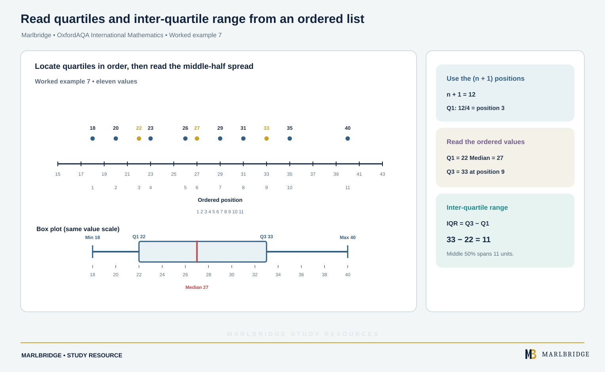

This guide covers part of section 3.4.1 (Presentation and analysis) of the OxfordAQA International GCSE Mathematics (9260) specification, Version 5.1. It covers statements S1, S2, S3 and S5: types of data, reading tables, two-way tables, and averages and spread. The specification lists Core content and Extension content separately. Core content is also assessable on the Extension papers, as the specification states. Only the statements marked "Extension only" below go beyond Core.

Charts and diagrams (S4) are taught on a separate page. For other topics see the [OxfordAQA IGCSE Mathematics hub](/boards/oxfordaqa/igcse/mathematics/) and the [printable checklist](/checklists/oxfordaqa/igcse/mathematics/). Companion pages: [revision notes](/resources/oxfordaqa-igcse-mathematics-data-types-tables-and-averages-revision-notes/) and [practice questions](/resources/oxfordaqa-igcse-mathematics-data-types-tables-and-averages-practice/). If you want to find your weak spots first, try the [free diagnostics](/diagnostics/).

## What this unit covers

| Ref | What you must be able to do | Content |
|---|---|---|
| S1 | Understand and use qualitative, discrete and continuous data, grouped and ungrouped | Core |
| S2 | Extract data from printed tables and lists | Core |
| S3 | Design and use two-way tables for grouped and ungrouped data | Core |
| S5 | Calculate median, mean, range, mode and modal class | Core |
| S5 | Quartiles, inter-quartile range and percentiles | Extension only |

## 1. Types of data (S1)

**Qualitative data** describes a quality and is not a number: eye colour, favourite sport, blood group.

**Quantitative data** is numerical. It is one of two kinds.

- **Discrete data** can only take separate values, usually found by counting: number of siblings, shoe size, goals scored. Nothing lies between neighbouring values.
- **Continuous data** can be any value between two limits and is found by measuring: height, time, mass, temperature. How exact it is depends on the measuring tool.

Data can also be **ungrouped** (each value listed, or listed with a frequency) or **grouped** (values sorted into class intervals).

Class intervals must not overlap and must leave no gaps. For continuous data use inequalities:

```
20 ≤ t < 30     includes 20, excludes 30
30 ≤ t < 40     the value 30 belongs here
```

For discrete data you can write classes such as 0–4, 5–9, 10–14.

### Worked example 1

Classify each: (a) the number of pages in a novel, (b) the time a kettle takes to boil, (c) a pupil's favourite subject.

- (a) Discrete. Pages are counted, and 212.5 pages makes no sense.
- (b) Continuous. Time is measured and can take any value, such as 138.46 s.
- (c) Qualitative. It is a category, not a number.

<figure class="topic-figure">
  
  <figcaption>Data is qualitative or quantitative; numbers are counted (discrete) or measured (continuous).</figcaption>
</figure>

<figure class="topic-figure">
  
  <figcaption>A boundary value goes in the class that starts at that value.</figcaption>
</figure>


## 2. Extracting data from tables and lists (S2)

Read the question first, so you know which row and column you need. Check the units in the heading. Then run a finger along the row and down the column until they meet.

### Worked example 2

A courier's price list:

| Weight of parcel | Price |
|---|---|
| Up to 1 kg | £6.50 |
| Over 1 kg, up to 3 kg | £9.80 |
| Over 3 kg, up to 10 kg | £14.25 |

Find the cost of sending parcels weighing 1 kg, 2.4 kg and 3.1 kg.

```
1 kg    "up to 1 kg" includes exactly 1 kg   → £6.50
2.4 kg  over 1, up to 3                      → £9.80
3.1 kg  over 3, up to 10                     → £14.25
Total = 6.50 + 9.80 + 14.25 = £30.55
```

Exact boundary values are where marks are lost. Read the wording ("up to", "over") to decide which row a boundary value belongs to.

<figure class="topic-figure">
  
  <figcaption>&quot;Up to&quot; includes the boundary and &quot;over&quot; excludes it, so each parcel has exactly one price band.</figcaption>
</figure>


## 3. Two-way tables (S3)

A two-way table sorts the same people or items by two features at once. Rows show one feature, columns the other, and totals go at the ends.

**Designing one.** Choose categories that cover everything and do not overlap (for example "under 18" and "18 or over", not "under 18" and "over 18"). Label rows and columns, and add a total row and column. A table with a total in the corner lets you check your arithmetic: the row totals and the column totals must give the same grand total.

**Completing one.** Fill any row or column with one gap first. Subtract the known entries from the total.

### Worked example 3

A film club has 80 members. 35 are under 16. 28 members chose comedy. 12 of the under-16s chose comedy. Everyone chose either comedy or drama. Complete the table and find how many members aged 16 or over chose drama.

| | Comedy | Drama | Total |
|---|---|---|---|
| Under 16 | 12 | 23 | 35 |
| 16 or over | 16 | 29 | 45 |
| Total | 28 | 52 | 80 |

Working: under 16 drama = 35 − 12 = 23. 16 or over = 80 − 35 = 45. 16 or over comedy = 28 − 12 = 16. 16 or over drama = 45 − 16 = 29. Check: 23 + 29 = 52 and 28 + 52 = 80.

**Answer: 29 members.**

<figure class="topic-figure">
  
  <figcaption>Fill any cell whose row or column is otherwise known, then check totals both ways.</figcaption>
</figure>


## 4. Averages and range for ungrouped data (S5, Core)

| Measure | How to find it |
|---|---|
| Mean | sum of all values ÷ number of values |
| Median | middle value of the ordered list; for an even number of values, the mean of the two middle ones |
| Mode | most common value (there can be none, one, or several) |
| Range | largest value − smallest value |

A single extreme value drags the mean towards it, because every value counts. The median only depends on the middle of the ordered list. The mode is the only average that works for qualitative data. The range measures spread, not a typical value.

### Worked example 4

Messages sent in one day by ten people: 14, 9, 22, 17, 9, 31, 12, 9, 25, 18. Find the mean, median, mode and range.

```
Ordered: 9, 9, 9, 12, 14, 17, 18, 22, 25, 31
Sum = 166, so mean = 166 ÷ 10 = 16.6
Median: 10 values, so mean of 5th and 6th = (14 + 17) ÷ 2 = 15.5
Mode = 9 (appears three times)
Range = 31 − 9 = 22
```

### Working backwards

If the mean of n values is m, the total is n × m.

Example: the mean of 6 numbers is 15.5, and five of them are 12, 20, 9, 18 and 14. Total = 6 × 15.5 = 93. Five known add to 73. The sixth number is 93 − 73 = **20**.

### Combining two groups

Never average two means. Use the totals.

Example: 15 runners have a mean time of 52 minutes and 25 runners have a mean time of 64 minutes. Total = 15 × 52 + 25 × 64 = 780 + 1600 = 2380. Mean of all 40 = 2380 ÷ 40 = **59.5** minutes.

<figure class="topic-figure">
  
  <figcaption>Combine group means using totals, not by averaging the two means.</figcaption>
</figure>

<figure class="topic-figure">
  
  <figcaption>The mean, median, mode and range of one small list of data.</figcaption>
</figure>


## 5. Frequency tables (S5)

For a table of values x with frequencies f:

- Total frequency n = Σf.
- Mean = Σfx ÷ Σf, where you multiply each value by its frequency first.
- The mode is the value that has the greatest frequency. Quote that value, not the frequency.
- The median is the value at position (n + 1) ÷ 2 in the ordered list. Use a cumulative frequency column to find it.

### Worked example 5

Cups of tea drunk in one day by 40 office staff:

| Cups, x | 0 | 1 | 2 | 3 | 4 | 5 |
|---|---|---|---|---|---|---|
| Frequency, f | 3 | 8 | 12 | 9 | 5 | 3 |
| Cumulative | 3 | 11 | 23 | 32 | 37 | 40 |

```
Σfx = 0 + 8 + 24 + 27 + 20 + 15 = 94
Mean = 94 ÷ 40 = 2.35
Median position = (40 + 1) ÷ 2 = 20.5, so between the 20th and 21st values.
Both lie in the "2" group (positions 12 to 23), so median = 2
Mode = 2 (frequency 12)
Range = 5 − 0 = 5
```

<figure class="topic-figure">
  
  <figcaption>The cumulative frequency column locates positions 20 and 21 inside the group of 2s, so the median is 2.</figcaption>
</figure>

<figure class="topic-figure">
  
  <figcaption>For a frequency table, multiply each value by its frequency, add, then divide by the total frequency.</figcaption>
</figure>


## 6. Grouped data (S5)

You do not know the exact values, so every answer except the modal class is an estimate.

- **Modal class**: the class with the highest frequency (when the classes have equal width).
- **Class containing the median**: use the cumulative frequency and find where position n ÷ 2 falls.
- **Estimated mean**: replace each class by its midpoint, then use Σfx ÷ Σf.
- **Estimated range**: the largest the range could be is the upper end of the top class minus the lower end of the bottom class.

### Worked example 6

Journey times (minutes) of 60 cycle commutes:

| Time, t | 8 ≤ t < 12 | 12 ≤ t < 16 | 16 ≤ t < 20 | 20 ≤ t < 24 | 24 ≤ t < 28 |
|---|---|---|---|---|---|
| Frequency | 6 | 14 | 22 | 11 | 7 |
| Midpoint | 10 | 14 | 18 | 22 | 26 |
| Cumulative | 6 | 20 | 42 | 53 | 60 |

```
Modal class: 16 ≤ t < 20 (frequency 22)
Σfx = 60 + 196 + 396 + 242 + 182 = 1076
Estimated mean = 1076 ÷ 60 = 17.9 minutes (1 d.p.)
Median position = 60 ÷ 2 = 30; cumulative reaches 20 then 42,
so the median is in 16 ≤ t < 20
Largest possible range = 28 − 8 = 20 minutes
```

The mean is only an estimate because each commute is treated as if it took the midpoint time.

<figure class="topic-figure">
  
  <figcaption>Use the midpoint of each class, not a boundary, so the mean is only an estimate.</figcaption>
</figure>


## 7. Quartiles, inter-quartile range and percentiles (S5, Extension only)

Quartiles split an ordered list into four equal parts. The **lower quartile** (Q1) is the value with one quarter of the data below it. The **median** is Q2. The **upper quartile** (Q3) has three quarters below it. The **inter-quartile range** is IQR = Q3 − Q1. It measures the spread of the middle half of the data and is not changed by extreme values at either end.

A **percentile** divides the data into 100 parts. The 90th percentile is the value below which about 90% of the data lies.

**Method used here.** With n values in order, the position of a quartile or percentile is (fraction) × (n + 1). The fractions are 1/4, 1/2 and 3/4 for the quartiles, and p/100 for the pth percentile. If the position is not a whole number, move that fraction of the way between the two neighbouring values. The questions on this site use list sizes where the position is a whole number, so other common ways of splitting the list give the same answer. Use the method your teacher shows you.

### Worked example 7

<!-- marlbridge-diagram:math-b62-oxfordaqa-quartiles-iqr-boxplot-eleven-values -->
<figure class="lesson-diagram" style="margin: 2rem 0;">
  <a href="/public/images/learning/mathematics/math-b62-oxfordaqa-quartiles-iqr-boxplot-eleven-values.svg" aria-label="Open full-size diagram: math-b62-oxfordaqa-quartiles-iqr-boxplot-eleven-values"></a>
  <figcaption>An ordered dot strip and matching box plot for eleven values mark minimum 18, lower quartile 22, median 27, upper quartile 33, maximum 40, and IQR 11.</figcaption>
</figure>
<!-- /marlbridge-diagram:math-b62-oxfordaqa-quartiles-iqr-boxplot-eleven-values -->


Eleven values: 23, 31, 18, 27, 35, 29, 40, 22, 26, 33, 20.

```
Ordered: 18, 20, 22, 23, 26, 27, 29, 31, 33, 35, 40
n + 1 = 12
Q1 at position 12 ÷ 4 = 3  → 22
Median at position 6      → 27
Q3 at position 9          → 33
IQR = 33 − 22 = 11
```

### Worked example 8 (percentiles)

Nineteen values in order: 39, 41, 44, 45, 47, 48, 50, 52, 53, 55, 57, 58, 60, 61, 63, 64, 66, 69, 72.

n + 1 = 20. The 20th percentile is at position 0.2 × 20 = 4, so it is **45**. The 80th percentile is at position 0.8 × 20 = 16, so it is **64**.

### From a frequency table

Build the cumulative frequency, then find the position. For 39 values, n + 1 = 40, so Q1 is at position 10, the median at 20 and Q3 at 30.

| Value | 1 | 2 | 3 | 4 | 5 | 6 | 7 |
|---|---|---|---|---|---|---|---|
| Frequency | 2 | 5 | 9 | 10 | 7 | 4 | 2 |
| Cumulative | 2 | 7 | 16 | 26 | 33 | 37 | 39 |

Position 10 falls in the group where the cumulative goes from 7 to 16, so Q1 = 3. Position 20 is in the group reaching 26, so the median = 4. Position 30 is in the group reaching 33, so Q3 = 5. IQR = 5 − 3 = **2**.

<figure class="topic-figure">
  
  <figcaption>Quartile positions are fraction × (n + 1) in the sorted list; IQR = Q3 − Q1.</figcaption>
</figure>

<figure class="topic-figure">
  
  <figcaption>Read across at n/4, n/2 and 3n/4, then down; the IQR is UQ minus LQ.</figcaption>
</figure>

<figure class="topic-figure">
  
  <figcaption>The p-th percentile is read at p/100 of the total; the slowest 10% is the 90th percentile.</figcaption>
</figure>


## 8. Choosing and comparing averages

| Situation | Best choice | Reason |
|---|---|---|
| Data with an extreme value | Median | Not pulled by the extreme value |
| Qualitative data | Mode | Only average that works |
| Fair share or total needed | Mean | Uses every value |
| Spread, no outliers | Range | Simple, but uses only two values |
| Spread, outliers present (Extension only) | IQR | Ignores the extremes |

<figure class="topic-figure">
  
  <figcaption>One extreme value drags the mean but not the median, which is why the median is chosen when there is an outlier.</figcaption>
</figure>

<figure class="topic-figure">
  
  <figcaption>Compare data sets with one comment on an average and one on spread.</figcaption>
</figure>


## Common errors

- Picking the median from a list that is still unordered.
- Quoting the largest frequency as the mode instead of the value it belongs to.
- Dividing Σfx by the count of table columns instead of Σf.
- Putting a class limit into Σfx where the midpoint should go.
- Calling a grouped mean exact.
- Averaging two means without weighting by group size.
- Writing 18 and under 18 as classes, so a value fits two rows.
- Treating the median as the middle of the range rather than the middle value of the ordered data.
- Giving the position of the quartile instead of the value at that position.

## Next steps

Use the [revision notes](/resources/oxfordaqa-igcse-mathematics-data-types-tables-and-averages-revision-notes/) to memorise the methods, then test yourself with the [practice questions](/resources/oxfordaqa-igcse-mathematics-data-types-tables-and-averages-practice/). For rounding and number skills, see the [Number study guide](/resources/igcse-oxfordaqa-mathematics-number/). The [free diagnostics](/diagnostics/) help you decide what to revise next.

## Official syllabus

Source: OxfordAQA International GCSE Mathematics (9260) specification, Version 5.1, for exams from May/June 2018, published by OxfordAQA. Section 3.4.1, statements S1, S2, S3 and S5.
