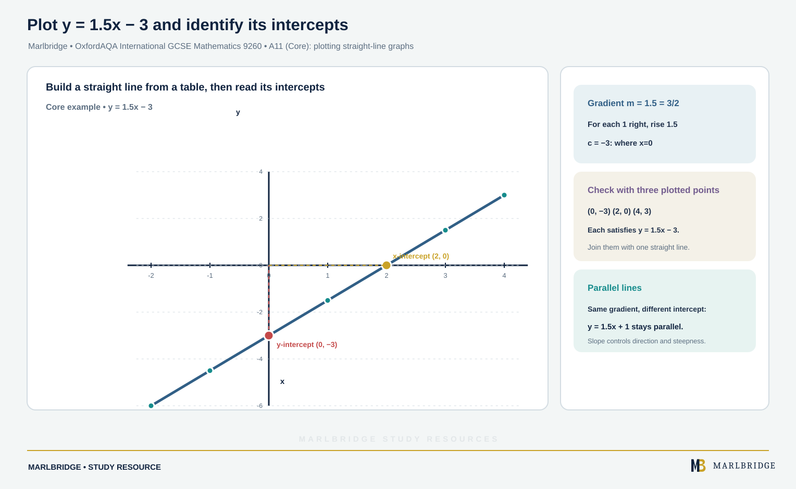

This study guide follows the OxfordAQA International GCSE Mathematics (9260) specification, Version 5.1, section 3.2.2 (Functions, graphs and calculus), statements A9, A10 and A11. The specification sets out Core content and, beside it, extra Extension content. Core content can also be assessed on the Extension papers, so Extension candidates need all of it. Anything that only Extension candidates need is labelled **Extension only** below.

Related pages: [revision notes](/resources/oxfordaqa-igcse-mathematics-functions-coordinates-and-straight-line-graphs-revision-notes/), [practice questions](/resources/oxfordaqa-igcse-mathematics-functions-coordinates-and-straight-line-graphs-practice/), the [course hub](/boards/oxfordaqa/igcse/mathematics/) and the [printable checklist](/checklists/oxfordaqa/igcse/mathematics/). For rearranging formulae, see the [algebra manipulation revision notes](/resources/oxfordaqa-igcse-mathematics-algebra-manipulation-revision-notes/). To find your weak spots first, try the [free diagnostics](/diagnostics/).

## What this unit covers

| Reference | Skill | Level |
|---|---|---|
| A9 | Interpret simple expressions as functions with inputs and outputs | Core |
| A9 | Use the definition of a function and f(x) = … notation; use domain and range; find the composite function fg and the inverse function f⁻¹ | Extension only |
| A10 | Work with coordinates in all four quadrants | Core |
| A11 | Plot straight-line graphs; use y = mx + c; identify and interpret gradients and intercepts, graphically and algebraically; know that parallel lines have equal gradients | Core |
| A11 | Write the equation of a line from two points, or from a point and a gradient; use perpendicular gradients | Extension only |

Curved graphs, rates of change, variation and tangents belong to other units, so they are not covered here.

## A9 (Core): expressions as functions

A function takes an **input**, applies a rule, and gives one **output**. A function machine shows the steps in order. Writing the steps as an expression lets you find the output for any input.

**Example 1.** A machine multiplies the input x by 4, then subtracts 9.

```
x → ×4 → −9 → output
```

The output is 4x − 9.
- Input 6 gives 4 × 6 − 9 = 15.
- To find the input that gives output 31, work backwards: 31 + 9 = 40, then 40 ÷ 4 = 10. So the input is 10.
- Check with an output of −5: −5 + 9 = 4, and 4 ÷ 4 = 1.

**Order matters.** "Add 3, then multiply by 5" is 5(x + 3), which is not the same as 5x + 3. With x = 4, the first gives 35 and the second gives 23. Brackets are what record the order.

**Example 2.** A rule says "square the input, then subtract three times the input". This is x² − 3x. For input −2, the output is (−2)² − 3(−2) = 4 + 6 = 10. Put negative inputs in brackets before squaring.

Working backwards means undoing each step in reverse order, using the inverse operation each time. The Extension material below turns this idea into a formal tool.

<figure class="topic-figure">
  
  <figcaption>The same two steps in a different order give different outputs, 35 and 23, for input 4.</figcaption>
</figure>

<figure class="topic-figure">
  
  <figcaption>Whatever goes in the brackets replaces x in the rule.</figcaption>
</figure>


## A9 (Extension only): f(x) notation, domain and range

A **function** is a rule that pairs every allowed input with a single output. We write f(x) = 2x + 5 to name the function f and its rule. Then f(3) means "put x = 3 into the rule", so f(3) = 11. The letter x is only a placeholder: f(a + 1) = 2(a + 1) + 5 = 2a + 7.

- The **domain** is the set of inputs you are allowed to use.
- The **range** is the set of outputs that result.

If no domain is stated, it is every input that works. Division by zero is not allowed, so for f(x) = 1/(x − 4) the domain is all x except x = 4, written x ≠ 4.

**Example 3.** f(x) = x² + 2 for −3 ≤ x ≤ 2. Find the range.

Do not simply substitute the endpoints. Look at the shape: x² is smallest at x = 0.

```
f(−3) = 9 + 2 = 11
f(0)  = 0 + 2 = 2
f(2)  = 4 + 2 = 6
```

The smallest output is 2 (at x = 0) and the largest is 11 (at x = −3). The range is 2 ≤ f(x) ≤ 11.

**Example 4.** g(x) = 2x − 1 for 1 ≤ x ≤ 6. A straight-line rule only increases, so the endpoints give the extremes: g(1) = 1 and g(6) = 11. The range is 1 ≤ g(x) ≤ 11.

<figure class="topic-figure">
  
  <figcaption>On a restricted domain the range comes from the shape of the curve, not just from the end values.</figcaption>
</figure>

<figure class="topic-figure">
  
  <figcaption>The range lists each different output once; two inputs can share an output.</figcaption>
</figure>

<figure class="topic-figure">
  
  <figcaption>g(x) = 3x² + 1 never goes below 1, and k(x) = 5/(x − 4) has no value at x = 4.</figcaption>
</figure>


## A9 (Extension only): composite functions

The composite function **fg(x)** means "do g first, then f". It is f(g(x)). Read it from the right.

**Example 5.** f(x) = 2x + 3 and g(x) = x² − 5.

```
fg(x) = f(g(x)) = 2(x² − 5) + 3 = 2x² − 7
gf(x) = g(f(x)) = (2x + 3)² − 5 = 4x² + 12x + 4
```

So fg and gf are different. Evaluate: fg(3) = 2(9) − 7 = 11. Solve fg(x) = 25:

```
2x² − 7 = 25
2x² = 32
x² = 16
x = 4 or x = −4
```

Keep both roots unless the domain rules one out.

<figure class="topic-figure">
  
  <figcaption>Solving fg(x) = 25 gives two roots because the horizontal line meets the curve twice.</figcaption>
</figure>

<figure class="topic-figure">
  
  <figcaption>In gf(x) the function nearest x acts first, so fg(x) and gf(x) usually differ.</figcaption>
</figure>


## A9 (Extension only): inverse functions

The inverse function **f⁻¹** undoes f. If f(a) = b then f⁻¹(b) = a. So f⁻¹(f(x)) = x. The inputs of f⁻¹ are the outputs of f, so the domain of f⁻¹ is the range of f.

**Method to find f⁻¹(x):**
1. Set y equal to the rule for f.
2. Rearrange so that x is on its own on the left.
3. Swap the letters, so the answer is written with x as the input.

**Example 6.** h(x) = (3x − 4)/5.

```
y = (3x − 4)/5
5y = 3x − 4
5y + 4 = 3x
x = (5y + 4)/3
```

So h⁻¹(x) = (5x + 4)/3. Check: h⁻¹(2) = 14/3, and h(14/3) = (14 − 4)/5 = 2. ✓

**Example 7 (x appears twice).** k(x) = (x + 1)/(x − 2), with x ≠ 2.

```
y(x − 2) = x + 1
yx − 2y = x + 1
yx − x = 2y + 1
x(y − 1) = 2y + 1
x = (2y + 1)/(y − 1)
```

So k⁻¹(x) = (2x + 1)/(x − 1). Collecting every x-term on one side, then factorising, is the key step.

<figure class="topic-figure">
  
  <figcaption>The inverse undoes each step of f in the reverse order.</figcaption>
</figure>

<figure class="topic-figure">
  
  <figcaption>The graph of f⁻¹ is the reflection of the graph of f in the line y = x.</figcaption>
</figure>


## A10 (Core): coordinates in four quadrants

The axes cross at the origin (0, 0). They split the plane into four quadrants, numbered anticlockwise from the top right.

| Quadrant | x | y | Example |
|---|---|---|---|
| 1st (top right) | positive | positive | (3, 2) |
| 2nd (top left) | negative | positive | (−3, 2) |
| 3rd (bottom left) | negative | negative | (−3, −2) |
| 4th (bottom right) | positive | negative | (3, −2) |

A point is written (x, y): along first, then up or down. Points on an axis belong to no quadrant. Horizontal lines have equations y = b and vertical lines have equations x = a. The line y = x passes through the 1st and 3rd quadrants, and y = −x passes through the 2nd and 4th.

**Example 8.** A(−3, 2), B(1, 2) and C(3, −1) are three vertices of parallelogram ABCD, taken in order. Find D.

Moving from A to B is 4 across and 0 up. D to C must be the same move, so D = C − (4, 0) = (−1, −1). Check: A to D is 2 across and 3 down, and B to C is 2 across and 3 down. ✓

<figure class="topic-figure">
  
  <figcaption>Opposite sides of a parallelogram make the same move, which locates the fourth vertex.</figcaption>
</figure>

<figure class="topic-figure">
  
  <figcaption>The signs of x and y tell you the quadrant; on the x-axis y = 0 and on the y-axis x = 0.</figcaption>
</figure>


## A11 (Core): plotting straight-line graphs

<!-- marlbridge-diagram:math-b60-oxfordaqa-linear-graph-table-intercepts -->
<figure class="lesson-diagram" style="margin: 2rem 0;">
  <a href="/public/images/learning/mathematics/math-b60-oxfordaqa-linear-graph-table-intercepts.svg" aria-label="Open full-size diagram: math-b60-oxfordaqa-linear-graph-table-intercepts"></a>
  <figcaption>A straight-line graph for y=1.5x−3 shows source table points, gradient 1.5, y-intercept (0,−3), x-intercept (2,0), and a parallel line with the same gradient.</figcaption>
</figure>
<!-- /marlbridge-diagram:math-b60-oxfordaqa-linear-graph-table-intercepts -->


An equation such as y = 1.5x − 3 gives a straight line. Plot with a table of values, using at least three points as a check.

| x | −2 | −1 | 0 | 1 | 2 | 3 | 4 |
|---|---|---|---|---|---|---|---|
| y | −6 | −4.5 | −3 | −1.5 | 0 | 1.5 | 3 |

Plot the points and draw one ruled line through them. If one point is off the line, recheck that value.

The line crosses the y-axis at (0, −3). It crosses the x-axis where y = 0: 1.5x − 3 = 0, so x = 2.

### The form y = mx + c

In y = mx + c, the number **m** is the gradient, and **c** gives the height where the line meets the y-axis.

Gradient = (change in y) ÷ (change in x). Between (−2, −6) and (4, 3): (3 − (−6))/(4 − (−2)) = 9/6 = 1.5. This matches the 1.5x in the equation. A positive gradient means the line slopes up from left to right, and a negative gradient means it slopes down. A gradient of 0 is a horizontal line.

**Rearranging first.** If the equation is not in the form y = mx + c, rearrange it.

**Example 9.** 3x + 4y = 12.

```
4y = −3x + 12
y = −(3/4)x + 3
```

The gradient is −3/4 and the y-intercept is 3. For the x-intercept set y = 0: 3x = 12, so x = 4.

<figure class="topic-figure">
  
  <figcaption>m is the gradient and c is where the line crosses the y-axis.</figcaption>
</figure>

<figure class="topic-figure">
  
  <figcaption>Uphill is positive, downhill is negative, flat is zero.</figcaption>
</figure>

<figure class="topic-figure">
  
  <figcaption>For x and y on the same side, set x = 0 and y = 0 to find the axis crossing points, then check a third point.</figcaption>
</figure>


### Parallel lines

Lines with the same gradient are **parallel**. So y = 2x − 5, y = 2x and 4x − 2y = 7 are all parallel. The third one rearranges to y = 2x − 3.5. A line parallel to y = 2x − 5 with y-intercept 4 is y = 2x + 4.

<figure class="topic-figure">
  
  <figcaption>Make a table, plot every point and rule one line across the whole range.</figcaption>
</figure>

<figure class="topic-figure">
  
  <figcaption>Parallel lines share a gradient; use a point to find c.</figcaption>
</figure>


## A11 (Extension only): finding equations of lines

**Through a point with a given gradient.** Use y − y₁ = m(x − x₁).

**Example 10.** Gradient −2/3, through (4, −1).

```
y − (−1) = −(2/3)(x − 4)
y + 1 = −(2/3)x + 8/3
y = −(2/3)x + 5/3
3y = −2x + 5, so 2x + 3y = 5
```

Check: 2(4) + 3(−1) = 5. ✓

**Through two points.** Find the gradient, then use either point.

**Example 11.** (−3, −4) and (5, 8). Gradient = (8 − (−4))/(5 − (−3)) = 12/8 = 3/2. Then y + 4 = (3/2)(x + 3), so y = (3/2)x + 1/2. Check with (5, 8): 7.5 + 0.5 = 8. ✓

**Perpendicular lines.** Two lines at right angles have gradients that multiply to give −1. A line of gradient m has perpendiculars of gradient −1/m. The line y = 4x + 1 has a perpendicular gradient of −1/4.

**Example 12.** A(1, 3) and B(5, 6). Find the line through B perpendicular to AB.

Gradient AB = 3/4. Perpendicular gradient = −4/3.

```
y − 6 = −(4/3)(x − 5)
3y − 18 = −4x + 20
4x + 3y = 38
```

It meets the x-axis where y = 0: 4x = 38, so x = 9.5.

<figure class="topic-figure">
  
  <figcaption>Gradient from two points, then the equation of the line through them.</figcaption>
</figure>

<figure class="topic-figure">
  
  <figcaption>A point and a gradient fix the line: y - y1 = m(x - x1), checked by substituting the point.</figcaption>
</figure>

<figure class="topic-figure">
  
  <figcaption>Perpendicular gradients multiply to -1.</figcaption>
</figure>


## Common errors

- Writing the point as (y, x).
- Reading the gradient of 3x + 4y = 12 as 3 or −3. You must rearrange first.
- Using "run over rise" for gradient.
- Giving only the positive root when solving fg(x) = a number.
- Doing fg in the wrong order. g acts first.
- Swapping x and y but not rearranging when finding f⁻¹.
- Forgetting that a perpendicular gradient changes sign as well as being inverted.

## Next steps

Try the [practice questions](/resources/oxfordaqa-igcse-mathematics-functions-coordinates-and-straight-line-graphs-practice/), then condense with the [revision notes](/resources/oxfordaqa-igcse-mathematics-functions-coordinates-and-straight-line-graphs-revision-notes/). Use the [checklist](/checklists/oxfordaqa/igcse/mathematics/) to track progress.

## Frequently asked questions

**What is the domain and range of a function?**
The domain is the set of inputs you are allowed to use, and the range is the set of outputs that result.

**How are the four quadrants numbered?**
They are numbered anticlockwise from the top right. The first quadrant has x and y both positive, and the third has both negative.

**How do you tell if two lines are parallel?**
Two lines are parallel if they have the same gradient. Rearrange each into y = mx + c to compare.

**How do you find the equation of a line through two points?**
Find the gradient m from the two points first, then use y − y₁ = m(x − x₁) with either point. This is Extension only in OxfordAQA International GCSE Mathematics 9260.

**How many points should you plot for a straight-line graph?**
Use a table of values with at least three points, so a mistake shows up as a point that is not in line.

## Official syllabus

OxfordAQA International GCSE Mathematics (9260), specification Version 5.1, for exams May/June 2018 onwards, published by OxfordAQA. Section 3.2.2, statements A9, A10 and A11.
