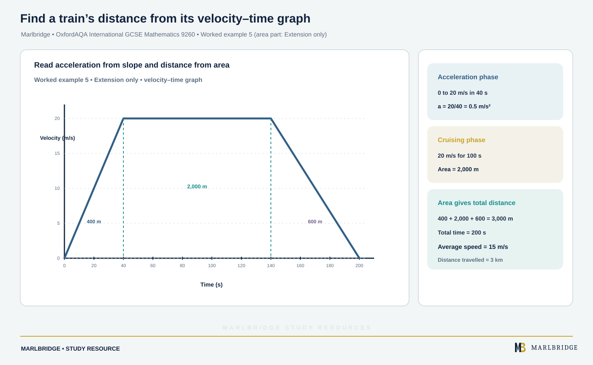

This study guide is for OxfordAQA International GCSE Mathematics (9260), written to the specification Version 5.1 (for exams May/June 2018 onwards). It covers references A17 and A18 in section 3.2.2, Functions, graphs and calculus. A17 has Core content and extra Extension content. A18 (direct and inverse variation) is Extension only. Extension papers can also assess the Core content.

Use it with the [revision notes](/resources/oxfordaqa-igcse-mathematics-graphs-in-real-contexts-rates-of-change-and-direct-and-revision-notes/) and the [practice set](/resources/oxfordaqa-igcse-mathematics-graphs-in-real-contexts-rates-of-change-and-direct-and-practice/). See the [OxfordAQA International GCSE Mathematics course hub](/boards/oxfordaqa/igcse/mathematics/) and the printable [checklist](/checklists/oxfordaqa/igcse/mathematics/) lets you tick off each skill. Try the [free diagnostics](/diagnostics/) to find weak spots.

## What you must be able to do

| Ref | Skill | Tier |
|---|---|---|
| A17 | Plot and interpret graphs of non-standard functions in real contexts; find approximate solutions | Core |
| A17 | Solve simple kinematic problems with distance, speed and acceleration | Core |
| A17 | Find distance as the area under a velocity-time graph | Extension only |
| A17 | Explain what a straight line's gradient tells you about how fast a quantity changes | Core |
| A17 | Calculate or estimate gradients of curved graphs and areas under graphs; interpret distance-time and velocity-time graphs | Extension only |
| A18 | Express direct and inverse variation algebraically and find unknowns | Extension only |

## 1. Graphs of non-standard functions in real contexts

A non-standard function is one you do not have a named shape for. You are given a table, a rule or a plotted curve and asked what it says about the situation. Plot the points, join them with a smooth curve (or straight segments if the context is piecewise), then read the graph.

**Reading off a value.** Go up from the horizontal value to the curve, then across to the vertical axis.

**Finding an approximate solution.** To solve "when does the quantity equal c?", draw a horizontal line at height c. The horizontal value where it meets the curve is the approximate solution. Give units and say it is an estimate.

### Worked example 1

A cup of tea cools. Its temperature T (°C) after t minutes is:

| t (min) | 0 | 5 | 10 | 15 | 20 | 25 | 30 |
|---|---|---|---|---|---|---|---|
| T (°C) | 90 | 66 | 52 | 43 | 38 | 35 | 33 |

Estimate when the tea is 50 °C, and say why the room temperature must be below 33 °C.

```
Draw the line T = 50. It meets the curve between t = 10 (T = 52) and t = 15 (T = 43).
A straight-line guess between these two points gives
10 + (52 - 50)/(52 - 43) × 5 = 10 + 1.1 = 11.1
```

The tea reaches 50 °C after about **11 minutes**. The curve is still falling at t = 30, so the tea is still losing heat and the room must be cooler than 33 °C. A reading from about 10.5 to 11.5 minutes is sensible.

Where two graphs cross, the two quantities are equal. This helps you decide which of two deals is cheaper.

### Worked example 2

Gym A charges £25 a month plus £2 a visit. Gym B charges £10 a month plus £3.50 a visit. For d visits the costs are C = 25 + 2d and C = 10 + 3.5d.

```
Equal when 25 + 2d = 10 + 3.5d
15 = 1.5d
d = 10 visits, when each costs £45
```

On the graph, A starts higher but has the smaller gradient, so the lines cross at (10, 45). For fewer than 10 visits, B is cheaper. For more than 10 visits, A is cheaper.

<figure class="topic-figure">
  
  <figcaption>To solve for a value on a curve, draw a horizontal line at that height and read down.</figcaption>
</figure>

<figure class="topic-figure">
  
  <figcaption>Where two cost lines cross the deals cost the same; the smaller gradient wins for larger numbers of visits.</figcaption>
</figure>


## 2. The gradient of a straight line as a rate of change

A straight line's gradient is (change in vertical value) ÷ (change in horizontal value). In a real graph, it is the **rate of change**: the units are "vertical unit per horizontal unit", such as litres per minute or pounds per kilogram. A positive gradient means the quantity is rising; a negative gradient means it is falling. The vertical intercept is the starting value when the horizontal value is zero.

### Worked example 3

A candle is 30 cm tall when lit. After 8 hours it is 18 cm tall. Assume it burns at a constant rate.

```
Gradient = (18 - 30)/(8 - 0) = -12/8 = -1.5
```

The gradient is **-1.5 cm per hour**: the candle burns down 1.5 cm every hour. The height h after t hours is h = 30 - 1.5t. It burns out when 30 = 1.5t, so **t = 20 hours**.

<figure class="topic-figure">
  
  <figcaption>The gradient −1.5 cm per hour is the burning rate, and the line reaches zero at 20 hours.</figcaption>
</figure>

<figure class="topic-figure">
  
  <figcaption>A line with an intercept: gradient is the rate, intercept is the fixed charge, and scaling fails.</figcaption>
</figure>

<figure class="topic-figure">
  
  <figcaption>Reading a conversion graph, and why a line through the origin lets you scale.</figcaption>
</figure>


## 3. Distance, speed and acceleration

Learn the three relationships and rearrange them as needed. Rearranging is practised in the [algebra manipulation guide](/resources/igcse-oxfordaqa-mathematics-algebra-notation-and-manipulation/).

```
speed = distance / time        average speed = total distance / total time
acceleration = change in speed / time taken
```

To change units: m/s to km/h, multiply by 3.6. km/h to m/s, divide by 3.6. For example 20 m/s = 72 km/h and 90 km/h = 25 m/s. Keep time units consistent: 30 minutes is 0.5 hours when the speed is in km/h.

### Distance-time graphs

On a distance-time graph the vertical axis is distance from the start. A straight segment means constant speed, and the gradient is the speed. A horizontal segment means the object is stationary. A line coming back down is a return journey. The steeper the line, the faster the movement.

### Worked example 4

A cyclist rides from home. The graph has straight segments through (0, 0), (30, 12), (45, 12) and (90, 0), where time is in minutes and distance from home is in km.

```
0 to 30 min: speed = 12 km in 0.5 h = 24 km/h
30 to 45 min: stationary (horizontal)
45 to 90 min: 12 km back in 45 min = 0.75 h, speed = 12/0.75 = 16 km/h
whole journey: total distance = 12 + 12 = 24 km in 90 min = 1.5 h, average speed = 24/1.5 = 16 km/h
```

Average speed uses the *total distance travelled*, not the final displacement. The final displacement here is zero, but the average speed is not.

### Velocity-time graphs

On a velocity-time graph the vertical axis is speed (or velocity). A horizontal segment means constant speed. A straight sloping segment means constant acceleration, and the gradient is the acceleration; a negative gradient means slowing down (deceleration). (Extension only) The area between the graph and the time axis is the distance travelled. For a straight-line graph, split the area into triangles, rectangles and trapeziums.

### Worked example 5 (area part: Extension only)

<!-- marlbridge-diagram:math-b60-oxfordaqa-train-velocity-time-area -->
<figure class="lesson-diagram" style="margin: 2rem 0;">
  <a href="/public/images/learning/mathematics/math-b60-oxfordaqa-train-velocity-time-area.svg" aria-label="Open full-size diagram: math-b60-oxfordaqa-train-velocity-time-area"></a>
  <figcaption>Velocity-time graph rises from rest to 20 m/s in 40 s, stays constant for 100 s, then returns to zero in 60 s; triangle and rectangle areas total 3,000 m in 200 s.</figcaption>
</figure>
<!-- /marlbridge-diagram:math-b60-oxfordaqa-train-velocity-time-area -->


A train leaves a station. It speeds up uniformly from rest to 20 m/s in 40 s, runs at 20 m/s for 100 s, then slows uniformly to rest in 60 s.

```
Acceleration = 20/40 = 0.5 m/s²
Deceleration = 20/60 = 1/3 m/s² (gradient -1/3)
Total time = 40 + 100 + 60 = 200 s
Area = trapezium: ½ × (100 + 200) × 20 = 3000 m
Average speed = 3000/200 = 15 m/s
```

The train travels **3 km**. The parallel sides of the trapezium are the times (100 s and 200 s); its height is the speed (20 m/s).

<figure class="topic-figure">
  
  <figcaption>Reading speed, stops and average speed from a distance-time graph.</figcaption>
</figure>

<figure class="topic-figure">
  
  <figcaption>Gradient is acceleration and area under the graph is distance.</figcaption>
</figure>


## 4. Curved graphs: gradients and areas (Extension only)

### Gradient at a point (Extension only)

On a curve the gradient changes. To estimate the gradient at a point:

- Place a ruler so it touches the curve at that point and does not cut it. This is the **tangent**.
- Draw it long enough to read two points far apart.
- Gradient = (change up) ÷ (change across), using the tangent only, not the curve.

On a distance-time graph the gradient is the speed at that instant. On a velocity-time graph it is the acceleration at that instant.

### Worked example 6 (Extension only)

A distance-time graph of a trolley shows distance d metres at time t seconds. A tangent at t = 4 passes through (2, 4) and (6, 28).

```
Gradient = (28 - 4)/(6 - 2) = 24/4 = 6
```

The trolley's speed at t = 4 is about **6 m/s**. It is an estimate, because it depends on how accurately the tangent is drawn.

<figure class="topic-figure">
  
  <figcaption>In inverse-square variation, doubling the distance divides the value by 4.</figcaption>
</figure>

<figure class="topic-figure">
  
  <figcaption>Every direct proportion graph starts at O; powers curve upwards and roots flatten.</figcaption>
</figure>

<figure class="topic-figure">
  
  <figcaption>In inverse proportion y falls as x rises, and a higher power falls faster.</figcaption>
</figure>

<figure class="topic-figure">
  
  <figcaption>For y = kx squared, multiplying x by a number multiplies y by that number squared.</figcaption>
</figure>

<figure class="topic-figure">
  
  <figcaption>Find k from one point, then read the graph either way.</figcaption>
</figure>

<figure class="topic-figure">
  
  <figcaption>In inverse proportion the product t × n stays the same.</figcaption>
</figure>


### Area under a curve (Extension only)

For a curved velocity-time graph, split the time into equal strips and treat each strip as a trapezium. For strip width h and readings y₀, y₁, …, yₙ:

```
Area ≈ (h/2) × [y₀ + yₙ + 2 × (y₁ + y₂ + … + yₙ₋₁)]
```

### Worked example 7 (Extension only)

The speed v (m/s) of a runner at time t seconds is:

| t | 0 | 2 | 4 | 6 | 8 | 10 |
|---|---|---|---|---|---|---|
| v | 0 | 3.6 | 6.4 | 8.4 | 9.6 | 10 |

```
h = 2
Area ≈ (2/2) × [0 + 10 + 2 × (3.6 + 6.4 + 8.4 + 9.6)]
     = 1 × [10 + 2 × 28]
     = 66
```

The runner covers about **66 m** in 10 s. Because the curve bends downwards, each trapezium sits slightly below the curve, so 66 m is a slight underestimate.

<figure class="topic-figure">
  
  <figcaption>The trapezium rule splits the area under a curve into strips whose areas add to an estimate.</figcaption>
</figure>

<figure class="topic-figure">
  
  <figcaption>Speed at one instant is the gradient of the tangent, not of a chord.</figcaption>
</figure>


## 5. Direct and inverse variation (Extension only)

Variation means the relationship between two quantities is fixed by a constant k. Always follow the same method.

1. Write the relationship as an equation with k.
2. Substitute the known pair of values to find k.
3. Write the full formula with the value of k in it.
4. Substitute the new value to find the unknown.

| Statement | Equation | Graph shape |
|---|---|---|
| y proportional to x | y = kx | Line passing through the origin |
| y proportional to x² | y = kx² | Curve from the origin, steepening |
| y proportional to √x | y = k√x | Curve from the origin, flattening |
| y inversely proportional to x | y = k/x | Falling curve that never meets either axis |
| y inversely proportional to x² | y = k/x² | Like y = k/x but steeper at first |

"Is proportional to" and "varies as" mean the same. "Inversely" puts the other quantity in the denominator.

### Worked example 8

y is directly proportional to x². y = 75 when x = 5. Find y when x = 8, and x when y = 147.

```
y = kx²
75 = k × 25, so k = 3
y = 3x²
x = 8: y = 3 × 64 = 192
y = 147: 3x² = 147, x² = 49, x = 7 (taking the positive value in a context with lengths)
```

### Worked example 9

The time T hours for a pump system to empty a pond is inversely proportional to the number n of pumps. Four pumps take 9 hours.

```
T = k/n
9 = k/4, so k = 36
T = 36/n
6 pumps: T = 36/6 = 6 hours
```

### Worked example 10

y is directly proportional to √x, and y = 12 when x = 16. Find y when x = 49 and x when y = 18.

```
y = k√x, 12 = k × 4, k = 3
x = 49: y = 3 × 7 = 21
y = 18: √x = 6, x = 36
```

### Worked example 11

The signal strength S from a mast falls with the square of the distance d: S is inversely proportional to d². S = 64 when d = 5.

```
S = k/d², 64 = k/25, k = 1600
d = 10: S = 1600/100 = 16
S = 4: d² = 1600/4 = 400, d = 20
```

Doubling the distance divides the strength by 4, not 2.

### Testing a relationship from data

For direct variation with xⁿ, work out y ÷ xⁿ for each pair. For inverse variation, work out y × xⁿ. If every pair gives the same number, that number is k.

### Effect of changing a quantity

For y = kx², doubling x multiplies y by 4. For y = k/x, doubling x halves y.

<figure class="topic-figure">
  
  <figcaption>From (5, 75) we get k = 3; then x = 8 gives 192 and y = 147 gives x = 7.</figcaption>
</figure>


## Common errors

- Reading a gradient from a curve by joining two points on the curve instead of drawing a tangent.
- Forgetting units on a gradient (for example "1.5" instead of "1.5 cm per hour").
- Mixing minutes and hours, or using final distance from the start as total distance travelled.
- In variation questions, substituting the new value before finding k.
- Writing y = k/x for "directly proportional" or y = kx for "inversely proportional".

## Frequently asked questions

**What is a non-standard function graph in IGCSE Maths?**
It is a graph of a function with no named shape, given as a table, rule or plotted curve in a real context. You plot the points, join them with a smooth curve and read values or approximate solutions from it.

**How do you find an approximate solution from a real-context graph?**
To solve "when does the quantity equal c?", draw a horizontal line at height c and read the horizontal values where it meets the graph. Give units and say the answer is approximate.

**How do you estimate the gradient of a curve at a point?**
Draw a tangent with a ruler so it touches the curve at that point without cutting it, make it long, and use two far-apart points on the tangent: gradient = change up ÷ change across. In OxfordAQA International GCSE Mathematics (9260) this is Extension only.

**How do you estimate the area under a curved velocity-time graph?**
Split the time into equal strips and treat each strip as a trapezium, then add the areas. The total is an estimate of the distance travelled.

**How do you test whether data shows direct or inverse variation?**
For direct variation with xⁿ, work out y ÷ xⁿ for each pair; for inverse variation, work out y × xⁿ. If every pair gives the same number, the relationship holds and that number is k.

## Official syllabus

OxfordAQA International GCSE Mathematics (9260), specification Version 5.1 (for exams May/June 2018 onwards), published by OxfordAQA, section 3.2.2 Functions, graphs and calculus, references A17 and A18.
