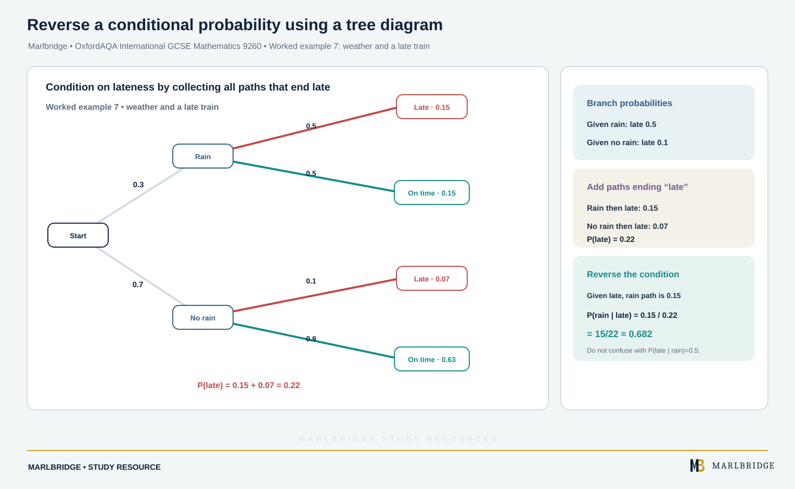

This guide is aligned to the OxfordAQA International GCSE Mathematics (9260) specification, Version 5.1 (for exams May/June 2018 onwards). It covers section 3.4.3 Probability, statements S17 and S18. Both statements sit in the Extension column of the specification, so everything here is **Extension only**. Core content is also assessable at Extension, but nothing in this guide is Core-only. For quick recall use the [revision notes](/resources/oxfordaqa-igcse-mathematics-independent-events-tree-diagrams-and-conditional-revision-notes/), then test yourself with the [practice questions](/resources/oxfordaqa-igcse-mathematics-independent-events-tree-diagrams-and-conditional-practice/). Course pages: the [OxfordAQA IGCSE Mathematics hub](/boards/oxfordaqa/igcse/mathematics/) and the [checklist](/checklists/oxfordaqa/igcse/mathematics/). To check your level first, use a [free 10-minute diagnostic](/diagnostics/).

## Scope of this unit

| Statement | Skill | Tier |
|---|---|---|
| S17 | Calculate the probability of independent combined events, including with tree diagrams and other representations | Extension only |
| S17 | Use P(A ∩ B) = P(A) × P(B) when A and B are independent | Extension only |
| S18 | Calculate conditional probabilities, including with tree diagrams and other representations | Extension only |

Sample spaces, mutually exclusive events and Venn diagram probability are taught in a separate unit. Here you need only one fact from them: all the probabilities in a situation total 1, hence P(not A) = 1 − P(A).

## Independent events

Two events are **independent** when knowing the result of one tells you nothing new about the other. Two separate dice, two coins and two machines working in different buildings are standard examples.

When A and B are independent:

```
P(A ∩ B) = P(A) × P(B)
```

A ∩ B means "A and B both happen". Read the word "and" in a question as a signal to multiply. With three or more independent events, multiply every one of the probabilities together.

### Worked example 1: two alarms

A house has two alarm clocks that work independently. Clock 1 rings at the right time with probability 0.9. Clock 2 rings at the right time with probability 0.85. Find the probability that

(a) both ring on time,
(b) at least one rings on time,
(c) exactly one rings on time.

```
(a) P(both) = 0.9 × 0.85 = 0.765

(b) "At least one" is the opposite of "neither".
    P(clock 1 fails) = 1 − 0.9 = 0.1
    P(clock 2 fails) = 1 − 0.85 = 0.15
    P(neither) = 0.1 × 0.15 = 0.015
    P(at least one) = 1 − 0.015 = 0.985

(c) Two ways: clock 1 only, or clock 2 only.
    P(clock 1 only) = 0.9 × 0.15 = 0.135
    P(clock 2 only) = 0.1 × 0.85 = 0.085
    P(exactly one) = 0.135 + 0.085 = 0.22
```

Notice the pattern in part (c). Each way is a product, and the separate ways are then added.

### Testing for independence

You can check whether two events are independent. Multiply P(A) by P(B), then see whether the result matches P(A ∩ B). A match means independent. No match means not independent.

<figure class="topic-figure">
  
  <figcaption>A and B are independent only when P(A) × P(B) equals the given P(A ∩ B).</figcaption>
</figure>


### Worked example 2: is it independent?

For events C and D, P(C) = 0.25, P(D) = 0.6 and P(C ∩ D) = 0.15. For events E and F, P(E) = 0.3, P(F) = 0.5 and P(E ∩ F) = 0.2.

```
C and D: 0.25 × 0.6 = 0.15, which equals P(C ∩ D).
         C and D are independent.

E and F: 0.3 × 0.5 = 0.15, which is not equal to 0.2.
         E and F are not independent.
```

Always show the product and the comparison. A bare "yes" or "no" does not show your reasoning.

<figure class="topic-figure">
  
  <figcaption>Multiplying probabilities for independent events gives the four regions 0.765, 0.135, 0.085 and 0.015.</figcaption>
</figure>


## Tree diagrams

A **tree diagram** lays out the stages of an experiment from left to right. Each stage has branches, and each branch carries a probability.

Rules for using a tree:

- Branches that start from the same point must have probabilities totalling 1.
- For one complete path, multiply the branch probabilities.
- If an outcome can arise along several paths, find each path first, then add.

A text sketch of a two-stage tree for two independent events looks like this, where first-stage branches are labelled P and Q and second-stage branches R and S:

```
Stage 1        Stage 2        Path probability
        /--- R               P × R
  P ---<
        \--- S               P × S
        /--- R               Q × R
  Q ---<
        \--- S               Q × S
```

The four path probabilities add to 1. That is a quick check on your tree.

### With replacement

If an item is put back, the second stage has the same probabilities as the first. The two stages are independent.

<figure class="topic-figure">
  
  <figcaption>With replacement, both stages use 3/5 and 2/5: same flavour is 13/25, different is 12/25.</figcaption>
</figure>

<figure class="topic-figure">
  
  <figcaption>Without replacement the second-stage fractions change: both blue is 7/22, at least one blue is 28/33.</figcaption>
</figure>

<figure class="topic-figure">
  
  <figcaption>Of the 77 equally likely cells with a blue second pen, 42 have a blue first pen: 42/77 = 6/11.</figcaption>
</figure>

<figure class="topic-figure">
  
  <figcaption>With replacement the second branches repeat the first; multiply along paths and add the paths you want.</figcaption>
</figure>

<figure class="topic-figure">
  
  <figcaption>Without replacement the second branches change because the bag has one fewer counter.</figcaption>
</figure>


### Worked example 3: sweets with replacement

A jar holds 6 mint and 4 fruit sweets. One sweet is taken at random, replaced, and a second is taken. Find the probability that the two sweets are

(a) both mint,
(b) the same flavour,
(c) different flavours.

```
At each stage: P(mint) = 6/10 = 3/5, P(fruit) = 4/10 = 2/5

(a) P(mint, mint) = 3/5 × 3/5 = 9/25

(b) P(fruit, fruit) = 2/5 × 2/5 = 4/25
    P(same) = 9/25 + 4/25 = 13/25

(c) P(different) = 1 − 13/25 = 12/25
    Check by paths: (3/5 × 2/5) + (2/5 × 3/5) = 6/25 + 6/25 = 12/25
```

### Without replacement

If the item is not put back, the second stage changes. The two stages are **not** independent, so you cannot reuse the first-stage probabilities. Reduce the total number, and reduce the number of the colour you took.

### Worked example 4: pens without replacement

<!-- marlbridge-diagram:math-b43-oxfordaqa-igcse-pens-without-replacement-tree -->
<figure class="lesson-diagram" style="margin: 2rem 0;">
  <a href="/images/learning/mathematics/math-b43-oxfordaqa-igcse-pens-without-replacement-tree.svg" aria-label="Open full-size diagram: math-b43-oxfordaqa-igcse-pens-without-replacement-tree"></a>
  <figcaption>Without replacement: a two-stage tree for coloured pens Select the image to enlarge it.</figcaption>
</figure>
<!-- /marlbridge-diagram:math-b43-oxfordaqa-igcse-pens-without-replacement-tree -->


A box holds 7 blue and 5 yellow pens. Two pens are drawn one after the other and kept out. Find the probability that

(a) both are blue,
(b) the pens are different colours,
(c) at least one is blue.

```
Stage 1: P(blue) = 7/12, P(yellow) = 5/12
Stage 2 after a blue:   P(blue) = 6/11, P(yellow) = 5/11
Stage 2 after a yellow: P(blue) = 7/11, P(yellow) = 4/11

(a) P(blue, blue) = 7/12 × 6/11 = 42/132 = 7/22

(b) P(blue, yellow) = 7/12 × 5/11 = 35/132
    P(yellow, blue) = 5/12 × 7/11 = 35/132
    P(different) = 70/132 = 35/66

(c) P(no blue) = P(yellow, yellow) = 5/12 × 4/11 = 20/132 = 5/33
    P(at least one blue) = 1 − 5/33 = 28/33
```

### Three or more stages

A tree can have three stages. You multiply along three branches instead of two, and the idea does not change. For "at least one", the complement is usually quicker than listing every path.

<figure class="topic-figure">
  
  <figcaption>Three stages multiply along three branches; exactly one late day can happen in three ways.</figcaption>
</figure>


### Worked example 5: three days

A commuter's train is late on any day with probability 0.2, independently of other days. Find the probability that over three days

(a) the train is never late,
(b) the train is late at least once,
(c) the train is late on exactly one day.

```
(a) 0.8 × 0.8 × 0.8 = 0.512

(b) 1 − 0.512 = 0.488

(c) One late day can be the first, second or third.
    Each way: 0.2 × 0.8 × 0.8 = 0.128
    Three ways: 3 × 0.128 = 0.384
```

## Other representations

The specification says "tree diagrams and other representations". The most useful other representation is a **two-way table**, which also works well for conditional probability. A sample space grid works for two independent events with equally likely outcomes. Choose whichever layout lets you see every outcome once.

<figure class="topic-figure">
  
  <figcaption>A sample space diagram lists every equally likely outcome so you can count the favourable ones.</figcaption>
</figure>


## Conditional probability

A **conditional probability** measures how likely an event is once you know another event has already taken place. The word "given" or the phrase "given that" is the signal.

Write P(A | B) for "the probability of A given B". The given event B becomes your new, smaller set of possible outcomes. The method is:

1. Find the outcomes where B happens. This is your new total.
2. Among those, count or measure the outcomes where A also happens.
3. Divide the second by the first.

In probability terms this is P(A | B) = P(A ∩ B) ÷ P(B). Both forms give the same answer.

### From a two-way table

<figure class="topic-figure">
  
  <figcaption>From a table, the given condition picks one row or column as the whole sample space.</figcaption>
</figure>


### Worked example 6: travel to school

100 students were asked how they travel and which year they are in.

| | Year 10 | Year 11 | Total |
|---|---|---|---|
| Bus | 18 | 22 | 40 |
| Walk | 25 | 15 | 40 |
| Car | 12 | 8 | 20 |
| Total | 55 | 45 | 100 |

A student is chosen at random. Find

(a) P(bus | Year 11),
(b) P(Year 10 | walk).

```
(a) Given Year 11, the total is 45. Of these, 22 take the bus.
    P(bus | Year 11) = 22/45

(b) Given walk, the total is 40. Of these, 25 are in Year 10.
    P(Year 10 | walk) = 25/40 = 5/8
```

The order matters. P(Year 10 | walk) is 5/8, but P(walk | Year 10) = 25/55 = 5/11. They answer different questions.

### From a tree diagram

On a tree for dependent stages, the second-stage branches already show conditional probabilities. For example, the branch from "rain" to "late" carries P(late | rain).

<figure class="topic-figure">
  
  <figcaption>P(rain | late) is the rain share of all the paths that end in late: 0.15 out of 0.22.</figcaption>
</figure>


### Worked example 7: weather and a late train

<!-- marlbridge-diagram:math-b60-oxfordaqa-weather-late-conditional-tree -->
<figure class="lesson-diagram" style="margin: 2rem 0;">
  <a href="/public/images/learning/mathematics/math-b60-oxfordaqa-weather-late-conditional-tree.svg" aria-label="Open full-size diagram: math-b60-oxfordaqa-weather-late-conditional-tree"></a>
  <figcaption>A two-stage probability tree shows rain/no rain then late/on-time outcomes; the two late paths total 0.22, so the conditional probability of rain given a late train is 15/22.</figcaption>
</figure>
<!-- /marlbridge-diagram:math-b60-oxfordaqa-weather-late-conditional-tree -->


The probability of rain is 0.3. If it rains, the train is late with probability 0.5. If it does not rain, the train is late with probability 0.1.

```
Tree paths ending in "late":
  rain, late:      0.3 × 0.5 = 0.15
  no rain, late:   0.7 × 0.1 = 0.07

P(late) = 0.15 + 0.07 = 0.22

Given that the train is late, find the probability that it rained.
  P(rain | late) = P(rain and late) ÷ P(late)
                 = 0.15 ÷ 0.22
                 = 15/22
```

This reverses the tree. The tree gives P(late | rain) directly. To find P(rain | late) you must first find P(late) by adding every path that ends in "late".

### Conditional probability without replacement

When items are not replaced, each second-stage branch is itself conditional. The probability that the second pen is blue, given the first was blue, is 6/11 in Worked example 4.

You can also be asked to reverse. For instance, in Worked example 4, find P(first blue | second blue).

```
P(blue, blue) = 7/22
P(yellow, blue) = 35/132
P(second blue) = 42/132 + 35/132 = 77/132 = 7/12
P(first blue | second blue) = 42/132 ÷ 77/132 = 42/77 = 6/11
```

The answer 6/11 matches the direct reasoning: once the second pen is known to be blue, the other 11 pens hold 6 blue ones.

<figure class="topic-figure">
  
  <figcaption>Given a condition, only the part of the diagram that satisfies it counts.</figcaption>
</figure>


## Common errors

- Multiplying when events are not independent. Without replacement, use the changed second-stage probabilities.
- Forgetting that branches leaving one point add to 1. Add them up as a check.
- Adding along a path or multiplying across separate paths. Multiply along, add across.
- Giving P(A | B) when the question asks for P(B | A). Underline the "given" event before you start.
- Using the full total instead of the reduced total in a conditional probability.
- Leaving the answer as an unsimplified fraction or rounding too early. Keep exact fractions until the end.
- Calling events independent because they "look unrelated". You must either be told so or test with the product.

## Next steps

Condense this unit with the [revision notes](/resources/oxfordaqa-igcse-mathematics-independent-events-tree-diagrams-and-conditional-revision-notes/), then work through the [practice questions](/resources/oxfordaqa-igcse-mathematics-independent-events-tree-diagrams-and-conditional-practice/). Tick the statements off on the [checklist](/checklists/oxfordaqa/igcse/mathematics/).

## Official syllabus

OxfordAQA International GCSE Mathematics (9260), specification Version 5.1, for exams May/June 2018 onwards, published by OxfordAQA. This guide follows section 3.4.3 Probability, statements S17 and S18.
