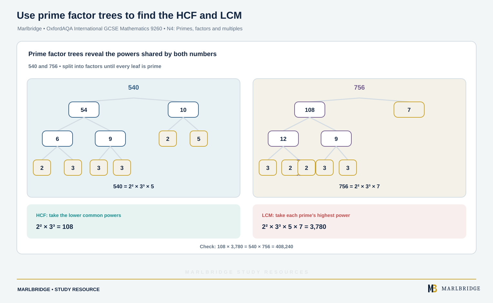

This study guide follows the OxfordAQA International GCSE Mathematics (9260) specification, Version 5.1 (for exams May/June 2018 onwards). It covers section 3.1.1 Structure and calculation, content references N1 to N5 and N10. Every statement here is Core content, and the specification says all content can be assessed on the Extension tier papers, so Core and Extension students both need all of it. Nothing on this page is "Extension only".

Use it with the [revision notes](/resources/oxfordaqa-igcse-mathematics-ordering-the-four-operations-primes-powers-and-revision-notes/) and the [practice questions](/resources/oxfordaqa-igcse-mathematics-ordering-the-four-operations-primes-powers-and-practice/). The course hub is at [OxfordAQA IGCSE Mathematics](/boards/oxfordaqa/igcse/mathematics/) and the printable list is the [checklist](/checklists/oxfordaqa/igcse/mathematics/). Not sure where you stand? Take a free [diagnostic](/diagnostics/).

## What this unit covers

| Ref | What you must be able to do |
|---|---|
| N1 | Order positive and negative integers, decimals and fractions; use =, ≠, <, > and a number line |
| N2 | Use the four operations, with formal written methods, on integers, decimals, proper and improper fractions and mixed numbers, positive and negative; use place value; work in context |
| N3 | Use inverse operations and cancellation; use priority of operations with brackets, powers, roots and reciprocals |
| N4 | Even, odd and prime numbers, factors, multiples, common factors and multiples, HCF, LCM, prime factorisation (index form and product notation) |
| N5 | Positive integer powers and the associated real roots (square, cube and higher); recognise powers of 2, 3, 4 and 5 |
| N10 | Use a calculator effectively and efficiently, including trigonometrical functions |

The specification asks you to bring a scientific calculator to every paper. It also says you should not round during the middle of a calculation. Graphical calculators and calculators with built-in symbolic algebra or calculus are not allowed.

## N1: Ordering numbers

On a number line, numbers increase to the right. A negative number is always smaller than a positive one, and among negatives the one further from zero is smaller: −0.7 < −0.2.

| Symbol | Meaning |
|---|---|
| = | equal to |
| ≠ | not equal to |
| < | less than |
| > | greater than |

To compare mixed forms, convert everything to decimals, or to fractions with a common denominator. Write the decimals with their points aligned and compare the digits from the left. Add zeros so each decimal has the same number of places.

**Worked example 1.** Put these in order, smallest first: 3/8, 0.36, 7/20, −0.4, −1/3.

```
3/8  = 0.375
7/20 = 0.35
−1/3 = −0.333...
```

The two negatives come first. −0.4 is further from zero than −0.333..., so −0.4 < −1/3. For the positives, 0.35 < 0.36 < 0.375.

Order: **−0.4, −1/3, 7/20, 0.36, 3/8**.

A statement such as −1/3 > −0.4 is true. Reading the symbol as "the open end faces the bigger number" helps.

<figure class="topic-figure">
  
  <figcaption>Further left on the number line always means smaller, whatever the form or sign.</figcaption>
</figure>


## N2: The four operations

### Negatives

Adding a negative is subtracting. Subtracting a negative is adding. Two like signs multiply or divide to a positive; unlike signs give a negative.

**Worked example 2.** Work out −7 − (−12) + 3 × (−4).

```
3 × (−4) = −12
−7 − (−12) = −7 + 12 = 5
5 + (−12) = −7
```

Answer: **−7**. (Multiplication is done before the additions and subtractions.)

### Fractions and mixed numbers

- Add and subtract: use a common denominator.
- Multiply: multiply the numerators and the denominators, cancelling first if you can.
- Divide: multiply by the reciprocal of the second fraction.
- Mixed numbers: change to improper fractions first.

**Worked example 3.** Work out 2 3/4 − 1 5/6.

```
2 3/4 = 11/4 = 33/12
1 5/6 = 11/6 = 22/12
33/12 − 22/12 = 11/12
```

Answer: **11/12**.

**Worked example 4.** Work out (−3 1/2) ÷ 2 1/3.

```
−7/2 ÷ 7/3 = −7/2 × 3/7
Cancel the 7s: −1/2 × 3 = −3/2
```

Answer: **−3/2**, which is −1 1/2.

<figure class="topic-figure">
  
  <figcaption>Writing both mixed numbers in twelfths turns the subtraction into 33 - 22.</figcaption>
</figure>

<figure class="topic-figure">
  
  <figcaption>Divide mixed numbers by converting, flipping the second fraction, cancelling and multiplying.</figcaption>
</figure>


### Decimals and place value

For multiplication, ignore the decimal points, multiply the whole numbers, then put the point back using the total number of decimal places in the question. For division, scale both numbers by the same power of 10 until the divisor is a whole number.

**Worked example 5.** Work out 4.07 × 0.35 and 7.2 ÷ 0.045.

```
407 × 35 = 14 245
4.07 has 2 d.p. and 0.35 has 2 d.p., so 4 d.p. in total
4.07 × 0.35 = 1.4245

7.2 ÷ 0.045 = 7200 ÷ 45 = 160
```

Answers: **1.4245** and **160**.

<figure class="topic-figure">
  
  <figcaption>Multiplying ignores the points then restores total decimal places; dividing scales both numbers until the divisor is whole.</figcaption>
</figure>


### Context questions

Read what the answer must be. "How many pieces can be cut" wants a whole number of complete pieces, so you round down.

**Worked example 6.** A ribbon is 12.5 m long and is cut into lengths of 0.8 m. How many complete lengths are there, and what remains?

```
12.5 ÷ 0.8 = 125 ÷ 8 = 15.625
```

Fifteen complete lengths fit. Used: 15 × 0.8 = 12 m. Left: 12.5 − 12 = 0.5 m.

Answer: **15 pieces with 0.5 m left**.

<figure class="topic-figure">
  
  <figcaption>Dividing by 5/8 counts how many 5/8 m pieces fit, and the answer is 12.</figcaption>
</figure>


## N3: Inverse operations and priority of operations

Addition and subtraction are inverses, as are multiplication and division, and squaring and square rooting. Use them to undo a calculation, to check an answer, or to cancel.

**Cancellation.** (47 × 18) ÷ (47 × 6) needs no multiplying out. The 47s cancel, leaving 18 ÷ 6 = **3**.

**Undoing.** A number is divided by 4, then 7 is added, giving 12. Work backwards: 12 − 7 = 5, then 5 × 4 = **20**.

**Priority (BIDMAS).** Work in this order:

1. Brackets (and the top and bottom of a fraction line, each as if bracketed)
2. Indices: powers and roots
3. Division and multiplication, left to right
4. Addition and subtraction, left to right

**Worked example 7.** Work out (a) 8 + 3 × (14 − 2²), (b) (√(25 − 9) + 2³) ÷ (−4).

```
(a) 2² = 4, so the bracket is 14 − 4 = 10
    3 × 10 = 30, and 8 + 30 = 38

(b) 25 − 9 = 16 and √16 = 4
    2³ = 8
    4 + 8 = 12, and 12 ÷ (−4) = −3
```

Answers: **38** and **−3**. A root sign covers everything under it, so it acts as a bracket.

**Reciprocals.** The reciprocal of a number is 1 divided by it. The reciprocal of 2/5 is 5/2. The reciprocal of 0.8 is 1/0.8 = 5/4. Zero has no reciprocal.

**Powers and negatives.** −2² means −(2²) = −4, but (−2)² = 4. The brackets decide.

<figure class="topic-figure">
  
  <figcaption>Work out indices and brackets first, then multiply and divide left to right, then add and subtract.</figcaption>
</figure>


## N4: Primes, factors and multiples

<!-- marlbridge-diagram:math-b58-oxfordaqa-prime-factor-trees-hcf-lcm -->
<figure class="lesson-diagram" style="margin: 2rem 0;">
  <a href="/public/images/learning/mathematics/math-b58-oxfordaqa-prime-factor-trees-hcf-lcm.svg" aria-label="Open full-size diagram: math-b58-oxfordaqa-prime-factor-trees-hcf-lcm"></a>
  <figcaption>Two factor trees resolve 540 and 756 into prime factors. A shared-power comparison yields HCF 108 and LCM 3,780; their product equals the product of the original numbers.</figcaption>
</figure>
<!-- /marlbridge-diagram:math-b58-oxfordaqa-prime-factor-trees-hcf-lcm -->


- An even number is a multiple of 2. An odd number is not.
- A prime number has exactly two factors: 1 and itself. That rules out 1, and 2 is the one prime that is even.
- Factors (divisors) of a number divide into it exactly. Multiples are in its times table.
- A common factor divides two or more numbers. A common multiple is in all their lists.

Primes below 30: 2, 3, 5, 7, 11, 13, 17, 19, 23, 29.

To test whether n is prime, try dividing by each prime up to √n. For 91, √91 is just under 10, so try 2, 3, 5, 7. Since 91 = 7 × 13, it is **not prime**.

**Prime factorisation.** Break the number into primes, using a factor tree or repeated division. Product notation lists the primes: 36 = 2 × 2 × 3 × 3. Index form groups them: 36 = 2² × 3².

**Worked example 8.** Find the HCF and LCM of 540 and 756.

```
540 = 2² × 3³ × 5
756 = 2² × 3³ × 7
```

- HCF: for each prime take the **lower** power that appears in both: 2² × 3³ = 4 × 27 = **108**.
- LCM: for each prime take the **higher** power that appears in either: 2² × 3³ × 5 × 7 = 108 × 35 = **3780**.

Check: HCF × LCM = 108 × 3780 = 408 240 = 540 × 756. That product rule holds for any two numbers.

**Worked example 9.** Two machines are serviced every 15 minutes and every 24 minutes. Both are serviced now. After how long are they next serviced together?

```
15 = 3 × 5
24 = 2³ × 3
LCM = 2³ × 3 × 5 = 120
```

Answer: **120 minutes**, which is 2 hours.

Ask yourself which fits: "next together" or "repeats at the same time" points to LCM. "Largest equal groups" or "greatest size that divides both" points to HCF.

<figure class="topic-figure">
  
  <figcaption>“Next together” is the lowest common multiple: 120 minutes for every 15 and every 24.</figcaption>
</figure>

<figure class="topic-figure">
  
  <figcaption>Lower power of each prime gives the HCF; higher power gives the LCM.</figcaption>
</figure>

<figure class="topic-figure">
  
  <figcaption>To test n, divide by each prime up to √n.</figcaption>
</figure>

<figure class="topic-figure">
  
  <figcaption>The overlap gives the HCF; every prime factor used once gives the LCM.</figcaption>
</figure>


## N5: Powers and roots

A positive integer power means repeated multiplication: 3⁴ = 3 × 3 × 3 × 3 = 81. A root undoes a power: ⁴√81 = 3 because 3⁴ = 81.

Learn these:

| Base | Powers |
|---|---|
| 2 | 2, 4, 8, 16, 32, 64, 128, 256, 512, 1024 |
| 3 | 3, 9, 27, 81, 243, 729 |
| 4 | 4, 16, 64, 256, 1024 |
| 5 | 5, 25, 125, 625, 3125 |

Also know the square numbers up to 15² = 225 and the first ten cubes.

**Real roots.** An even root (square, fourth) of a negative number has no real value, because no real number multiplied by itself an even number of times is negative. An odd root (cube, fifth) of a negative number is negative: ∛(−64) = −4 because (−4)³ = −64. A square root sign means the positive root: √144 = 12, though x² = 144 has two solutions, 12 and −12.

**Worked example 10.** Evaluate (a) (−3)⁴, (b) −3⁴, (c) ∛(−125), (d) ⁴√625, (e) √1.44.

```
(a) (−3)⁴ = 81         (even power of a negative is positive)
(b) −3⁴ = −(3⁴) = −81
(c) (−5)³ = −125, so ∛(−125) = −5
(d) 5⁴ = 625, so ⁴√625 = 5
(e) 1.2 × 1.2 = 1.44, so √1.44 = 1.2
```

<figure class="topic-figure">
  
  <figcaption>The powers of 2, 3, 4 and 5 to learn, with a root undoing a power.</figcaption>
</figure>

<figure class="topic-figure">
  
  <figcaption>Even powers are never negative, so only odd roots of negatives exist.</figcaption>
</figure>

<figure class="topic-figure">
  
  <figcaption>A square of side n has n squared unit squares and a cube of side n has n cubed unit blocks.</figcaption>
</figure>

<figure class="topic-figure">
  
  <figcaption>Odd powers of a negative number are negative, even powers are positive, and brackets decide what is raised to the power.</figcaption>
</figure>


## N10: Using a calculator well

- Enter a long calculation in one go, using brackets round the top and bottom of any fraction. Keep every digit on the display until the end.
- Use your calculator's π value if it has one. Otherwise use 3.142, which the specification says is given on the front of the paper.
- For trigonometry, check which angle unit your calculator is using before you start. Degrees are expected here.
- To find a missing side use sin, cos or tan. To find a missing angle use the inverse function.

**Worked example 11.** In triangle ABC the angle at B is 90°, AB = 6.3 cm and angle A = 41°. Find BC. Also find angle θ in a right-angled triangle where the side opposite θ is 8.5 cm and the adjacent side is 6.2 cm.

```
tan 41° = BC / 6.3
BC = 6.3 × tan 41° = 5.4765...  → 5.48 cm (3 s.f.)

tan θ = 8.5 / 6.2
θ = tan⁻¹(8.5 / 6.2) = 53.89...° → 53.9° (1 d.p.)
```

For a chain such as 9.4 × sin 52° ÷ sin 67°, enter it in one go and read **8.05** (3 s.f.). Writing sin 52° ≈ 0.79 on the way would make the final digits less reliable.

## Common errors

- Ordering −0.4 and −1/3 as if bigger digits mean bigger numbers. For negatives it is reversed.
- Adding fractions by adding the denominators.
- Dividing mixed numbers without converting to improper fractions first.
- Placing the decimal point wrongly after multiplying: count the places in both numbers.
- Treating −2² as 4.
- Calling 1 a prime number, or listing 2 as odd.
- Taking the higher power for the HCF, or the lower power for the LCM.
- Typing a fraction division without brackets, so the calculator divides only by the first term.
- Rounding before the end of a calculation.

## Frequently asked questions

**How do you divide fractions?**
Multiply by the reciprocal of the second fraction, cancelling first if you can. Change any mixed numbers to improper fractions before you start.

**What are inverse operations?**
Inverse operations undo each other: addition and subtraction, multiplication and division, and squaring and square rooting. Use them to undo a calculation, check an answer or cancel.

**What value of π should you use in OxfordAQA 9260 exams?**
Use your calculator's π value if it has one; otherwise use 3.142, which the OxfordAQA International GCSE Mathematics (9260) specification says is given on the front of the paper.

**Which calculators are not allowed in OxfordAQA International GCSE Maths?**
Graphical calculators and calculators with built-in symbolic algebra or calculus are not allowed. A scientific calculator is expected for every paper.

**What angle mode should a calculator be in for trigonometry?**
Degrees. Check the angle unit before any trigonometry, and use the inverse function, such as tan⁻¹, to find a missing angle.

## Official syllabus

OxfordAQA International GCSE Mathematics (9260), Version 5.1, for exams May/June 2018 onwards, published by OxfordAQA: section 3.1.1 Structure and calculation, references N1 to N5 and N10.
